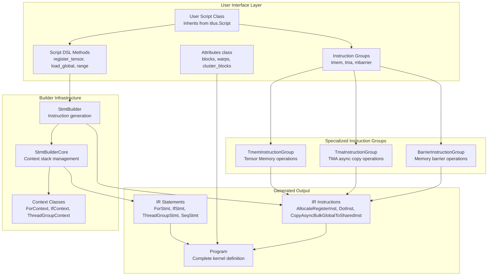
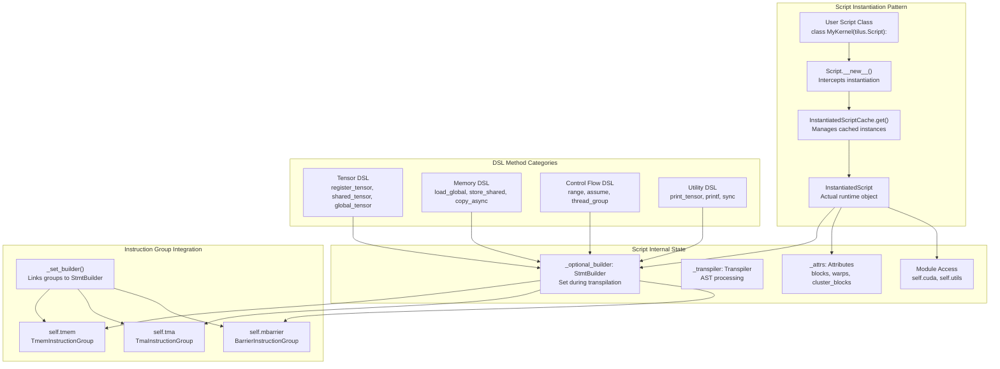
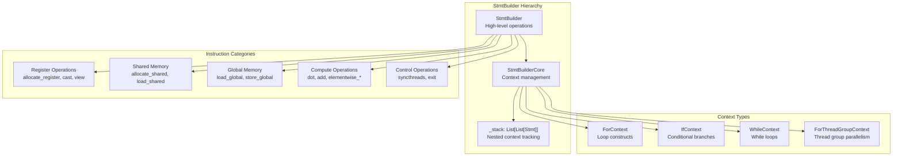
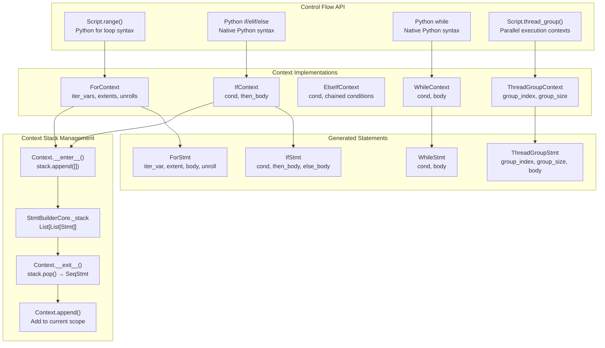
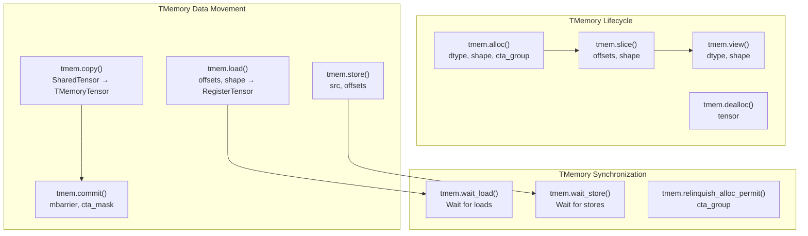
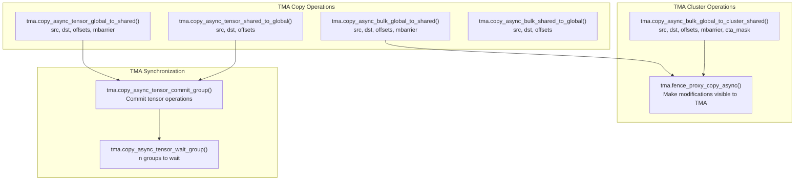
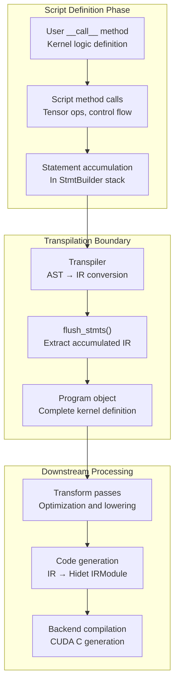

<!-- source: DeepWiki mcp.deepwiki.com · repo NVIDIA/tilus · page 3.1 Script System · fetched 2026-10-26 -->

# Script System

Relevant source files

The following files were used as context for generating this wiki page:

- [docs/source/index.rst](docs/source/index.rst)
- [docs/source/programming-guides/control-flow.rst](docs/source/programming-guides/control-flow.rst)
- [docs/source/programming-guides/thread-group.rst](docs/source/programming-guides/thread-group.rst)
- [docs/source/python-api/tilus-script.rst](docs/source/python-api/tilus-script.rst)
- [python/tilus/ir/builders/stmt_builder.py](python/tilus/ir/builders/stmt_builder.py)
- [python/tilus/lang/script.py](python/tilus/lang/script.py)
- [tests/lang/test_thread_group.py](tests/lang/test_thread_group.py)

## Purpose and Scope

The Script System provides the primary user interface for defining GPU kernels in Tilus through a Python-based Domain-Specific Language (DSL). At its core is the `tilus.Script` class that users inherit from to write block-level computational logic, supported by the `StmtBuilder` infrastructure that translates high-level operations into Tilus IR instructions. This system enables developers to write GPU kernels with explicit control over memory hierarchies, tensor layouts, and hardware-specific operations while maintaining a Pythonic interface.

The Script System serves as the entry point for the Tilus compilation pipeline, bridging natural language programming constructs with precise GPU programming semantics.

For information about how Script instances are instantiated and compiled, see [JIT Compilation and Autotuning](#3.2). For details about the transpilation process that converts Script methods to IR, see [Transpilation](#4.1).

## System Architecture

The Script System operates as a multi-layer architecture with specialized instruction groups and context management:

Sources: [python/tilus/lang/script.py:44-94](), [python/tilus/lang/script.py:95-157](), [python/tilus/lang/script.py:630-633](), [python/tilus/ir/builders/stmt_builder.py:127-276]()

## Script Class Design

The `Script` class implements a sophisticated instantiation pattern that intercepts object creation and delegates to the instantiated script cache system:

Sources: [python/tilus/lang/script.py:608-616](), [python/tilus/lang/script.py:617-633](), [python/tilus/lang/script.py:638-649]()

## StmtBuilder Architecture

The `StmtBuilder` manages instruction generation and maintains a context stack for nested control flow constructs:

Sources: [python/tilus/ir/builders/stmt_builder.py:327-881](), [python/tilus/ir/builders/stmt_builder.py:248-325]()

## Script DSL Methods

The Script class provides a comprehensive Domain-Specific Language through delegated methods to `StmtBuilder`. These methods form the core vocabulary for GPU kernel development:

### Tensor Allocation Methods

| Method | Purpose | Memory Space | Implementation |
|--------|---------|--------------|----------------|
| `register_tensor()` | Allocate register tensor with optional initialization | Register | Delegates to `StmtBuilder.allocate_register()` |
| `shared_tensor()` | Allocate shared memory tensor | Shared | Delegates to `StmtBuilder.allocate_shared()` |
| `global_tensor()` | Allocate global memory tensor | Global | Delegates to `StmtBuilder.allocate_global()` |
| `global_view()` | Create view of existing global memory | Global | Creates `GlobalTensor` from pointer |

### Memory Transfer Operations

| Method | Source → Destination | Key Features | Implementation |
|--------|---------------------|---------------|----------------|
| `load_global()` | Global → Register | Layout inference, bounds checking | `StmtBuilder.load_global()` |
| `store_global()` | Register → Global | Vectorization support | `StmtBuilder.store_global()` |
| `load_shared()` | Shared → Register | Bank conflict avoidance | `StmtBuilder.load_shared()` |
| `store_shared()` | Register → Shared | Coalescing optimization | `StmtBuilder.store_shared()` |
| `copy_async()` | Global → Shared | Asynchronous copy with barriers | `StmtBuilder.copy_async()` |

### Computational Operations

| Method Category | Core Methods | Advanced Methods | Features |
|----------------|--------------|------------------|----------|
| Linear Algebra | `dot()` | `load_matrix()` | MMA unit utilization, layout-aware |
| Element-wise | `add()`, `sub()`, `mul()`, `div()` | `maximum()`, `where()`, `clip()` | Broadcasting, type promotion |
| Reductions | `sum()`, `max()`, `min()` | Custom reduction functions | Thread group coordination |
| Transforms | `cast()`, `view()`, `transpose()` | `squeeze()`, `unsqueeze()` | Layout preservation |
| Math Functions | `exp()`, `log()`, `sqrt()`, `abs()` | `exp2()`, `round()`, `neg()` | Hardware intrinsics when available |

### Control Flow and Synchronization

| Method | Purpose | Context Management | Features |
|--------|---------|-------------------|----------|
| `range()` | Loop iteration | Returns `Iterable[Var]` | Unroll hints, step control |
| `assume()` | Compiler hints | Condition analysis | Divisibility, bounds assumptions |
| `thread_group()` | Thread partitioning | `ThreadGroupContext` | Nested groups, size specification |
| `sync()` | Thread synchronization | Current thread group | Barrier insertion |

Sources: [python/tilus/lang/script.py:286-647](), [python/tilus/lang/script.py:709-844](), [python/tilus/ir/builders/stmt_builder.py:371-881]()

## Control Flow and Context Management

The Script system implements control flow through a sophisticated context stack system managed by `StmtBuilderCore`:

Sources: [python/tilus/lang/script.py:709-774](), [python/tilus/ir/builders/stmt_builder.py:127-276](), [python/tilus/ir/builders/stmt_builder.py:283-312]()

## Specialized Instruction Groups

The Script system provides access to hardware-specific operations through specialized instruction groups that encapsulate complex GPU primitives:

### Tensor Memory (TMemory) Operations

The `TmemInstructionGroup` provides access to SM90+ Tensor Memory hardware:

### Tensor Memory Access (TMA) Operations

The `TmaInstructionGroup` provides asynchronous global-shared memory transfers:

### Memory Barrier Operations

The `BarrierInstructionGroup` manages thread synchronization and asynchronous operation coordination:

| Method | Purpose | Parameters | Behavior |
|--------|---------|------------|----------|
| `mbarrier.init()` | Initialize barrier | `barrier, count` | Sets up barrier state machine |
| `mbarrier.arrive()` | Signal arrival | `barrier` | Decrements pending arrivals |
| `mbarrier.arrive_remote()` | Remote arrival | `barrier, remote_block` | Cross-block arrival signaling |
| `mbarrier.wait()` | Wait for phase | `barrier, phase` | Blocks until phase completion |

Sources: [python/tilus/lang/script.py:110-156](), [python/tilus/lang/script.py:158-489](), [python/tilus/lang/script.py:491-597]()

## Integration with Compilation Pipeline

The Script system interfaces with the broader Tilus compilation infrastructure through well-defined boundaries:

Sources: [python/tilus/ir/builders/stmt_builder.py:311-324](), [python/tilus/lang/script.py:103-116]()

---

