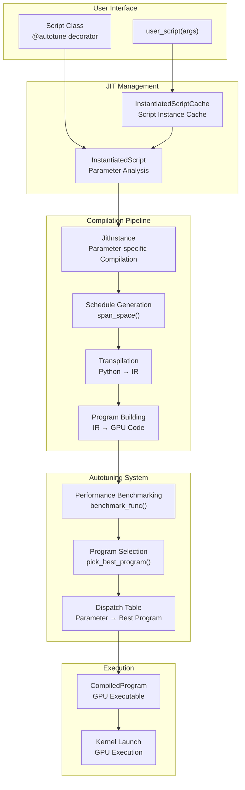
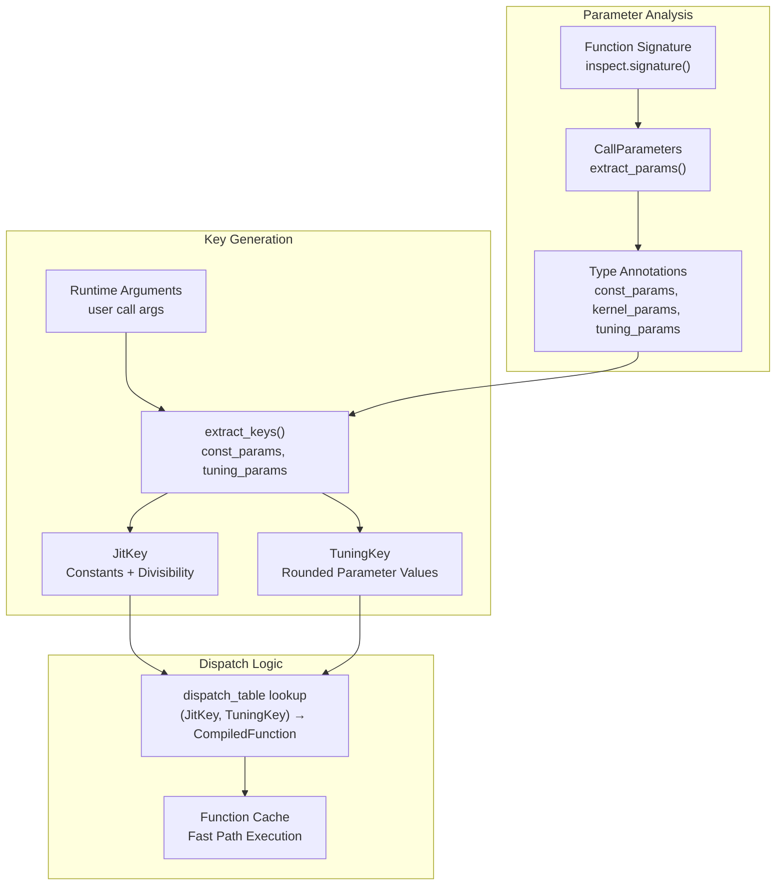
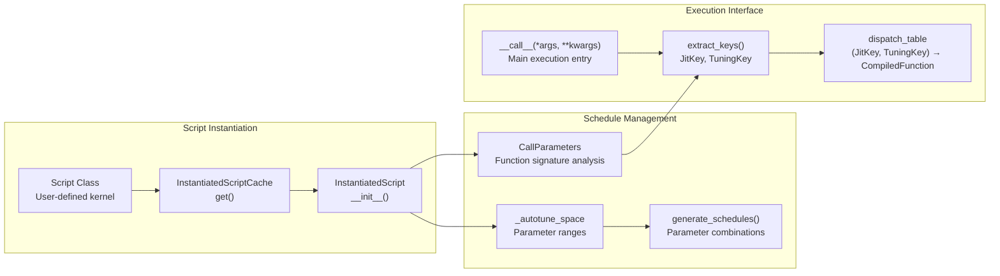
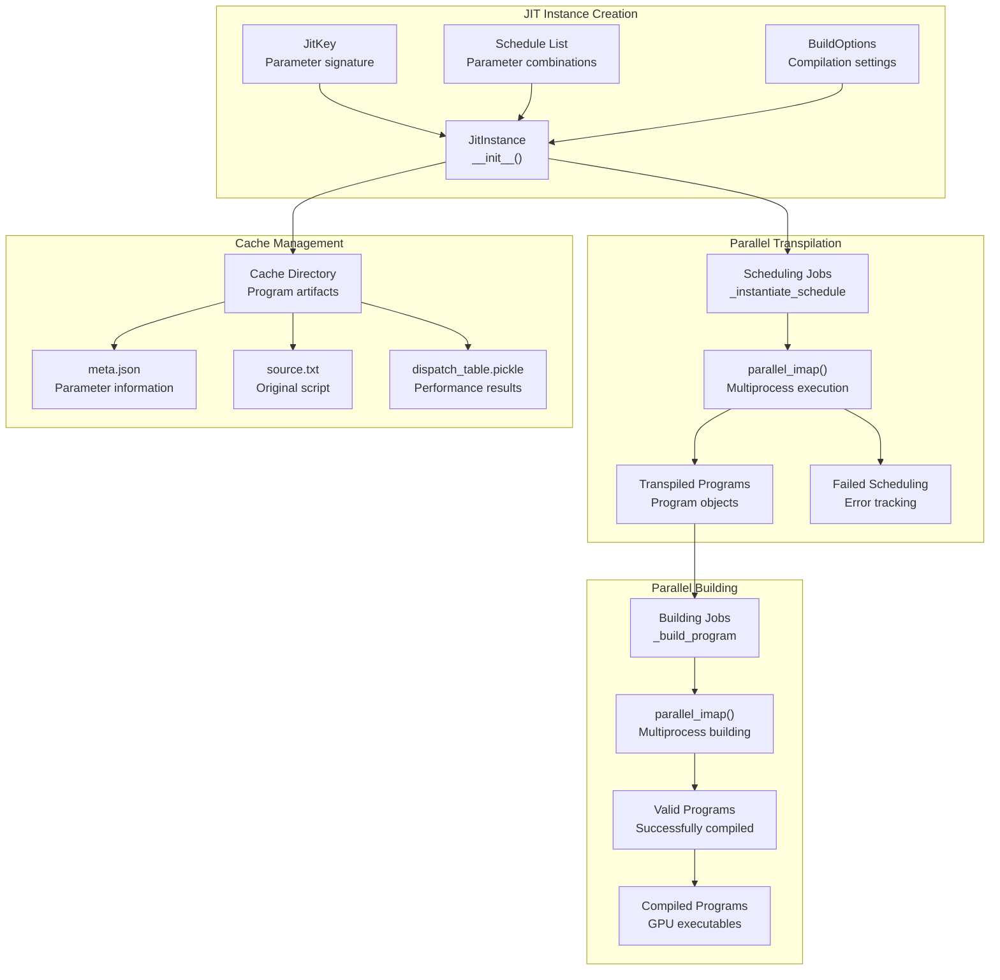
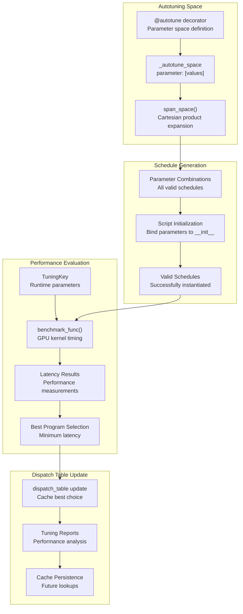

<!-- source: DeepWiki mcp.deepwiki.com · repo NVIDIA/tilus · page 3.2 JIT Compilation and Autotuning · fetched 2026-10-26 -->

# JIT Compilation and Autotuning

<details>
<summary>Relevant source files</summary>

The following files were used as context for generating this wiki page:

- [python/tilus/ir/analyzers/grid_analyzer.py](python/tilus/ir/analyzers/grid_analyzer.py)
- [python/tilus/lang/instantiated_script.py](python/tilus/lang/instantiated_script.py)
- [python/tilus/lang/modules/cuda.py](python/tilus/lang/modules/cuda.py)
- [python/tilus/transforms/layout_inference.py](python/tilus/transforms/layout_inference.py)
- [tests/kernels/matmul/test_matmul_v0.py](tests/kernels/matmul/test_matmul_v0.py)
- [tests/lang/test_simple_mma_matmul.py](tests/lang/test_simple_mma_matmul.py)

</details>


This document covers Tilus's Just-In-Time (JIT) compilation system and automatic performance tuning infrastructure. The JIT system compiles GPU kernels on-demand based on runtime parameters, while the autotuning system automatically explores different implementation strategies to find optimal configurations for specific workloads.

For information about the Script DSL that defines kernels, see [Script System](#3.1). For details about the compilation pipeline that transforms scripts into executable code, see [Compilation Pipeline](#4).

## Overview

The JIT compilation and autotuning system provides several key capabilities:

- **Parameter-sensitive compilation**: Different parameter values trigger different optimizations and code paths
- **Automatic schedule exploration**: Multiple implementation variants are generated and benchmarked
- **Intelligent caching**: Compiled programs are cached to avoid recompilation
- **Performance-driven selection**: The best-performing implementation is automatically chosen for each parameter configuration



Sources: [python/tilus/lang/instantiated_script.py:1-830](), [python/tilus/lang/script.py]()

## Parameter Classification and Key Generation

The JIT system categorizes function parameters into three types based on their impact on compilation and performance:

| Parameter Type | Description | JIT Impact | Tuning Impact |
|---------------|-------------|------------|---------------|
| **Constant Parameters** | Python builtin types (`int`, `float`, `str`, `bool`) | Triggers new JIT compilation | No impact |
| **Kernel Parameters** | Hidet IR types (tensors, pointers) | No JIT impact | No impact |
| **Tuning Parameters** | Integer Hidet types (`int32`, `int64`) | Divisibility affects JIT | Value affects tuning choice |



The key generation process uses divisibility information for tuning parameters to enable efficient caching while maintaining performance sensitivity:

- **JIT Key**: Contains constant parameter values and divisibility factors for tuning parameters
- **Tuning Key**: Contains rounded values of tuning parameters to group similar workload sizes

Sources: [python/tilus/lang/instantiated_script.py:164-298](), [python/tilus/lang/instantiated_script.py:234-287]()

## InstantiatedScript and Caching

The `InstantiatedScript` class manages the lifecycle of compiled scripts and provides the main execution interface:



The caching system operates at multiple levels:

1. **Script-level caching**: `InstantiatedScriptCache` caches script instances based on class and initialization parameters
2. **JIT-level caching**: Each `InstantiatedScript` maintains a cache of `JitInstance` objects for different JIT keys
3. **Function-level caching**: Compiled functions are cached in the dispatch table for fast lookup

Sources: [python/tilus/lang/instantiated_script.py:692-782](), [python/tilus/lang/instantiated_script.py:784-830]()

## JIT Instance Management

`JitInstance` handles compilation for a specific combination of constant and divisibility parameters:



The JIT instance creation process includes:

1. **Schedule instantiation**: Converting parameter combinations into actual script objects
2. **Parallel transpilation**: Converting scripts to IR programs using multiprocessing
3. **Parallel building**: Compiling IR programs to GPU executables
4. **Error handling**: Tracking and reporting compilation failures
5. **Cache organization**: Storing results and metadata for future use

Sources: [python/tilus/lang/instantiated_script.py:300-391](), [python/tilus/lang/instantiated_script.py:431-506](), [python/tilus/lang/instantiated_script.py:512-607]()

## Autotuning Process

The autotuning system automatically benchmarks different implementations and selects the best-performing one:



The autotuning process operates on-demand when a new parameter combination is encountered:

1. **Space expansion**: Convert parameter ranges into concrete combinations
2. **Schedule validation**: Ensure all parameter combinations can instantiate valid scripts
3. **Performance measurement**: Benchmark all valid implementations
4. **Result caching**: Store the best choice for future use
5. **Report generation**: Create detailed performance analysis

Sources: [python/tilus/lang/instantiated_script.py:50-161](), [python/tilus/lang/instantiated_script.py:608-690]()

## Performance Optimization Features

The JIT system includes several performance optimization features:

### Divisibility-Based Optimization

```python
# Example from extract_keys function
def extract_keys(args, const_params, tuning_params):
    for i in tuning_params:
        arg: int = args[i]
        jit_key.append(divisibility_key[arg % 32])  # Divisibility info
        block = 1 << max((arg.bit_length() - 2), 0)
        tuning_key.append((arg + block - 1) // block * block)  # Rounded value
```

The system uses divisibility information to enable compiler optimizations while grouping similar parameter values for tuning efficiency.

### Multiprocess Compilation

Both transpilation and building phases use multiprocessing to compile multiple schedules in parallel, significantly reducing compilation time for large autotuning spaces.

### Intelligent Caching

- **File-based locking**: Prevents race conditions in multi-process environments
- **Hash-based cache keys**: Ensures cache validity across code changes
- **Incremental updates**: Only recompiles when necessary
- **Metadata preservation**: Maintains debugging and analysis information

### Launch Optimization

```python
# Fast path execution
compiled_func = self.dispatch_table.get(keys, None)
if compiled_func is None:
    # Slow path: JIT compilation and tuning
    ...
else:
    # Fast path: Direct execution
    return compiled_func(*kernel_args)
```

The dispatch table provides O(1) lookup for previously tuned parameter combinations, enabling fast execution for repeated calls.

Sources: [python/tilus/lang/instantiated_script.py:711-749](), [python/tilus/lang/instantiated_script.py:256-287](), [python/tilus/utils/multiprocess.py]()

---

