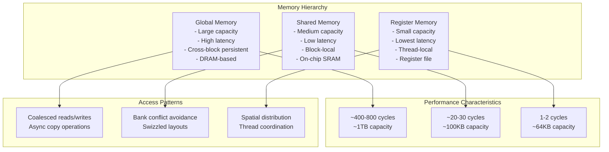
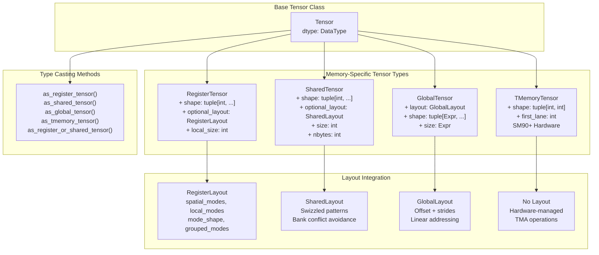
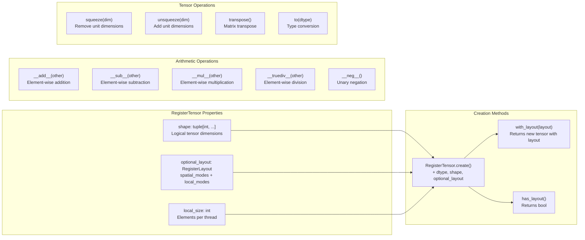
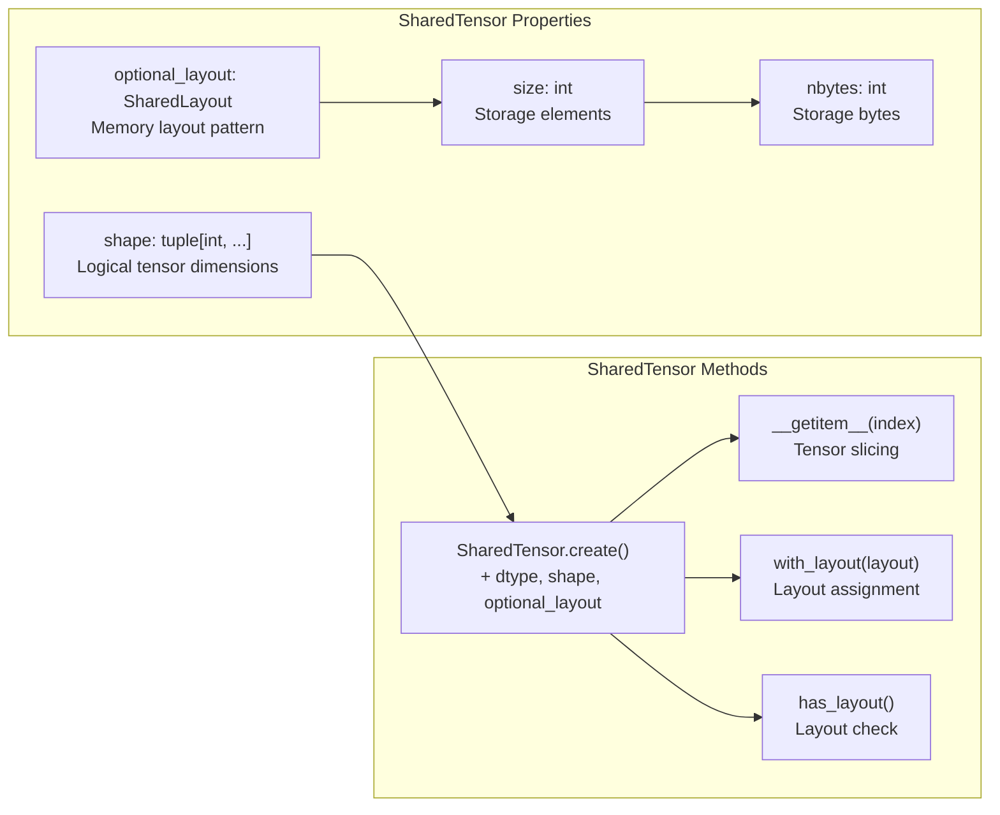
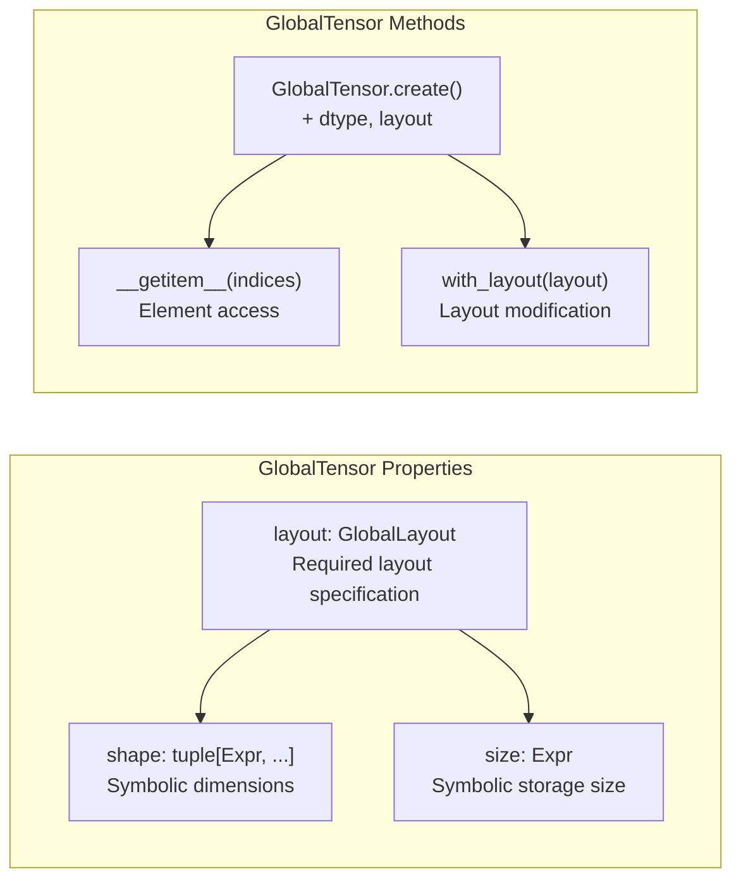
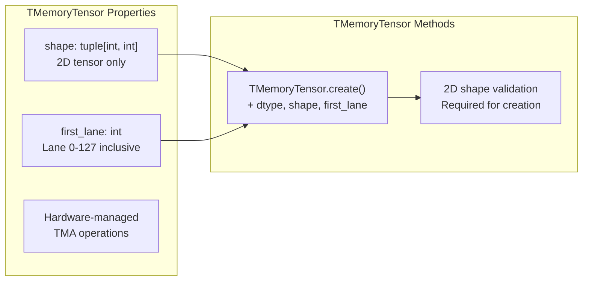
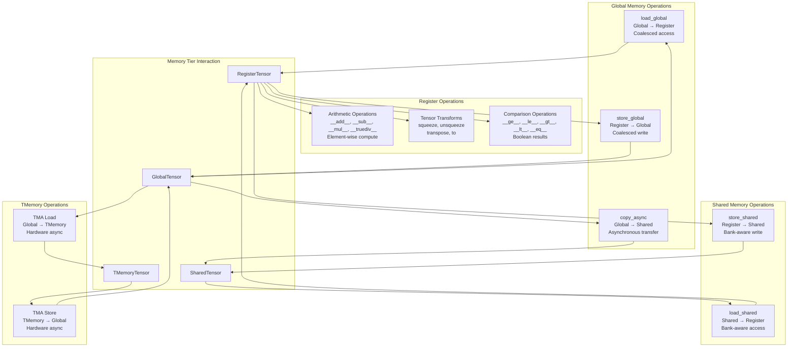
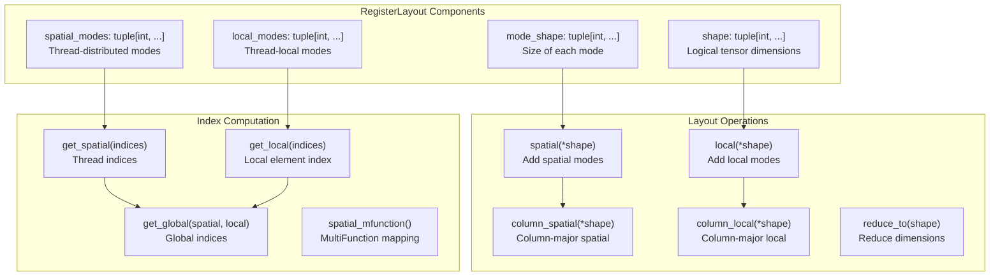
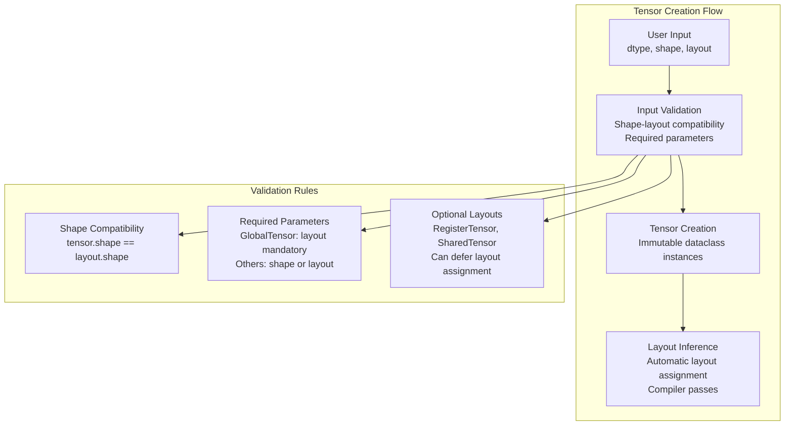

<!-- source: DeepWiki mcp.deepwiki.com · repo NVIDIA/tilus · page 3.3 Memory Model and Tensor Types · fetched 2026-10-26 -->

# Memory Model and Tensor Types

Relevant source files

The following files were used as context for generating this wiki page:

- [python/tilus/ir/layout/register_layout.py](python/tilus/ir/layout/register_layout.py)
- [python/tilus/ir/tensor.py](python/tilus/ir/tensor.py)

## Purpose and Scope

This page documents Tilus's three-tier memory hierarchy and the corresponding tensor types that form the foundation of GPU kernel programming. The memory model distinguishes between global, shared, and register memory spaces, each with different performance characteristics and access patterns. Each memory tier has a corresponding tensor type that encapsulates both data and layout information.

For specific memory layout implementations and transformations, see [Memory Layout System](#6.2). For the instruction system that operates on these tensors, see [Instruction System](#6.3).

## Three-Tier Memory Hierarchy

Tilus organizes GPU memory into three distinct tiers, each optimized for different access patterns and performance requirements:

**Sources:** [python/tilus/ir/tensor.py:352-419]()

## Tensor Type System

Tilus provides a unified tensor type system where each tensor encapsulates both data type information and memory tier-specific layout details:

**Sources:** [python/tilus/ir/tensor.py:30-58](), [python/tilus/ir/tensor.py:452-464](), [python/tilus/ir/layout/register_layout.py:34-54]()

### Base Tensor Class

The `Tensor` base class provides common functionality and type casting methods:

| Method | Purpose | Returns |
|--------|---------|---------|
| `as_register_tensor()` | Cast to RegisterTensor | `RegisterTensor` |
| `as_shared_tensor()` | Cast to SharedTensor | `SharedTensor` |
| `as_global_tensor()` | Cast to GlobalTensor | `GlobalTensor` |
| `as_tmemory_tensor()` | Cast to TMemoryTensor | `TMemoryTensor` |
| `as_register_or_shared_tensor()` | Cast to register or shared | `RegisterTensor \| SharedTensor` |

**Sources:** [python/tilus/ir/tensor.py:42-61]()

### RegisterTensor

Register tensors represent data distributed across thread registers with optional layout specifications:

**Sources:** [python/tilus/ir/tensor.py:64-361](), [python/tilus/ir/tensor.py:186-360]()

### SharedTensor

Shared tensors manage block-local memory with layout-aware size calculations:

**Sources:** [python/tilus/ir/tensor.py:362-450](), [python/tilus/ir/tensor.py:380-449]()

### GlobalTensor

Global tensors represent data in device memory with mandatory layout information:

**Sources:** [python/tilus/ir/tensor.py:466-536](), [python/tilus/ir/tensor.py:485-535]()

### TMemoryTensor

TMemoryTensor represents data in tensor memory, available on SM90+ hardware:

**Sources:** [python/tilus/ir/tensor.py:452-464]()

## Memory Operations and Data Movement

The tensor type system supports data movement between memory tiers through specialized operations:

**Sources:** [python/tilus/ir/tensor.py:186-330](), [python/tilus/ir/tensor.py:332-360](), [python/tilus/ir/tensor.py:380-381](), [python/tilus/ir/tensor.py:512-530]()

## Layout System Integration

Each tensor type integrates with its corresponding layout system to manage memory access patterns and performance optimizations:

| Tensor Type | Layout Type | Key Features |
|-------------|-------------|--------------|
| `RegisterTensor` | `RegisterLayout` | `spatial_modes`, `local_modes`, `mode_shape`, thread distribution |
| `SharedTensor` | `SharedLayout` | Bank conflict avoidance, swizzled patterns, storage optimization |
| `GlobalTensor` | `GlobalLayout` | Stride-based addressing, offset calculations, symbolic shapes |
| `TMemoryTensor` | Hardware-managed | No explicit layout, TMA operations, first lane addressing |

### RegisterLayout Details

The `RegisterLayout` class provides sophisticated thread data distribution:

The layout system ensures that:
- Register tensors distribute data efficiently using `spatial_modes` and `local_modes`
- Shared tensors avoid memory bank conflicts through swizzling
- Global tensors support efficient coalesced memory access patterns
- TMemory tensors leverage hardware-managed addressing via TMA

**Sources:** [python/tilus/ir/tensor.py:26](), [python/tilus/ir/layout/register_layout.py:34-54](), [python/tilus/ir/layout/register_layout.py:183-219](), [python/tilus/ir/layout/register_layout.py:114-180]()

## Tensor Creation and Validation

The tensor type system provides factory methods with comprehensive validation:

**Sources:** [python/tilus/ir/tensor.py:78-109](), [python/tilus/ir/tensor.py:284-299](), [python/tilus/ir/tensor.py:366-368]()

---

