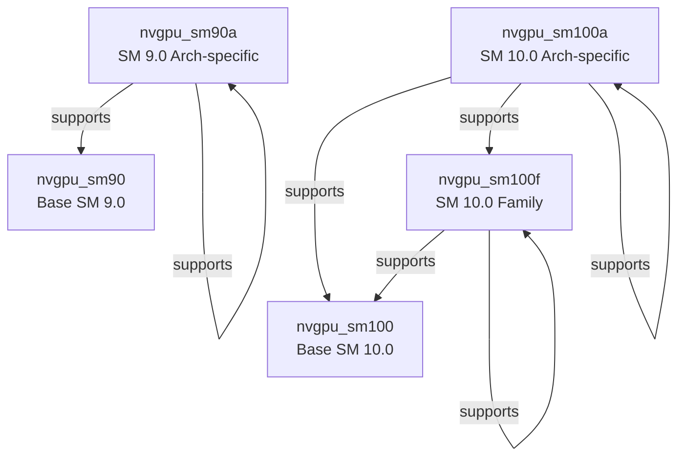
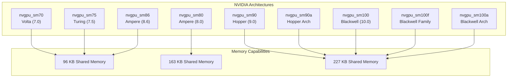
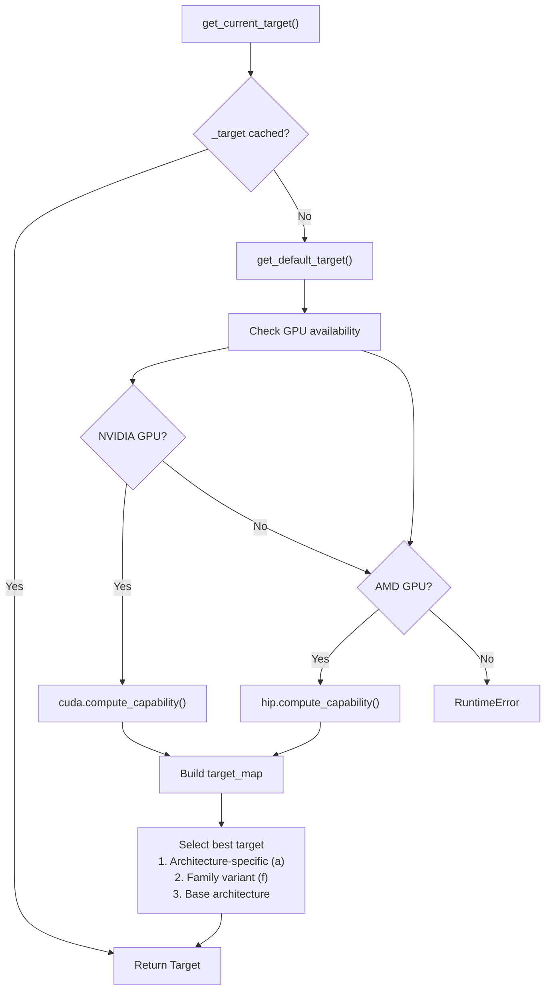
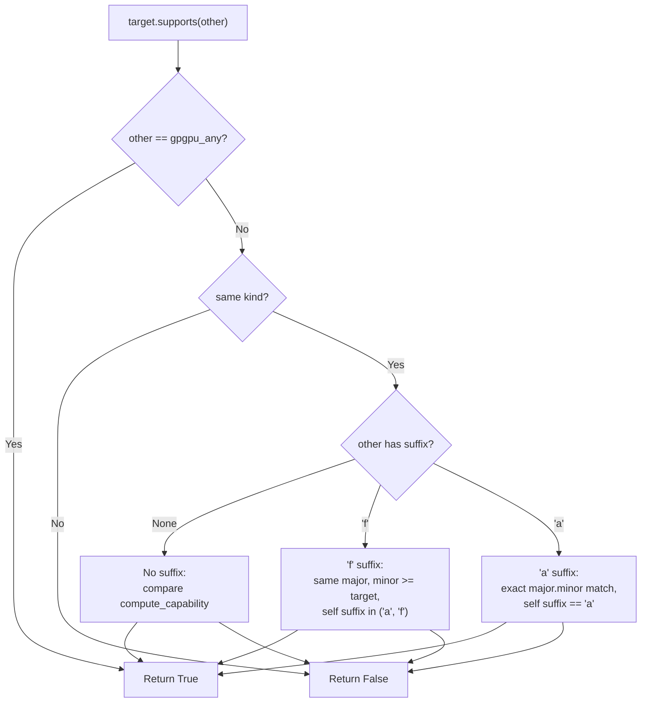
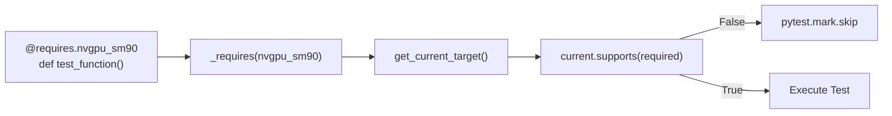

<!-- source: DeepWiki mcp.deepwiki.com · repo NVIDIA/tilus · page 3.4 Target System · fetched 2026-10-26 -->

# Target System

<details>
<summary>Relevant source files</summary>

The following files were used as context for generating this wiki page:

- [python/tilus/target.py](python/tilus/target.py)
- [python/tilus/testing/requires.py](python/tilus/testing/requires.py)
- [tests/conftest.py](tests/conftest.py)
- [tests/ir/test_targets.py](tests/ir/test_targets.py)

</details>


The Target System defines GPU target architectures, manages hardware capability detection, and provides target-specific compilation support. This system enables Tilus to compile kernels for different GPU architectures (NVIDIA CUDA, AMD HIP) while ensuring compatibility and optimal hardware utilization.

For information about compilation pipeline integration, see [Compilation Pipeline](#4). For memory hierarchy specifics, see [Memory Model and Tensor Types](#3.3).

## Core Target Architecture

The Target System is built around two primary classes that define GPU architectures and their capabilities.

```mermaid
classDiagram
    class Target {
        +string kind
        +string arch
        +TargetProperties properties
        +__str__() string
        +is_nvgpu() bool
        +is_amdgpu() bool
        +supports(Target) bool
    }
    
    class TargetProperties {
        +tuple compute_capability
        +string feature_suffix
        +int shared_memory_per_block
    }
    
    Target *-- TargetProperties
    
    class "Predefined Targets" {
        +nvgpu_sm80
        +nvgpu_sm90
        +nvgpu_sm90a
        +amdgpu_gfx1100
        +gpgpu_any
    }
    
    "Predefined Targets" --> Target : "instances"
```

The `Target` class represents a specific GPU architecture with three key components: the vendor kind (`nvgpu`, `amdgpu`, `gpgpu`), the architecture identifier (`sm80`, `gfx1100`), and detailed properties including compute capability and hardware-specific features.

Sources: [python/tilus/target.py:20-81]()

## Target Properties and Capabilities

Target properties encode hardware-specific information that drives compilation decisions and optimization strategies.

| Property | Purpose | Example Values |
|----------|---------|----------------|
| `compute_capability` | CUDA/HIP compute capability tuple | `(8, 0)`, `(9, 0)`, `(11, 0)` |
| `feature_suffix` | Architecture variant identifier | `None`, `"a"`, `"f"` |
| `shared_memory_per_block` | Maximum shared memory per thread block | `96 * 1024`, `227 * 1024` |

The feature suffix system provides fine-grained architecture support:
- **No suffix**: Base architecture support
- **`"f"` suffix**: Family variant with broader compatibility 
- **`"a"` suffix**: Architecture-specific variant with precise feature matching



Sources: [python/tilus/target.py:20-25](), [python/tilus/target.py:164-241]()

## GPU Architecture Support

Tilus supports multiple GPU vendors and architectures through predefined target definitions.

### NVIDIA GPU Targets



The system includes comprehensive NVIDIA GPU support from SM 7.0 (Volta) through SM 12.1 (future architectures), with architecture-specific shared memory configurations and feature variations.

### AMD GPU Targets

AMD GPU support includes modern RDNA architectures with standardized shared memory configurations:

- `amdgpu_gfx1100`: RX 7900 XTX and similar (compute capability 11.0, 64KB shared memory)
- `amdgpu_any`: Generic AMD GPU target for broad compatibility

Sources: [python/tilus/target.py:99-241]()

## Target Selection and Management

The target selection system automatically detects available hardware and selects appropriate compilation targets.



The target selection follows a priority hierarchy for NVIDIA GPUs:
1. **Architecture-specific variant** (`"a"` suffix): Most precise feature matching
2. **Family variant** (`"f"` suffix): Broader compatibility within major version
3. **Base architecture** (no suffix): Minimum compatibility guarantee

Sources: [python/tilus/target.py:264-383]()

## Target Compatibility System

The `supports()` method implements sophisticated compatibility checking that considers compute capabilities and feature suffixes.

### Compatibility Rules

| Self Target | Supports Target | Result | Reason |
|-------------|----------------|--------|---------|
| `nvgpu_sm90` | `nvgpu_sm80` | ✓ | Higher compute capability |
| `nvgpu_sm80` | `nvgpu_sm90` | ✗ | Insufficient capability |
| `nvgpu_sm90a` | `nvgpu_sm90` | ✓ | Architecture includes base |
| `nvgpu_sm90` | `nvgpu_sm90a` | ✗ | Base excludes architecture-specific |
| `nvgpu_sm100f` | `nvgpu_sm100` | ✓ | Family includes base |
| `nvgpu_sm100a` | `nvgpu_sm100f` | ✓ | Architecture includes family |



Sources: [python/tilus/target.py:42-81](), [tests/ir/test_targets.py:55-176]()

## Testing Integration

The target system integrates with the testing framework through architecture-specific requirement decorators.



The `requires` class provides convenient decorators for GPU architecture requirements:
- `@requires.nvgpu_sm90`: Requires SM 9.0 or higher
- `@requires.nvgpu_sm80`: Requires SM 8.0 or higher  
- `@requires.nvgpu_sm100`: Requires SM 10.0 or higher

Tests are automatically skipped when the current GPU doesn't meet the architecture requirements, enabling comprehensive testing across different hardware configurations.

Sources: [python/tilus/testing/requires.py:22-57](), [tests/conftest.py:34-60]()

## Target Matching and Selection

The `match_target()` function provides advanced target selection from available options, enabling flexible compilation strategies.

```python
def match_target(target: Target, target_templates: Sequence[Target]) -> Optional[Target]:
    supported_targets = [tt for tt in target_templates if target.supports(tt)]
    if len(supported_targets) == 0:
        return None
    return max(supported_targets, 
               key=lambda tt: (tt.properties.compute_capability[0], 
                             tt.properties.compute_capability[1]))
```

This function filters available targets by compatibility and selects the highest compute capability target, enabling optimal hardware utilization while maintaining compatibility guarantees.

Sources: [python/tilus/target.py:385-394]()

---

