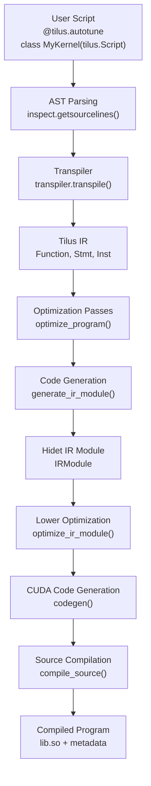
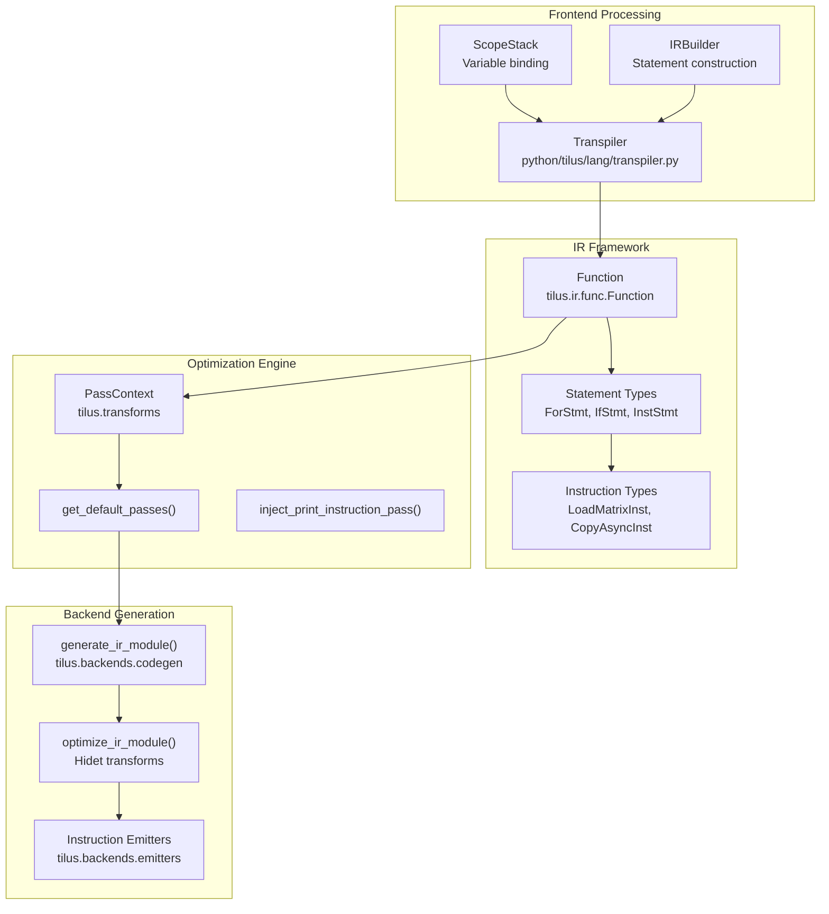
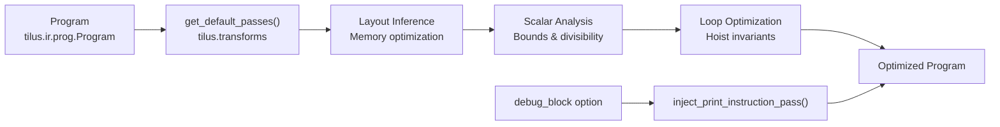
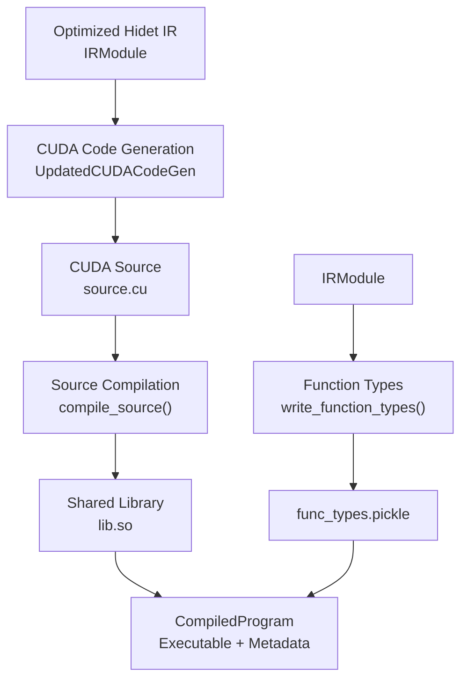
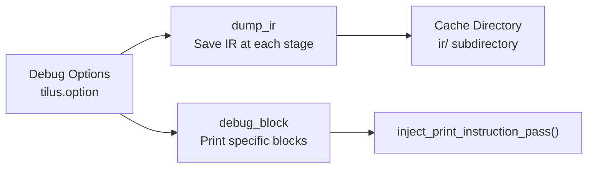

<!-- source: DeepWiki mcp.deepwiki.com · repo NVIDIA/tilus · page 4 Compilation Pipeline · fetched 2026-10-26 -->

# Compilation Pipeline

Relevant source files

The following files were used as context for generating this wiki page:

- [python/tilus/backends/emitters/cuda/ldmatrix.py](python/tilus/backends/emitters/cuda/ldmatrix.py)
- [python/tilus/backends/emitters/debug.py](python/tilus/backends/emitters/debug.py)
- [python/tilus/drivers.py](python/tilus/drivers.py)
- [python/tilus/extensions/hidet/backend/codegen.py](python/tilus/extensions/hidet/backend/codegen.py)
- [python/tilus/lang/transpiler.py](python/tilus/lang/transpiler.py)
- [tests/lang/test_copy_async_bulk.py](tests/lang/test_copy_async_bulk.py)
- [tests/lang/test_copy_async_tensor.py](tests/lang/test_copy_async_tensor.py)

The compilation pipeline is the core system that transforms user-written Python scripts using the Tilus DSL into optimized GPU executable code. This process involves multiple stages of transformation, from Python AST parsing to low-level code generation, with extensive optimization at each level.

For detailed information about the transpilation process from Python to Tilus IR, see [Transpilation](#4.1). For comprehensive documentation of the Tilus IR system, see [Intermediate Representation](#4.2). For backend code generation details, see [Code Generation and Backend](#4.3).

## Compilation Flow Overview

The compilation pipeline follows a multi-stage transformation process that converts high-level Python scripts into efficient GPU kernels:

**Compilation Pipeline Stages**
Sources: [python/tilus/drivers.py:249-318](), [python/tilus/lang/transpiler.py:204-254]()

## Key Pipeline Components

The compilation pipeline consists of several core components that work together to transform and optimize the code:

**Core Pipeline Components**
Sources: [python/tilus/lang/transpiler.py:154-168](), [python/tilus/drivers.py:65-97](), [python/tilus/backends/codegen.py]()

## Transpilation Phase

The transpilation phase converts Python source code into Tilus IR through AST analysis and scope management:

| Component | File Location | Purpose |
|-----------|---------------|---------|
| `Transpiler` | [python/tilus/lang/transpiler.py:154]() | Main AST visitor that converts Python to Tilus IR |
| `Scope` | [python/tilus/lang/transpiler.py:65]() | Manages variable bindings and statement collection |
| `ScopeStack` | [python/tilus/lang/transpiler.py:116]() | Hierarchical scope management for nested contexts |
| `LambdaProxy` | [python/tilus/lang/transpiler.py:130]() | Handles lambda function calls within kernels |

The transpiler performs several key operations:
- Extracts source code using `inspect.getsourcelines()` and `inspect.getsourcefile()`
- Parses Python AST using `ast.parse()`
- Resolves variable bindings and type annotations
- Converts Python statements to Tilus IR statements
- Manages kernel attributes like block dimensions and warp counts

Sources: [python/tilus/lang/transpiler.py:204-254](), [python/tilus/lang/transpiler.py:380-461]()

## Optimization Phases

The compilation pipeline includes two distinct optimization phases that target different abstraction levels:

### High-Level Tilus IR Optimization

**High-Level Optimization Pipeline**
Sources: [python/tilus/drivers.py:65-97](), [python/tilus/transforms/__init__.py]()

### Low-Level Hidet IR Optimization

The low-level optimization phase applies Hidet's comprehensive transformation pipeline:

| Pass Category | Key Transforms | Purpose |
|---------------|----------------|---------|
| Register Lowering | `inline_register_tensor_pass()` | Inline register tensor operations |
| Type Lowering | `lower_subbyte_type_pass()` | Handle sub-byte data types |
| Loop Optimization | `hoist_loop_invariants_pass()` | Move invariant computations |
| Simplification | `rule_based_simplify_pass()` | Apply algebraic simplifications |
| Code Generation | `generate_launch_func_pass()` | Create kernel launch functions |

Sources: [python/tilus/drivers.py:99-199](), [python/tilus/extensions/hidet/transforms/]()

## Code Generation and Compilation

The final phase generates executable GPU code through a multi-step process:

**Code Generation Pipeline**
Sources: [python/tilus/drivers.py:296-318](), [python/tilus/extensions/hidet/backend/codegen.py:158-186]()

## Caching and Build Management

The compilation pipeline includes sophisticated caching to avoid redundant compilation:

| Component | Purpose | Implementation |
|-----------|---------|----------------|
| `get_cache_dir()` | Generate unique cache directory based on program hash | [python/tilus/drivers.py:202-246]() |
| `compiled_program_exists()` | Check if program already compiled | [python/tilus/runtime.py]() |
| `FileLock` | Prevent concurrent compilation of same program | [python/tilus/drivers.py:284]() |
| `BuildOptions` | Configurable compilation parameters | [python/tilus/drivers.py:37-63]() |

The caching system uses SHA256 hashing of the program text and build options to create unique cache directories, ensuring that different versions or configurations don't interfere with each other.

Sources: [python/tilus/drivers.py:202-287]()

## Debug and Instrumentation Support

The compilation pipeline provides extensive debugging capabilities:

- **IR Dumping**: When `debug.dump_ir` option is enabled, intermediate representations are saved at each transformation stage
- **Print Injection**: Debug blocks can be specified to inject print statements for specific GPU blocks
- **Pass Instrumentation**: Timing and profiling information for each optimization pass
- **Source Preservation**: Original Python source and intermediate files are cached for debugging

**Debug Infrastructure**
Sources: [python/tilus/drivers.py:89-95](), [python/tilus/drivers.py:193-196]()

---

