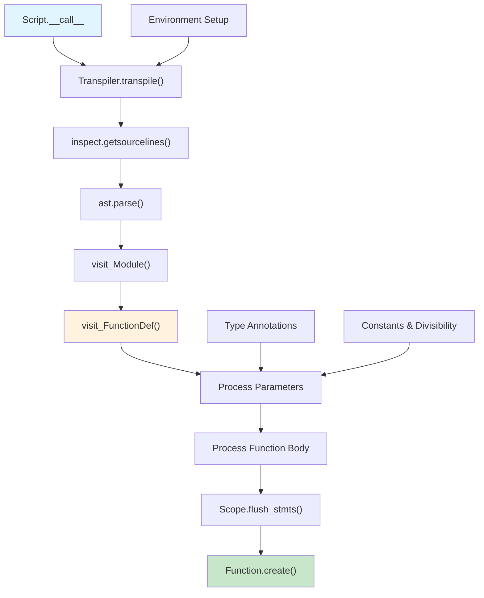
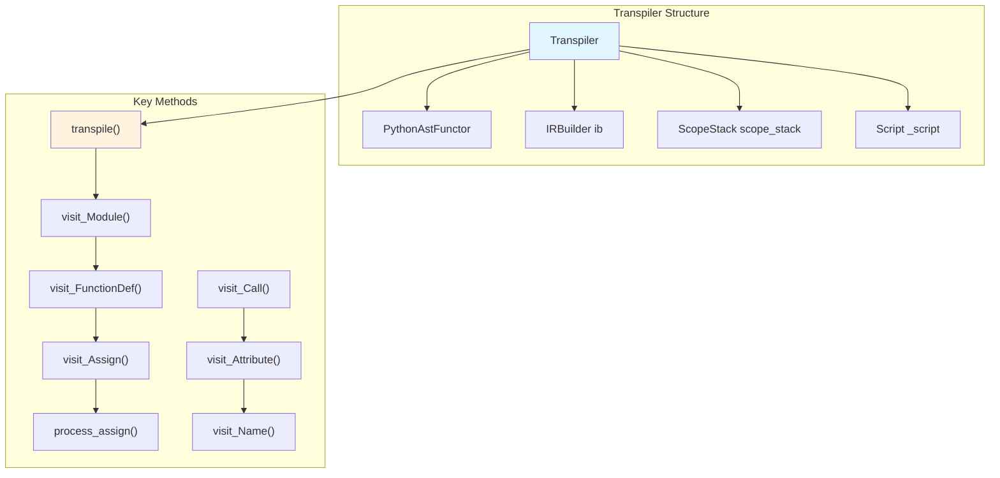
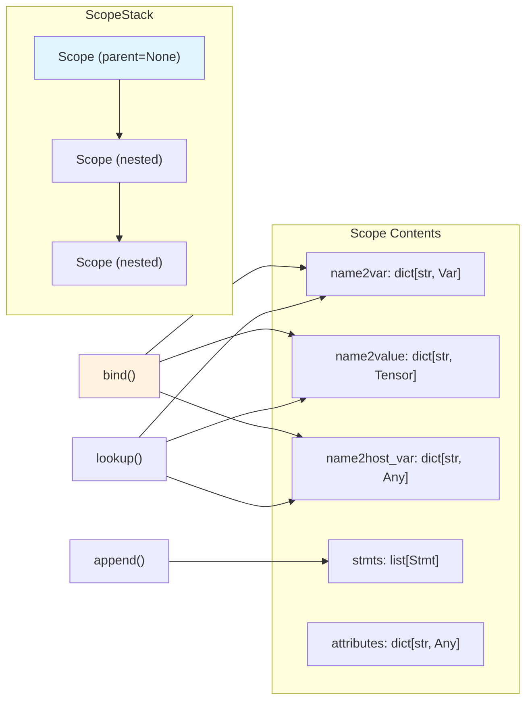
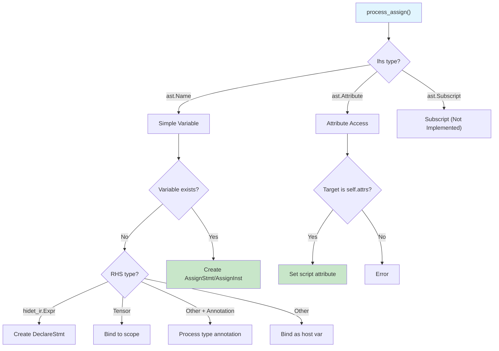
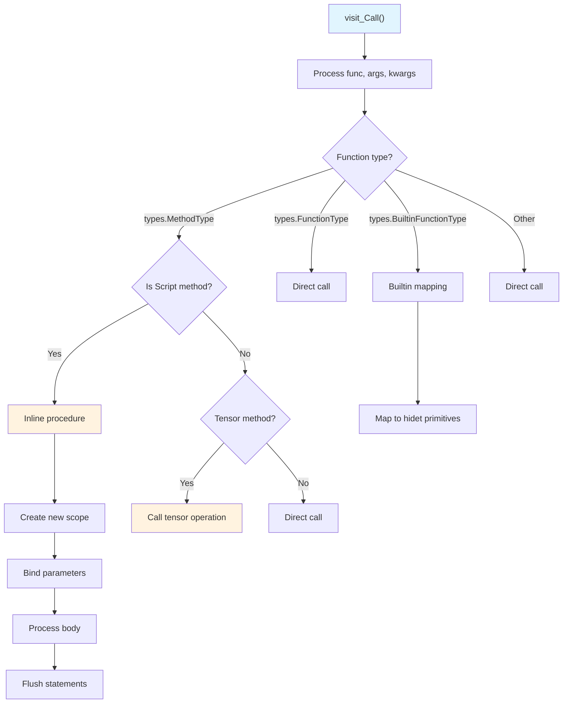
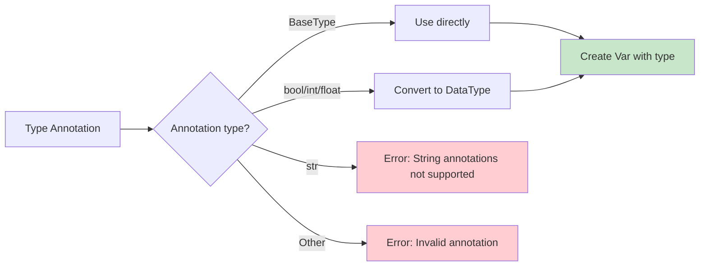
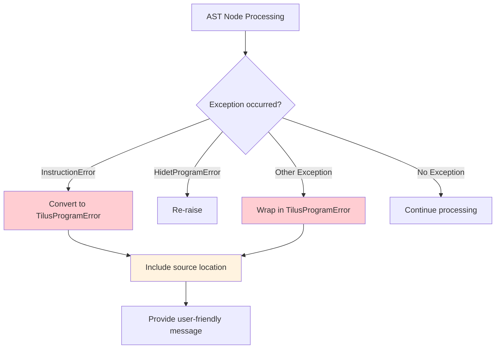
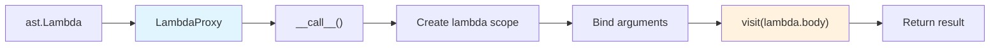

<!-- source: DeepWiki mcp.deepwiki.com · repo NVIDIA/tilus · page 4.1 Transpilation · fetched 2026-10-26 -->

# Transpilation

Relevant source files

The following files were used as context for generating this wiki page:

- [python/tilus/lang/transpiler.py](python/tilus/lang/transpiler.py)

## Purpose and Scope

The transpilation system is responsible for converting Python source code written using the Tilus DSL into Tilus Intermediate Representation (IR). This system bridges the gap between high-level Python syntax and the structured IR that can be optimized and compiled to GPU code.

The transpiler analyzes Python Abstract Syntax Trees (AST) and transforms them into Tilus IR constructs including functions, statements, instructions, and tensor operations. For information about the resulting IR structures, see [Intermediate Representation](#4.2). For details about the compilation stages that follow transpilation, see [Code Generation and Backend](#4.3).

## Transpilation Overview

The transpilation process converts user-written `tilus.Script` classes into executable `Function` objects that contain structured IR. This transformation handles scope management, type inference, and the mapping of Python constructs to GPU-specific operations.

**Transpilation Flow**

Sources: [python/tilus/lang/transpiler.py:204-254]()

## Core Components

### Transpiler Class

The `Transpiler` class serves as the main engine for AST-to-IR conversion. It inherits from `PythonAstFunctor` and implements visitor methods for each Python AST node type.

The transpiler maintains several key attributes:
- `ib`: An `IRBuilder` for constructing IR nodes
- `scope_stack`: A `ScopeStack` for managing variable scopes
- `type_annotations`: Dictionary mapping parameter names to types
- `name2consts`: Constants provided at instantiation time
- `name2divisibility`: Divisibility constraints for optimization

Sources: [python/tilus/lang/transpiler.py:154-167]()

### Scope Management System

The scope system tracks variable bindings, tensor values, and host variables throughout the transpilation process. Each scope can contain three types of bindings:

The `ScopeStack` provides context manager functionality for creating nested scopes during transpilation. The default top-level scope includes bindings for built-in constructs like `range`.

Sources: [python/tilus/lang/transpiler.py:65-128]()

## AST Node Processing

### Assignment Processing

The `process_assign` method handles the complex logic of Python assignment statements, supporting multiple assignment patterns and type annotations.

| Assignment Type | Example | Processing Logic |
|-----------------|---------|------------------|
| Simple Variable | `x = value` | Create `DeclareStmt` or `AssignStmt` |
| Tensor Assignment | `a = b` (RegisterTensor) | Create `AssignInst` |
| Attribute Assignment | `self.attrs.blocks = 16` | Set script attributes |
| Tuple Unpacking | `a, b = c, d` | Process each element separately |

Sources: [python/tilus/lang/transpiler.py:256-348]()

### Function Call Processing

Function calls in Tilus scripts are categorized into several types, each handled differently:

1. **Inlined kernel procedures**: Methods of the user-defined `Script` subclass
2. **Tensor methods**: Operations on `GlobalTensor`, `SharedTensor`, or `RegisterTensor`
3. **Python builtin functions**: Mathematical operations like `max`, `min`
4. **Other function calls**: General Python function calls

Sources: [python/tilus/lang/transpiler.py:480-708]()

### Expression and Statement Visitors

The transpiler implements visitor methods for all supported Python AST node types:

| AST Node | Visitor Method | Purpose |
|----------|----------------|---------|
| `ast.Module` | `visit_Module` | Entry point for transpilation |
| `ast.FunctionDef` | `visit_FunctionDef` | Process function definition |
| `ast.Assign` | `visit_Assign` | Handle assignment statements |
| `ast.Call` | `visit_Call` | Process function calls |
| `ast.For` | `visit_For` | Convert for loops to IR |
| `ast.If` | `visit_If` | Convert if statements to IR |
| `ast.BinOp` | `visit_BinOp` | Handle binary operations |
| `ast.Compare` | `visit_Compare` | Handle comparison operations |
| `ast.Subscript` | `visit_Subscript` | Handle tensor indexing/slicing |

Sources: [python/tilus/lang/transpiler.py:350-461](), [python/tilus/lang/transpiler.py:875-1281]()

## Type System Integration

### Parameter Type Processing

The transpiler processes function parameter type annotations to create properly typed `Var` objects in the IR:

The transpiler also handles divisibility information for optimization, tracking which parameters have known divisibility constraints.

Sources: [python/tilus/lang/transpiler.py:357-378](), [python/tilus/lang/transpiler.py:392-426]()

### Tensor Type Handling

Different tensor types require different processing during transpilation:

- **GlobalTensor**: Support indexing and slicing operations
- **SharedTensor**: Support indexing and slicing operations  
- **RegisterTensor**: Support element-wise operations and method calls
- **TMemoryTensor**: Hardware-specific tensor memory operations

Sources: [python/tilus/lang/transpiler.py:875-940]()

## Error Handling and Diagnostics

The transpiler provides comprehensive error reporting through `TilusProgramError`, which extends `HidetProgramError` with source location information:

Common error cases include:
- Unsupported AST node types
- Invalid type annotations
- Assignment to incompatible types
- Missing function parameter annotations
- Invalid tensor operations

Sources: [python/tilus/lang/transpiler.py:169-189](), [python/tilus/lang/transpiler.py:61-62]()

## Lambda Expression Support

The transpiler handles lambda expressions through the `LambdaProxy` class, which defers evaluation until the lambda is called:

This allows lambda expressions to be used in contexts where they are later evaluated with specific arguments, maintaining proper scope isolation.

Sources: [python/tilus/lang/transpiler.py:130-152](), [python/tilus/lang/transpiler.py:872-873]()

---

