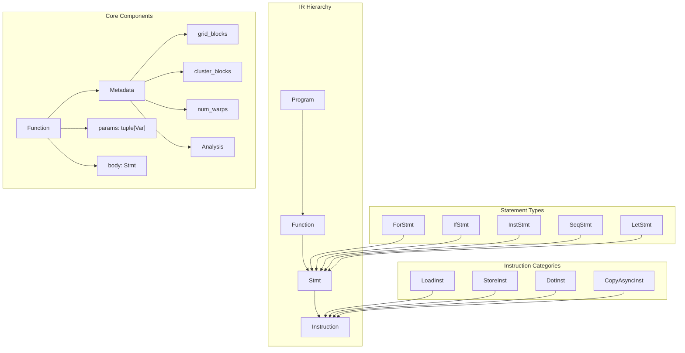
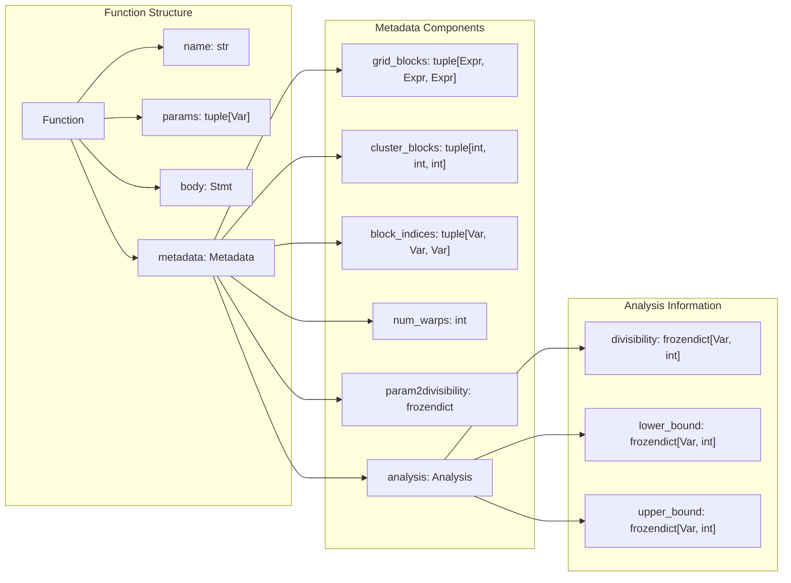
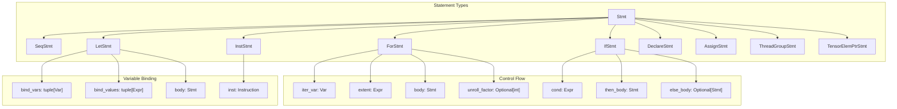
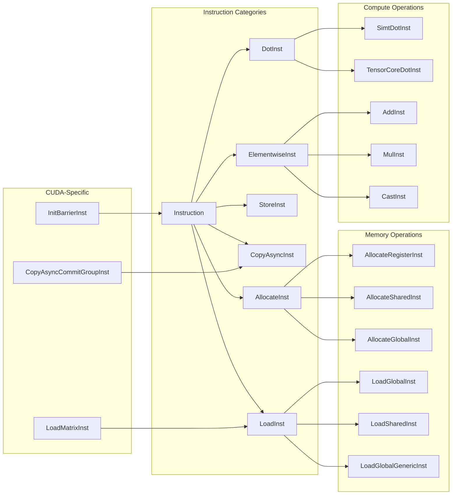
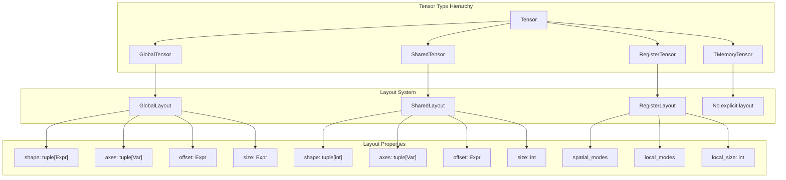
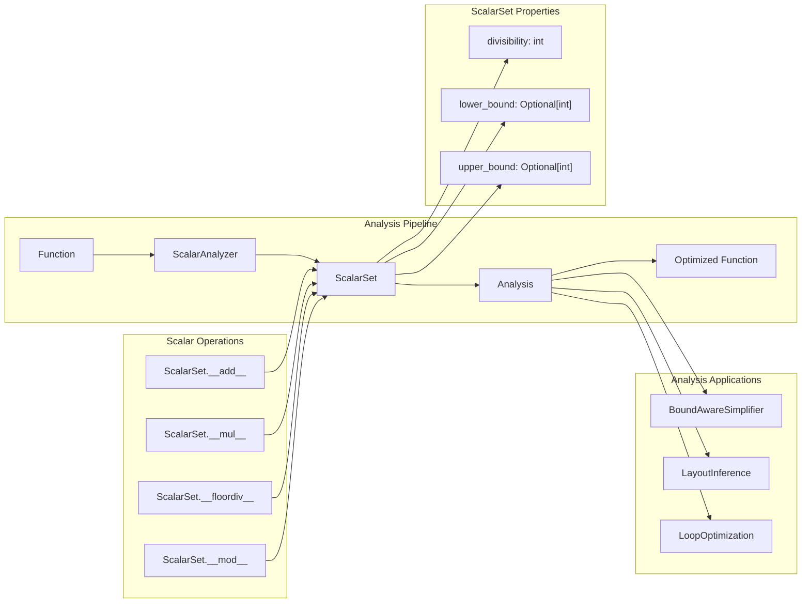
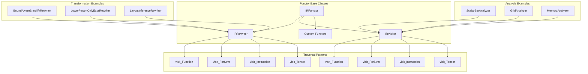
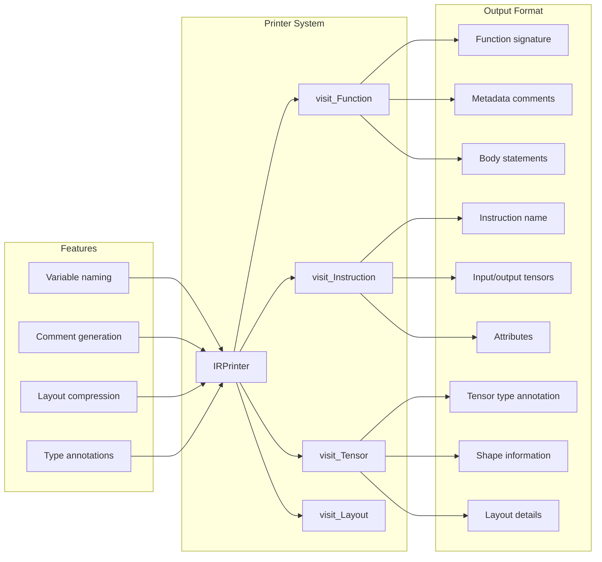

<!-- source: DeepWiki mcp.deepwiki.com · repo NVIDIA/tilus · page 4.2 Intermediate Representation · fetched 2026-10-26 -->

# Intermediate Representation

<details>
<summary>Relevant source files</summary>

The following files were used as context for generating this wiki page:

- [python/tilus/backends/emitters/cast.py](python/tilus/backends/emitters/cast.py)
- [python/tilus/backends/emitters/cuda/cp_async_base.py](python/tilus/backends/emitters/cuda/cp_async_base.py)
- [python/tilus/backends/emitters/cuda/mbarrier.py](python/tilus/backends/emitters/cuda/mbarrier.py)
- [python/tilus/ir/analyzers/scalar_analyzer.py](python/tilus/ir/analyzers/scalar_analyzer.py)
- [python/tilus/ir/builders/func_builder.py](python/tilus/ir/builders/func_builder.py)
- [python/tilus/ir/func.py](python/tilus/ir/func.py)
- [python/tilus/ir/functors/functor.py](python/tilus/ir/functors/functor.py)
- [python/tilus/ir/instructions/__init__.py](python/tilus/ir/instructions/__init__.py)
- [python/tilus/ir/instructions/cuda/__init__.py](python/tilus/ir/instructions/cuda/__init__.py)
- [python/tilus/ir/instructions/cuda/mbarrier.py](python/tilus/ir/instructions/cuda/mbarrier.py)
- [python/tilus/ir/stmt.py](python/tilus/ir/stmt.py)
- [python/tilus/ir/tools/printer.py](python/tilus/ir/tools/printer.py)
- [python/tilus/ir/utils/normalize.py](python/tilus/ir/utils/normalize.py)
- [python/tilus/lang/constructs/contexts.py](python/tilus/lang/constructs/contexts.py)
- [python/tilus/testing/__init__.py](python/tilus/testing/__init__.py)
- [python/tilus/transforms/bound_aware_simplify.py](python/tilus/transforms/bound_aware_simplify.py)
- [python/tilus/transforms/lower_param_only_expr.py](python/tilus/transforms/lower_param_only_expr.py)
- [scripts/sign-commits.sh](scripts/sign-commits.sh)
- [tests/lang/test_blocks_per_cluster.py](tests/lang/test_blocks_per_cluster.py)

</details>


The Intermediate Representation (IR) system forms the core of Tilus's compilation pipeline, providing a structured representation of GPU kernels that enables analysis, optimization, and code generation. The IR captures GPU-specific concepts like memory hierarchy, tensor operations, and execution metadata while maintaining a level of abstraction suitable for optimization passes.

This page covers the IR data structures, analysis framework, and traversal patterns. For information about converting Python code to IR, see [Transpilation](#4.1). For information about generating executable code from IR, see [Code Generation and Backend](#4.3).

## IR Architecture Overview

The Tilus IR is organized as a hierarchical structure with four main component types: Programs, Functions, Statements, and Instructions. This design enables fine-grained control over GPU kernel compilation while supporting sophisticated analysis and transformation passes.



**IR Hierarchy and Component Relationships**

Sources: [python/tilus/ir/prog.py](), [python/tilus/ir/func.py:81-110](), [python/tilus/ir/stmt.py:27-146](), [python/tilus/ir/inst.py]()

## Core IR Components

### Functions and Metadata

Functions represent complete GPU kernels with execution parameters and analysis information. The `Function` class encapsulates the kernel parameters, body statements, and GPU-specific metadata.



**Function and Metadata Structure**

The metadata captures GPU execution configuration and scalar analysis results that enable optimization passes.

| Component | Purpose | Example |
|-----------|---------|---------|
| `grid_blocks` | Grid dimensions for kernel launch | `(cdiv(M, 128), cdiv(N, 128), 1)` |
| `cluster_blocks` | Thread block clustering (SM90+) | `(2, 2, 1)` |
| `num_warps` | Warps per thread block | `4` |
| `analysis` | Scalar value bounds and divisibility | Used for loop optimization |

Sources: [python/tilus/ir/func.py:81-110](), [python/tilus/ir/func.py:28-76]()

### Statement Hierarchy

Statements represent control flow and variable bindings in the IR. The statement hierarchy supports both imperative constructs and functional programming patterns.



**Statement Type Hierarchy and Key Properties**

Sources: [python/tilus/ir/stmt.py:27-146]()

### Instruction System

Instructions represent atomic operations on tensors and scalars. The instruction system is extensible and target-specific, supporting both generic operations and hardware-specific primitives.



**Instruction Type System and Specializations**

Instructions encapsulate both generic tensor operations and target-specific hardware primitives like CUDA's `cp.async` and tensor core operations.

Sources: [python/tilus/ir/instructions/__init__.py:15-80](), [python/tilus/ir/inst.py]()

### Tensor Types and Memory Hierarchy

The IR explicitly models GPU memory hierarchy through distinct tensor types, each with associated layout specifications that enable memory access optimization.



**Tensor Types and Associated Layout System**

| Tensor Type | Memory Space | Layout Type | Purpose |
|-------------|--------------|-------------|---------|
| `GlobalTensor` | Global Memory | `GlobalLayout` | Large datasets, parameter tensors |
| `SharedTensor` | Shared Memory | `SharedLayout` | Block-level data sharing, tiling |
| `RegisterTensor` | Register Memory | `RegisterLayout` | Thread-local computation |
| `TMemoryTensor` | Tensor Memory | None | SM90+ hardware-managed memory |

Sources: [python/tilus/ir/tensor.py](), [python/tilus/ir/layout.py]()

## Analysis Framework

The IR includes a comprehensive analysis framework that computes scalar value properties to enable optimization passes. The analysis system tracks divisibility, bounds, and other properties through the computation graph.



**Scalar Analysis Framework and Applications**

The analysis framework uses abstract interpretation to track possible values of scalar expressions, enabling optimizations like loop unrolling and bound checking elimination.

Sources: [python/tilus/ir/analyzers/scalar_analyzer.py:79-565](), [python/tilus/transforms/bound_aware_simplify.py:22-199]()

## Traversal and Transformation System

The IR provides a powerful functor-based system for traversing and transforming IR trees. This system supports both immutable transformations and mutable analysis passes.



**IR Functor System for Traversal and Transformation**

The functor system provides:
- **Memoization**: Automatic caching of traversal results
- **Type Dispatch**: Automatic method dispatch based on node type
- **Immutable Updates**: Structural sharing for unchanged subtrees
- **Extensibility**: Support for custom node types

```python
# Example usage pattern from IRRewriter
def visit_ForStmt(self, stmt: ForStmt) -> Stmt:
    extent = self.visit(stmt.extent)  # Transform extent expression
    body = self.visit(stmt.body)      # Transform body statements
    if extent is stmt.extent and body is stmt.body:
        return stmt                   # Return original if unchanged
    else:
        return ForStmt(stmt.iter_var, extent, body, stmt.unroll_factor)
```

Sources: [python/tilus/ir/functors/functor.py:47-563]()

## Printer and Debugging Support

The IR includes comprehensive printing and debugging facilities that generate human-readable representations of the IR structure.



**IR Printer System and Output Format**

The printer generates Python-like syntax with type annotations and metadata comments, making IR inspection and debugging straightforward.

Example output:
```python
def matrix_multiply(A: pointer<float16[4096, 4096]>, B: pointer<float16[4096, 4096]>):
    # grid_blocks = [32, 32, 1]
    # cluster_blocks = [1, 1, 1] 
    # num_warps = 4
    
    %s0 = AllocateShared(dtype=float16, shape=[128, 128])  # shared memory allocation
    %r0 = LoadGlobal(%g0, axes=[u0, u1])                  # register tensor load
    %r1 = Dot(%r0, %r1, config=MmaConfig(...))            # tensor core operation
```

Sources: [python/tilus/ir/tools/printer.py:54-513]()

---

