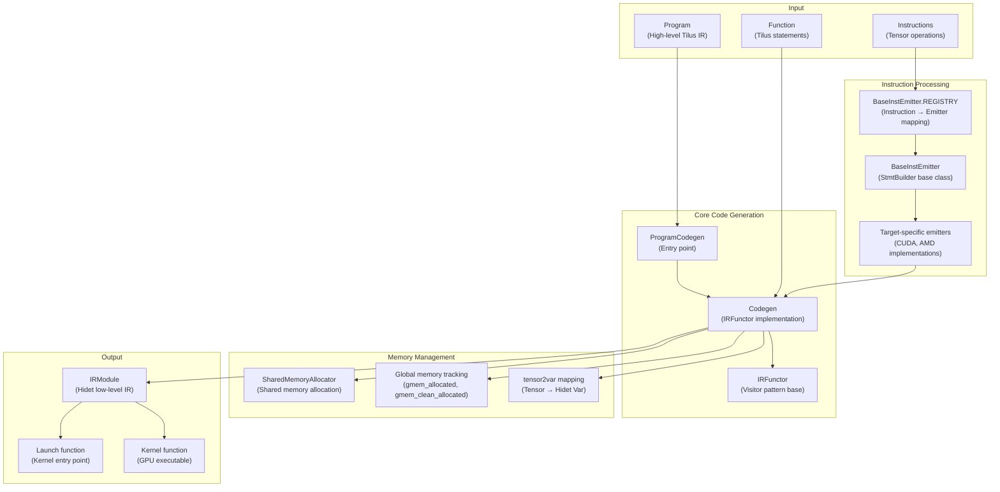
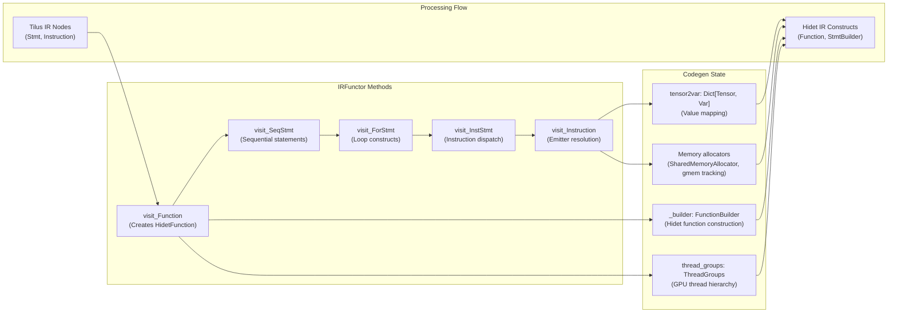
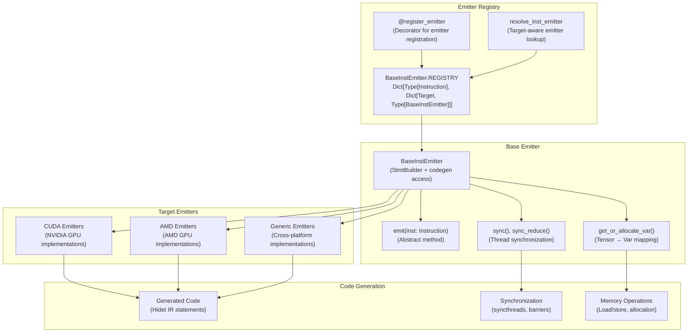
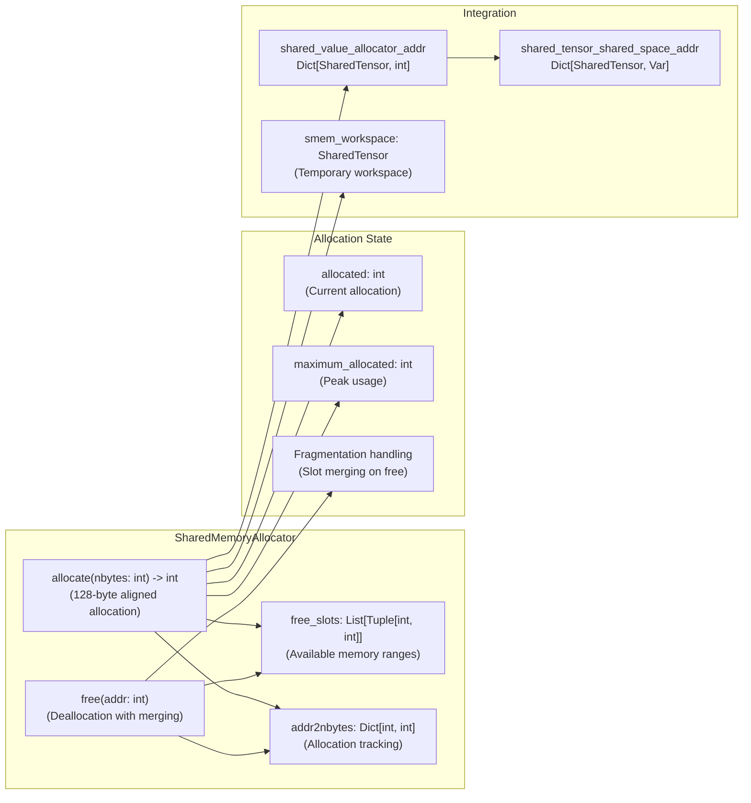
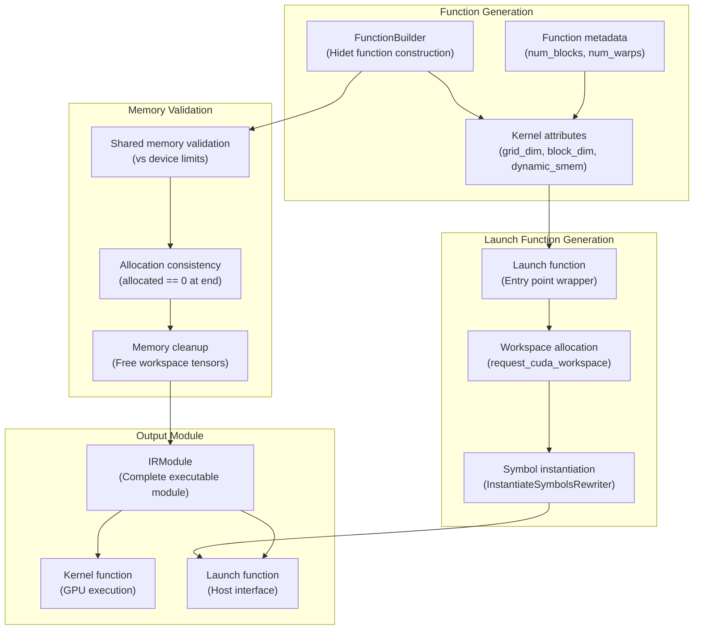

<!-- source: DeepWiki mcp.deepwiki.com · repo NVIDIA/tilus · page 4.3 Code Generation and Backend · fetched 2026-10-26 -->

# Code Generation

<details>
<summary>Relevant source files</summary>

The following files were used as context for generating this wiki page:

- [python/tilus/backends/codegen.py](python/tilus/backends/codegen.py)
- [python/tilus/backends/emitters/cuda/ldmatrix.py](python/tilus/backends/emitters/cuda/ldmatrix.py)
- [python/tilus/backends/emitters/debug.py](python/tilus/backends/emitters/debug.py)
- [python/tilus/drivers.py](python/tilus/drivers.py)
- [python/tilus/extensions/hidet/backend/codegen.py](python/tilus/extensions/hidet/backend/codegen.py)
- [tests/lang/test_copy_async_bulk.py](tests/lang/test_copy_async_bulk.py)
- [tests/lang/test_copy_async_tensor.py](tests/lang/test_copy_async_tensor.py)

</details>


This document covers the code generation phase of the Tilus compilation pipeline, which transforms high-level Tilus IR (`Program` objects) into low-level Hidet `IRModule` representations that can be compiled into executable GPU kernels. For information about the preceding stages, see [Transpilation](#4.1) and [IR Transform Passes](#4.2).

The code generation system is responsible for:
- Converting Tilus statements and instructions into Hidet IR constructs
- Managing GPU memory allocation (shared, global, and register memory)
- Generating target-specific instruction sequences through emitters
- Creating launch functions with proper workspace allocation
- Optimizing memory layouts and synchronization patterns

## Code Generation Architecture

The code generation system follows the visitor pattern through the `IRFunctor` base class, with specialized emitters for different instruction types and memory management subsystems.



**Sources:** [python/tilus/backends/codegen.py:265-636](), [python/tilus/ir/functors/functor.py:46-230]()

## The Codegen Class and IRFunctor Pattern

The `Codegen` class is the central component that transforms Tilus IR into Hidet IR using the visitor pattern. It inherits from `IRFunctor` and implements visit methods for each type of IR node.



The `Codegen` class maintains several critical pieces of state during code generation:

| Component | Purpose | Key Fields |
|-----------|---------|------------|
| Function Builder | Constructs Hidet function IR | `_builder: FunctionBuilder` |
| Tensor Mapping | Maps Tilus tensors to Hidet variables | `tensor2var: Dict[Tensor, Var]` |
| Memory Management | Tracks memory allocation | `smem_allocator`, `gmem_allocated` |
| Thread Groups | Manages GPU thread hierarchy | `thread_groups: ThreadGroups` |

**Sources:** [python/tilus/backends/codegen.py:265-310](), [python/tilus/ir/functors/functor.py:46-75]()

## Instruction Emitter System

The instruction emitter system provides a registry-based approach to generate target-specific code for different instruction types. Each instruction class can have multiple emitters for different GPU targets.



The emitter registration process allows for target-specific optimizations:

1. **Registration**: Emitters are registered using the `@register_emitter` decorator
2. **Resolution**: `resolve_inst_emitter` finds the best emitter for the current target
3. **Emission**: The selected emitter generates Hidet IR statements
4. **Integration**: Generated code is integrated into the function builder

**Sources:** [python/tilus/backends/codegen.py:76-205](), [python/tilus/backends/codegen.py:171-190]()

## Memory Management

The code generation system implements sophisticated memory management for GPU's three-tier memory hierarchy: global, shared, and register memory.

### Shared Memory Allocation

The `SharedMemoryAllocator` manages dynamic allocation of shared memory with alignment and fragmentation handling:



### Global Memory Management

Global memory allocation tracks workspace requirements and generates proper launch function setup:

| Memory Type | Base Pointer | Allocated Counter | Purpose |
|-------------|--------------|-------------------|---------|
| General Workspace | `gmem_base_ptr` | `gmem_allocated` | Temporary storage |
| Clean Workspace | `gmem_clean_base_ptr` | `gmem_clean_allocated` | Zero-initialized storage |

**Sources:** [python/tilus/backends/codegen.py:207-258](), [python/tilus/backends/codegen.py:287-347]()

## IR Module Generation

The final stage converts the generated Hidet function into a complete `IRModule` with proper launch function setup.



The launch function generation process includes:

1. **Workspace Setup**: Allocates GPU memory workspaces based on tracked requirements
2. **Symbol Resolution**: Instantiates symbolic references like `__gmem_workspace`
3. **Parameter Mapping**: Maps program parameters to launch function parameters
4. **Target Selection**: Chooses appropriate runtime functions (`request_cuda_workspace` vs `request_hip_workspace`)

**Sources:** [python/tilus/backends/codegen.py:375-491](), [python/tilus/backends/codegen.py:437-491]()

## Program-Level Code Generation

The `ProgramCodegen` class orchestrates the generation of complete modules from Tilus programs containing multiple functions.

The `generate_ir_module` function serves as the main entry point:

```python
def generate_ir_module(prog: Program) -> IRModule
```

This function:
1. Creates a `ProgramCodegen` instance
2. Processes each function in the program using individual `Codegen` instances
3. Merges the resulting `IRModule` objects
4. Adds a default launch function if only one public function exists
5. Verifies the final IR module

The verification step ensures the generated Hidet IR is well-formed and ready for compilation to executable GPU code.

**Sources:** [python/tilus/backends/codegen.py:585-636](), [python/tilus/backends/codegen.py:616-636]()

---

