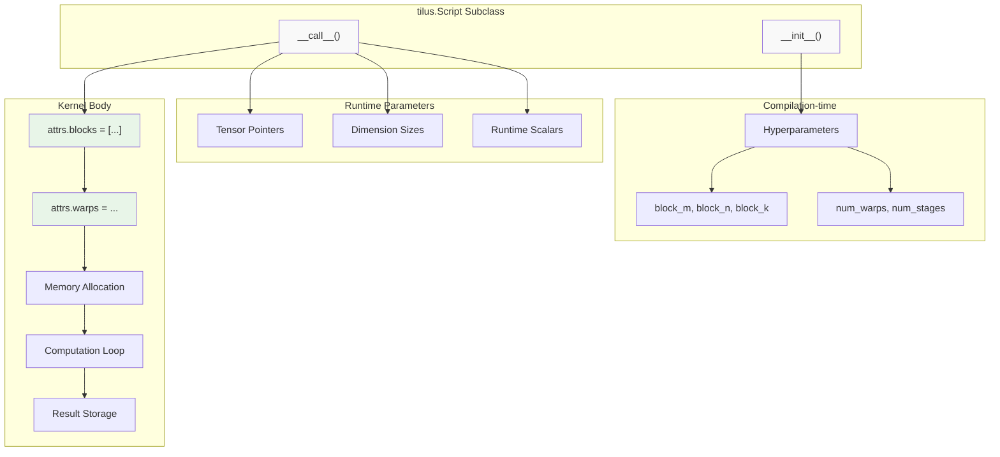
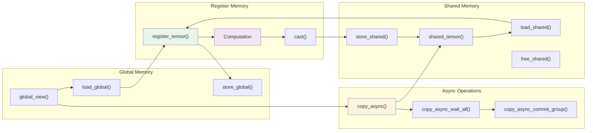
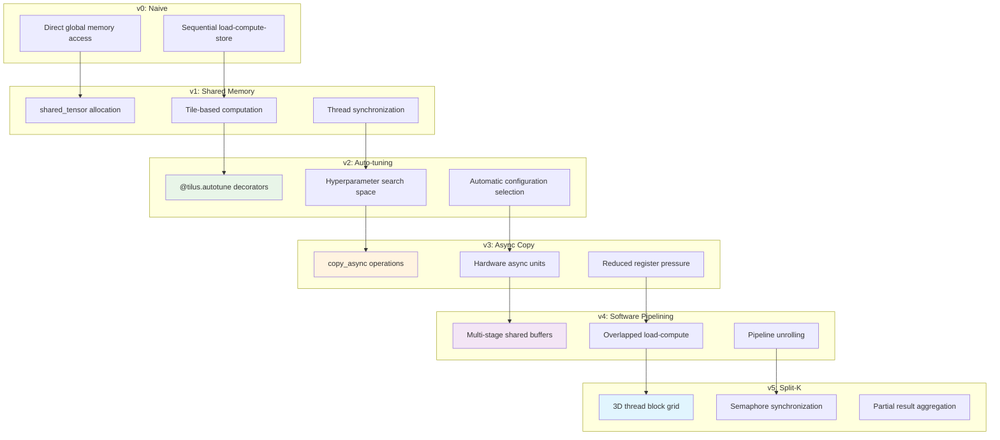
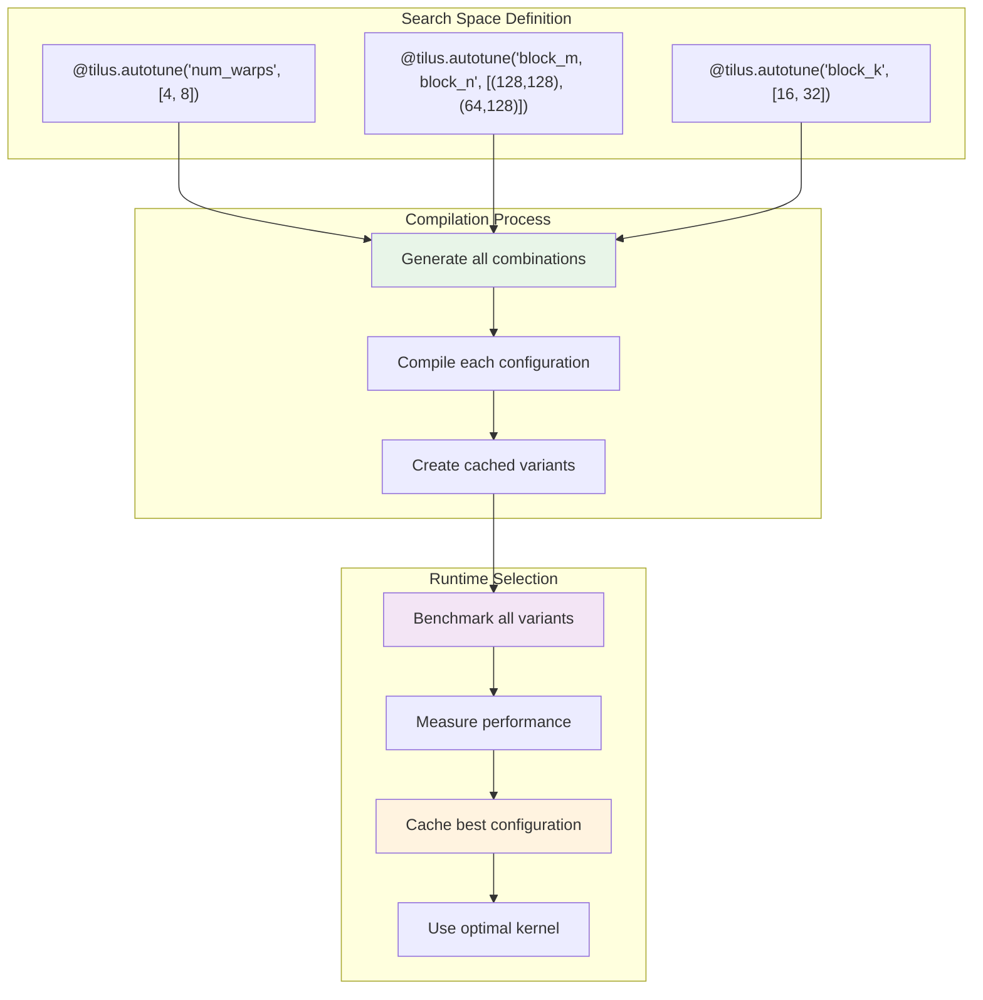
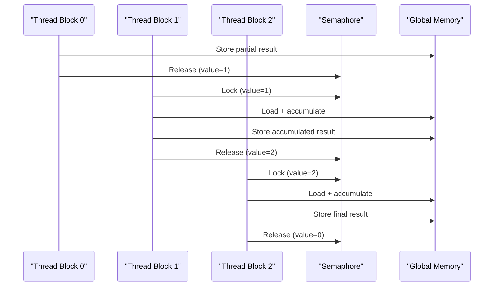

<!-- source: DeepWiki mcp.deepwiki.com · repo NVIDIA/tilus · page 5 Programming Guide · fetched 2026-10-26 -->

# Programming Guide

Relevant source files

The following files were used as context for generating this wiki page:

- [examples/matmul/matmul_v0.py](examples/matmul/matmul_v0.py)
- [examples/matmul/matmul_v1.py](examples/matmul/matmul_v1.py)
- [examples/matmul/matmul_v2.py](examples/matmul/matmul_v2.py)
- [examples/matmul/matmul_v3.py](examples/matmul/matmul_v3.py)
- [examples/matmul/matmul_v4.py](examples/matmul/matmul_v4.py)
- [examples/matmul/matmul_v5.py](examples/matmul/matmul_v5.py)

This document provides practical guidance for implementing high-performance GPU kernels using the Tilus programming framework. It covers the core programming patterns, memory management strategies, optimization techniques, and auto-tuning approaches needed to write efficient GPU code.

For step-by-step tutorials on specific kernel implementations, see [Basic Matrix Multiplication](#5.1), [FlashAttention Implementation](#5.2), [Quantized Computing](#5.3), and [Advanced Kernel Examples](#5.4). For detailed documentation of the underlying systems, see [Script System](#3.1), [Memory Model and Tensor Types](#3.3), and [JIT Compilation and Autotuning](#3.2).

## Core Programming Model

Tilus kernels are implemented by subclassing the `tilus.Script` class and defining two key methods: `__init__` for compile-time hyperparameters and `__call__` for the kernel computation logic. The programming model follows a block-level approach where operations are executed by all threads in a thread block.

**Kernel Structure Pattern**

The `__init__` method processes compile-time known hyperparameters like tile sizes and thread configurations, while `__call__` defines the actual computation using runtime parameters. The kernel execution configuration is set via `attrs.blocks` and `attrs.warps` attributes.

Sources: [examples/matmul/matmul_v0.py:24-36](), [examples/matmul/matmul_v0.py:48-70]()

## Memory Hierarchy and Tensor Management

Tilus provides explicit control over the GPU memory hierarchy through distinct tensor types. The memory model mirrors the hardware architecture with three main memory domains: global memory (large, high latency), shared memory (fast, block-scoped), and register memory (fastest, thread-local).

**Memory Operations and Data Flow**

The typical data flow involves loading data from global memory into shared memory buffers, then loading into registers for computation. Results are stored back through the hierarchy. Asynchronous copy operations enable overlapping memory transfers with computation for better performance.

Sources: [examples/matmul/matmul_v0.py:77-104](), [examples/matmul/matmul_v1.py:45-89](), [examples/matmul/matmul_v3.py:80-105]()

## Progressive Optimization Patterns

The matrix multiplication examples demonstrate a systematic approach to GPU kernel optimization, with each version introducing new techniques that build upon previous optimizations.

| Version | Optimization Technique | Key Instructions | Performance Impact |
|---------|----------------------|------------------|-------------------|
| v0 | Naive Implementation | `load_global`, `dot`, `store_global` | Baseline |
| v1 | Shared Memory Tiling | `shared_tensor`, `store_shared`, `sync` | Reduced global memory traffic |
| v2 | Auto-tuning | `@tilus.autotune` decorator | Optimal hyperparameter search |
| v3 | Async Copy | `copy_async`, `copy_async_wait_all` | Overlapped memory operations |
| v4 | Software Pipelining | Multi-stage buffers, `copy_async_commit_group` | Computation-memory overlap |
| v5 | Split-K Reduction | `global_tensor`, `lock_semaphore`, `release_semaphore` | Better parallelization |

**Optimization Progression Flow**

Each optimization targets specific performance bottlenecks: memory bandwidth, latency hiding, parameter tuning, and parallelization efficiency.

Sources: [examples/matmul/matmul_v0.py:48-104](), [examples/matmul/matmul_v1.py:45-89](), [examples/matmul/matmul_v2.py:54-122](), [examples/matmul/matmul_v3.py:84-105](), [examples/matmul/matmul_v4.py:89-131](), [examples/matmul/matmul_v5.py:84-187]()

## Auto-tuning and Performance Optimization

The `@tilus.autotune` decorator enables automatic hyperparameter optimization by defining search spaces for kernel configurations. The system compiles and benchmarks all configurations to select the optimal parameters for given input sizes and hardware targets.

**Auto-tuning Configuration**

The auto-tuning process occurs transparently during the first kernel invocation. Subsequent calls use the cached optimal configuration, eliminating tuning overhead in production workloads.

**Common Auto-tuning Parameters**

| Parameter | Purpose | Typical Values | Impact |
|-----------|---------|----------------|---------|
| `num_warps` | Thread block size | 1, 2, 4, 8, 16 | Resource utilization |
| `block_m`, `block_n` | Output tile dimensions | 32-256 | Memory coalescing |
| `block_k` | Reduction dimension tile | 8-64 | Register pressure |
| `num_stages` | Pipeline depth | 2-8 | Latency hiding |
| `split_k_factor` | K-dimension splitting | 1, 4, 8, 16 | Parallelism |

Sources: [examples/matmul/matmul_v2.py:54-56](), [examples/matmul/matmul_v4.py:51-54](), [examples/matmul/matmul_v5.py:53-57]()

## Advanced Synchronization and Communication

Complex kernels require sophisticated synchronization patterns for coordinating thread blocks and managing shared resources. Tilus provides hardware-accelerated primitives for efficient inter-block communication.

**Synchronization Primitives**

| Instruction | Scope | Purpose | Usage Pattern |
|-------------|-------|---------|---------------|
| `sync()` | Thread block | Barrier synchronization | Memory consistency |
| `lock_semaphore()` | Global | Acquire exclusive access | Inter-block coordination |
| `release_semaphore()` | Global | Release exclusive access | Resource management |
| `copy_async_wait_group()` | Thread block | Wait for async operations | Pipeline synchronization |

**Split-K Synchronization Pattern**

The split-K optimization in `MatmulV5` demonstrates advanced inter-block coordination using semaphores. Multiple thread blocks compute partial results for the same output tile, then use semaphores to serialize the aggregation process.

This pattern ensures correct aggregation order while maintaining high parallelism for the compute-intensive portion of the kernel.

Sources: [examples/matmul/matmul_v5.py:163-186](), [examples/matmul/matmul_v4.py:95-124]()

## Type System and Kernel Interfaces

Tilus uses a specialized type system to distinguish between compile-time and runtime parameters, enabling efficient code generation and optimization.

**Parameter Type Annotations**

| Type | Description | JIT Behavior | Usage |
|------|-------------|--------------|-------|
| `int` | Compile-time integer | Triggers recompilation | Tile sizes, constants |
| `int32` | Runtime 32-bit integer | Runtime parameter | Dynamic dimensions |
| `~float16` | Pointer to float16 data | Runtime parameter | Tensor pointers |
| `float16`, `float32` | Scalar data types | Type inference | Tensor element types |

The type system enables the JIT compiler to specialize kernels for specific parameter combinations while maintaining flexibility for runtime inputs. Compile-time parameters become constants in the generated code, enabling aggressive optimization.

Sources: [examples/matmul/matmul_v0.py:59-64](), [examples/matmul/matmul_v0.py:108-114]()

---

