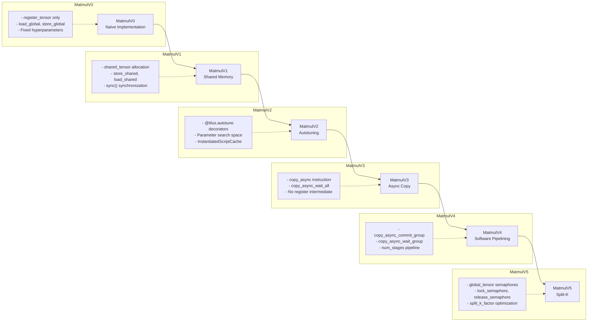
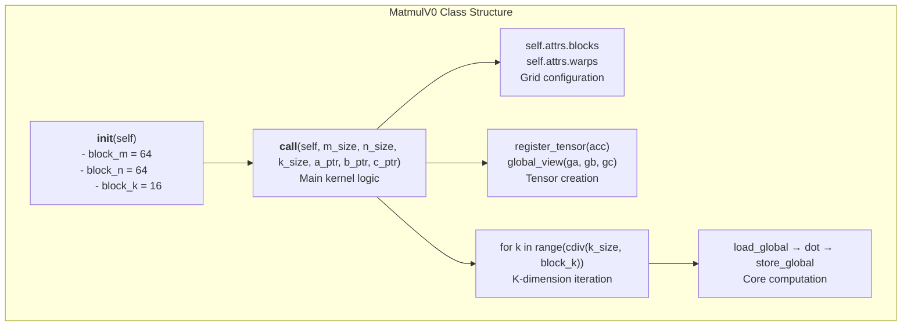
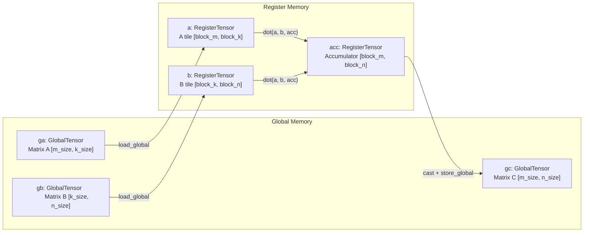
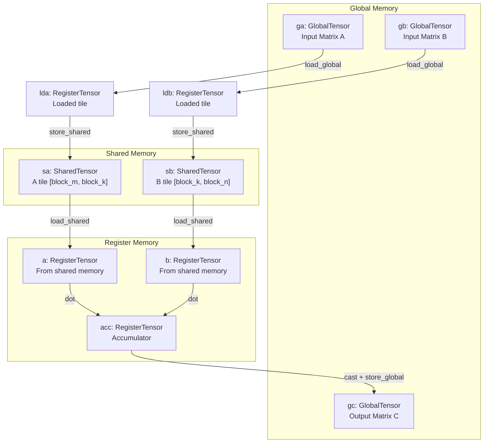
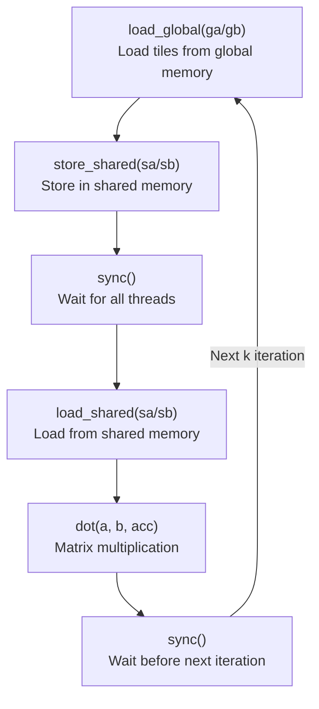
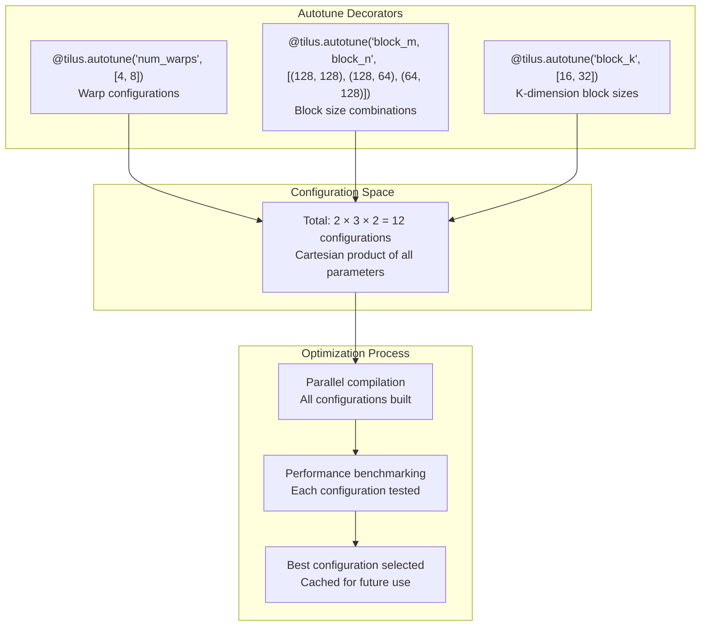
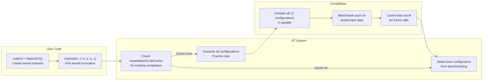
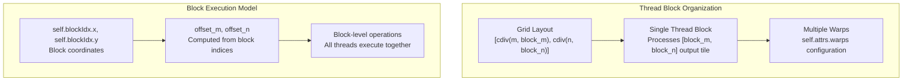

<!-- source: DeepWiki mcp.deepwiki.com · repo NVIDIA/tilus · page 5.1 Basic Matrix Multiplication · fetched 2026-10-26 -->

# Basic Matrix Multiplication

Relevant source files

The following files were used as context for generating this wiki page:

- [examples/matmul/matmul_v0.py](examples/matmul/matmul_v0.py)
- [examples/matmul/matmul_v1.py](examples/matmul/matmul_v1.py)
- [examples/matmul/matmul_v2.py](examples/matmul/matmul_v2.py)
- [examples/matmul/matmul_v3.py](examples/matmul/matmul_v3.py)
- [examples/matmul/matmul_v4.py](examples/matmul/matmul_v4.py)
- [examples/matmul/matmul_v5.py](examples/matmul/matmul_v5.py)

This document walks through a complete step-by-step tutorial series showing progressive optimization techniques for matrix multiplication in Tilus. The five versions (v0-v5) demonstrate fundamental concepts from basic kernel structure to advanced GPU optimizations including async memory operations, software pipelining, and split-K decomposition.

Each version builds upon the previous one, introducing new Tilus instructions and optimization patterns that are essential for high-performance GPU kernels.

## Complete Matrix Multiplication Progression

The Tilus codebase provides five progressive implementations of matrix multiplication that demonstrate core concepts and advanced optimizations:

Sources: [examples/matmul/matmul_v0.py](), [examples/matmul/matmul_v1.py](), [examples/matmul/matmul_v2.py](), [examples/matmul/matmul_v3.py](), [examples/matmul/matmul_v4.py](), [examples/matmul/matmul_v5.py]()

## Naive Implementation (MatmulV0)

The `MatmulV0` class demonstrates the basic structure of a Tilus kernel using only register tensors and direct global memory access.

### Script Structure

Sources: [examples/matmul/matmul_v0.py:48-105]()

### Memory Operations Flow

The naive implementation uses a simple memory access pattern:

Sources: [examples/matmul/matmul_v0.py:76-104]()

Key instructions used in the naive implementation:

| Instruction | Purpose | Line Reference |
|-------------|---------|----------------|
| `global_view` | Create tensor views of input matrices | [examples/matmul/matmul_v0.py:77-78]() |
| `register_tensor` | Allocate accumulator tensor | [examples/matmul/matmul_v0.py:81-83]() |
| `load_global` | Load matrix tiles into registers | [examples/matmul/matmul_v0.py:91-96]() |
| `dot` | Perform matrix multiplication | [examples/matmul/matmul_v0.py:99]() |
| `cast` | Convert float32 to float16 | [examples/matmul/matmul_v0.py:102]() |
| `store_global` | Write results back to global memory | [examples/matmul/matmul_v0.py:104]() |

## Shared Memory Optimization (MatmulV1)

The `MatmulV1` class introduces shared memory to optimize data reuse across threads within a block.

### Enhanced Memory Hierarchy

Sources: [examples/matmul/matmul_v1.py:46-89]()

### Synchronization Pattern

The shared memory implementation requires careful thread synchronization:

Sources: [examples/matmul/matmul_v1.py:54-82]()

New instructions introduced in `MatmulV1`:

| Instruction | Purpose | Line Reference |
|-------------|---------|----------------|
| `shared_tensor` | Allocate shared memory | [examples/matmul/matmul_v1.py:46-47]() |
| `store_shared` | Store register data to shared memory | [examples/matmul/matmul_v1.py:62,72]() |
| `load_shared` | Load shared memory to registers | [examples/matmul/matmul_v1.py:78-79]() |
| `sync` | Synchronize all threads in block | [examples/matmul/matmul_v1.py:75,82]() |
| `free_shared` | Release shared memory allocation | [examples/matmul/matmul_v1.py:84-85]() |

## Autotuning (MatmulV2)

The `MatmulV2` class adds automatic parameter optimization using the `@tilus.autotune` decorator system.

### Autotune Configuration Space

Sources: [examples/matmul/matmul_v2.py:54-56]()

### JIT Compilation Flow

The autotuning process integrates with Tilus's JIT compilation system:

Sources: [examples/matmul/matmul_v2.py:144,150]()

## Key Programming Concepts

### Parameter Type Annotations

Tilus uses specific type annotations to control compilation behavior:

| Annotation | Meaning | JIT Behavior | Example Usage |
|------------|---------|--------------|---------------|
| `int32` | Runtime integer | No recompilation | `m_size: int32` |
| `int` | Compile-time integer | Triggers JIT | `n_size: int` |
| `~float16` | Pointer type | Runtime value | `a_ptr: ~float16` |

Sources: [examples/matmul/matmul_v0.py:59-64](), [examples/matmul/matmul_v0.py:108-114]()

### Block-Level Semantics

All Tilus instructions operate with block-level semantics, meaning they are executed by all threads in a thread block:

Sources: [examples/matmul/matmul_v0.py:66-74](), [examples/matmul/matmul_v0.py:127-128]()

---

