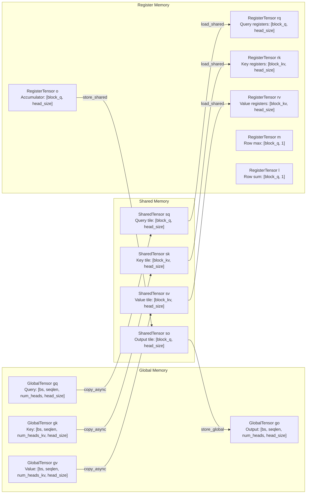
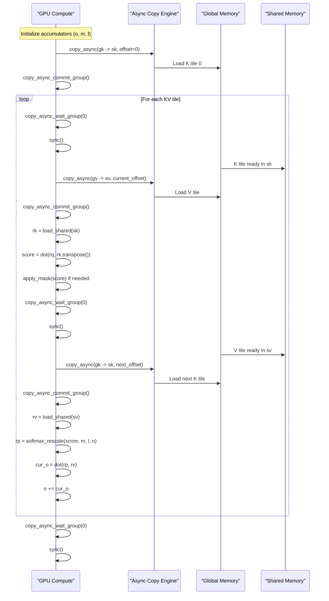
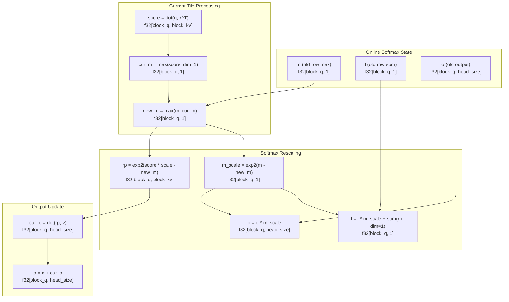
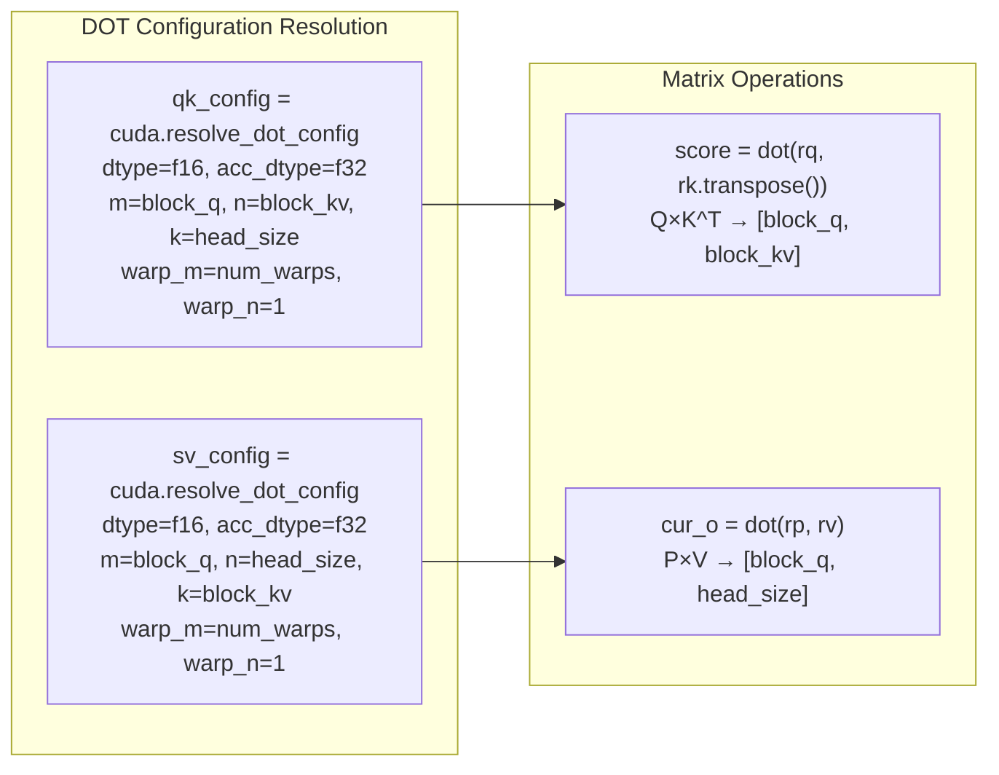
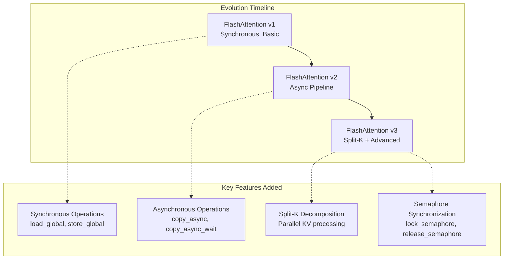

<!-- source: DeepWiki mcp.deepwiki.com · repo NVIDIA/tilus · page 5.2 FlashAttention Implementation · fetched 2026-10-26 -->

# FlashAttention Implementation

Relevant source files

The following files were used as context for generating this wiki page:

- [examples/attention/flash_attention_v1.py](examples/attention/flash_attention_v1.py)
- [examples/attention/flash_attention_v2.py](examples/attention/flash_attention_v2.py)
- [examples/attention/flash_attention_v3.py](examples/attention/flash_attention_v3.py)
- [python/tilus/extensions/hidet/transforms/hoist_loop_invariants.py](python/tilus/extensions/hidet/transforms/hoist_loop_invariants.py)

This page documents the FlashAttention implementation in Tilus, which serves as a sophisticated example of advanced GPU kernel programming using Tilus's memory hierarchy and optimization features. The FlashAttention algorithm demonstrates efficient attention computation for transformer models while managing GPU memory constraints through tiled computation and online algorithms.

For basic kernel programming concepts, see [Basic Matrix Multiplication](#5.1). For advanced optimization techniques like software pipelining, see [Advanced Optimization Techniques](#5.3).

## FlashAttention Class Architecture

The FlashAttention implementation is structured as a `tilus.Script` class with extensive autotuning capabilities. The class demonstrates the progression from simple to highly optimized implementations across three versions.

```mermaid
graph TB
    subgraph "FlashAttention Class Hierarchy"
        TilusScript["tilus.Script<br/>Base class"]
        FlashV1["FlashAttention v1<br/>Basic implementation"]
        FlashV2["FlashAttention v2<br/>With async copies"]
        FlashV3["FlashAttention v3<br/>Split-K optimization"]
    end
    
    subgraph "Autotuning Parameters"
        NumWarps["@autotune('num_warps')<br/>[2, 4, 8]"]
        BlockQ["@autotune('block_q')<br/>[32, 64, 128]"]
        BlockKV["@autotune('block_kv')<br/>[32, 64, 128]"]
        SplitKV["@autotune('split_kv')<br/>[-1, 512, 1024, 4096]"]
        KeepQInRegs["@autotune('keep_q_in_regs')<br/>[False, True]"]
    end
    
    subgraph "Core Methods"
        Init["__init__<br/>Configuration setup"]
        Call["__call__<br/>Kernel entry point"]
        MainLoop["main_loop<br/>Attention computation"]
        AttentionIter["attention_iteration<br/>Per-tile processing"]
        SoftmaxRescale["softmax_rescale<br/>Online softmax"]
        StoreBack["store_back<br/>Result handling"]
    end
    
    TilusScript --> FlashV1
    TilusScript --> FlashV2  
    TilusScript --> FlashV3
    
    NumWarps --> FlashV3
    BlockQ --> FlashV3
    BlockKV --> FlashV3
    SplitKV --> FlashV3
    KeepQInRegs --> FlashV3
    
    Init --> Call
    Call --> MainLoop
    MainLoop --> AttentionIter
    AttentionIter --> SoftmaxRescale
    Call --> StoreBack
```

Sources: [examples/attention/flash_attention_v3.py:25-47](), [examples/attention/flash_attention_v2.py:26-46](), [examples/attention/flash_attention_v1.py:20-46]()

## Memory Management Strategy

FlashAttention demonstrates sophisticated memory management using Tilus's three-tier memory hierarchy. The implementation carefully orchestrates data movement between global memory, shared memory, and registers to maximize performance.

Sources: [examples/attention/flash_attention_v3.py:175-179](), [examples/attention/flash_attention_v3.py:400-408](), [examples/attention/flash_attention_v3.py:260-264]()

## Asynchronous Memory Pipeline

The FlashAttention implementation uses sophisticated asynchronous memory operations to overlap computation with data movement, achieving high memory bandwidth utilization.

Sources: [examples/attention/flash_attention_v3.py:114-124](), [examples/attention/flash_attention_v3.py:133-143](), [examples/attention/flash_attention_v3.py:193-195]()

## Online Softmax Algorithm

The core innovation of FlashAttention is the online softmax algorithm that maintains running statistics to compute attention weights without materializing the full attention matrix.

Sources: [examples/attention/flash_attention_v3.py:84-93](), [examples/attention/flash_attention_v3.py:148-154]()

## Performance Optimizations

The FlashAttention implementation incorporates several advanced optimization techniques that demonstrate Tilus's capabilities for high-performance GPU programming.

| Optimization | Implementation | File Reference |
|--------------|----------------|----------------|
| **Autotuning** | Multiple parameter spaces for warps, block sizes, and split-K | [examples/attention/flash_attention_v3.py:20-24]() |
| **Split-K Decomposition** | Parallel processing of attention computation across K/V sequence | [examples/attention/flash_attention_v3.py:167-223]() |
| **Register Optimization** | `keep_q_in_regs` to avoid shared memory roundtrips | [examples/attention/flash_attention_v3.py:112-113](), [examples/attention/flash_attention_v3.py:189-191]() |
| **Async Memory Pipeline** | Overlapping computation with memory transfers | [examples/attention/flash_attention_v3.py:114-143]() |
| **Layout Annotations** | Explicit layout control for matrix operations | [examples/attention/flash_attention_v3.py:153]() |
| **Semaphore Synchronization** | Global synchronization for split-K reduction | [examples/attention/flash_attention_v3.py:299-364]() |

### Layout Configuration

The implementation uses CUDA-specific matrix multiplication configurations to optimize memory access patterns:

Sources: [examples/attention/flash_attention_v3.py:66-68](), [examples/attention/flash_attention_v2.py:49-67]()

## Implementation Variants

The codebase includes three progressively sophisticated implementations that demonstrate the evolution of optimization techniques:

### Version 1: Basic Implementation
- Simple tiled attention with synchronous memory operations
- Inline softmax computation without rescaling optimization
- Basic causal masking

### Version 2: Asynchronous Pipeline
- Introduction of `copy_async` operations for memory pipeline
- Separation of query loading and computation phases
- Improved memory bandwidth utilization

### Version 3: Advanced Optimizations
- Split-K decomposition for parallel processing
- Configurable register vs. shared memory usage
- Global synchronization with semaphores
- Complete async memory pipeline with prefetching

Sources: [examples/attention/flash_attention_v1.py:69-235](), [examples/attention/flash_attention_v2.py:164-311](), [examples/attention/flash_attention_v3.py:367-412]()

---

