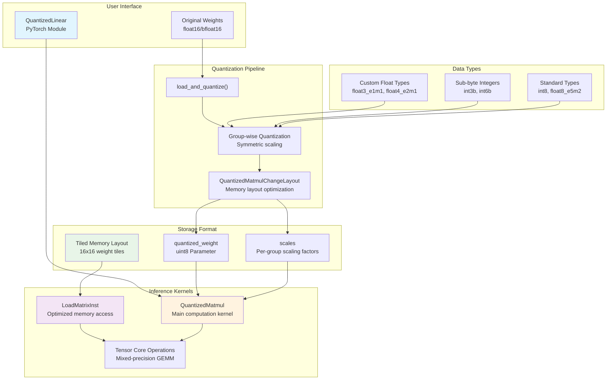
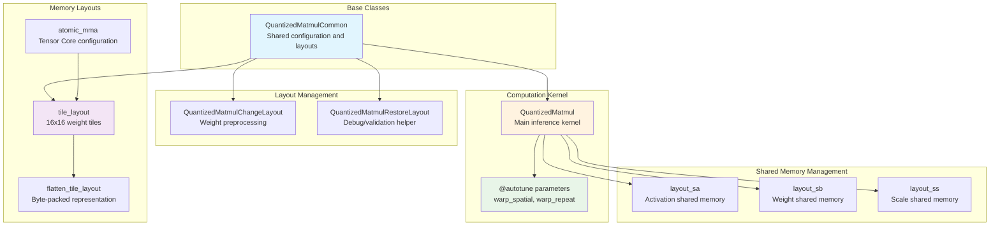
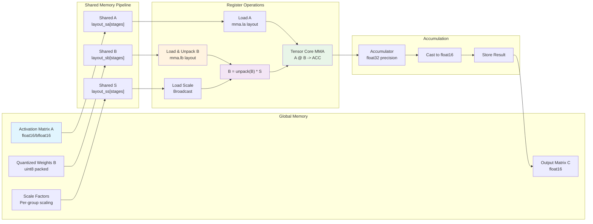
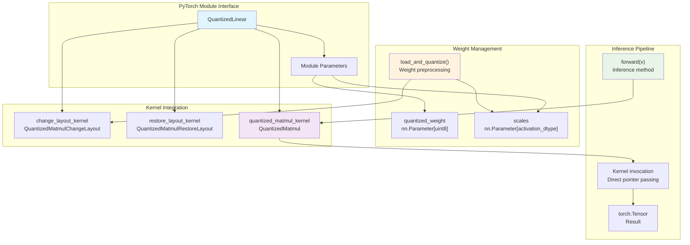

<!-- source: DeepWiki mcp.deepwiki.com · repo NVIDIA/tilus · page 5.3 Quantized Computing · fetched 2026-10-26 -->

# Quantized Computing

<details>
<summary>Relevant source files</summary>

The following files were used as context for generating this wiki page:

- [examples/quantization/matmul_a16wx.py](examples/quantization/matmul_a16wx.py)
- [python/tilus/extensions/hidet/transforms/lower_subbyte_type.py](python/tilus/extensions/hidet/transforms/lower_subbyte_type.py)

</details>


This document covers Tilus's support for low-precision quantized matrix operations, specifically the A16Wx quantization scheme where activations use 16-bit precision and weights use variable bit-width quantization (1-8 bits). The system enables efficient GPU kernels for quantized linear layers with group-wise symmetric quantization and custom data type support.

For general matrix multiplication techniques, see [Basic Matrix Multiplication](#5.1). For advanced optimization patterns, see [Advanced Optimization Techniques](#5.3).

## Overview

Tilus provides a complete quantized computing system built around the A16Wx quantization paradigm. The system supports activations in `float16` or `bfloat16` formats while enabling weights to use various low-precision formats ranging from 1 to 8 bits, including both integer and custom floating-point representations.

The quantized computing pipeline consists of three main operational phases: weight layout transformation for optimal memory access, quantized matrix multiplication with group-wise scaling, and integration with PyTorch through a high-level module interface.

**Quantized Computing System Architecture**



Sources: [examples/quantization/matmul_a16wx.py:33-440]()

## Quantization Schemes and Data Types

The quantized computing system supports symmetric quantization with group-wise scaling factors. Weights are quantized within configurable group sizes, with each group having its own scaling factor to maintain numerical precision across the weight matrix.

| Data Type | Bits | Type | Min Value | Max Value | Use Case |
|-----------|------|------|-----------|-----------|----------|
| `float8_e5m2` | 8 | Float | -57344 | 57344 | High precision weights |
| `float6_e3m2` | 6 | Float | -28 | 28 | Balanced precision/size |
| `float4_e2m1` | 4 | Float | -6 | 6 | Aggressive compression |
| `float3_e1m1` | 3 | Float | -2 | 2 | Ultra-low precision |
| `int8` | 8 | Integer | -128 | 127 | Standard quantization |
| `int6b` | 6 | Integer | -32 | 31 | Sub-byte integer |
| `int4b` | 4 | Integer | -8 | 7 | Popular 4-bit format |
| `int3b` | 3 | Integer | -4 | 3 | Extreme compression |

The quantization formula applies symmetric scaling per group:
```
quantized_value = clamp(weight / scale, min_value, max_value)
scale = max(abs(group_weights)) / max_quantized_value
```

Sources: [examples/quantization/matmul_a16wx.py:11-24](), [examples/quantization/matmul_a16wx.py:558-571](), [examples/quantization/matmul_a16wx.py:469-500]()

## Kernel Architecture

The quantized matrix multiplication system consists of four main kernel components that work together to provide efficient quantized inference.

**Kernel Component Relationships**



### QuantizedMatmulCommon Base Class

The `QuantizedMatmulCommon` class establishes shared configuration and memory layouts used across all quantized matrix multiplication kernels. It configures tensor core operations based on activation data type and calculates optimized memory access patterns for sub-byte weight data.

Key responsibilities include:
- Atomic MMA configuration selection (`m16n8k16_f16_f32` or `m16n8k16_bf16_f32`)
- Weight tile layout computation for 16x16 tiles
- Flattened byte layout for efficient sub-byte packing
- Bit-to-byte alignment validation

Sources: [examples/quantization/matmul_a16wx.py:33-66]()

### Layout Transformation Kernels

The `QuantizedMatmulChangeLayout` and `QuantizedMatmulRestoreLayout` kernels handle weight data layout transformations. The change layout kernel preprocesses weights from standard row-major format into an optimized tiled format that enables efficient memory coalescing during inference.

The transformation process:
1. Load weights in original layout using `tile_layout`
2. View as packed bytes using `flatten_tile_layout`
3. Store in tiled format for optimal access patterns

Sources: [examples/quantization/matmul_a16wx.py:68-135]()

### Main Computation Kernel

The `QuantizedMatmul` kernel implements the core quantized matrix multiplication with extensive autotuning support. It uses a multi-stage pipeline with async memory copies and software pipelining for optimal performance.

**Quantized GEMM Pipeline**



The kernel features:
- Multi-stage async pipeline with configurable `num_stages`
- Autotuned parameters: `warp_spatial`, `warp_repeat`, `split_k_factor`
- Group-wise scaling applied during computation
- Split-K reduction for large problem sizes
- Semaphore-based synchronization for split-K accumulation

Sources: [examples/quantization/matmul_a16wx.py:137-392]()

## Optimized Memory Access

The quantized computing system leverages specialized memory access patterns and the `LoadMatrixInst` for optimal performance on modern GPUs. The system automatically detects when shared memory loads can be lowered to efficient `ldmatrix` instructions.

### LoadMatrix Optimization

The `LowerToLoadMatrixPass` analyzes memory access patterns and converts eligible `LoadSharedInst` operations to `LoadMatrixInst` when specific conditions are met:

1. **Data Type Compatibility**: Register tensor must use supported data types
2. **Layout Divisibility**: Register layout must be divisible by `ldmatrix_layout`
3. **Memory Alignment**: Shared memory addresses must be 16-byte aligned
4. **Contiguity**: Memory rows must be contiguous for efficient vectorized access

**LoadMatrix Configuration Matrix**

| nbytes | trans | ldmatrix_layout | Description |
|--------|-------|-----------------|-------------|
| 1 | false | `spatial(8,4).local(1,4)` | 1-byte elements, 4 elements per thread |
| 2 | false | `spatial(8,4).local(1,2)` | 2-byte elements, 2 elements per thread |
| 4 | false | `spatial(8,4)` | 4-byte elements, 1 element per thread |
| 2 | true | `column_spatial(4,8).local(2,1)` | Transposed 2-byte access |

The transformation analyzes memory access patterns using grid analysis to determine alignment and contiguity properties, enabling automatic optimization of quantized weight loading operations.

Sources: [python/tilus/transforms/lower_to_load_matrix.py:46-124](), [python/tilus/ir/instructions/cuda/ldmatrix.py:50-64]()

## PyTorch Integration

The `QuantizedLinear` module provides seamless integration with PyTorch, encapsulating the entire quantized inference pipeline in a familiar `nn.Module` interface.

**QuantizedLinear Architecture**



### Weight Quantization Process

The `load_and_quantize` method implements the complete weight preprocessing pipeline:

1. **Shape Transformation**: Convert weights from `[out_features, in_features]` to `[in_features, out_features]`
2. **Group Reshaping**: Reorganize into `[in_features//group_size, group_size, out_features]`
3. **Scale Computation**: Calculate per-group maximum absolute values and scaling factors
4. **Quantization**: Apply scaling and clamp to target data type range
5. **Layout Transformation**: Convert to optimized memory layout using `change_layout_kernel`

The quantization maintains numerical precision through symmetric scaling while achieving significant memory reduction through low-precision weight representation.

### Runtime Inference

The `forward` method provides efficient inference through direct kernel invocation:
- Zero-copy tensor data access via `data_ptr()`
- Direct GPU memory pointer passing to Tilus kernels
- Automatic output tensor allocation with proper device placement
- Integration with PyTorch's autograd system (gradients disabled for quantized weights)

Sources: [examples/quantization/matmul_a16wx.py:394-534]()

## Performance Characteristics

The quantized computing system demonstrates significant memory savings and competitive performance across various precision levels. The implementation supports problem sizes from small batch inference (m=1) to large training workloads (m=4096+) with automatic performance optimization through autotuning.

Benchmark results show effective utilization of GPU tensor cores with custom data types, achieving high throughput for quantized inference workloads while maintaining acceptable numerical accuracy through group-wise symmetric quantization.

Sources: [examples/quantization/matmul_a16wx.py:537-612]()

---

