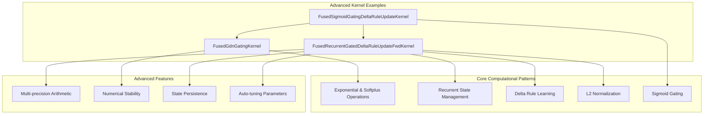
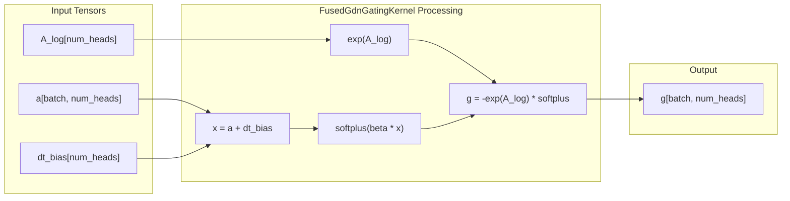
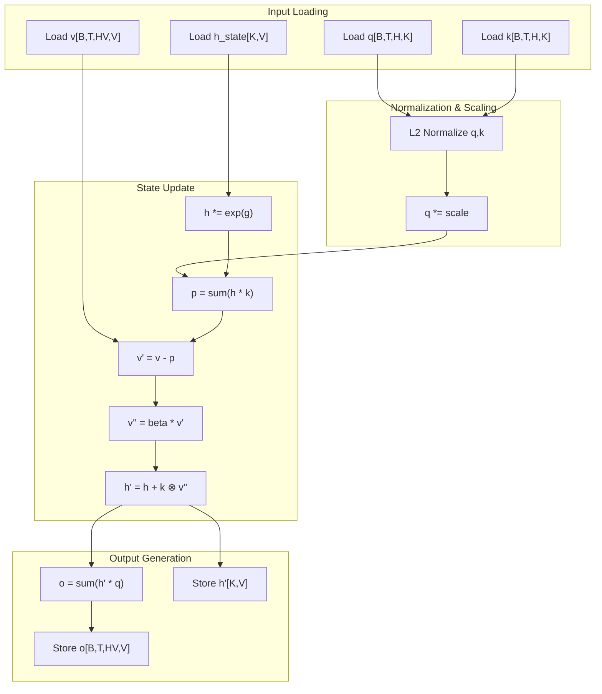
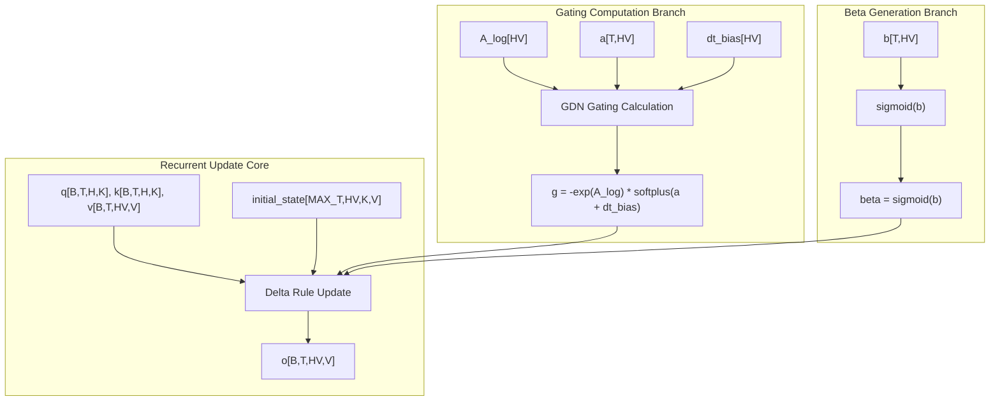
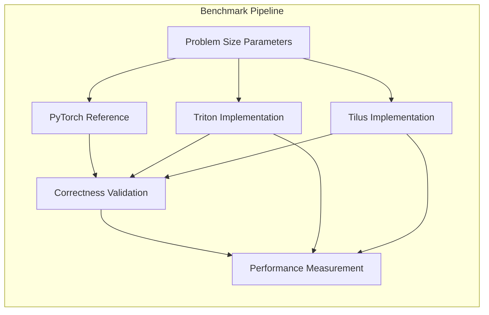

<!-- source: DeepWiki mcp.deepwiki.com · repo NVIDIA/tilus · page 5.4 Advanced Kernel Examples · fetched 2026-10-26 -->

# Advanced Kernel Examples

Relevant source files

The following files were used as context for generating this wiki page:

- [examples/flash_attention_decode/main.py](examples/flash_attention_decode/main.py)
- [examples/flash_attention_decode/tilus_kernel.py](examples/flash_attention_decode/tilus_kernel.py)
- [examples/flash_attention_decode/torch_kernel.py](examples/flash_attention_decode/torch_kernel.py)
- [examples/flash_attention_decode/triton_kernel.py](examples/flash_attention_decode/triton_kernel.py)
- [python/tilus/ir/layout/inference/__init__.py](python/tilus/ir/layout/inference/__init__.py)

This section demonstrates sophisticated GPU kernel implementations that showcase advanced Tilus features including recurrent computations, complex gating mechanisms, and stateful operations. These examples go beyond basic matrix operations to illustrate real-world neural network components with intricate data flow patterns and numerical stability requirements.

For basic matrix multiplication tutorials, see [Basic Matrix Multiplication](#5.1). For attention mechanism implementations, see [FlashAttention Implementation](#5.2). For quantization techniques, see [Quantized Computing](#5.3).

## Overview of Advanced Examples

The advanced kernel examples focus on recurrent neural network operations that combine multiple computational patterns within single, highly optimized kernels. These implementations demonstrate Tilus's capability to handle complex control flow, persistent state management, and multi-precision arithmetic.

**Sources:** [examples/flash_attention_decode/tilus_kernel.py:12-431](), [examples/flash_attention_decode/main.py:23-274]()

## Fused GDN Gating Kernel

The `FusedGdnGatingKernel` implements a gating computation that combines exponential decay with softplus activation, commonly used in gated neural network architectures. The kernel computes: `g = -exp(A_log) * softplus(a + dt_bias)` with numerical stability optimizations.

The kernel uses block-level parallelization with configurable `block_heads` parameter and implements numerical stability through conditional softplus evaluation. The implementation handles both 2D and 3D input tensors dynamically.

**Sources:** [examples/flash_attention_decode/tilus_kernel.py:12-75](), [examples/flash_attention_decode/torch_kernel.py:6-42]()

## Fused Recurrent Gated Delta Rule Update

The `FusedRecurrentGatedDeltaRuleUpdateFwdKernel` implements a complex recurrent operation that combines exponential gating, delta rule learning, and state persistence. This kernel demonstrates advanced state management and multi-head processing capabilities.

### Computational Flow

The kernel operates on tensor blocks with configurable `BV` parameter for value dimension blocking and supports multi-head attention patterns with head broadcasting. State management includes initial state loading and final state persistence through `initial_state_source` and `initial_state_indices` tensors.

**Sources:** [examples/flash_attention_decode/tilus_kernel.py:77-194](), [examples/flash_attention_decode/torch_kernel.py:45-135]()

### Key Implementation Features

| Feature | Description | Tilus Implementation |
|---------|-------------|---------------------|
| **Multi-head Broadcasting** | Maps `HV` heads to `H` query/key heads | `i_h = i_hv // (HV // H)` |
| **L2 Normalization** | Optional query/key normalization | `USE_QK_L2NORM_IN_KERNEL` flag |
| **State Persistence** | Maintains hidden state across timesteps | `initial_state_source` tensor |
| **Auto-tuning** | Optimizes warp count and block size | `@tilus.autotune` decorators |
| **Mixed Precision** | Uses `float32` for computation, `bfloat16` for I/O | Type conversions in kernel |

## Sigmoid Gating Delta Rule Update

The `FusedSigmoidGatingDeltaRuleUpdateKernel` combines the previous two kernels into a single, fully-fused operation. This demonstrates Tilus's ability to merge complex computational graphs for optimal performance.

### Fused Operation Architecture

This fused kernel eliminates intermediate tensor storage and memory bandwidth overhead by computing all operations within a single GPU kernel launch. The fusion pattern demonstrates advanced kernel composition techniques.

**Sources:** [examples/flash_attention_decode/tilus_kernel.py:282-431](), [examples/flash_attention_decode/triton_kernel.py:257-293]()

## Multi-Framework Implementation Comparison

The advanced examples provide implementations across three frameworks to demonstrate performance characteristics and implementation complexity differences.

### Framework Comparison Matrix

| Aspect | Tilus | Triton | PyTorch |
|--------|-------|--------|---------|
| **Kernel Definition** | `@tilus.autotune` class-based | `@triton.jit` function-based | Pure Python functions |
| **Memory Management** | `global_view`, `register_tensor` | Pointer arithmetic | Automatic tensor operations |
| **Auto-tuning** | Built-in parameter search | Manual heuristics | Not applicable |
| **Type System** | Explicit dtype annotations | Runtime type inference | Dynamic typing |
| **Performance** | Optimized for target hardware | Good GPU utilization | CPU reference only |

### Performance Benchmarking

The examples include comprehensive benchmarking infrastructure that compares implementations across varying problem sizes and validates numerical correctness.

**Sources:** [examples/flash_attention_decode/main.py:23-274](), [examples/flash_attention_decode/main.py:78-91]()

## Advanced Auto-tuning Features

The kernels demonstrate sophisticated auto-tuning capabilities that optimize multiple parameters simultaneously for different hardware configurations.

### Auto-tuning Parameter Space

| Kernel | Tuned Parameters | Search Space | Impact |
|--------|------------------|--------------|---------|
| **FusedGdnGatingKernel** | `num_warps`, `block_heads` | `[1]`, `[4]` | Thread block utilization |
| **FusedRecurrentGatedDeltaRuleUpdateFwdKernel** | `num_warps`, `BV` | `[1,2,4]`, `[2,4,8,16,32,64,128]` | Memory coalescing |
| **FusedSigmoidGatingDeltaRuleUpdateKernel** | `num_warps`, `BV` | `[1,2,4]`, `[2,4,8,16,32,64,128]` | Register pressure optimization |

The auto-tuning system explores the parameter space systematically and caches optimal configurations for different problem sizes and hardware targets.

**Sources:** [examples/flash_attention_decode/tilus_kernel.py:12-13](), [examples/flash_attention_decode/tilus_kernel.py:77-78](), [examples/flash_attention_decode/tilus_kernel.py:282-283]()

---

