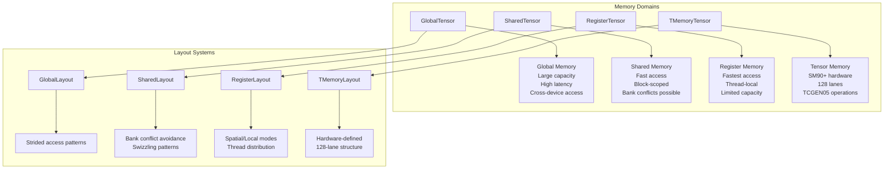
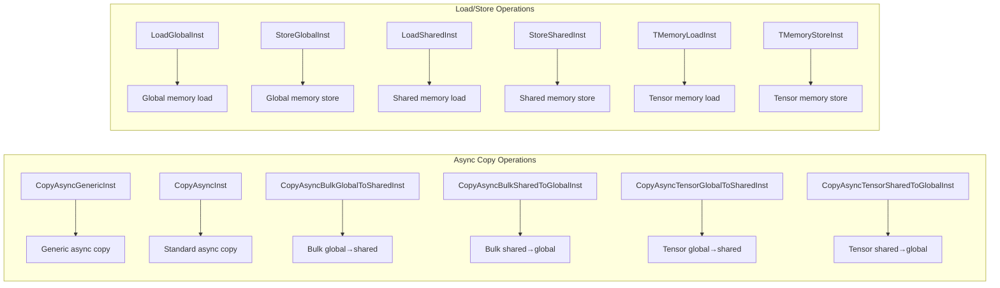
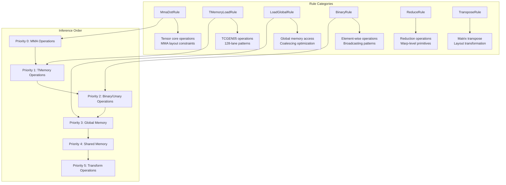
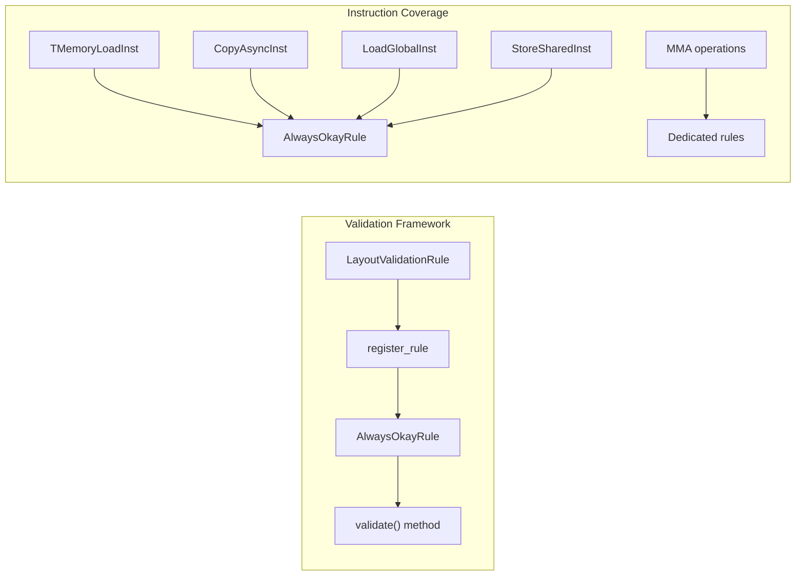
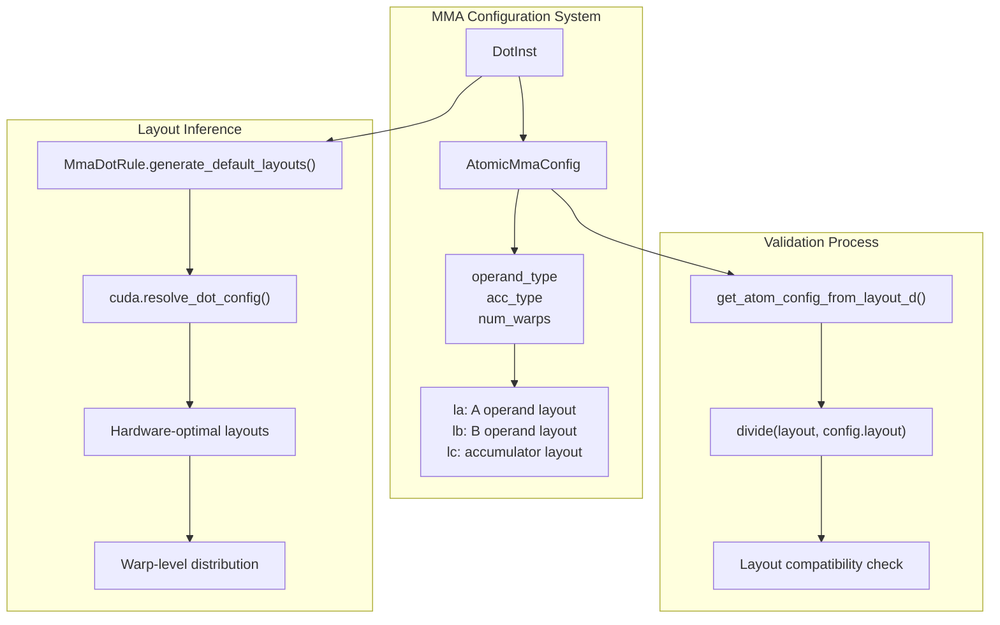
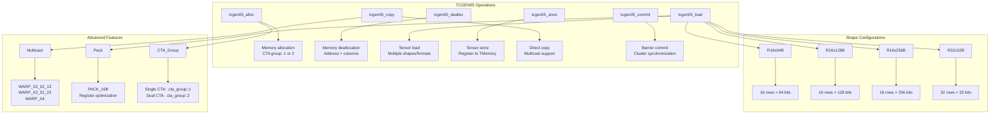
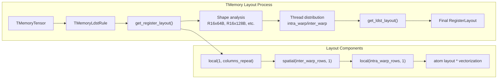
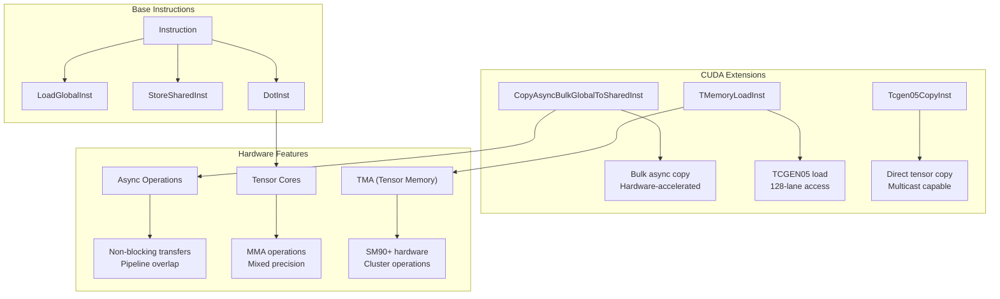
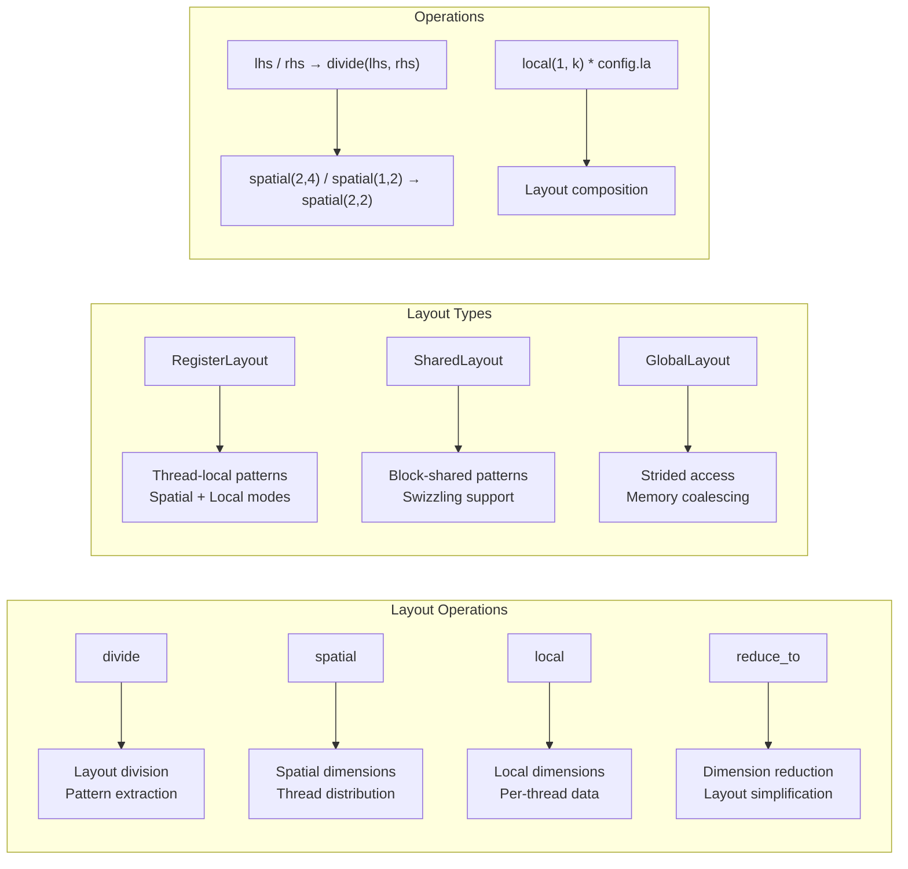

<!-- source: DeepWiki mcp.deepwiki.com · repo NVIDIA/tilus · page 6 GPU Programming Features · fetched 2026-10-26 -->

# GPU Programming Features

Relevant source files

The following files were used as context for generating this wiki page:

- [python/tilus/extensions/hidet/ir/primitives/cuda/tcgen05.py](python/tilus/extensions/hidet/ir/primitives/cuda/tcgen05.py)
- [python/tilus/ir/instructions/cuda/tmem.py](python/tilus/ir/instructions/cuda/tmem.py)
- [python/tilus/ir/layout/inference/inference_rules/__init__.py](python/tilus/ir/layout/inference/inference_rules/__init__.py)
- [python/tilus/ir/layout/inference/inference_rules/mma_dot.py](python/tilus/ir/layout/inference/inference_rules/mma_dot.py)
- [python/tilus/ir/layout/inference/inference_rules/tmem_ldst.py](python/tilus/ir/layout/inference/inference_rules/tmem_ldst.py)
- [python/tilus/ir/layout/inference/order.py](python/tilus/ir/layout/inference/order.py)
- [python/tilus/ir/layout/inference/validation_rules/always_ok.py](python/tilus/ir/layout/inference/validation_rules/always_ok.py)
- [tests/ir/layout/register_layout/test_layout_divide.py](tests/ir/layout/register_layout/test_layout_divide.py)

This document covers the GPU-specific programming features and optimizations available in Tilus. It focuses on the low-level primitives, memory management, instruction system, and layout inference that enable efficient GPU kernel development. For high-level kernel programming patterns, see [Programming Guide](#5). For memory layout specifics, see [Memory Layout System](#6.1). For instruction implementation details, see [Instruction System](#6.2).

## Memory Hierarchy and Tensor Types

Tilus provides explicit support for the GPU memory hierarchy through distinct tensor types that correspond to different memory spaces. Each tensor type has specific characteristics and usage patterns optimized for its memory domain.

### Tensor Type System

**Memory Hierarchy Architecture**

Sources: [python/tilus/ir/tensor.py](), [python/tilus/ir/layout/](), [python/tilus/ir/instructions/cuda/tmem.py:24-25]()

### Memory Operations and Data Movement

The system provides optimized operations for moving data between memory hierarchies:

**Memory Operation Instruction Types**

Sources: [python/tilus/ir/layout/inference/validation_rules/always_ok.py:15-43](), [python/tilus/ir/instructions/cuda/tmem.py:89-114]()

## Layout Inference System

Tilus employs a sophisticated layout inference system that automatically determines optimal memory layouts for tensors based on their usage patterns and hardware constraints.

### Layout Inference Rules Architecture

**Layout Inference Priority System**

The inference system processes rules in a specific order to ensure hardware constraints are satisfied first, followed by optimization opportunities.

Sources: [python/tilus/ir/layout/inference/order.py:42-61](), [python/tilus/ir/layout/inference/inference_rules/]()

### Validation Rules System

**Layout Validation Architecture**

Sources: [python/tilus/ir/layout/inference/validation_rules/always_ok.py:47-82]()

## CUDA-Specific Hardware Primitives

Tilus provides direct access to CUDA hardware primitives for maximum performance, particularly on modern GPU architectures.

### Tensor Core (MMA) Operations

**MMA Operation Configuration**

Sources: [python/tilus/ir/layout/inference/inference_rules/mma_dot.py:23-98](), [python/tilus/ir/instructions/cuda/mma_dot.py]()

### TCGEN05 Tensor Memory Operations

TCGEN05 provides advanced tensor memory capabilities on SM90+ hardware:

**TCGEN05 Hardware Primitive System**

Sources: [python/tilus/extensions/hidet/ir/primitives/cuda/tcgen05.py:27-498]()

### TMemory Layout Inference

**TMemory Layout Inference Process**

Sources: [python/tilus/ir/layout/inference/inference_rules/tmem_ldst.py:29-109]()

## Instruction System Architecture

The instruction system provides a hierarchical organization of GPU operations, from generic memory operations to hardware-specific primitives.

### Instruction Hierarchy

| Instruction Category | Examples | Purpose |
|---------------------|----------|---------|
| Memory Allocation | `AllocateSharedInst`, `TMemoryAllocInst` | Resource management |
| Data Movement | `LoadGlobalInst`, `StoreSharedInst`, `CopyAsyncInst` | Memory hierarchy operations |
| Compute Operations | `DotInst`, MMA instructions | Mathematical computations |
| Hardware Primitives | TCGEN05 instructions, barriers | Low-level hardware access |
| Control Flow | Synchronization, barriers | Thread coordination |

### CUDA-Specific Instruction Extensions

**CUDA Instruction Extension Architecture**

Sources: [python/tilus/ir/instructions/](), [python/tilus/ir/instructions/cuda/]()

## Layout Operation Framework

Tilus provides a comprehensive set of layout operations for manipulating tensor memory patterns.

### Core Layout Operations

**Layout Operation System**

Sources: [tests/ir/layout/register_layout/test_layout_divide.py:19-36](), [python/tilus/ir/layout/ops.py]()

## Performance Optimization Features

### Hardware-Aware Optimizations

1. **Memory Coalescing**: Automatic layout inference ensures optimal global memory access patterns
2. **Bank Conflict Avoidance**: Shared memory layouts use swizzling to minimize bank conflicts  
3. **Tensor Core Utilization**: MMA operations automatically select optimal tensor core configurations
4. **Async Pipeline**: Non-blocking memory transfers enable computation/communication overlap
5. **Register Optimization**: Layout system minimizes register pressure through efficient data distribution

### Target-Specific Features

| GPU Architecture | Supported Features |
|-----------------|-------------------|
| SM80 | Tensor cores, async copy, shared memory optimization |
| SM90 | All SM80 features + TCGEN05, tensor memory, cluster operations |
| Future architectures | Extensible through target system |

The GPU programming features in Tilus provide a comprehensive foundation for implementing high-performance GPU kernels while maintaining code clarity and optimization opportunities through automatic layout inference and hardware-specific primitive access.

Sources: [python/tilus/ir/layout/](), [python/tilus/ir/instructions/](), [python/tilus/extensions/hidet/ir/primitives/cuda/]()

---

