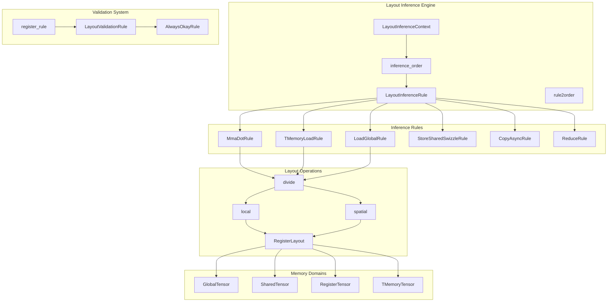
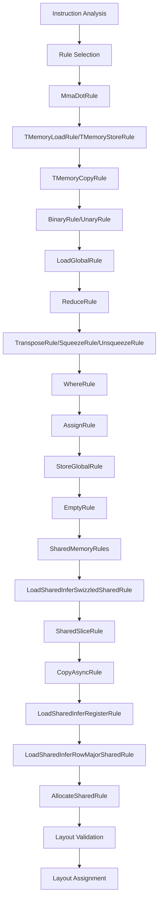
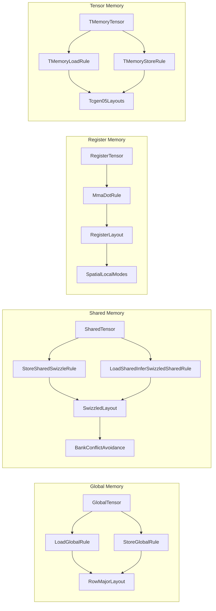
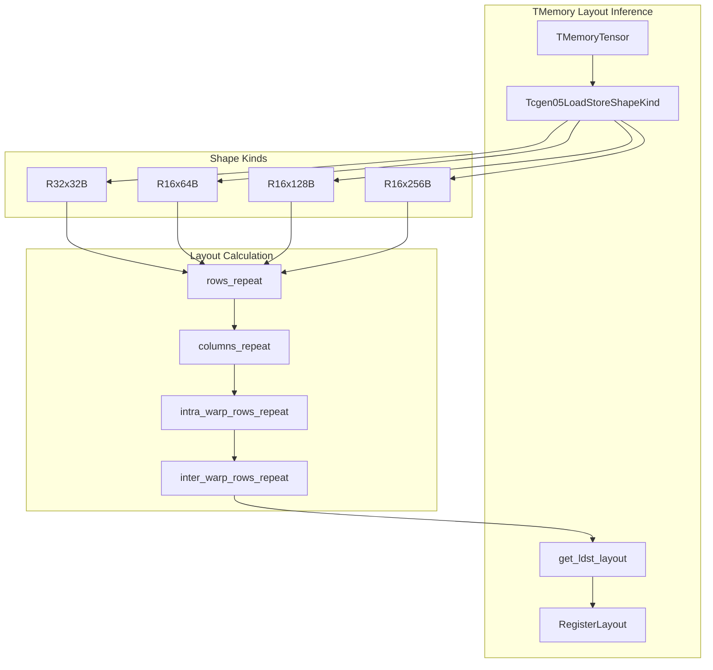
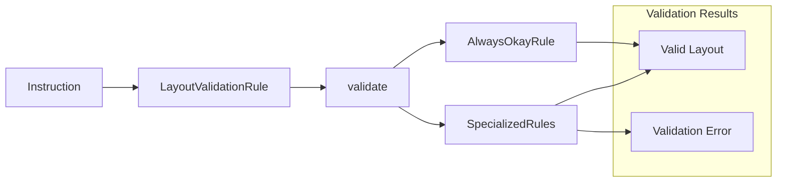

<!-- source: DeepWiki mcp.deepwiki.com · repo NVIDIA/tilus · page 6.1 Memory Layout System · fetched 2026-10-26 -->

# Memory Layout System

<details>
<summary>Relevant source files</summary>

The following files were used as context for generating this wiki page:

- [python/tilus/extensions/hidet/ir/primitives/cuda/tcgen05.py](python/tilus/extensions/hidet/ir/primitives/cuda/tcgen05.py)
- [python/tilus/ir/instructions/cuda/tmem.py](python/tilus/ir/instructions/cuda/tmem.py)
- [python/tilus/ir/layout/inference/inference_rules/__init__.py](python/tilus/ir/layout/inference/inference_rules/__init__.py)
- [python/tilus/ir/layout/inference/inference_rules/mma_dot.py](python/tilus/ir/layout/inference/inference_rules/mma_dot.py)
- [python/tilus/ir/layout/inference/inference_rules/tmem_ldst.py](python/tilus/ir/layout/inference/inference_rules/tmem_ldst.py)
- [python/tilus/ir/layout/inference/order.py](python/tilus/ir/layout/inference/order.py)
- [python/tilus/ir/layout/inference/validation_rules/always_ok.py](python/tilus/ir/layout/inference/validation_rules/always_ok.py)
- [tests/ir/layout/register_layout/test_layout_divide.py](tests/ir/layout/register_layout/test_layout_divide.py)

</details>


## Purpose and Scope

The Memory Layout System is Tilus's sophisticated framework for inferring, validating, and optimizing memory access patterns across GPU memory hierarchies. This system automatically determines optimal data layouts for tensors stored in different memory domains (global, shared, register, and tensor memory) to maximize performance while ensuring correctness.

The system handles layout inference through a rule-based approach that considers hardware constraints, memory access patterns, and instruction requirements. For information about the broader compilation pipeline that uses these layouts, see [Compilation Pipeline](#4). For details about tensor types and memory domains, see [Memory Model and Tensor Types](#3.3).

## System Architecture

The Memory Layout System consists of several interconnected components that work together to optimize memory access patterns:



**Sources:** [python/tilus/ir/layout/inference/order.py:42-61](), [python/tilus/ir/layout/inference/rule.py](), [python/tilus/ir/layout/inference/validation_rules/always_ok.py:71-74]()

## Layout Inference Pipeline

The layout inference process follows a carefully orchestrated sequence of rules applied in priority order:



**Sources:** [python/tilus/ir/layout/inference/order.py:42-61](), [python/tilus/ir/layout/inference/inference_rules/__init__.py:15-33]()

## Memory Domain Layout Specialization

Different memory domains require specialized layout handling based on their hardware characteristics:



**Sources:** [python/tilus/ir/layout/inference/inference_rules/ldst_global.py](), [python/tilus/ir/layout/inference/inference_rules/store_shared.py](), [python/tilus/ir/layout/inference/inference_rules/tmem_ldst.py:29-110]()

## MMA Layout Inference

The MMA (Matrix Multiply Accumulate) instruction requires sophisticated layout inference to ensure optimal tensor core utilization:

| Component | Purpose | Implementation |
|-----------|---------|----------------|
| `AtomicMmaConfig` | Defines MMA instruction layouts | Hardware-specific configurations |
| `generate_default_layouts` | Creates default MMA layouts | Based on tensor shapes and warp count |
| `get_atom_config_from_layout_d` | Infers config from output layout | Validates layout compatibility |
| Layout Division | Computes outer layouts | Uses `divide` operation for layout decomposition |

**Sources:** [python/tilus/ir/layout/inference/inference_rules/mma_dot.py:24-98]()

## Tensor Memory Layout System

Tensor Memory (TMemory) introduces hardware-accelerated memory operations that require specialized layout handling:



**Sources:** [python/tilus/ir/layout/inference/inference_rules/tmem_ldst.py:31-64](), [python/tilus/extensions/hidet/ir/primitives/cuda/tcgen05.py:42-83]()

## Layout Operations

The layout system provides fundamental operations for manipulating and combining layouts:

### Layout Division

The `divide` operation is central to layout inference, allowing decomposition of complex layouts:

```python
# Examples from test cases:
spatial(2, 4) / spatial(1, 2) = spatial(2, 2)
spatial(2, 4).local(2, 1) / local(2, 1) = spatial(2, 4)
spatial(32, 1).local(1, 32) / spatial(32, 1) = local(1, 32)
```

### Spatial and Local Modes

| Mode | Purpose | Usage |
|------|---------|-------|
| `spatial` | Inter-thread layout | Distributes data across threads |
| `local` | Intra-thread layout | Organizes data within each thread |

**Sources:** [tests/ir/layout/register_layout/test_layout_divide.py:19-36](), [python/tilus/ir/layout/ops.py]()

## Validation System

The layout validation system ensures that inferred layouts are compatible with hardware constraints:



The current implementation includes temporary fallback rules for instructions that don't yet have specialized validation:

| Instruction Type | Validation Rule | Status |
|------------------|----------------|---------|
| `TMemoryLoadInst` | `AlwaysOkayRule` | Temporary (needs dedicated rule) |
| `CopyAsyncInst` | `AlwaysOkayRule` | Temporary (needs dedicated rule) |
| `LoadGlobalInst` | `AlwaysOkayRule` | Validated |
| `StoreSharedInst` | `AlwaysOkayRule` | Validated |

**Sources:** [python/tilus/ir/layout/inference/validation_rules/always_ok.py:47-82]()

## CUDA Hardware Integration

The layout system integrates tightly with CUDA hardware features, particularly for SM90+ architectures:

### Tcgen05 Instructions

The system supports advanced CUDA instructions for tensor memory operations:

| Instruction Family | Purpose | Layout Requirements |
|-------------------|---------|-------------------|
| `tcgen05.ld` | Tensor memory load | Specific shape and alignment |
| `tcgen05.st` | Tensor memory store | Compatible register layouts |
| `tcgen05.cp` | Tensor memory copy | Descriptor-based addressing |

### Memory Descriptors

Tensor memory operations use hardware descriptors that encode layout information:

```python
# Descriptor encoding includes:
# - smem_addr: 14 bits
# - lbo (leading batch offset): 14 bits  
# - sbo (stride batch offset): 14 bits
# - mbo (major batch offset): 3 bits
# - stride_mode: 1 bit
# - swizzle_mode: 3 bits
```

**Sources:** [python/tilus/extensions/hidet/ir/primitives/cuda/tcgen05.py:394-412](), [python/tilus/ir/instructions/cuda/tmem.py:27-141]()

## Layout Inference Context

The `LayoutInferenceContext` provides essential information for layout decisions:

| Context Information | Purpose | Usage |
|--------------------|---------|-------|
| `num_threads` | Total thread count | Determines parallelism level |
| `thread_begin/end` | Thread range | Maps to hardware lanes |
| Target architecture | Hardware capabilities | Selects appropriate layouts |

**Sources:** [python/tilus/ir/layout/inference/rule.py](), [python/tilus/ir/layout/inference/inference_rules/tmem_ldst.py:67-110]()

---

