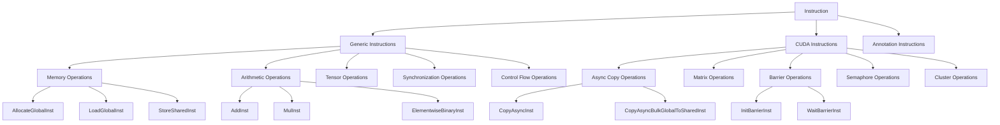
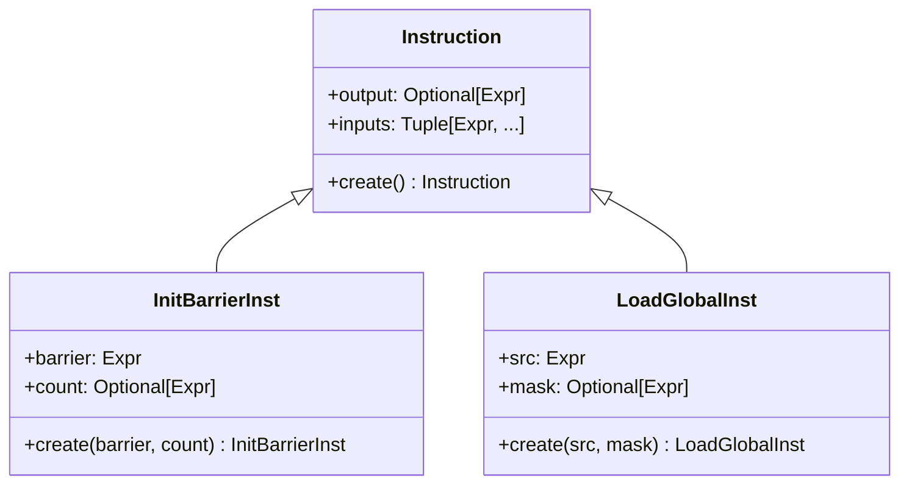
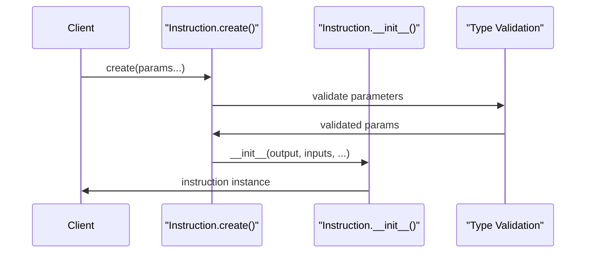
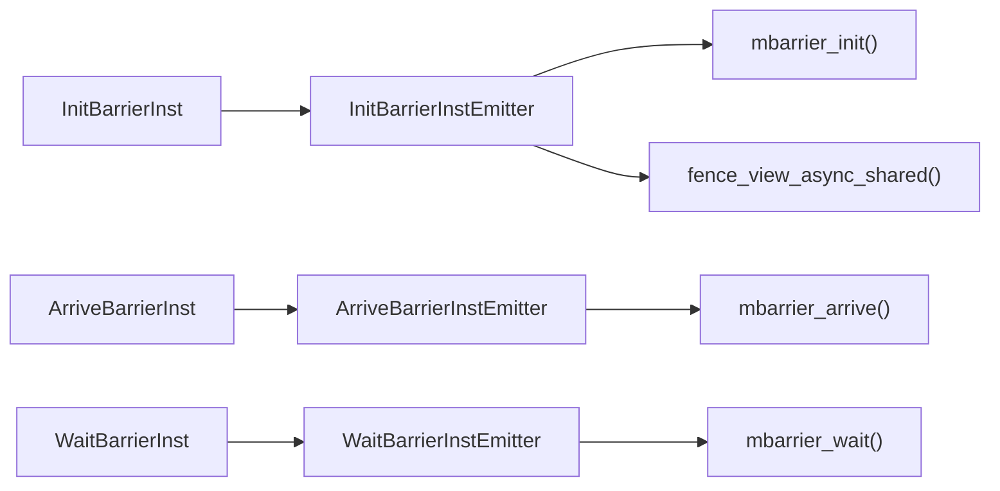

<!-- source: DeepWiki mcp.deepwiki.com · repo NVIDIA/tilus · page 6.2 Instruction System · fetched 2026-10-26 -->

# Instruction System

<details>
<summary>Relevant source files</summary>

The following files were used as context for generating this wiki page:

- [python/tilus/backends/emitters/cuda/mbarrier.py](python/tilus/backends/emitters/cuda/mbarrier.py)
- [python/tilus/ir/instructions/__init__.py](python/tilus/ir/instructions/__init__.py)
- [python/tilus/ir/instructions/cuda/__init__.py](python/tilus/ir/instructions/cuda/__init__.py)
- [python/tilus/ir/instructions/cuda/mbarrier.py](python/tilus/ir/instructions/cuda/mbarrier.py)
- [python/tilus/testing/__init__.py](python/tilus/testing/__init__.py)
- [scripts/sign-commits.sh](scripts/sign-commits.sh)
- [tests/lang/test_blocks_per_cluster.py](tests/lang/test_blocks_per_cluster.py)

</details>


The Instruction System forms the core operational layer of Tilus's intermediate representation (IR), providing a comprehensive set of low-level operations that can be executed on GPU hardware. This system defines atomic operations for memory management, data movement, computation, synchronization, and hardware-specific primitives, serving as the bridge between high-level script constructs and target-specific code generation.

For information about the broader IR framework including functions and statements, see [Intermediate Representation](#4.2). For details on how instructions are compiled to target code, see [Code Generation and Backend](#4.3).

## Instruction Hierarchy

The instruction system is built around a base `Instruction` class with specialized implementations for different operation categories and hardware targets.



Sources: [python/tilus/ir/instructions/__init__.py:15-79]()

## Base Instruction Structure

All instructions inherit from the base `Instruction` class and follow a consistent pattern:

- **Dataclass Design**: Instructions are immutable dataclasses with `frozen=True, eq=False`
- **Factory Methods**: Each instruction provides a static `create` method for construction
- **Input/Output Tracking**: Instructions maintain references to their inputs and outputs
- **Type Safety**: Strong typing for all instruction parameters



Sources: [python/tilus/ir/instructions/cuda/mbarrier.py:26-33]()

## Generic Instructions

Generic instructions provide fundamental operations that work across all GPU targets.

### Memory Management Instructions

| Instruction | Purpose | Key Parameters |
|-------------|---------|----------------|
| `AllocateGlobalInst` | Allocate global memory tensor | `shape`, `dtype`, `layout` |
| `AllocateSharedInst` | Allocate shared memory tensor | `shape`, `dtype`, `layout` |
| `AllocateRegisterInst` | Allocate register memory tensor | `shape`, `dtype`, `layout` |
| `FreeSharedInst` | Free shared memory allocation | `tensor` |

### Load/Store Instructions

| Instruction | Purpose | Memory Type |
|-------------|---------|-------------|
| `LoadGlobalInst` | Load from global memory | Global |
| `LoadSharedInst` | Load from shared memory | Shared |
| `LoadGlobalGenericInst` | Generic global load with vectorization | Global |
| `LoadSharedGenericInst` | Generic shared load with vectorization | Shared |
| `StoreGlobalInst` | Store to global memory | Global |
| `StoreSharedInst` | Store to shared memory | Shared |
| `StoreGlobalGenericInst` | Generic global store with vectorization | Global |
| `StoreSharedGenericInst` | Generic shared store with vectorization | Shared |

### Arithmetic Instructions

| Instruction | Operation | Type |
|-------------|-----------|------|
| `AddInst` | Element-wise addition | Binary |
| `SubInst` | Element-wise subtraction | Binary |
| `MulInst` | Element-wise multiplication | Binary |
| `DivInst` | Element-wise division | Binary |
| `ModInst` | Element-wise modulo | Binary |
| `ElementwiseBinaryInst` | Generic binary operation | Binary |
| `ElementwiseUnaryInst` | Generic unary operation | Unary |

### Tensor Manipulation Instructions

| Instruction | Purpose |
|-------------|---------|
| `ViewInst` | Reshape tensor without data movement |
| `TransposeInst` | Transpose tensor dimensions |
| `SqueezeInst` | Remove singleton dimensions |
| `UnsqueezeInst` | Add singleton dimensions |
| `RepeatInst` | Repeat tensor along dimensions |
| `RepeatInterleaveInst` | Interleave tensor repetitions |
| `GlobalSliceInst` | Slice global memory tensor |
| `SharedSliceInst` | Slice shared memory tensor |
| `GlobalViewInst` | Create view of global memory tensor |

Sources: [python/tilus/ir/instructions/__init__.py:37-79]()

## CUDA-Specific Instructions

CUDA instructions provide access to hardware-specific features and optimizations.

```mermaid
graph TD
    A["CUDA Instructions"] --> B["Async Copy"]
    A --> C["Matrix Operations"]  
    A --> D["Synchronization"]
    A --> E["Cluster Operations"]
    
    B --> F["CopyAsyncInst"]
    B --> G["CopyAsyncGenericInst"]
    B --> H["CopyAsyncBulkGlobalToSharedInst"]
    B --> I["CopyAsyncBulkSharedToGlobalInst"]
    B --> J["CopyAsyncCommitGroupInst"]
    B --> K["CopyAsyncWaitGroupInst"]
    
    C --> L["LoadMatrixInst"]
    C --> M["DotInst"]
    C --> N["SimtDotInst"]
    
    D --> O["InitBarrierInst"]
    D --> P["ArriveBarrierInst"]
    D --> Q["WaitBarrierInst"]
    D --> R["LockSemaphoreInst"]
    D --> S["ReleaseSemaphoreInst"]
    
    E --> T["ClusterSyncThreadsInst"]
    E --> U["ArriveRemoteBarrierInst"]
```



### Asynchronous Copy Instructions

The async copy system enables efficient data movement with hardware acceleration:

| Instruction | Purpose | Hardware Requirement |
|-------------|---------|---------------------|
| `CopyAsyncInst` | Basic async copy operation | SM80+ |
| `CopyAsyncGenericInst` | Generic async copy with vectorization | SM80+ |
| `CopyAsyncBulkGlobalToSharedInst` | Bulk transfer global→shared | SM90+ |
| `CopyAsyncBulkSharedToGlobalInst` | Bulk transfer shared→global | SM90+ |
| `CopyAsyncBulkGlobalToClusterSharedInst` | Bulk transfer global→cluster shared | SM90+ |
| `CopyAsyncBulkSharedToClusterSharedInst` | Bulk transfer shared→cluster shared | SM90+ |
| `CopyAsyncCommitGroupInst` | Commit async copy group | SM80+ |
| `CopyAsyncWaitGroupInst` | Wait for async copy group | SM80+ |
| `CopyAsyncWaitAllInst` | Wait for all async copies | SM80+ |

### Matrix Operation Instructions

| Instruction | Purpose | Hardware |
|-------------|---------|----------|
| `LoadMatrixInst` | Load matrix for tensor core operations | SM80+ |
| `DotInst` | Tensor core matrix multiplication | SM80+ |
| `SimtDotInst` | SIMT matrix multiplication | All |

### Barrier and Synchronization Instructions

Multi-barrier (mbarrier) instructions provide fine-grained synchronization:

| Instruction | Purpose | Target |
|-------------|---------|--------|
| `InitBarrierInst` | Initialize barrier with participant count | SM80+ |
| `ArriveBarrierInst` | Signal arrival at barrier | SM80+ |
| `ArriveRemoteBarrierInst` | Signal arrival from remote block | SM90+ |
| `WaitBarrierInst` | Wait for barrier completion | SM90+ |

Sources: [python/tilus/ir/instructions/__init__.py:18-36](), [python/tilus/ir/instructions/cuda/mbarrier.py:26-64]()

## Instruction Creation Patterns

Instructions follow consistent creation patterns that ensure type safety and proper initialization:



### Example: Barrier Instruction Creation

The `InitBarrierInst` demonstrates the typical creation pattern:

```python
@staticmethod
def create(barrier: Expr, count: Optional[Expr]) -> InitBarrierInst:
    return InitBarrierInst(output=None, inputs=(), barrier=barrier, count=count)
```

### Example: Remote Barrier with Type Conversion

The `ArriveRemoteBarrierInst` shows automatic type conversion:

```python
@staticmethod
def create(barrier: Expr, remote_block: Expr | int) -> ArriveRemoteBarrierInst:
    remote_block = uint32(remote_block) if isinstance(remote_block, int) else remote_block
    return ArriveRemoteBarrierInst(output=None, inputs=(), barrier=barrier, remote_block=remote_block)
```

Sources: [python/tilus/ir/instructions/cuda/mbarrier.py:31-53]()

## Backend Code Generation

Instructions are translated to target-specific code through the emitter system, which provides hardware-specific implementations for each instruction type.



### Target-Specific Emitters

Each instruction type has emitters registered for specific GPU targets:

| Emitter | Instruction | Target | Generated Code |
|---------|-------------|--------|----------------|
| `InitBarrierInstEmitter` | `InitBarrierInst` | SM80+ | `mbarrier_init`, `fence_view_async_shared` |
| `ArriveBarrierInstEmitter` | `ArriveBarrierInst` | SM80+ | `mbarrier_arrive` |
| `WaitBarrierInstEmitter` | `WaitBarrierInst` | SM90+ | `mbarrier_wait` |

### Conditional Code Generation

Emitters can generate conditional code based on runtime conditions:

```python
def emit(self, inst: InitBarrierInst) -> None:
    with self.if_then(self.current_thread == 0):
        count = inst.count if inst.count is not None else int32(self.current_num_threads)
        self.append(mbarrier_init(inst.barrier, count))
        self.append(fence_view_async_shared())
```

Sources: [python/tilus/backends/emitters/cuda/mbarrier.py:29-59]()

## Instruction Categories Summary

The instruction system provides comprehensive coverage of GPU programming primitives:

| Category | Count | Purpose |
|----------|-------|---------|
| Memory Management | 4 | Allocate and free memory across memory hierarchy |
| Load/Store Operations | 8 | Data movement between memory spaces |
| Arithmetic Operations | 7 | Mathematical computations |
| Tensor Operations | 10 | Tensor manipulation and reshaping |
| Synchronization | 4 | Thread and block coordination |
| CUDA Async Copy | 9 | Hardware-accelerated data movement |
| CUDA Matrix Ops | 3 | Tensor core and matrix operations |
| CUDA Barriers | 4 | Multi-barrier synchronization primitives |
| CUDA Semaphores | 2 | Fine-grained locking mechanisms |
| CUDA Cluster Ops | 1 | Cross-block cluster coordination |

This comprehensive instruction set enables Tilus to generate highly optimized GPU kernels while maintaining a clean abstraction layer that hides hardware-specific complexity from higher-level script constructs.

Sources: [python/tilus/ir/instructions/__init__.py:17-79]()

---

