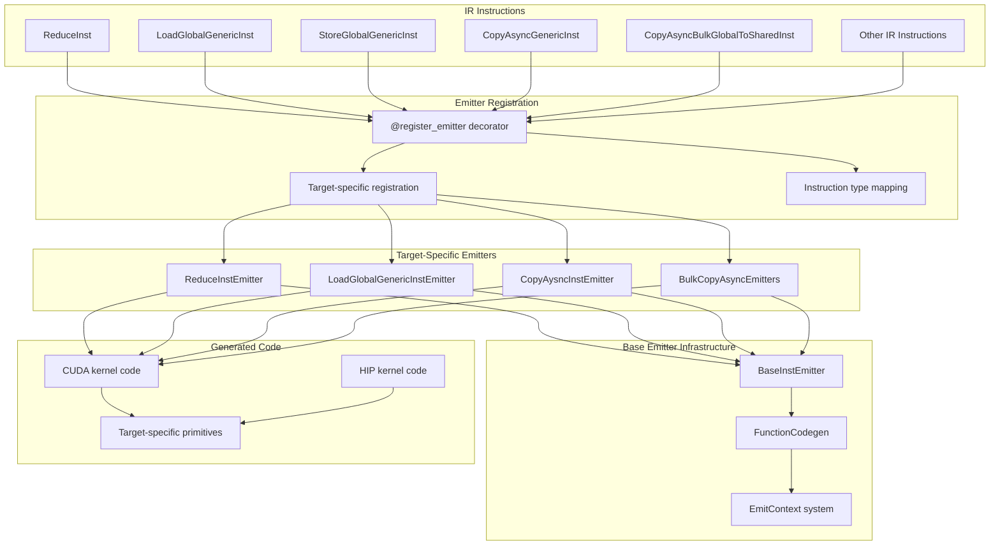
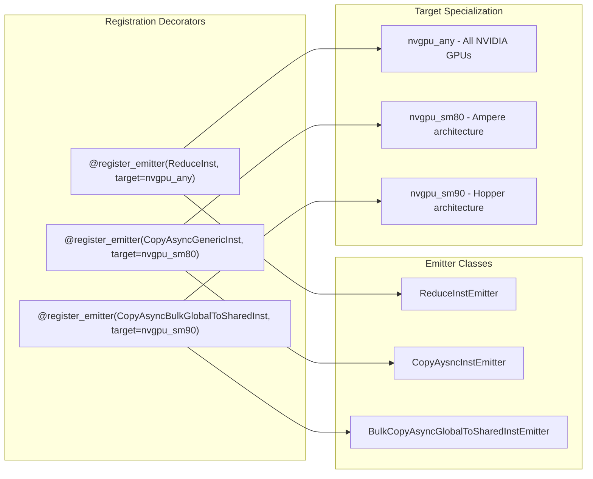
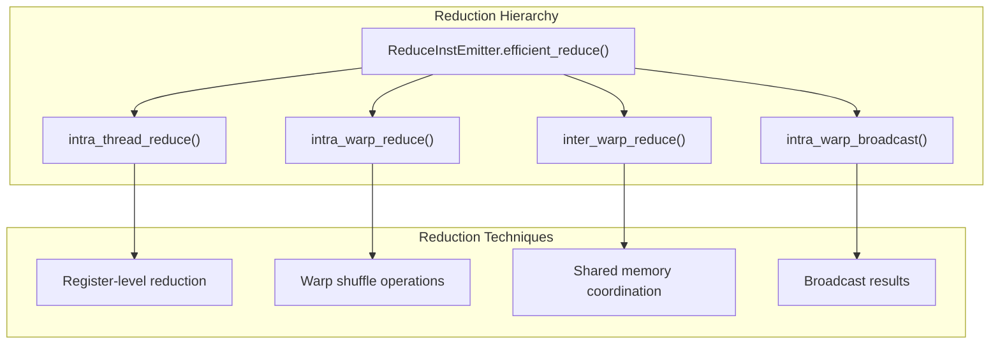
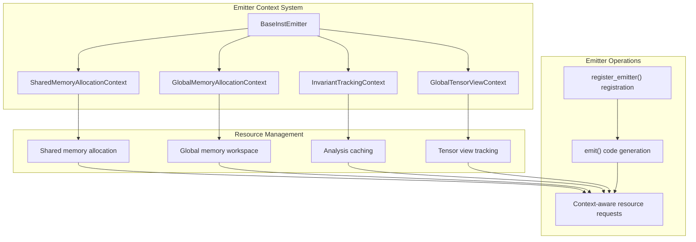
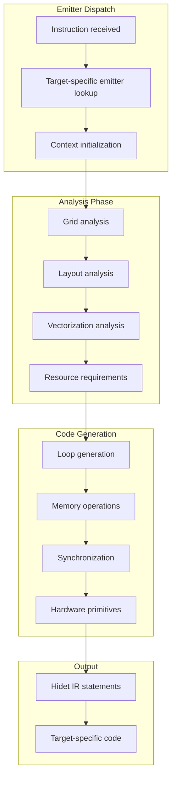

<!-- source: DeepWiki mcp.deepwiki.com · repo NVIDIA/tilus · page 6.3 Backend Emitters · fetched 2026-10-26 -->

# Backend Emitters

Relevant source files

The following files were used as context for generating this wiki page:

- [python/tilus/backends/contexts/__init__.py](python/tilus/backends/contexts/__init__.py)
- [python/tilus/backends/contexts/gmem.py](python/tilus/backends/contexts/gmem.py)
- [python/tilus/backends/contexts/smem.py](python/tilus/backends/contexts/smem.py)
- [python/tilus/backends/emitters/cuda/cp_async.py](python/tilus/backends/emitters/cuda/cp_async.py)
- [python/tilus/backends/emitters/cuda/cp_async_bulk.py](python/tilus/backends/emitters/cuda/cp_async_bulk.py)
- [python/tilus/backends/emitters/ldst.py](python/tilus/backends/emitters/ldst.py)
- [python/tilus/backends/emitters/reduce.py](python/tilus/backends/emitters/reduce.py)
- [python/tilus/backends/emitters/reduce_old.py](python/tilus/backends/emitters/reduce_old.py)

Backend emitters are responsible for generating target-specific GPU code from Tilus intermediate representation (IR) instructions. They form the final stage of the compilation pipeline, translating high-level IR operations into concrete hardware instructions for specific GPU architectures.

For information about the broader compilation pipeline context, see [Compilation Pipeline](#4). For details about IR instruction types that emitters consume, see [Instruction System](#6.2). For target-specific optimizations that emitters enable, see [CUDA Optimizations](#6.4).

## Emitter Architecture

Sources: [python/tilus/backends/emitters/reduce.py:38-39](), [python/tilus/backends/emitters/ldst.py:97-101](), [python/tilus/backends/emitters/cuda/cp_async.py:39]()

## Emitter Registration System

The emitter system uses a decorator-based registration mechanism that maps IR instruction types to target-specific emitter implementations:

Sources: [python/tilus/backends/emitters/reduce.py:38](), [python/tilus/backends/emitters/cuda/cp_async.py:39](), [python/tilus/backends/emitters/cuda/cp_async_bulk.py:142]()

## Core Emitter Types

### Load/Store Emitters

The `LoadStoreInstBaseEmitter` and `LoadGlobalGenericInstEmitter` handle memory access operations with sophisticated vectorization analysis:

| Emitter Class | Instruction Types | Key Features |
|---------------|------------------|--------------|
| `LoadGlobalGenericInstEmitter` | `LoadGlobalGenericInst`, `LoadSharedGenericInst`, `StoreGlobalGenericInst`, `StoreSharedGenericInst` | Vectorization analysis, memory coalescing |
| `LoadStoreInstBaseEmitter` | Base class | Common vectorization logic |

Key capabilities include:
- **Vectorization Analysis**: Determines optimal vector sizes for memory operations [python/tilus/backends/emitters/ldst.py:37-95]()
- **Memory Coalescing**: Ensures efficient memory access patterns
- **Sub-byte Support**: Handles quantized data types with sub-byte precision

Sources: [python/tilus/backends/emitters/ldst.py:36-101]()

### Reduction Emitters

The `ReduceInstEmitter` implements hierarchical reduction strategies across different GPU execution levels:

The reduction emitter supports multiple reduction operations:
- **Sum reduction**: `op == "sum"`
- **Max reduction**: `op == "max"`  
- **Min reduction**: `op == "min"`

Sources: [python/tilus/backends/emitters/reduce.py:335-350](), [python/tilus/backends/emitters/reduce.py:40-60]()

### Asynchronous Copy Emitters

Copy async emitters handle efficient data movement between memory hierarchies:

| Emitter Class | Target | Instruction Type | Features |
|---------------|--------|------------------|----------|
| `CopyAysncInstEmitter` | SM80+ | `CopyAsyncGenericInst` | Standard cp.async operations |
| `BulkCopyAsyncGlobalToSharedInstEmitter` | SM90+ | `CopyAsyncBulkGlobalToSharedInst` | Bulk transfers with mbarrier |
| `CopyAsyncBulkSharedToClusterSharedEmitter` | SM90+ | `CopyAsyncBulkSharedToClusterSharedInst` | Cluster-level coordination |

Sources: [python/tilus/backends/emitters/cuda/cp_async.py:39-40](), [python/tilus/backends/emitters/cuda/cp_async_bulk.py:142-172]()

## Context Integration

Emitters operate within specialized context systems that manage resource allocation and coordination:

Key context integrations:
- **Shared Memory**: `SharedMemoryAllocationContext.current().request_shared_workspace()` [python/tilus/backends/emitters/reduce.py:275-279]()
- **Global Memory**: `GlobalMemoryAllocationContext` for large workspace allocation [python/tilus/backends/contexts/gmem.py:29-80]()
- **Analysis Caching**: Reuse of expensive analysis computations [python/tilus/backends/emitters/reduce.py:178-179]()

Sources: [python/tilus/backends/contexts/__init__.py:15-19](), [python/tilus/backends/contexts/smem.py:83-140](), [python/tilus/backends/contexts/gmem.py:28-80]()

## Code Generation Process

The emitter code generation follows a structured pattern:

Example code generation patterns:
- **Loop Construction**: `self.for_range(extent=..., attr="u")` for unrolled loops [python/tilus/backends/emitters/ldst.py:117]()
- **Conditional Logic**: `self.if_then(mask)` for predicated execution [python/tilus/backends/emitters/ldst.py:138]()
- **Buffer Operations**: `self.buffer_store(buf, indices, value)` for memory writes [python/tilus/backends/emitters/reduce.py:71]()

Sources: [python/tilus/backends/emitters/ldst.py:102-161](), [python/tilus/backends/emitters/reduce.py:62-84]()

## Target Specialization

Emitters provide hardware-specific optimizations through target-aware registration:

| Target | Architecture | Specialized Features |
|--------|-------------|---------------------|
| `nvgpu_any` | All NVIDIA GPUs | Generic implementations |
| `nvgpu_sm80` | Ampere (A100) | cp.async, tensor cores |
| `nvgpu_sm90` | Hopper (H100) | cp.async.bulk, TMA, mbarrier |

Architecture-specific optimizations include:
- **SM80**: Standard asynchronous copy operations with `cp_async()` [python/tilus/backends/emitters/cuda/cp_async.py:161-171]()
- **SM90**: Bulk copy operations with `cp_async_bulk_global_to_shared()` [python/tilus/backends/emitters/cuda/cp_async_bulk.py:153-160]()
- **Cluster Operations**: Multi-CTA coordination for Hopper architecture [python/tilus/backends/emitters/cuda/cp_async_bulk.py:218-227]()

Sources: [python/tilus/backends/emitters/cuda/cp_async.py:39](), [python/tilus/backends/emitters/cuda/cp_async_bulk.py:142](), [python/tilus/target.py]()

---

