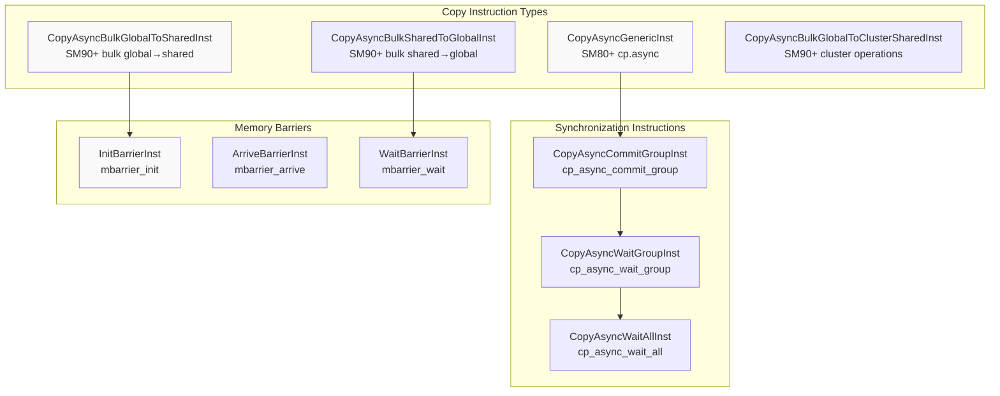
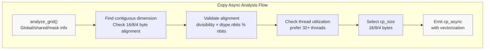
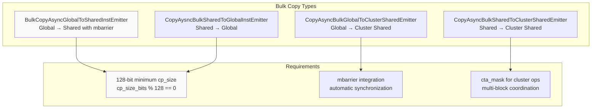
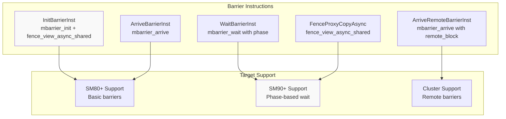
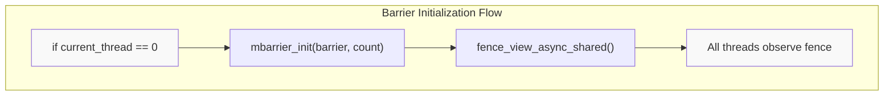
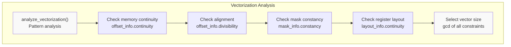
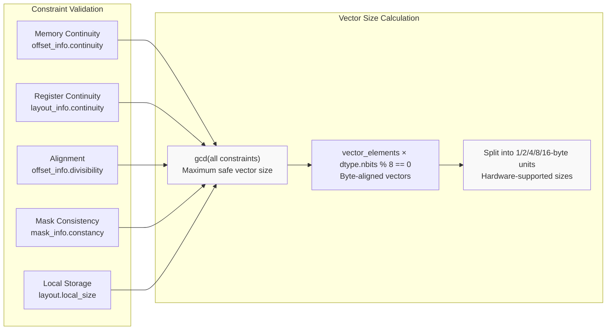
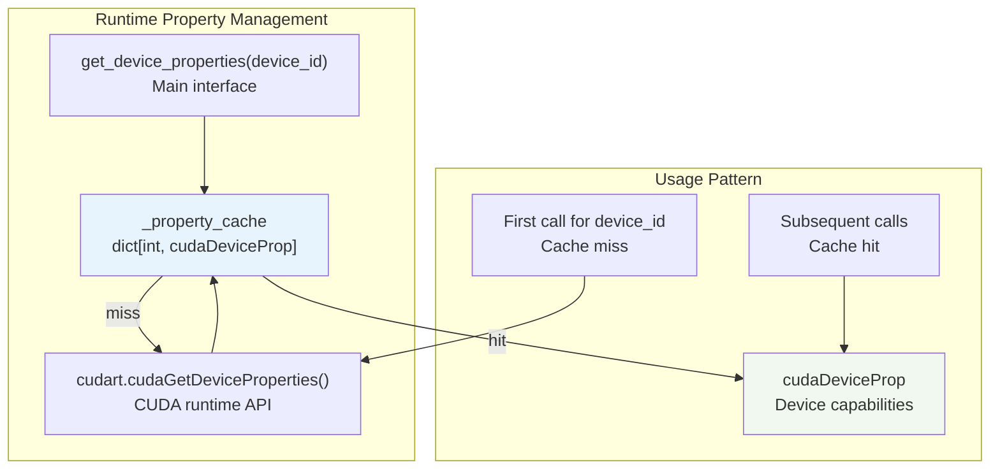
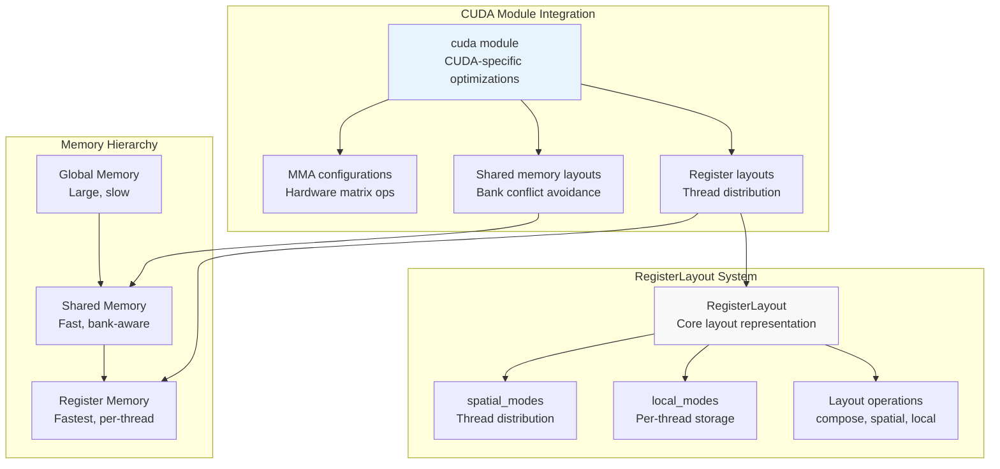

<!-- source: DeepWiki mcp.deepwiki.com · repo NVIDIA/tilus · page 6.4 CUDA Optimizations · fetched 2026-10-26 -->

# CUDA Optimizations

Relevant source files

The following files were used as context for generating this wiki page:

- [python/tilus/backends/emitters/cuda/cp_async.py](python/tilus/backends/emitters/cuda/cp_async.py)
- [python/tilus/backends/emitters/cuda/cp_async_bulk.py](python/tilus/backends/emitters/cuda/cp_async_bulk.py)
- [python/tilus/backends/emitters/cuda/mbarrier.py](python/tilus/backends/emitters/cuda/mbarrier.py)
- [python/tilus/backends/emitters/ldst.py](python/tilus/backends/emitters/ldst.py)
- [python/tilus/backends/emitters/reduce_old.py](python/tilus/backends/emitters/reduce_old.py)
- [python/tilus/ir/instructions/__init__.py](python/tilus/ir/instructions/__init__.py)
- [python/tilus/ir/instructions/cuda/__init__.py](python/tilus/ir/instructions/cuda/__init__.py)
- [python/tilus/ir/instructions/cuda/mbarrier.py](python/tilus/ir/instructions/cuda/mbarrier.py)
- [python/tilus/testing/__init__.py](python/tilus/testing/__init__.py)
- [scripts/sign-commits.sh](scripts/sign-commits.sh)
- [tests/lang/test_blocks_per_cluster.py](tests/lang/test_blocks_per_cluster.py)

This document covers CUDA-specific hardware optimizations and primitives provided by Tilus for efficient GPU kernel execution. Tilus implements advanced CUDA features including asynchronous memory operations, memory barriers, vectorized load/store instructions, and hardware-specific primitives for different SM architectures.

For general instruction concepts, see [Instruction System](#6.2). For backend code generation details, see [Backend Emitters](#6.3).

## Asynchronous Copy Operations

Tilus provides comprehensive support for CUDA's asynchronous copy operations, enabling overlapped computation and memory transfers. The system supports both traditional `cp.async` (SM80+) and the newer `cp.async.bulk` (SM90+) instructions.

**Copy Async Architecture**

### SM80+ Copy Async Implementation

The `CopyAysncInstEmitter` analyzes memory access patterns to optimize copy operations by determining the optimal copy size and vectorization strategy.

**Copy Size Selection Process:**
1. **Size Analysis**: Tests copy sizes of 16, 8, and 4 bytes based on alignment
2. **Continuity Check**: Verifies contiguous memory access patterns
3. **Divisibility Analysis**: Ensures proper alignment for vectorized operations
4. **Thread Distribution**: Optimizes for at least 32 threads when possible

The emitter supports both single-element and multi-element copies based on the relationship between `cp_size` and `dtype.nbits`:
- **Multi-element copies**: When `cp_size * 8 % dtype.nbits == 0`
- **Multi-instruction copies**: When `dtype.nbits % (cp_size * 8) == 0`

**Sources:** [python/tilus/backends/emitters/cuda/cp_async.py:39-196]()

### SM90+ Bulk Copy Operations

The SM90 architecture introduces bulk copy operations with enhanced performance and cluster support. The `cp.async.bulk` instructions provide 128-bit minimum transfer sizes and integrated memory barrier synchronization.

The bulk copy operations automatically handle memory barrier coordination:
- **Barrier Expect**: `mbarrier_expect_tx_cta_shared` sets expected transaction bytes
- **Cluster Coordination**: Multi-block operations use `cta_mask` for selective participation
- **Remote Addressing**: `mapa_shared` converts addresses for cross-block access

**Sources:** [python/tilus/backends/emitters/cuda/cp_async_bulk.py:59-305]()

## Memory Barriers and Synchronization

Tilus provides comprehensive support for CUDA's memory barrier primitives, essential for coordinating asynchronous operations and multi-block cluster computing on SM90+ architectures.

**Memory Barrier Instruction Types**

### Barrier Initialization and Coordination

The `InitBarrierInstEmitter` coordinates barrier setup with thread 0 performing initialization and all threads observing the fence:

The barrier count defaults to `current_num_threads` when not explicitly specified, ensuring all threads in the block participate in synchronization.

### Cluster Barrier Operations

For SM90+ cluster computing, `ArriveRemoteBarrierInst` enables cross-block coordination:

| Parameter | Type | Description |
|-----------|------|-------------|
| `barrier` | `Expr` | Shared memory barrier address |
| `remote_block` | `Expr` | Target block rank in cluster |
| `pred` | `Expr` | Predicate for conditional arrival (default: `boolean.true`) |

The remote barrier operations enable complex multi-block algorithms like cluster-wide reductions and distributed data movement.

**Sources:** [python/tilus/backends/emitters/cuda/mbarrier.py:29-60](), [python/tilus/ir/instructions/cuda/mbarrier.py:26-71]()

## Vectorized Load/Store Operations

Tilus automatically vectorizes memory operations to maximize bandwidth utilization. The `LoadStoreInstBaseEmitter` analyzes memory access patterns and generates optimal vectorized instructions.

**Vectorization Analysis Process**

### Vectorization Constraints

The vectorization system ensures safe and efficient vector operations by validating four key constraints:

1. **Single Thread Ownership**: Elements in each vector must belong to a single thread
2. **Memory Continuity**: Vector elements must be contiguous in memory
3. **Register Continuity**: Vector elements must be contiguous in thread-local storage
4. **Mask Consistency**: Load/store mask must be identical for all vector elements

### Vector Unit Types and Emission

When vectorization is possible, the system splits vectors into hardware-supported units:

| Unit Size | Data Type | Usage |
|-----------|-----------|-------|
| 1 byte | `uint8` | Single-byte operations |
| 2 bytes | `uint16` | Half-precision, small vectors |
| 4 bytes | `uint32` | Standard word operations |
| 8 bytes | `uint32x2` | Double-word operations |
| 16 bytes | `uint32x4` | Quad-word operations |

The emission process handles both load and store operations with proper masking:
- **Load operations**: Apply mask to load valid data, zero-fill for invalid elements
- **Store operations**: Apply mask to conditionally store data

**Sources:** [python/tilus/backends/emitters/ldst.py:36-161]()

## Runtime Device Management

### Device Property Caching

The `cuda.runtime` module provides efficient access to CUDA device properties through caching:

The caching mechanism ensures device properties are queried only once per device, improving performance for repeated capability checks.

**Sources:** [python/tilus/lang/modules/cuda.py:74-83]()

## Integration with Register Layouts

The CUDA optimizations integrate closely with Tilus's register layout system to provide complete memory hierarchy optimization:

**Sources:** [python/tilus/lang/modules/cuda.py:1-418](), [python/tilus/ir/layout/register_layout.py:35-114]()

---

