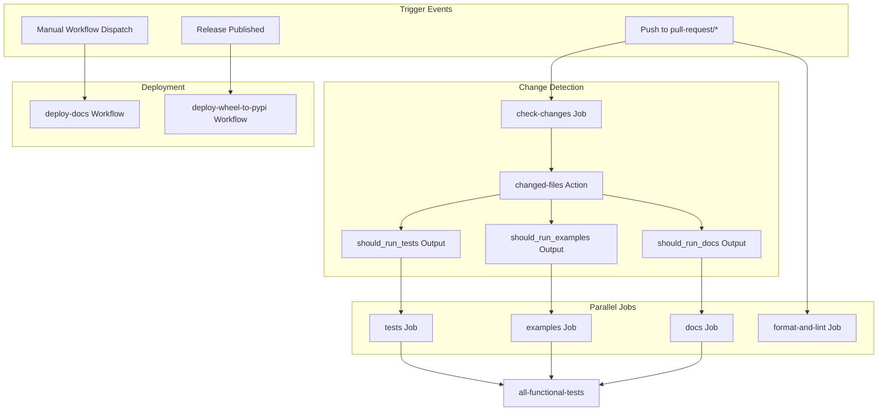
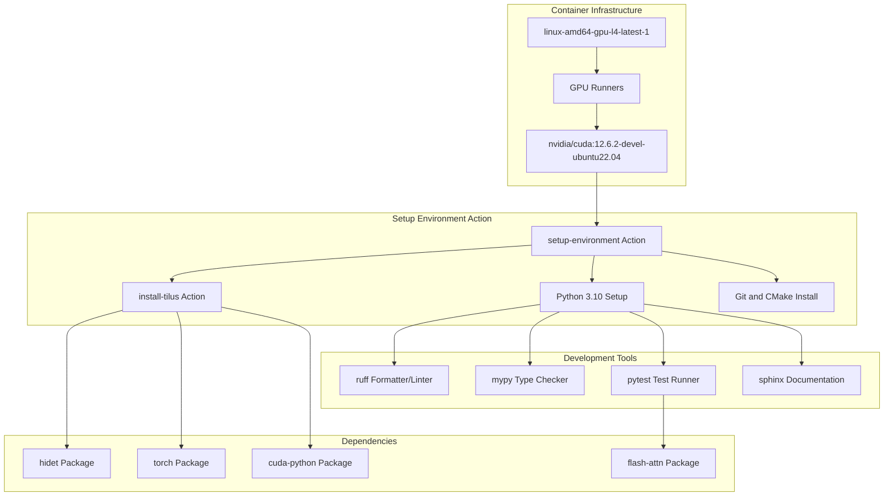
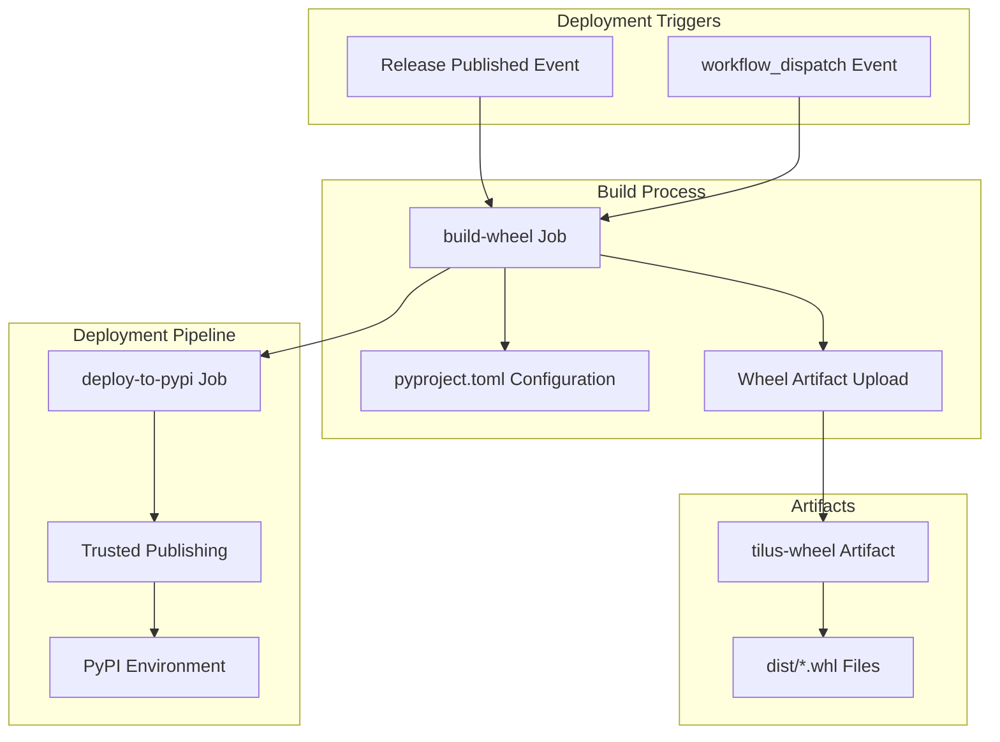
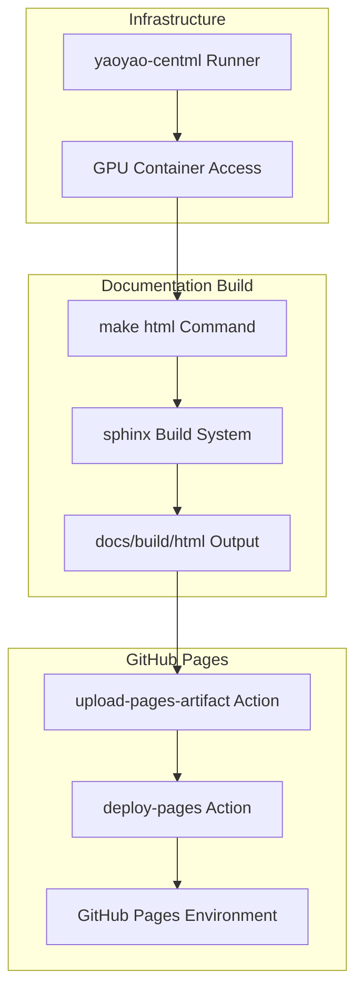
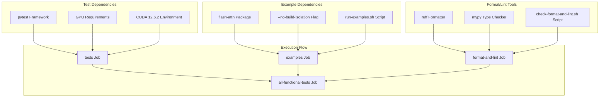
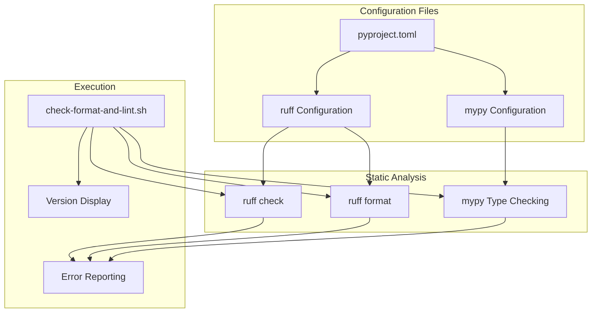

<!-- source: DeepWiki mcp.deepwiki.com · repo NVIDIA/tilus · page 7 Development Infrastructure · fetched 2026-10-26 -->

# Development Infrastructure

Relevant source files

The following files were used as context for generating this wiki page:

- [.github/actions/setup-environment/action.yaml](.github/actions/setup-environment/action.yaml)
- [.github/copy-pr-bot.yaml](.github/copy-pr-bot.yaml)
- [.github/workflows/deploy-docs.yaml](.github/workflows/deploy-docs.yaml)
- [.github/workflows/deploy-wheel-to-pypi.yaml](.github/workflows/deploy-wheel-to-pypi.yaml)
- [.github/workflows/format-and-lint.yaml](.github/workflows/format-and-lint.yaml)
- [.github/workflows/tests.yaml](.github/workflows/tests.yaml)

This document covers the development infrastructure for contributors and maintainers of the Tilus project. It includes the continuous integration and deployment (CI/CD) systems, build processes, testing frameworks, and development tools that support the Tilus codebase.

For information about using Tilus as an end-user, see [Getting Started](#2). For details on the testing and CI/CD workflows specifically, see [Testing and CI/CD](#7.1). For the documentation build system, see [Documentation System](#7.2).

## CI/CD Pipeline Architecture

The Tilus project uses GitHub Actions for continuous integration and deployment. The CI/CD system is designed around GPU-enabled runners and includes smart change detection to optimize build times.

### CI/CD Workflow Overview

The system uses the `step-security/changed-files` action to detect changes in specific directories and only run relevant jobs when files have changed.

Sources: [.github/workflows/tests.yaml:1-157](), [.github/workflows/format-and-lint.yaml:1-30]()

### Environment Setup and Infrastructure

The `setup-environment` action provides a reusable workflow component that standardizes the build environment across all jobs.

Sources: [.github/actions/setup-environment/action.yaml:1-56](), [.github/workflows/tests.yaml:74-79]()

## Build and Deployment System

### PyPI Deployment Pipeline

The deployment system uses GitHub's trusted publishing feature to securely deploy to PyPI without storing API tokens.

Sources: [.github/workflows/deploy-wheel-to-pypi.yaml:1-59]()

### Documentation Deployment

Documentation builds require GPU access to execute example code and generate dynamic content.

Sources: [.github/workflows/deploy-docs.yaml:1-53]()

## Testing Infrastructure

### Test Execution Framework

The testing system is designed around GPU-specific requirements and includes comprehensive validation of examples and documentation.

| Test Category | Purpose | Runner Requirements | Key Files |
|---------------|---------|-------------------|-----------|
| Unit Tests | Core functionality validation | GPU-enabled containers | `tests/**` |
| Examples | Tutorial and example validation | GPU with flash-attn | `examples/**` |
| Documentation | Sphinx build validation | GPU for code execution | `docs/**` |
| Format/Lint | Code quality checks | Standard runners | `python/**` |

### Test Job Dependencies

The `all-functional-tests` job aggregates results from all test categories and provides a single pass/fail status for the entire pipeline.

Sources: [.github/workflows/tests.yaml:56-156](), [.github/workflows/format-and-lint.yaml:12-30]()

## Development Tools and Quality Assurance

### Code Quality Pipeline

The quality assurance system enforces consistent code formatting and type safety across the entire codebase.

Sources: [.github/workflows/format-and-lint.yaml:26-29]()

### Repository Configuration

| Component | Configuration File | Purpose |
|-----------|-------------------|---------|
| CI/CD Workflows | `.github/workflows/*.yaml` | Define automated build and test processes |
| Environment Setup | `.github/actions/setup-environment/action.yaml` | Standardize build environment |
| PR Bot | `.github/copy-pr-bot.yaml` | Automated PR synchronization |
| Package Config | `pyproject.toml` | Python package metadata and tool configuration |

The development infrastructure supports both internal NVIDIA development workflows and external open-source contributions through standardized tooling and comprehensive automation.

Sources: [.github/copy-pr-bot.yaml:1-5]()

---

