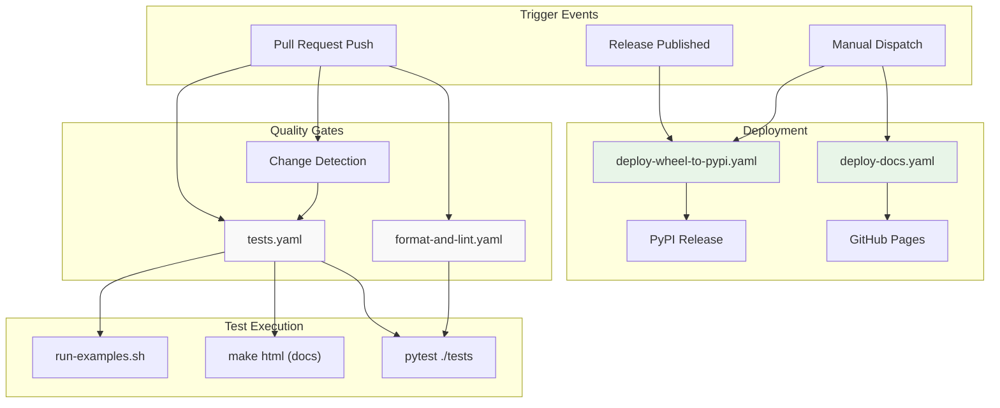
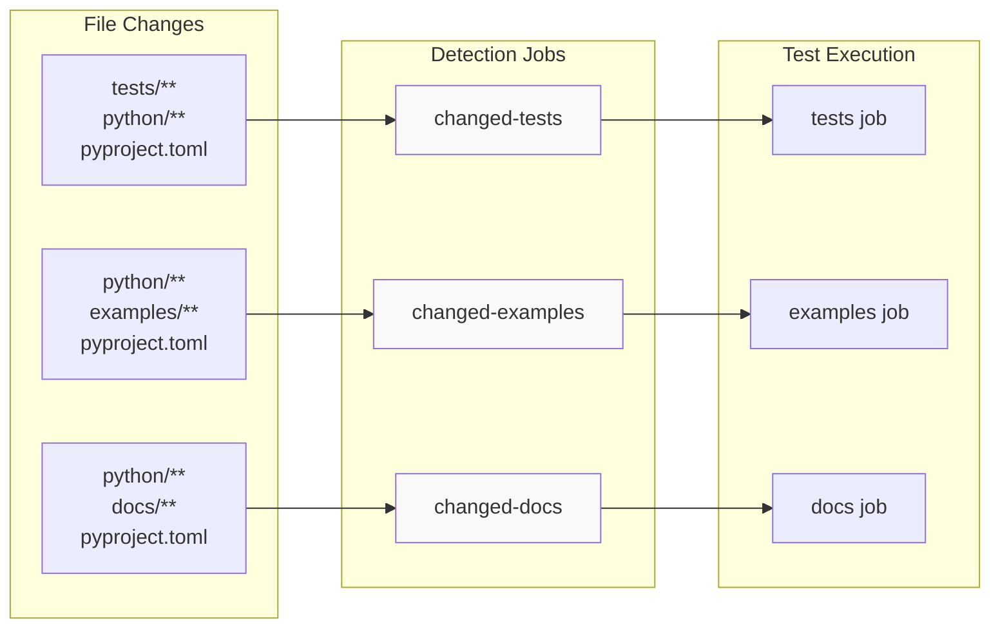
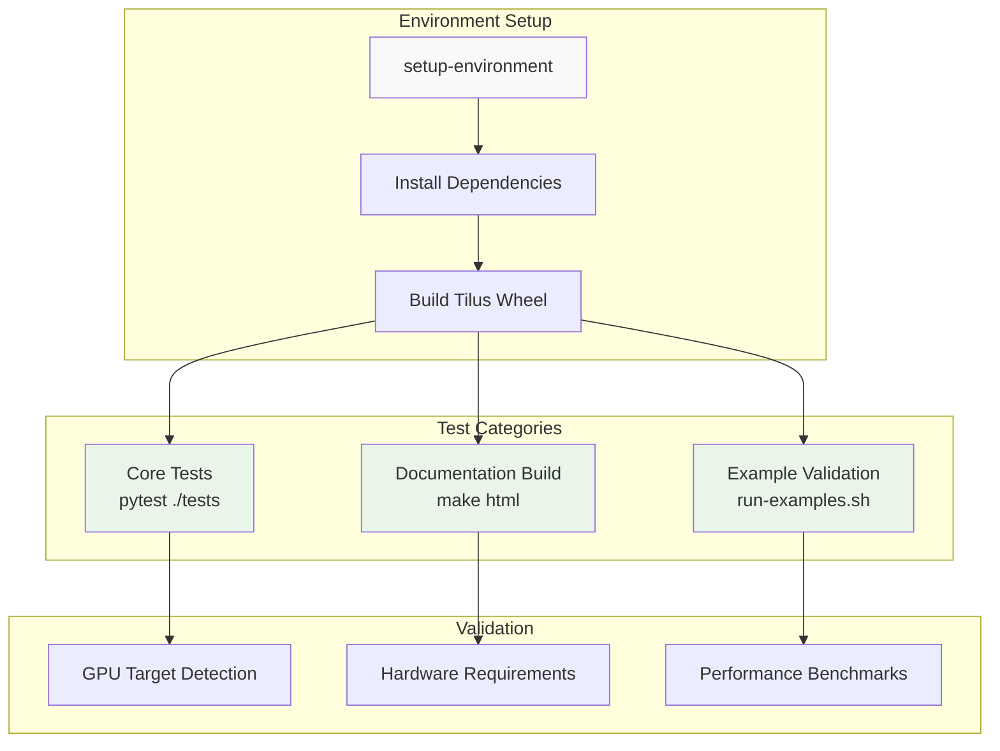
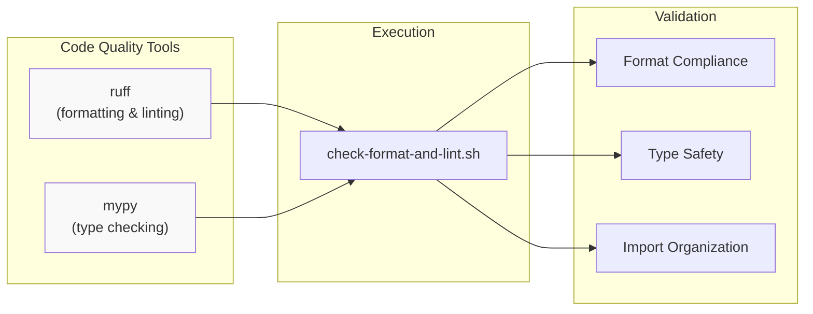
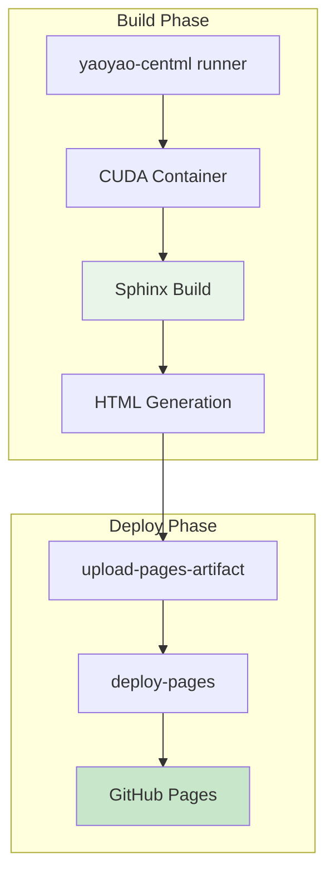
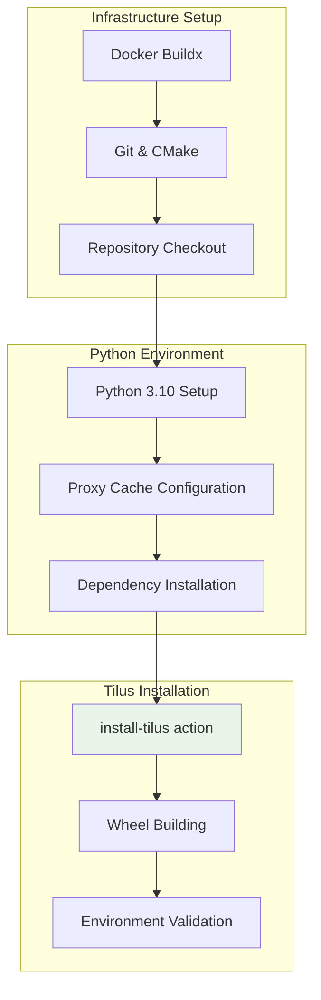

<!-- source: DeepWiki mcp.deepwiki.com · repo NVIDIA/tilus · page 7.1 Testing and CI/CD · fetched 2026-10-26 -->

# Testing and CI/CD

<details>
<summary>Relevant source files</summary>

The following files were used as context for generating this wiki page:

- [.github/actions/setup-environment/action.yaml](.github/actions/setup-environment/action.yaml)
- [.github/copy-pr-bot.yaml](.github/copy-pr-bot.yaml)
- [.github/workflows/deploy-docs.yaml](.github/workflows/deploy-docs.yaml)
- [.github/workflows/deploy-wheel-to-pypi.yaml](.github/workflows/deploy-wheel-to-pypi.yaml)
- [.github/workflows/format-and-lint.yaml](.github/workflows/format-and-lint.yaml)
- [.github/workflows/tests.yaml](.github/workflows/tests.yaml)

</details>


This document provides a comprehensive guide to Tilus's testing framework and continuous integration/continuous deployment (CI/CD) infrastructure. It covers the automated testing workflows, development processes, and deployment pipelines that ensure code quality and reliable releases.

For information about the documentation build system, see [Documentation System](#7.2).

## Overview

Tilus employs a sophisticated CI/CD infrastructure designed specifically for GPU-accelerated development. The system includes automated testing across multiple GPU architectures, code quality checks, documentation generation, and deployment to both GitHub Pages and PyPI. All GPU-dependent operations run on specialized NVIDIA runners with CUDA-enabled containers.

## CI/CD Pipeline Architecture

The following diagram illustrates the complete CI/CD pipeline structure:



**CI/CD Pipeline Architecture**

The pipeline implements intelligent change detection to optimize resource usage and execution time. Each workflow targets specific aspects of the codebase and runs only when relevant changes are detected.

Sources: [.github/workflows/tests.yaml:1-157](), [.github/workflows/format-and-lint.yaml:1-30](), [.github/workflows/deploy-docs.yaml:1-53](), [.github/workflows/deploy-wheel-to-pypi.yaml:1-59]()

## Test Workflow Components

### Change Detection System

The test workflow implements an intelligent change detection mechanism that determines which test suites need to run based on modified files:



**Change Detection Flow**

The system uses `step-security/changed-files@v46` to detect modifications and set output flags that control downstream job execution.

Sources: [.github/workflows/tests.yaml:13-55]()

### Test Environment Configuration

All GPU-dependent tests run in containerized environments with specific hardware requirements:

| Component | Configuration |
|-----------|---------------|
| **Runner** | `linux-amd64-gpu-l4-latest-1` |
| **Container** | `nvidia/cuda:12.6.2-devel-ubuntu22.04` |
| **GPU Access** | `--gpus all` |
| **Python Version** | `3.10` |
| **Concurrency** | Group by workflow and ref, cancel-in-progress |

The environment setup is handled by the reusable action `setup-environment` which standardizes Python installation, dependency management, and Tilus installation across all workflows.

Sources: [.github/workflows/tests.yaml:60-82](), [.github/actions/setup-environment/action.yaml:1-56]()

## Testing Framework

### Test Execution Structure

The main test suite execution follows this pattern:



**Test Execution Flow**

The testing framework validates functionality across three dimensions: core library functionality, documentation accuracy, and example correctness.

Sources: [.github/workflows/tests.yaml:80-81](), [.github/workflows/tests.yaml:102-105](), [.github/workflows/tests.yaml:132-133]()

### GPU Target Requirements

Tilus tests include hardware-specific requirements that are validated at runtime. The testing framework supports multiple GPU architectures and automatically detects available hardware capabilities. Tests use decorators like `@requires.nvgpu_sm90` to specify minimum hardware requirements.

### Example Dependencies

The examples workflow includes additional dependencies required for comprehensive validation:

```bash
pip install wheel
pip install flash-attn --no-build-isolation
```

This ensures that complex examples like FlashAttention implementations can be validated against reference implementations.

Sources: [.github/workflows/tests.yaml:126-130]()

## Code Quality Pipeline

### Format and Lint Workflow

The format and lint pipeline runs on every pull request and enforces code quality standards:



**Code Quality Pipeline**

The pipeline uses modern Python tooling to maintain consistent code style and catch potential issues before they reach the main branch.

Sources: [.github/workflows/format-and-lint.yaml:26-29]()

## Deployment Infrastructure

### Documentation Deployment

Documentation deployment to GitHub Pages follows this workflow:



**Documentation Deployment Flow**

Documentation builds require GPU access to execute example code and generate accurate outputs, making the specialized runner necessary even for documentation.

Sources: [.github/workflows/deploy-docs.yaml:15-53]()

### PyPI Deployment

The PyPI deployment process is triggered by GitHub releases and includes wheel building and trusted publishing:

| Stage | Action | Environment |
|-------|--------|-------------|
| **Build** | Wheel creation on GPU runner | CUDA container |
| **Artifact** | Upload to GitHub Actions | 7-day retention |
| **Deploy** | Trusted publishing to PyPI | Release events only |

The deployment uses GitHub's trusted publishing mechanism with `id-token: write` permissions, eliminating the need for API tokens.

Sources: [.github/workflows/deploy-wheel-to-pypi.yaml:17-59]()

## Development Workflow

### Pull Request Process

The development workflow implements comprehensive validation for all pull requests:

1. **Automatic Triggering**: Pull requests to branches matching `pull-request/[0-9]+` trigger all validation workflows
2. **Concurrent Execution**: Tests, documentation, and examples run in parallel when changes are detected
3. **Failure Handling**: The `all-functional-tests` job aggregates results and fails if any component fails
4. **Resource Optimization**: Change detection prevents unnecessary execution of unaffected test suites

### Repository Configuration

The repository includes additional automation through the copy-pr-bot configuration, which enables automatic synchronization of pull requests in NVIDIA's internal development environment.

Sources: [.github/copy-pr-bot.yaml:1-5]()

## Reusable Actions

### Setup Environment Action

The `setup-environment` action provides a standardized foundation for all workflows:



**Environment Setup Process**

This action encapsulates the complex setup required for GPU-accelerated development, including NVIDIA-specific optimizations like proxy caching for internal runners.

Sources: [.github/actions/setup-environment/action.yaml:15-56]()

The setup process handles both containerized and non-containerized environments, automatically detecting available sudo privileges and configuring the environment appropriately.

## Best Practices

### Contributing to Tests

When contributing to Tilus, developers should:

1. Ensure all new functionality includes appropriate test coverage
2. Use GPU target requirement decorators for hardware-specific tests
3. Validate that examples continue to work with code changes
4. Run format and lint checks locally before submitting pull requests

### GPU Resource Management

The CI/CD system is designed to optimize GPU resource usage through:

- Intelligent change detection to avoid unnecessary runs
- Concurrent job execution with proper resource allocation
- Container-based isolation for reproducible environments
- Specialized runner allocation for different workload types

This infrastructure ensures reliable validation while managing the computational costs associated with GPU-accelerated development.

---

