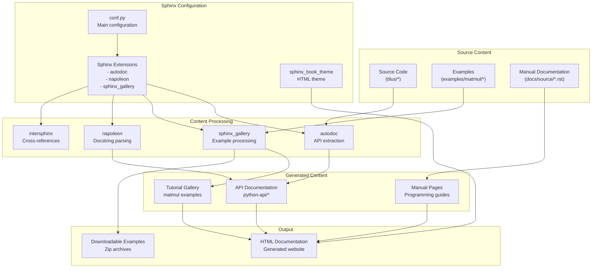
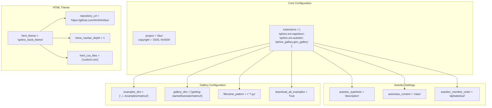
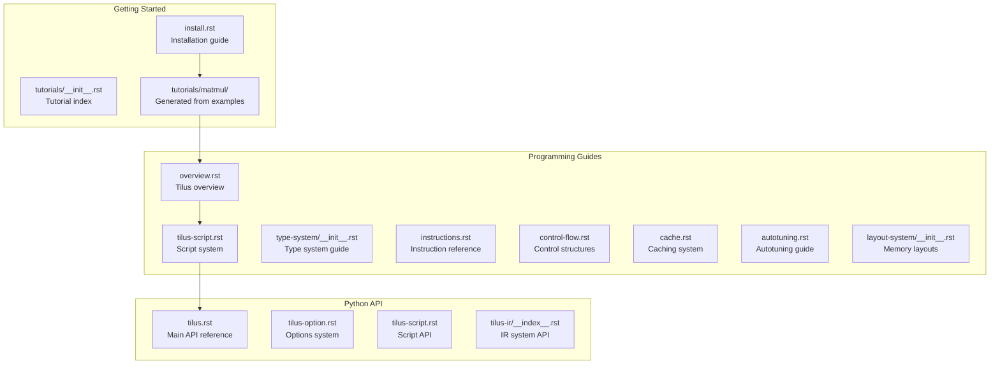
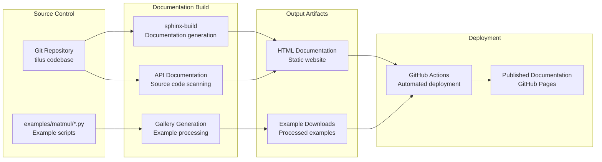

<!-- source: DeepWiki mcp.deepwiki.com · repo NVIDIA/tilus · page 7.2 Documentation System · fetched 2026-10-26 -->

# Documentation System

<details>
<summary>Relevant source files</summary>

The following files were used as context for generating this wiki page:

- [.gitignore](.gitignore)
- [docs/source/_static/custom.css](docs/source/_static/custom.css)
- [docs/source/conf.py](docs/source/conf.py)
- [docs/source/getting-started/install.rst](docs/source/getting-started/install.rst)
- [docs/source/index.rst](docs/source/index.rst)
- [docs/source/programming-guides/control-flow.rst](docs/source/programming-guides/control-flow.rst)
- [docs/source/programming-guides/thread-group.rst](docs/source/programming-guides/thread-group.rst)
- [docs/source/python-api/tilus-script.rst](docs/source/python-api/tilus-script.rst)
- [pyproject.toml](pyproject.toml)
- [tests/lang/test_thread_group.py](tests/lang/test_thread_group.py)

</details>


This document covers the Sphinx-based documentation system used to generate Tilus documentation, including configuration, content organization, and automated generation of API documentation and example galleries. For information about testing and CI/CD workflows that deploy this documentation, see [Testing and CI/CD](#7.1).

## System Architecture

The Tilus documentation system is built on Sphinx and organized into several interconnected components that automatically generate comprehensive documentation from source code, examples, and manually authored content.

### Documentation Pipeline



**Sources:** [docs/source/conf.py:1-74](), [docs/source/index.rst:1-43]()

### Configuration Architecture



**Sources:** [docs/source/conf.py:17-19](), [docs/source/conf.py:24-37](), [docs/source/conf.py:39-42](), [docs/source/conf.py:47-52](), [docs/source/conf.py:63-72]()

## Sphinx Extensions and Features

The documentation system uses multiple Sphinx extensions to provide comprehensive functionality:

| Extension | Purpose | Configuration |
|-----------|---------|---------------|
| `sphinx.ext.napoleon` | Parse Google/NumPy style docstrings | Automatic docstring processing |
| `sphinx.ext.autodoc` | Generate API docs from source code | `autodoc_typehints = "description"` |
| `sphinx.ext.autosummary` | Create summary tables of modules | Used with autodoc |
| `sphinx.ext.intersphinx` | Cross-reference external documentation | Currently disabled |
| `sphinx.ext.viewcode` | Add source code links | Automatic source linking |
| `sphinx.ext.coverage` | Track documentation coverage | Development tool |
| `sphinx.ext.todo` | Manage TODO items | Development tracking |
| `sphinx.ext.graphviz` | Render Graphviz diagrams | Diagram support |
| `sphinx.ext.doctest` | Test code examples | Documentation testing |
| `sphinx_copybutton` | Add copy buttons to code blocks | User experience |
| `autodocsumm` | Enhanced autodoc summaries | Extended API docs |
| `sphinx_gallery.gen_gallery` | Generate example galleries | Tutorial generation |

**Sources:** [docs/source/conf.py:24-37]()

## Content Organization

The documentation is structured into three main sections, each serving different user needs:

### Documentation Structure



**Sources:** [docs/source/index.rst:13-43]()

### Gallery System

The `sphinx_gallery` extension automatically processes example files to create interactive tutorials:

```python
sphinx_gallery_conf = {
    'examples_dirs': ['../../examples/matmul'],
    'gallery_dirs': ['getting-started/tutorials/matmul'],
    'filename_pattern': r'.*\.py',
    'download_all_examples': True,
}
```

This configuration:
- Scans `examples/matmul/` for Python files
- Generates gallery pages in `getting-started/tutorials/matmul/`
- Includes all `.py` files matching the pattern
- Creates downloadable archives of all examples

**Sources:** [docs/source/conf.py:47-52]()

## API Documentation Generation

The system uses `autodoc` to automatically generate API documentation from source code docstrings:

### Autodoc Configuration

| Setting | Value | Purpose |
|---------|-------|---------|
| `autodoc_typehints` | `"description"` | Include type hints in descriptions |
| `autoclass_content` | `"class"` | Show class docstring only |
| `autodoc_class_signature` | `"separated"` | Separate class signature |
| `autodoc_member_order` | `"alphabetical"` | Sort members alphabetically |

### API Documentation Structure

The API documentation is organized into logical modules:

- **tilus**: Main module with core functionality
- **tilus-option**: Configuration and options system  
- **tilus-script**: Script class and related functionality
- **tilus-ir**: Internal representation system

**Sources:** [docs/source/conf.py:39-42](), [docs/source/index.rst:37-42]()

## Theme and Presentation

The documentation uses the `sphinx_book_theme` with custom configuration:

```python
html_theme = 'sphinx_book_theme'
html_theme_options = {
    "repository_url": "https://github.com/NVIDIA/tilus",
    "use_repository_button": True,
    "show_navbar_depth": 1,
}
```

Additional presentation features:
- Custom CSS styling via `_static/custom.css`
- Copy buttons on code blocks (`sphinx_copybutton`)
- Permalink icons for sections
- GitHub repository integration

**Sources:** [docs/source/conf.py:63-73]()

## Build Process Integration

The documentation system integrates with the broader development infrastructure:

### Development Integration



The system supports:
- Automatic rebuilding when source files change
- Integration with version control for documentation versioning
- Deployment automation through CI/CD pipelines
- Cross-referencing between different documentation sections

**Sources:** [docs/source/conf.py:1-74](), [docs/source/index.rst:1-43]()