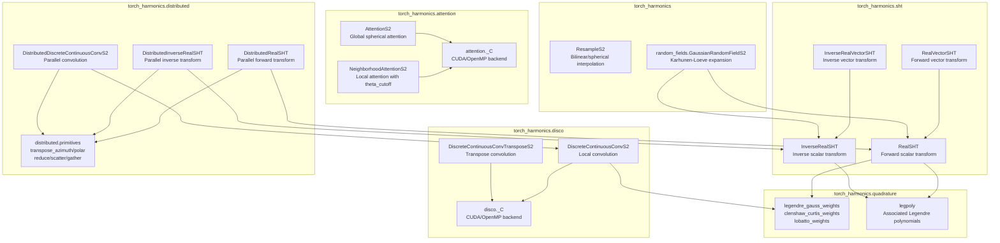
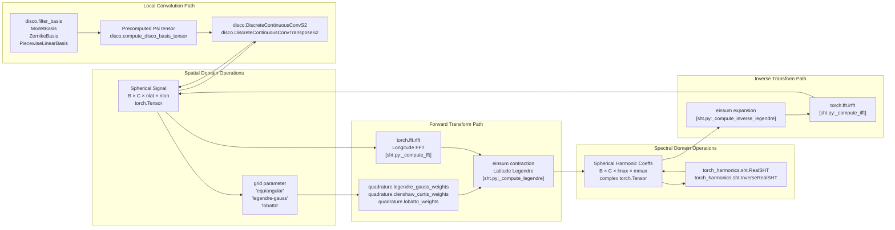
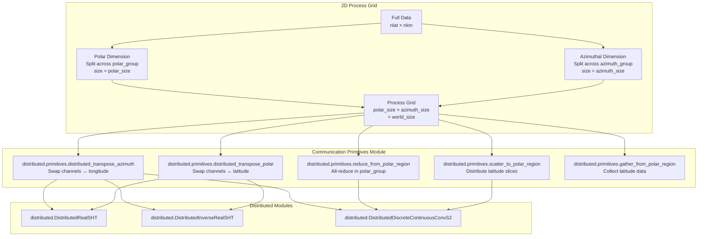

<!-- source: DeepWiki mcp.deepwiki.com · repo NVIDIA/torch-harmonics · page 1 Overview · fetched 2026-10-26 -->

# Overview

<details>
<summary>Relevant source files</summary>

The following files were used as context for generating this wiki page:

- [Changelog.md](Changelog.md)
- [README.md](README.md)
- [notebooks/partial_derivatives.ipynb](notebooks/partial_derivatives.ipynb)
- [setup.py](setup.py)
- [torch_harmonics/__init__.py](torch_harmonics/__init__.py)

</details>


## Purpose and Scope

This page provides a high-level introduction to torch-harmonics, a PyTorch library for differentiable signal processing on the sphere. torch-harmonics implements spherical harmonic transforms (SHT), discrete-continuous (DISCO) convolutions, and spherical attention mechanisms optimized for GPU and distributed computing environments. The library enables neural operators and deep learning models for data defined on spherical geometries, such as global climate data, omnidirectional images, and planetary-scale simulations.

For installation instructions, see [Installation and Setup](#1.1). For mathematical background on spherical harmonics and grid types, see [Core Concepts](#1.2). For detailed API documentation, see [API Reference](#11).

**Sources:** [README.md:51-59](), [torch_harmonics/__init__.py:32-41]()

---

## High-Level Architecture

torch-harmonics is organized into three architectural layers: **core mathematical primitives** for forward and inverse spherical transforms, **distributed computing extensions** for multi-GPU/multi-node execution, and **high-level neural operator architectures** that compose these primitives. All operations are implemented as `torch.nn.Module` subclasses for seamless integration with PyTorch training workflows.

The library supports multiple optimization backends (CUDA, Triton, OpenMP) with automatic fallback to pure PyTorch implementations when hardware acceleration is unavailable.

### Core Library Components



**Sources:** [torch_harmonics/__init__.py:34-38](), [README.md:51-59]()

---

## Mathematical Primitives to Code Mapping

The following diagram maps mathematical operations to their concrete implementations in the codebase:



**Sources:** [README.md:125-170](), [torch_harmonics/__init__.py:34-37]()

---

## Core Mathematical Primitives

### Spherical Harmonic Transforms

The `RealSHT` and `InverseRealSHT` classes implement forward and inverse spherical harmonic transforms using the algorithm from Schaeffer (2013). The transform decomposes into:

1. **Longitude FFT**: Computed via `torch.fft.rfft` to extract Fourier modes in the azimuthal direction
2. **Latitude Legendre Transform**: Computed via quadrature-based einsum contractions with associated Legendre polynomials

| Class | Purpose | Key Methods | Distributed Variant |
|-------|---------|-------------|---------------------|
| `RealSHT` | Forward scalar transform | `forward(x)` | `DistributedRealSHT` |
| `InverseRealSHT` | Inverse scalar transform | `forward(x)` | `DistributedInverseRealSHT` |
| `RealVectorSHT` | Forward vector transform | `forward(u, v)` | `DistributedRealVectorSHT` |
| `InverseRealVectorSHT` | Inverse vector transform | `forward(u_coeffs, v_coeffs)` | `DistributedInverseRealVectorSHT` |

Vector transforms decompose vector fields into spheroidal and toroidal components, enabling computation of divergence and curl on the sphere.

For detailed usage, see [RealSHT and InverseRealSHT](#2.1) and [Vector Spherical Harmonic Transforms](#2.2).

**Sources:** [README.md:125-170](), [torch_harmonics/__init__.py:34]()

### DISCO Convolutions

The `DiscreteContinuousConvS2` class implements localized convolutions on the sphere using continuous filter basis functions. Unlike global spectral operations, DISCO convolutions have compact support controlled by the `theta_cutoff` parameter.

Key configuration parameters:
- `in_channels`, `out_channels`: Channel dimensions
- `kernel_shape`: Shape of the convolution kernel (e.g., `"spherical"`, `"zonal"`)
- `filter_basis`: One of `"morlet"`, `"zernike"`, `"piecewise-linear"`
- `theta_cutoff`: Maximum angular distance for local support (in radians)

The implementation precomputes a basis tensor `Psi` mapping spatial positions to filter coefficients, then uses custom CUDA or OpenMP kernels in `disco._C` for efficient forward and backward passes.

For detailed usage, see [DiscreteContinuousConvS2](#3.1) and [Filter Basis Functions](#3.2).

**Sources:** [torch_harmonics/__init__.py:35](), [README.md:171-174](), [Changelog.md:82-86]()

### Spherical Attention Mechanisms

The `AttentionS2` and `NeighborhoodAttentionS2` classes implement attention mechanisms adapted for spherical geometry:

- **AttentionS2**: Global attention over the entire sphere, using quadrature-aware position encodings
- **NeighborhoodAttentionS2**: Local attention within geodesic neighborhoods defined by `theta_cutoff`

Both implementations use custom CUDA kernels in `attention._C` for efficient computation of attention weights and value aggregation. The operations correctly handle the non-Euclidean geometry of the sphere, using geodesic distances for neighborhood definitions.

For detailed usage, see [AttentionS2 (Global)](#4.1) and [NeighborhoodAttentionS2](#4.2).

**Sources:** [torch_harmonics/__init__.py:37](), [Changelog.md:16-18](), [README.md:175-177]()

---

## Distributed Computing Strategy

torch-harmonics implements a 2D process grid strategy for distributing spherical data across multiple GPUs. Data is partitioned along both latitude (`polar_group`) and longitude (`azimuth_group`) dimensions.

### Process Grid and Communication Primitives



Each distributed module orchestrates communication primitives to ensure correct data layout for local operations. For example, `DistributedRealSHT` transposes data to make longitude local before FFT, then transposes again to make latitude local before the Legendre transform.

For detailed usage, see [Distributed Computing](#6) and [Communication Primitives](#6.3).

**Sources:** [README.md:200](), [Changelog.md:90-93]()

---

## Optimization Backends

The library provides multiple optimization backends with automatic fallback:

### Backend Selection Matrix

| Operation | CUDA Backend | Triton Backend | OpenMP Backend | PyTorch Fallback |
|-----------|--------------|----------------|----------------|------------------|
| SHT/ISHT | N/A | N/A | N/A | torch.fft, einsum |
| DISCO Convolutions | `disco._C` (>= sm_70) | triton (deprecated) | `disco._C` | Python loop |
| Neighborhood Attention | `attention._C` (>= sm_70) | N/A | `attention._C` | Python loop |
| Global Attention | N/A | N/A | N/A | torch ops |

### Backend Availability Query

```python
# Check if optimized kernels are available
from torch_harmonics.disco import optimized_kernels_is_available as disco_available
from torch_harmonics.attention import optimized_kernels_is_available as attn_available

print(f"DISCO optimized kernels: {disco_available()}")
print(f"Attention optimized kernels: {attn_available()}")
```

Backend selection is controlled through environment variables during installation:
- `FORCE_CUDA_EXTENSION=1`: Force compilation of CUDA extensions even in containers
- `TORCH_CUDA_ARCH_LIST="8.0 9.0"`: Specify target GPU architectures
- `TORCH_HARMONICS_ENABLE_OPENMP=1`: Enable OpenMP parallelization in CPU backend
- `TORCH_HARMONICS_DEBUG=1`: Compile with debug symbols
- `TORCH_HARMONICS_PROFILE=1`: Enable profiling annotations

For details on compilation, see [Building from Source](#10.1). For performance characteristics, see [Optimization Backends](#9.1).

**Sources:** [setup.py:39-83](), [Changelog.md:9-10](), [README.md:78-88]()

---

## Minimal Usage Example

The following example demonstrates basic SHT operations:

```python
import torch
import torch_harmonics as th

device = torch.device('cuda' if torch.cuda.is_available() else 'cpu')

# Define grid parameters
nlat = 512
nlon = 2 * nlat
batch_size = 32

# Create random signal on equiangular grid
signal = torch.randn(batch_size, nlat, nlon, device=device)

# Initialize forward and inverse transforms
sht = th.RealSHT(nlat, nlon, grid="equiangular").to(device)
isht = th.InverseRealSHT(nlat, nlon, grid="equiangular").to(device)

# Forward transform: spatial -> spectral
coeffs = sht(signal)  # shape: [batch_size, nlat, nlon//2 + 1]

# Inverse transform: spectral -> spatial
reconstructed = isht(coeffs)  # shape: [batch_size, nlat, nlon]

# Verify round-trip accuracy
error = torch.mean((signal - reconstructed)**2)
print(f"Round-trip MSE: {error.item():.2e}")
```

For distributed multi-GPU usage:

```python
import torch.distributed as dist
from torch_harmonics.distributed import DistributedRealSHT

# Initialize process group
dist.init_process_group(backend='nccl')

# Create distributed SHT with 2D process grid
dsht = DistributedRealSHT(
    nlat, nlon, 
    grid="equiangular",
    polar_size=2,      # Split latitude across 2 processes
    azimuth_size=4     # Split longitude across 4 processes
)

# Data is automatically partitioned across the 2D grid
coeffs = dsht(signal)
```

For complete tutorials, see [Getting started](./notebooks/getting_started.ipynb) and [Example Applications](#8).

**Sources:** [README.md:179-198](), [README.md:200]()

---

## Caching System

torch-harmonics includes an LRU cache for precomputed tensors (quadrature weights, Legendre polynomials, DISCO basis tensors) to accelerate model initialization. The cache is managed automatically and returns copies of cached tensors to prevent unintended modifications.

Users can manually reuse precomputed tensors in their models for additional memory savings, but the cache ensures fast setup even without manual optimization.

For details, see [Caching and Performance](#9.4).

**Sources:** [Changelog.md:30-34]()

---

## Version and Compatibility

Current version: **0.8.1**

**Key compatibility notes:**
- Requires PyTorch 2.0+ for full custom operator support and `torch.export` compatibility
- CUDA extensions require compute capability >= 7.0 (Volta architecture or newer)
- Custom CUDA kernels are optional; pure PyTorch fallbacks are always available
- Supports both NCCL (GPU) and Gloo (CPU) backends for distributed computing

For version history, see [Changelog.md](). For building from source, see [Building from Source](#10.1).

**Sources:** [torch_harmonics/__init__.py:32](), [Changelog.md:5-12](), [setup.py:88]()

---

