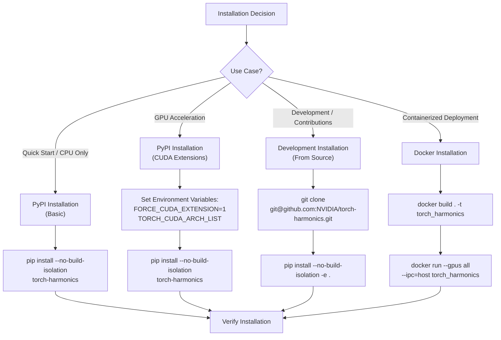
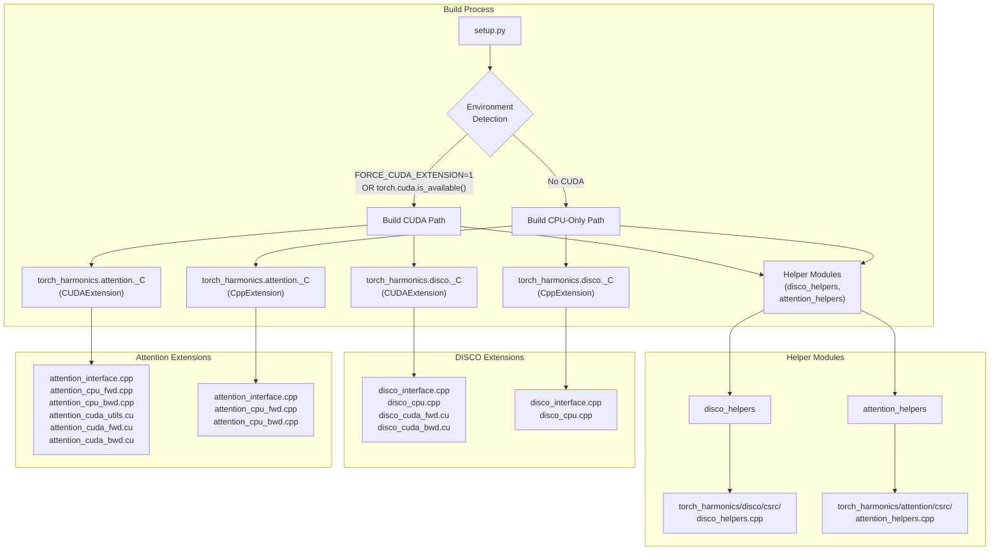
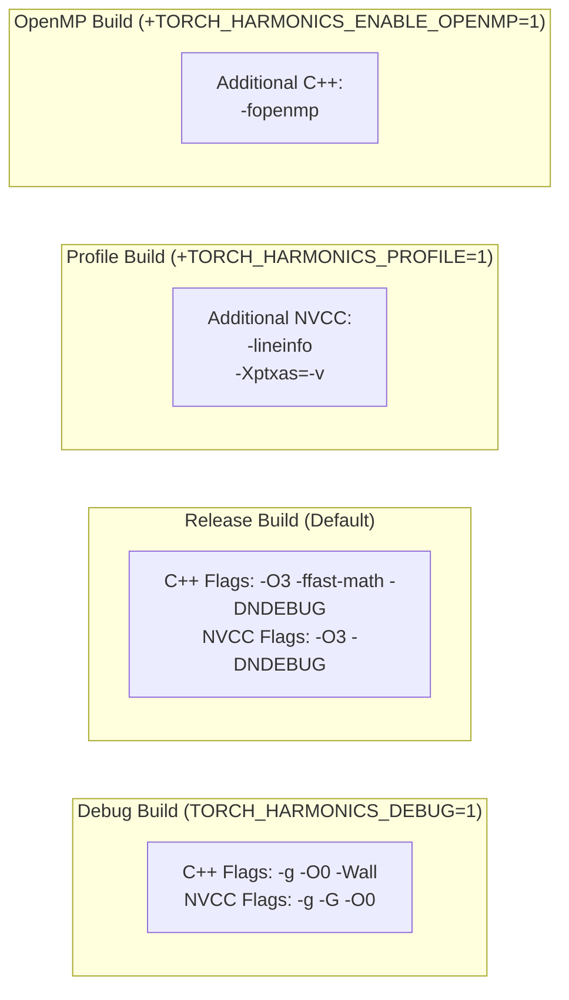
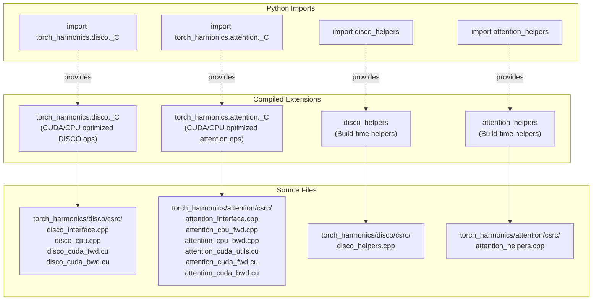

<!-- source: DeepWiki mcp.deepwiki.com · repo NVIDIA/torch-harmonics · page 1.1 Installation and Setup · fetched 2026-10-26 -->

# Installation and Setup

<details>
<summary>Relevant source files</summary>

The following files were used as context for generating this wiki page:

- [.coveragerc](.coveragerc)
- [.github/dependabot.yml](.github/dependabot.yml)
- [.github/workflows/deploy_pypi.yml](.github/workflows/deploy_pypi.yml)
- [.github/workflows/tests.yml](.github/workflows/tests.yml)
- [README.md](README.md)
- [notebooks/partial_derivatives.ipynb](notebooks/partial_derivatives.ipynb)
- [setup.py](setup.py)

</details>


## Purpose and Scope

This page provides comprehensive instructions for installing torch-harmonics on your system, including standard installations via PyPI, development installations from source, and containerized installations using Docker. It covers environment variable configuration, custom CUDA extension compilation, and troubleshooting common installation issues.

For information about the underlying build system and CI/CD processes, see [CI/CD Pipeline](#10.3). For testing after installation, see [Testing](#10.2).

## Prerequisites

torch-harmonics requires:
- Python 3.9 or higher
- PyTorch (CPU or CUDA-enabled)
- NumPy
- (Optional) CUDA toolkit for GPU acceleration
- (Optional) Docker for containerized deployment

**Important**: torch-harmonics uses custom C++ and CUDA extensions that must be compiled during installation. The `--no-build-isolation` flag is **required** to ensure these extensions compile against your existing PyTorch installation.

Sources: [README.md:77-106](), [.github/workflows/deploy_pypi.yml:20-29](), [.github/workflows/tests.yml:15-27]()

## Installation Decision Tree



Sources: [README.md:77-106]()

## Installation Methods

### Method 1: Basic PyPI Installation

For CPU-only usage or systems with CUDA automatically detected:

```bash
pip install --no-build-isolation torch-harmonics
```

This method:
- Installs the latest stable release from PyPI
- Automatically detects CUDA availability via `torch.cuda.is_available()` and `CUDA_HOME`
- Compiles CPU extensions (`disco_helpers`, `attention_helpers`)
- Compiles CUDA extensions (`disco._C`, `attention._C`) if CUDA is detected

Sources: [README.md:77-81](), [setup.py:39-54]()

### Method 2: PyPI Installation with Forced CUDA Extensions

For systems where CUDA is not automatically detected (e.g., containers) or to specify target GPU architectures:

```bash
export FORCE_CUDA_EXTENSION=1
export TORCH_CUDA_ARCH_LIST="7.0 7.2 7.5 8.0 8.6 8.7 9.0 10.0+PTX"
pip install --no-build-isolation torch-harmonics
```

**Important Architecture Notes**:
- Custom CUDA extensions only support CUDA architectures >= 7.0
- Specify only your target architecture(s) to reduce compilation time
- Common architectures:
  - `7.0`, `7.2`, `7.5`: Volta, Turing
  - `8.0`, `8.6`: Ampere
  - `8.7`: Jetson Orin
  - `9.0`: Hopper
  - `10.0+PTX`: Ada Lovelace

Sources: [README.md:82-88](), [setup.py:39](), [setup.py:50-52]()

### Method 3: Development Installation from Source

For active development and contributions:

```bash
git clone git@github.com:NVIDIA/torch-harmonics.git
cd torch-harmonics
pip install --no-build-isolation -e .
```

The `-e` flag installs in editable mode, allowing code changes without reinstallation.

Sources: [README.md:90-96]()

### Method 4: Docker Installation

For containerized deployment with full GPU support:

```bash
git clone git@github.com:NVIDIA/torch-harmonics.git
cd torch-harmonics
docker build . -t torch_harmonics
docker run --gpus all -it --rm --ipc=host --ulimit memlock=-1 --ulimit stack=67108864 torch_harmonics
```

Docker flags explained:
- `--gpus all`: Exposes all GPUs to container
- `--ipc=host`: Required for PyTorch DataLoader workers
- `--ulimit memlock=-1`: Removes memory locking limit
- `--ulimit stack=67108864`: Sets stack size for deep learning workloads

Sources: [README.md:98-105]()

## Build System Architecture



Sources: [setup.py:93-183]()

## Environment Variables

The build system supports several environment variables for customizing compilation:

| Variable | Purpose | Values | Default |
|----------|---------|--------|---------|
| `FORCE_CUDA_EXTENSION` | Force CUDA extension compilation | `0` or `1` | `0` |
| `TORCH_CUDA_ARCH_LIST` | Target GPU architectures | Space-separated arch list (e.g., `"8.0 8.6"`) | Auto-detected |
| `TORCH_HARMONICS_DEBUG` | Compile with debugging symbols | `0` or `1` | `0` |
| `TORCH_HARMONICS_PROFILE` | Enable profiling information | `0` or `1` | `0` |
| `TORCH_HARMONICS_ENABLE_OPENMP` | Enable OpenMP parallelization | `0` or `1` | `0` |

### Debug vs. Release Builds



Sources: [setup.py:56-83]()

### Compilation Flags Reference

**Debug Mode** (`TORCH_HARMONICS_DEBUG=1`):
- C++ flags: `-g`, `-O0`, `-Wall`
- NVCC flags: `-g`, `-G`, `-O0`
- Use for: Development, debugging segmentation faults

**Release Mode** (default):
- C++ flags: `-O3`, `-ffast-math`, `-DNDEBUG`
- NVCC flags: `-O3`, `-DNDEBUG`
- Use for: Production deployments

**Profile Mode** (`TORCH_HARMONICS_PROFILE=1`):
- Adds: `-lineinfo`, `-Xptxas=-v` to NVCC
- Use for: Performance profiling with NVIDIA tools

**OpenMP Mode** (`TORCH_HARMONICS_ENABLE_OPENMP=1`):
- Adds: `-fopenmp` to C++ compiler
- Use for: CPU-only parallelization

Sources: [setup.py:56-83]()

## Extension Module Mapping

The build system creates the following Python-importable modules:



Sources: [setup.py:100-181]()

## Verification

After installation, verify torch-harmonics is working correctly:

```python
import torch
import torch_harmonics as th

# Check basic functionality
device = torch.device('cuda' if torch.cuda.is_available() else 'cpu')
nlat, nlon = 512, 1024
sht = th.RealSHT(nlat, nlon, grid="equiangular").to(device)

# Test transform
signal = torch.randn(1, nlat, nlon, device=device)
coeffs = sht(signal)
print(f"Transform successful! Coefficient shape: {coeffs.shape}")

# Check CUDA extensions (if available)
if torch.cuda.is_available():
    try:
        from torch_harmonics.disco import _C as disco_C
        from torch_harmonics.attention import _C as attention_C
        print("CUDA extensions successfully loaded")
    except ImportError:
        print("Warning: CUDA extensions not available")
```

Sources: [README.md:183-198]()

## Troubleshooting

### Common Issues

#### Issue: CUDA Extensions Not Building

**Symptom**: Installation completes but GPU operations are slow or unavailable.

**Solutions**:
1. Verify CUDA toolkit is installed: `nvcc --version`
2. Check PyTorch CUDA support: `python -c "import torch; print(torch.cuda.is_available())"`
3. Force CUDA compilation:
   ```bash
   export FORCE_CUDA_EXTENSION=1
   pip install --no-build-isolation torch-harmonics
   ```
4. Check `CUDA_HOME` is set: `echo $CUDA_HOME`

Sources: [README.md:82-88](), [setup.py:39-52]()

#### Issue: Architecture Mismatch

**Symptom**: `CUDA error: no kernel image is available for execution on the device`

**Solution**: Rebuild with correct architecture:
```bash
# Check GPU compute capability
nvidia-smi --query-gpu=compute_cap --format=csv

# Rebuild with matching architecture
export TORCH_CUDA_ARCH_LIST="8.6"  # Example for RTX 3090
pip uninstall torch-harmonics
pip install --no-build-isolation torch-harmonics
```

Sources: [README.md:82-88]()

#### Issue: Build Isolation Errors

**Symptom**: `No module named 'torch'` during installation

**Solution**: Always use `--no-build-isolation`:
```bash
# Incorrect
pip install torch-harmonics

# Correct
pip install --no-build-isolation torch-harmonics
```

The `--no-build-isolation` flag ensures the build uses your existing PyTorch installation rather than creating an isolated environment.

Sources: [README.md:78-86]()

#### Issue: Compilation Errors in Debug Mode

**Symptom**: Undefined symbols or linking errors when `TORCH_HARMONICS_DEBUG=1`

**Solution**: Debug builds use different optimization flags that may expose issues. Try:
1. Update PyTorch: `pip install --upgrade torch`
2. Use release build for production
3. File issue at https://github.com/NVIDIA/torch-harmonics with full error log

Sources: [setup.py:56-83]()

#### Issue: AMP (Automatic Mixed Precision) Errors

**Symptom**: Errors about unsupported input dimensions when using `torch.autocast`

**Note**: This is a known limitation. cuFFT (used by torch-harmonics) only supports float16/bfloat16 for power-of-two dimensions.

**Solution**: Disable autocast for transforms:
```python
with torch.autocast(device_type="cuda", enabled=True):
    x = some_math(x)
    x = x.to(torch.float32)
    with torch.autocast(device_type="cuda", enabled=False):
        xt = sht(x)
```

Sources: [README.md:226-250]()

## CI/CD Integration

torch-harmonics uses GitHub Actions for continuous integration:

**Test Workflow** (`.github/workflows/tests.yml`):
- Runs on every push
- Tests on Ubuntu with Python 3.9
- CPU-only PyTorch installation
- Runs pytest on core modules: `test_sht.py`, `test_convolution.py`, `test_attention.py`, `test_cache.py`

**Deployment Workflow** (`.github/workflows/deploy_pypi.yml`):
- Triggered on release publication
- Builds source distribution only (no binary wheels)
- Users compile extensions locally during installation
- Publishes to PyPI

Sources: [.github/workflows/tests.yml:1-32](), [.github/workflows/deploy_pypi.yml:1-39]()

## Next Steps

After successful installation:
- **Basic Usage**: See [Overview](#1) for a quick-start guide
- **Core Concepts**: See [Core Concepts](#1.2) for theoretical background
- **Examples**: See [Example Applications](#8) for complete workflows
- **Testing**: See [Testing](#10.2) to run the test suite
- **Development**: See [Building from Source](#10.1) for contribution guidelines

---

