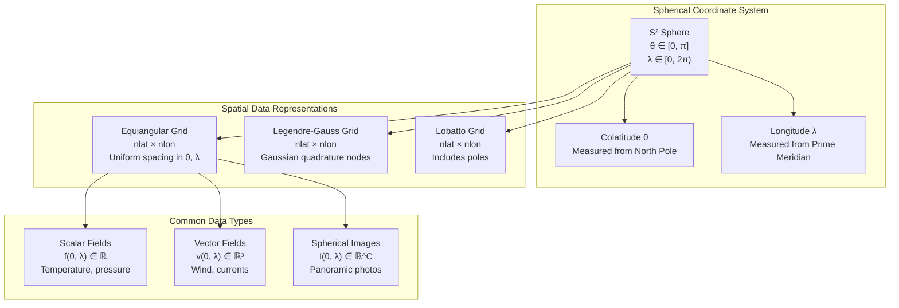
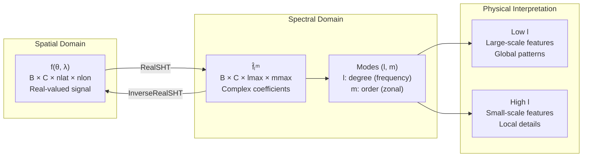
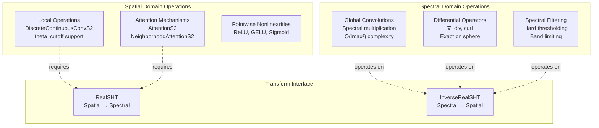
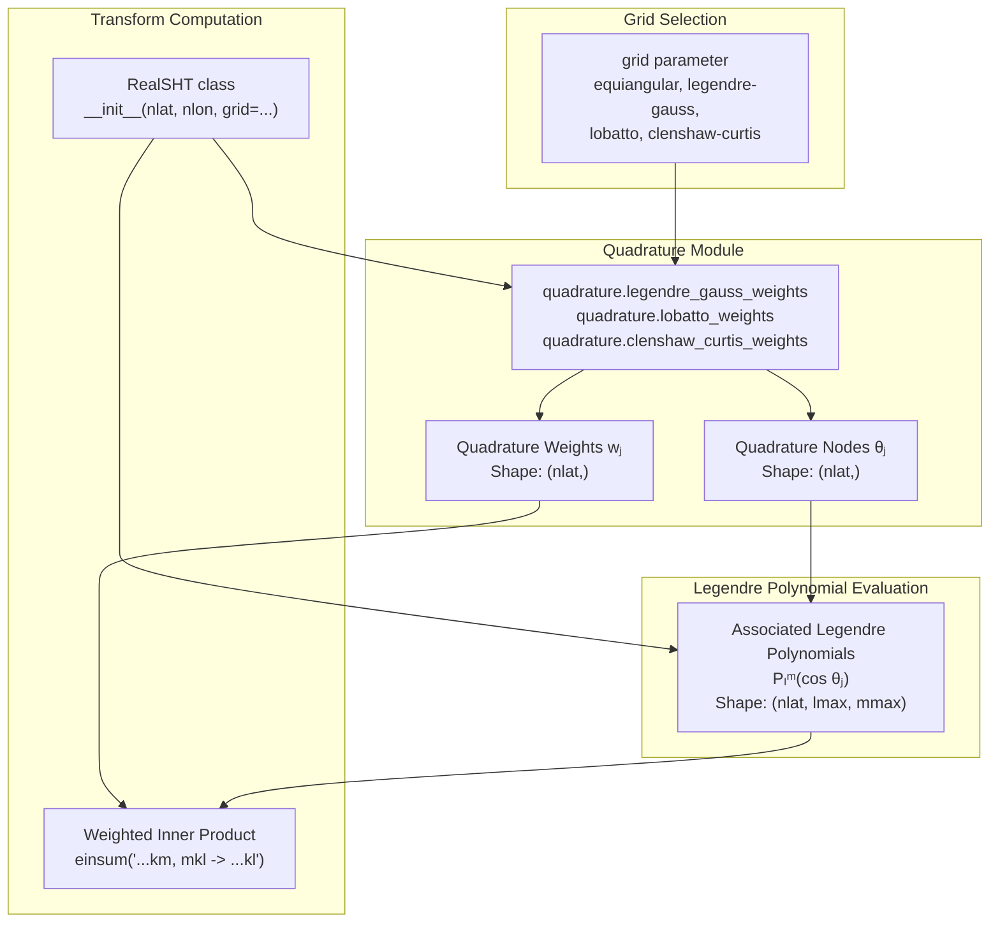
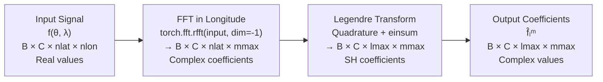
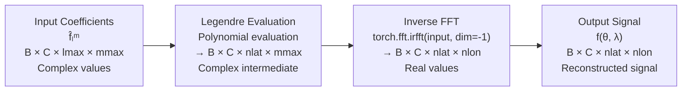
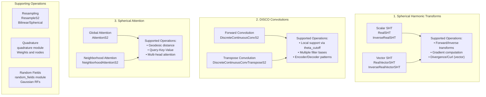
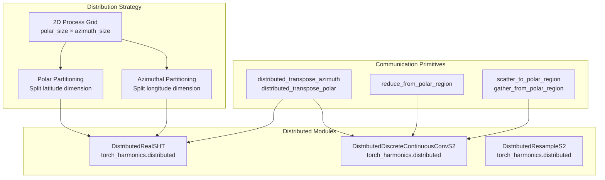
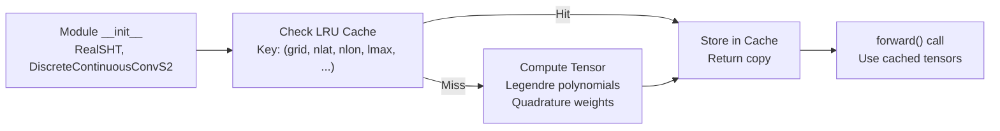

<!-- source: DeepWiki mcp.deepwiki.com · repo NVIDIA/torch-harmonics · page 1.2 Core Concepts · fetched 2026-10-26 -->

# Core Concepts

<details>
<summary>Relevant source files</summary>

The following files were used as context for generating this wiki page:

- [Changelog.md](Changelog.md)
- [README.md](README.md)
- [notebooks/partial_derivatives.ipynb](notebooks/partial_derivatives.ipynb)
- [setup.py](setup.py)
- [torch_harmonics/__init__.py](torch_harmonics/__init__.py)

</details>


## Purpose and Scope

This document introduces the fundamental mathematical and architectural concepts that underpin torch-harmonics. It covers the theoretical basis of spherical harmonic transforms, the distinction between spatial and spectral domains, grid types and quadrature rules, and the library's design philosophy emphasizing differentiability and composability.

For installation instructions and environment setup, see [Installation and Setup](#1.1). For detailed usage of specific transform classes, see [Spherical Harmonic Transforms](#2).

## The Sphere as a Data Domain

torch-harmonics operates on data defined on the 2-sphere $S^2$ embedded in three dimensions. Points on the sphere are parameterized by colatitude $\theta \in [0, \pi]$ and longitude $\lambda \in [0, 2\pi)$.



**Sources:** [README.md:109-170]()

## Spherical Harmonics Fundamentals

Spherical harmonics $Y_l^m(\theta, \lambda)$ form an orthonormal basis for functions on the sphere, analogous to Fourier series on a circle. They are defined as:

$$Y_l^m(\theta, \lambda) = \sqrt{\frac{(2l + 1)}{4 \pi} \frac{(l - m)!}{(l + m)!}} P_l^m(\cos \theta)  \exp(im\lambda)$$

where $P_l^m$ are the associated Legendre polynomials.

### Spherical Harmonic Decomposition

| Parameter | Description | Range | Interpretation |
|-----------|-------------|-------|----------------|
| $l$ | Degree | $l \geq 0$ | Frequency/scale (total oscillation) |
| $m$ | Order | $-l \leq m \leq l$ | Zonal frequency (oscillation in longitude) |
| $\hat{f}_l^m$ | Coefficient | Complex | Amplitude of mode $(l, m)$ |

The forward transform projects a spatial signal onto this basis:

$$\hat{f}_l^m = \int_{S^2}  \overline{Y_{l}^{m}}(\theta, \lambda) f(\theta, \lambda) \mathrm{d} \mu(\theta, \lambda)$$

The inverse transform reconstructs the signal:

$$f(\theta, \lambda) = \sum_{m=-M}^{M} \exp(im\lambda) \sum_{l=|m|}^{M} \hat{f}_l^m  P_l^m (\cos \theta)$$



**Sources:** [README.md:109-139](), [torch_harmonics/__init__.py:34]()

## Spatial vs Spectral Representations

torch-harmonics provides seamless transitions between spatial and spectral representations, each suited to different operations.

### Comparison of Domains

| Property | Spatial Domain | Spectral Domain |
|----------|----------------|-----------------|
| **Representation** | Gridded values $f(\theta, \lambda)$ | Modal coefficients $\hat{f}_l^m$ |
| **Data shape** | `B × C × nlat × nlon` | `B × C × lmax × mmax` |
| **Data type** | Real (`torch.float32/64`) | Complex (`torch.cfloat/cdouble`) |
| **Locality** | Pointwise operations efficient | Global operations efficient |
| **Memory** | $O(n_{\text{lat}} \cdot n_{\text{lon}})$ | $O(l_{\text{max}} \cdot m_{\text{max}})$ |
| **Best for** | Local convolutions, attention | Global convolutions, derivatives |

### Operations by Domain



**Sources:** [README.md:125-170](), [torch_harmonics/__init__.py:34-37]()

## Grid Types and Quadrature Rules

The choice of spatial grid determines the quadrature rule used for computing the Legendre transform. Different grids offer tradeoffs between accuracy, pole treatment, and computational efficiency.

### Grid Type Characteristics

| Grid Type | Quadrature Rule | Pole Points | Use Case |
|-----------|----------------|-------------|----------|
| `equiangular` | Trapezoid rule | Excluded | General purpose, simple |
| `legendre-gauss` | Gaussian quadrature | Excluded | High accuracy, default for precision |
| `lobatto` | Gauss-Lobatto | Included | Physical boundary conditions |
| `clenshaw-curtis` | Clenshaw-Curtis | Included | Fast, good for FFT |

### Quadrature in Transform Pipeline

The Legendre transform is computed using numerical quadrature:

$$\hat{f}_l^m = \sum_{j=1}^{n_{\theta}}  \hat{f}^m(\theta_j) P_l^m(\cos \theta_j) w_j$$

where $\theta_j$ are quadrature nodes and $w_j$ are quadrature weights.



**Sources:** [README.md:155-169](), [torch_harmonics/__init__.py:38]()

## Transform Pipeline Architecture

The spherical harmonic transform decomposes into two sequential operations: an FFT in longitude and a Legendre transform in latitude.

### Forward Transform (Spatial → Spectral)



The forward transform is implemented in [RealSHT](). The FFT operation uses `torch.fft.rfft` to compute:

$$\hat{f}^m(\theta) = \frac{1}{2 \pi} \int_{0}^{2\pi} f(\theta, \lambda) \exp(-im\lambda) \mathrm{d} \lambda$$

The Legendre transform then computes:

$$\hat{f}_l^m = \frac{1}{2} \int^{\pi}_0 \hat{f}^{m} (\theta) P_l^m (\cos \theta) \sin \theta \mathrm{d} \theta$$

### Inverse Transform (Spectral → Spatial)



The inverse transform is implemented in [InverseRealSHT]().

**Sources:** [README.md:141-169](), [torch_harmonics/__init__.py:34]()

## Core Computational Primitives

torch-harmonics provides three main computational primitives that can be composed to build neural operators and other spherical algorithms.

### Primitive Mapping to Code



### Implementation Characteristics

| Primitive | Spatial/Spectral | Complexity | Distributed Support |
|-----------|------------------|------------|---------------------|
| `RealSHT` | Spatial → Spectral | $O(n^2 \log n)$ | `DistributedRealSHT` |
| `InverseRealSHT` | Spectral → Spatial | $O(n^2 \log n)$ | `DistributedInverseRealSHT` |
| `DiscreteContinuousConvS2` | Spatial → Spatial | $O(n^2 k^2)$ | `DistributedDiscreteContinuousConvS2` |
| `AttentionS2` | Spatial → Spatial | $O(n^4)$ or $O(n^2 k^2)$ | Not yet available |
| `ResampleS2` | Spatial → Spatial | $O(n^2)$ | `DistributedResampleS2` |

**Sources:** [torch_harmonics/__init__.py:34-37](), [README.md:171-177]()

## Design Philosophy

### 1. Differentiability First

All operations are implemented using PyTorch primitives to ensure full differentiability through automatic differentiation. This enables:

- **End-to-end training** of neural operators
- **Gradient-based optimization** of PDE solvers
- **Backpropagation** through transform operations


### 2. Modular Composability

Operations are exposed as `torch.nn.Module` instances that can be composed in standard PyTorch workflows:

```python
# Example from README.md:183-198
sht = th.RealSHT(nlat, nlon, grid="equiangular").to(device)
coeffs = sht(signal)
```

Each module:
- Follows PyTorch conventions (`__init__`, `forward`, `.to(device)`)
- Can be part of `nn.Sequential` or custom modules
- Supports standard PyTorch features (DDP, checkpointing, mixed precision)

### 3. Spatial Distribution

For large-scale problems, torch-harmonics implements distributed versions of core operations using a 2D process grid:



### 4. Multi-Backend Optimization

Critical operations have multiple backend implementations selected at runtime:

| Operation | Backends | Selection Criterion |
|-----------|----------|---------------------|
| DISCO Convolution | CUDA, Triton, PyTorch | Device and kernel availability |
| Attention | CUDA (custom), OpenMP, PyTorch | Device and compilation flags |
| FFT | cuFFT (CUDA), PyTorch | Precision and device |

The build system ([setup.py:39-183]()) conditionally compiles CUDA extensions based on environment variables:
- `FORCE_CUDA_EXTENSION`: Force CUDA compilation
- `TORCH_HARMONICS_DEBUG`: Debug symbols
- `TORCH_HARMONICS_PROFILE`: Profiling info
- `TORCH_HARMONICS_ENABLE_OPENMP`: OpenMP support

### 5. Caching and Performance

The library implements an LRU cache for precomputed tensors (Legendre polynomials, quadrature weights, filter bases) to avoid redundant computation:



This significantly improves module instantiation time while managing memory efficiently.

**Sources:** [README.md:52-59](), [Changelog.md:29-34](), [setup.py:56-91]()

## Mathematical Notation and Conventions

Throughout the library, the following conventions are used:

| Symbol | Meaning | Typical Range |
|--------|---------|---------------|
| $\theta$ | Colatitude | $[0, \pi]$ |
| $\lambda$ | Longitude | $[0, 2\pi)$ |
| $l$ | Spherical harmonic degree | $0 \leq l \leq l_{\max}$ |
| $m$ | Spherical harmonic order | $-l \leq m \leq l$ |
| $n_{\text{lat}}$ | Number of latitude points | Typically $2^k$ or related to $l_{\max}$ |
| $n_{\text{lon}}$ | Number of longitude points | Typically $2 \times n_{\text{lat}}$ |
| `B` | Batch dimension | Variable |
| `C` | Channel dimension | Variable |

The library typically uses the convention $n_{\text{lon}} = 2 \times n_{\text{lat}}$ for equiangular grids, and $l_{\max} = m_{\max} = n_{\text{lat}} - 1$ for full resolution transforms.

**Sources:** [README.md:109-169]()

---

