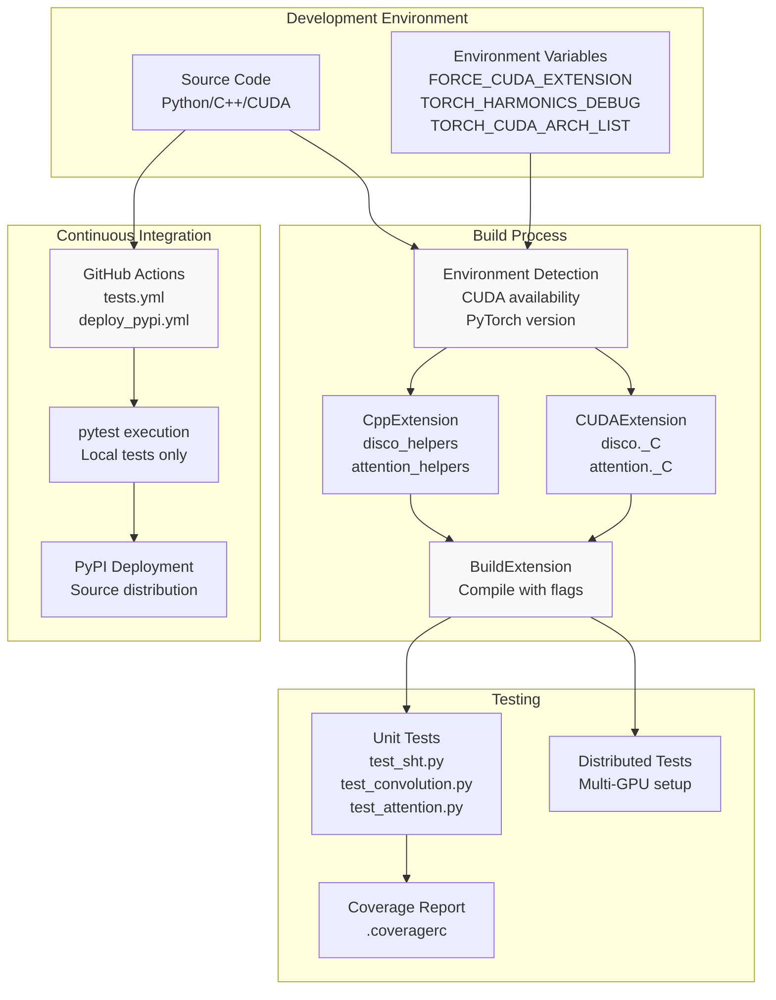
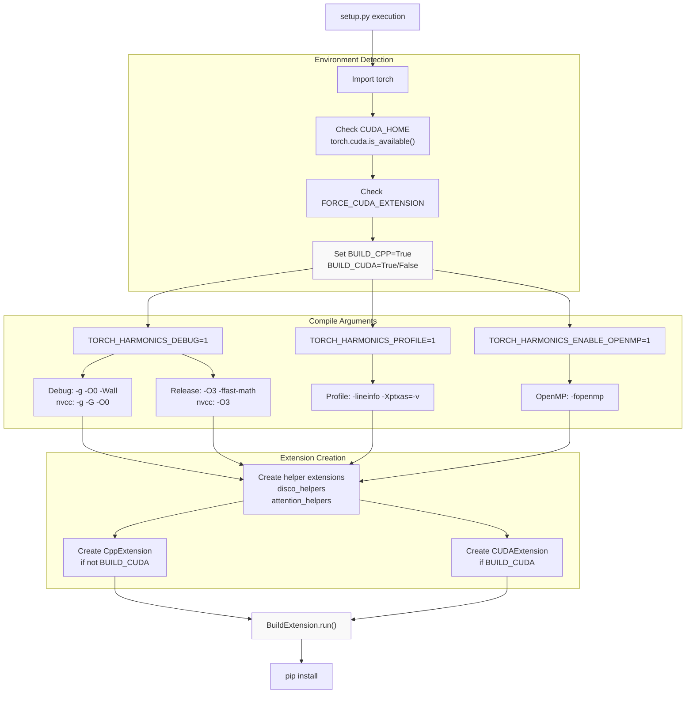
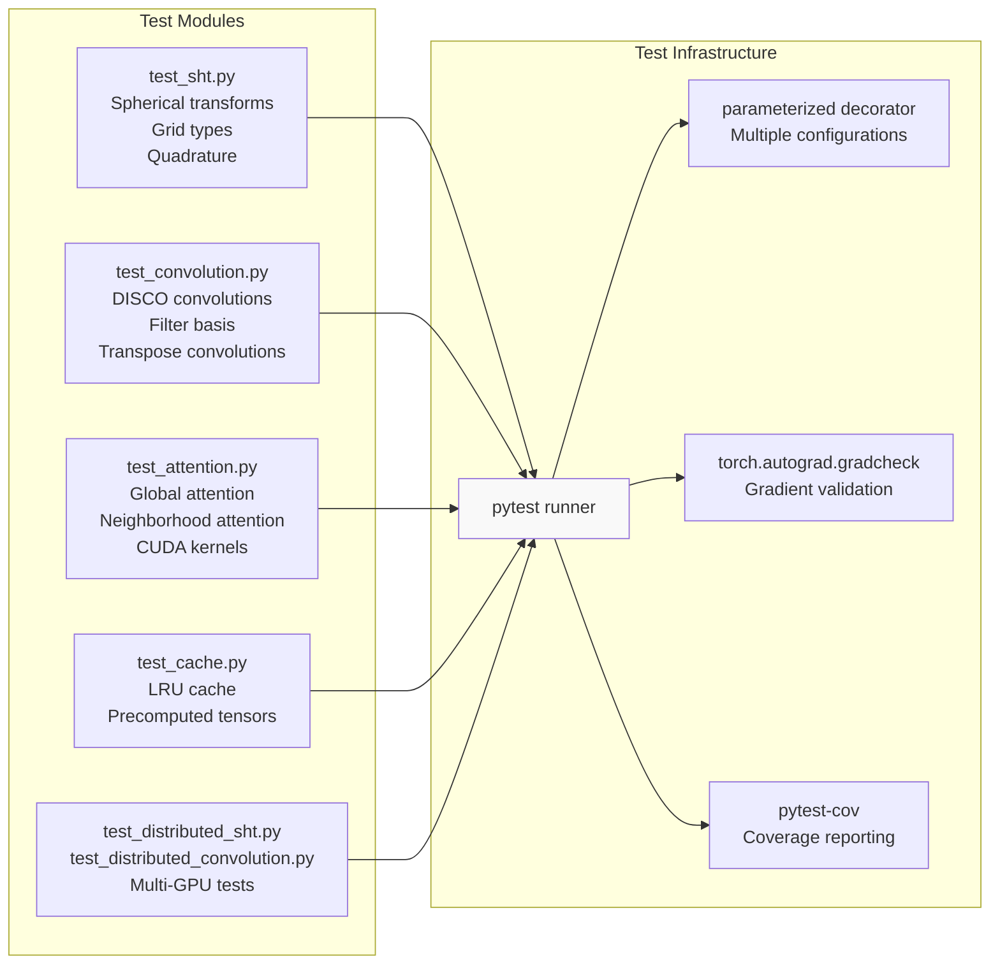
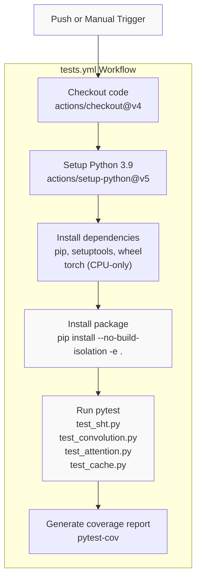
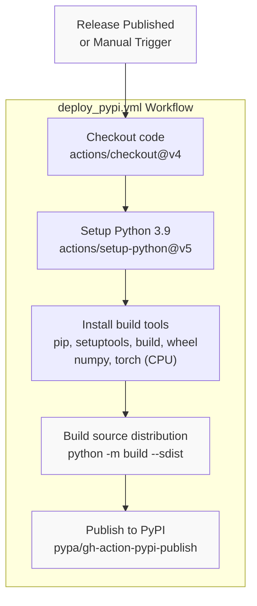
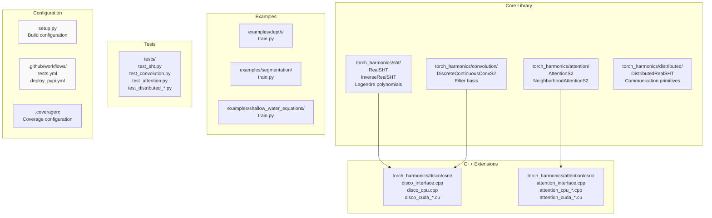

<!-- source: DeepWiki mcp.deepwiki.com · repo NVIDIA/torch-harmonics · page 10 Development Guide · fetched 2026-10-26 -->

# Development Guide

<details>
<summary>Relevant source files</summary>

The following files were used as context for generating this wiki page:

- [.coveragerc](.coveragerc)
- [.github/dependabot.yml](.github/dependabot.yml)
- [.github/workflows/deploy_pypi.yml](.github/workflows/deploy_pypi.yml)
- [.github/workflows/tests.yml](.github/workflows/tests.yml)
- [README.md](README.md)
- [notebooks/partial_derivatives.ipynb](notebooks/partial_derivatives.ipynb)
- [setup.py](setup.py)

</details>


This guide provides information for developers who want to contribute to torch-harmonics, modify the library, or understand its internal structure. It covers building from source, running tests, understanding the CI/CD pipeline, and working with the codebase.

For information about using torch-harmonics as an end-user, see [Installation and Setup](#1.1). For API documentation, see [API Reference](#11).

## Development Workflow Overview

The torch-harmonics development workflow follows standard open-source practices with automated testing and deployment. The library includes both pure Python code and custom C++/CUDA extensions that require compilation.



**Sources:** [setup.py:1-194](), [.github/workflows/tests.yml:1-32](), [.github/workflows/deploy_pypi.yml:1-39]()

## Build System Architecture

The build system uses `setuptools` with PyTorch's extension building utilities to compile custom C++ and CUDA kernels. The system conditionally compiles different extensions based on hardware availability.

### Extension Modules

The library compiles the following extension modules:

| Module | Type | Purpose | Source Files |
|--------|------|---------|-------------|
| `disco_helpers` | CppExtension | Helper routines for DISCO operations | `torch_harmonics/disco/csrc/disco_helpers.cpp` |
| `attention_helpers` | CppExtension | Helper routines for attention mechanisms | `torch_harmonics/attention/csrc/attention_helpers.cpp` |
| `torch_harmonics.disco._C` | CppExtension or CUDAExtension | DISCO convolution kernels (CPU/GPU) | `disco_interface.cpp`, `disco_cpu.cpp`, `disco_cuda_fwd.cu`, `disco_cuda_bwd.cu` |
| `torch_harmonics.attention._C` | CppExtension or CUDAExtension | Attention kernels (CPU/GPU) | `attention_interface.cpp`, `attention_cpu_fwd.cpp`, `attention_cpu_bwd.cpp`, `attention_cuda_*.cu` |

**Sources:** [setup.py:93-183]()

### Build Configuration Flow



**Sources:** [setup.py:32-91](), [setup.py:56-83]()

### Environment Variables

The build system responds to several environment variables:

| Variable | Values | Purpose | Default |
|----------|--------|---------|---------|
| `FORCE_CUDA_EXTENSION` | `0` or `1` | Force CUDA extension compilation even if CUDA not detected | `0` |
| `TORCH_HARMONICS_DEBUG` | `0` or `1` | Compile with debugging symbols and no optimization | `0` |
| `TORCH_HARMONICS_PROFILE` | `0` or `1` | Add profiling information to compiled kernels | `0` |
| `TORCH_HARMONICS_ENABLE_OPENMP` | `0` or `1` | Enable OpenMP parallelization in CPU kernels | `0` |
| `TORCH_CUDA_ARCH_LIST` | Compute capabilities | Target specific GPU architectures (e.g., "7.0 8.0 9.0") | PyTorch default |

**Sources:** [setup.py:39-61](), [README.md:82-88]()

## Testing Framework

The test suite uses `pytest` with parameterization for comprehensive coverage across different configurations. Tests are organized by functional area.

### Test Organization



**Sources:** [.github/workflows/tests.yml:29-32](), [.coveragerc:1-4]()

### Test Categories

Tests are categorized into several types:

1. **Unit Tests**: Test individual components in isolation
   - SHT forward/inverse transforms
   - DISCO convolution operations
   - Attention mechanism correctness
   - Cache functionality

2. **Gradient Tests**: Validate automatic differentiation using `torch.autograd.gradcheck`
   - Ensures backward passes are numerically correct
   - Tests all learnable operations

3. **Distributed Tests**: Multi-GPU and multi-node testing
   - Requires distributed PyTorch setup
   - Tests communication primitives
   - Validates distributed SHT and convolutions

4. **Performance Tests**: Threshold validation
   - Ensures operations meet performance targets
   - CPU vs GPU benchmarks

**Sources:** [.github/workflows/tests.yml:29-32]()

### Coverage Configuration

Test coverage excludes certain directories that are tested separately or are example code:

```
[run]
omit =
    */distributed/*
    */examples/*
```

Distributed code requires multi-GPU setup for testing and is typically tested in specialized environments. Examples are validated through manual testing.

**Sources:** [.coveragerc:1-4]()

## Continuous Integration Pipeline

The CI/CD system uses GitHub Actions with two primary workflows: testing and deployment.

### Testing Workflow



The testing workflow:
- Runs on every push to the repository
- Uses Python 3.9 on Ubuntu
- Installs CPU-only PyTorch for faster CI
- Runs local (non-distributed) tests only
- Generates coverage reports

**Sources:** [.github/workflows/tests.yml:1-32]()

### Deployment Workflow



The deployment workflow:
- Triggers on published GitHub releases
- Builds source distribution only (not wheels)
- Users compile extensions during installation
- Uses PyPI token authentication via secrets

**Sources:** [.github/workflows/deploy_pypi.yml:1-39]()

### CI Environment Differences

The CI environment differs from production installations:

| Aspect | CI Environment | Production |
|--------|---------------|------------|
| PyTorch | CPU-only from `download.pytorch.org/whl/cpu` | User's PyTorch installation |
| CUDA | Not available | May be available |
| Extensions | CPU-only (`BUILD_CUDA=False`) | CPU or CUDA based on environment |
| Tests | Local tests only | Can run distributed tests |
| Python | 3.9 fixed | User's Python version |

**Sources:** [.github/workflows/tests.yml:20-27](), [.github/workflows/deploy_pypi.yml:25-29]()

## Development Best Practices

### Building for Development

For active development, install in editable mode with build isolation disabled:

```bash
git clone git@github.com:NVIDIA/torch-harmonics.git
cd torch-harmonics
pip install --no-build-isolation -e .
```

The `--no-build-isolation` flag ensures extensions are built against your current PyTorch installation rather than a temporary environment.

**Sources:** [README.md:90-96]()

### Enabling CUDA Extensions

For GPU development, set appropriate environment variables:

```bash
export FORCE_CUDA_EXTENSION=1
export TORCH_CUDA_ARCH_LIST="7.0 8.0 9.0"
pip install --no-build-isolation -e .
```

Choose only the architectures you need to reduce compilation time. Current GPU architectures supported are 7.0+ (Volta and newer).

**Sources:** [README.md:82-88]()

### Debug Builds

For debugging C++/CUDA code:

```bash
export TORCH_HARMONICS_DEBUG=1
pip install --no-build-isolation -e .
```

This compiles with `-g -O0` flags, enabling debugger symbols and disabling optimization.

**Sources:** [setup.py:56-77]()

### Running Tests Locally

Run the full local test suite:

```bash
pip install pytest pytest-cov parameterized
pytest --cov-report term --cov-config=.coveragerc --cov=torch_harmonics \
    ./tests/test_sht.py \
    ./tests/test_convolution.py \
    ./tests/test_attention.py \
    ./tests/test_cache.py
```

For distributed tests (requires multi-GPU setup):

```bash
pytest ./tests/test_distributed_sht.py
pytest ./tests/test_distributed_convolution.py
```

**Sources:** [.github/workflows/tests.yml:29-32]()

## Codebase Structure

### Repository Organization



**Sources:** [setup.py:93-183](), [.coveragerc:1-4]()

### Extension Source Organization

C++ and CUDA extensions follow a consistent pattern:

- **Interface file**: Exposes functions to Python (e.g., `disco_interface.cpp`, `attention_interface.cpp`)
- **CPU implementation**: Pure C++ implementations (e.g., `disco_cpu.cpp`, `attention_cpu_fwd.cpp`)
- **CUDA implementation**: GPU-accelerated kernels (e.g., `disco_cuda_fwd.cu`, `attention_cuda_fwd.cu`)
- **Helper file**: Build-time configuration (e.g., `disco_helpers.cpp`, `attention_helpers.cpp`)

The helper files define `BUILD_CPP` and `BUILD_CUDA` macros that control which implementations are available at runtime.

**Sources:** [setup.py:100-181]()

## Debugging and Profiling

### Debugging C++ Extensions

1. Build with debug symbols:
   ```bash
   export TORCH_HARMONICS_DEBUG=1
   pip install --no-build-isolation -e .
   ```

2. Use a debugger (gdb/lldb):
   ```bash
   gdb python
   (gdb) run your_script.py
   ```

**Sources:** [setup.py:56-77]()

### Profiling CUDA Kernels

1. Build with profiling information:
   ```bash
   export TORCH_HARMONICS_PROFILE=1
   pip install --no-build-isolation -e .
   ```

2. Profile with Nsight Systems or nvprof:
   ```bash
   nsys profile python your_script.py
   ```

The profile build adds `-lineinfo` and `-Xptxas=-v` flags to show line-level performance information.

**Sources:** [setup.py:60-70]()

## Contributing Guidelines

### Code Style

The repository includes `.clang-format` configuration for C++ code formatting. While specific style guidelines are documented in [Code Style and Formatting](#10.4), contributors should:

1. Follow existing code patterns
2. Add tests for new functionality
3. Update documentation
4. Ensure CI tests pass

### Pull Request Process

1. Fork the repository
2. Create a feature branch
3. Make changes with tests
4. Ensure `pytest` passes locally
5. Submit pull request
6. Wait for CI validation

**Sources:** [.github/workflows/tests.yml:1-32]()

## Docker Development Environment

For containerized development, use the provided Dockerfile:

```bash
git clone git@github.com:NVIDIA/torch-harmonics.git
cd torch-harmonics
docker build . -t torch_harmonics
docker run --gpus all -it --rm --ipc=host \
    --ulimit memlock=-1 --ulimit stack=67108864 \
    torch_harmonics
```

The container includes all dependencies and CUDA support.

**Sources:** [README.md:98-105]()

---

This development guide covers the essential aspects of contributing to and working with torch-harmonics. For detailed API documentation, see [API Reference](#11). For building from source with specific configurations, see [Building from Source](#10.1). For running the test suite, see [Testing](#10.2).

---

