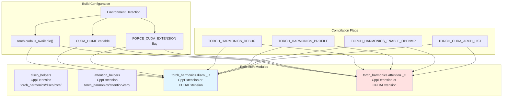
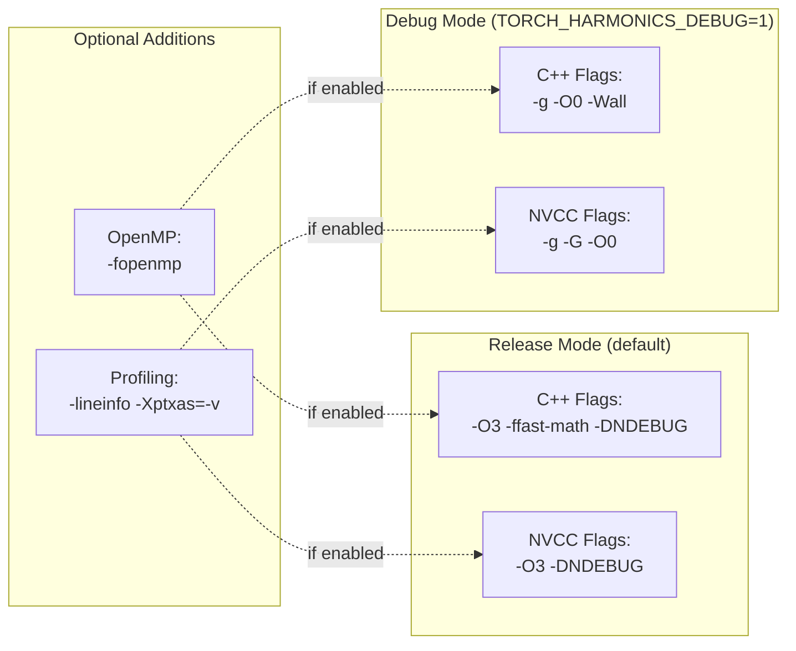
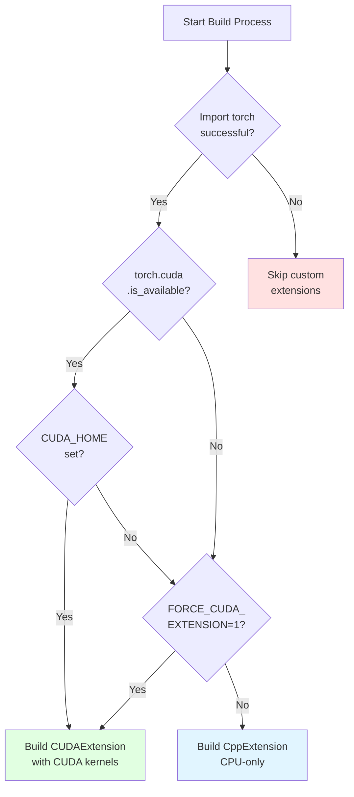

<!-- source: DeepWiki mcp.deepwiki.com · repo NVIDIA/torch-harmonics · page 10.1 Building from Source · fetched 2026-10-26 -->

# Building from Source

<details>
<summary>Relevant source files</summary>

The following files were used as context for generating this wiki page:

- [.coveragerc](.coveragerc)
- [.github/dependabot.yml](.github/dependabot.yml)
- [.github/workflows/deploy_pypi.yml](.github/workflows/deploy_pypi.yml)
- [.github/workflows/tests.yml](.github/workflows/tests.yml)
- [README.md](README.md)
- [notebooks/partial_derivatives.ipynb](notebooks/partial_derivatives.ipynb)
- [setup.py](setup.py)

</details>


## Purpose and Scope

This page provides detailed instructions for building torch-harmonics from source code. It covers the build system architecture, environment configuration, compilation of CPU and CUDA extensions, and troubleshooting common build issues. For information about running tests after building, see [Testing](#10.2). For CI/CD pipeline details, see [CI/CD Pipeline](#10.3).

## Prerequisites

Before building torch-harmonics from source, ensure you have the following dependencies installed:

- **Python**: Version 3.9 or higher
- **PyTorch**: A compatible PyTorch installation (CPU or CUDA-enabled)
- **NumPy**: Required for build-time operations
- **C++ Compiler**: For compiling CPU extensions (g++, clang, or MSVC)
- **CUDA Toolkit** (optional): Required only if building CUDA extensions
  - Minimum supported compute capability: 7.0 (Volta architecture)
  - Compatible with CUDA 11.0 and newer

Sources: [README.md:77-89](), [.github/workflows/deploy_pypi.yml:20-29](), [setup.py:42-54]()

## Build System Architecture

The torch-harmonics build system is implemented in `setup.py` using PyTorch's extension mechanisms. The build process conditionally compiles different extension modules based on the detected environment.



**Figure 1: Build System Architecture and Extension Compilation**

The build system creates four extension modules:

| Module Name | Type | Source Files | Purpose |
|------------|------|--------------|---------|
| `disco_helpers` | CppExtension | `torch_harmonics/disco/csrc/disco_helpers.cpp` | Helper routines for DISCO convolutions |
| `attention_helpers` | CppExtension | `torch_harmonics/attention/csrc/attention_helpers.cpp` | Helper routines for attention mechanisms |
| `torch_harmonics.disco._C` | CppExtension or CUDAExtension | `disco_interface.cpp`, `disco_cpu.cpp`, optionally `disco_cuda_fwd.cu`, `disco_cuda_bwd.cu` | Main DISCO convolution kernels |
| `torch_harmonics.attention._C` | CppExtension or CUDAExtension | `attention_interface.cpp`, `attention_cpu_fwd.cpp`, `attention_cpu_bwd.cpp`, optionally CUDA files | Main attention kernels |

Sources: [setup.py:93-183](), [setup.py:56-83]()

## Environment Variables

The build process is controlled by several environment variables that determine compilation behavior:

### Core Build Variables

| Variable | Values | Default | Description |
|----------|--------|---------|-------------|
| `FORCE_CUDA_EXTENSION` | `0` or `1` | `0` | Forces CUDA extension compilation even if CUDA is not auto-detected |
| `TORCH_CUDA_ARCH_LIST` | Compute capabilities (e.g., `"7.0 8.0 9.0"`) | PyTorch default | Specifies target GPU architectures for CUDA compilation |

### Debug and Profiling Variables

| Variable | Values | Default | Description |
|----------|--------|---------|-------------|
| `TORCH_HARMONICS_DEBUG` | `0` or `1` | `0` | Enables debug symbols and disables optimizations (`-g -O0`) |
| `TORCH_HARMONICS_PROFILE` | `0` or `1` | `0` | Adds profiling information to CUDA kernels (`-lineinfo -Xptxas=-v`) |
| `TORCH_HARMONICS_ENABLE_OPENMP` | `0` or `1` | `0` | Enables OpenMP parallelization in CPU code (`-fopenmp`) |

### Compilation Flags by Mode



**Figure 2: Compilation Flag Configuration**

Sources: [setup.py:56-83](), [setup.py:85-91]()

## Build Decision Logic

The build system automatically determines whether to compile CUDA extensions using the following logic:



**Figure 3: CUDA Extension Build Decision Flow**

Sources: [setup.py:38-54]()

## Installation Methods

### Method 1: Install from PyPI (Pre-built)

For standard installation without building from source:

```bash
pip install --no-build-isolation torch-harmonics
```

**Note**: The `--no-build-isolation` flag ensures custom CPU kernels are built with the existing torch installation rather than in an isolated environment.

Sources: [README.md:78-81]()

### Method 2: Build from Source with CUDA Support

For systems with CUDA GPUs, explicitly enable CUDA extension compilation:

```bash
# Set target GPU architectures (recommended for faster compilation)
export TORCH_CUDA_ARCH_LIST="7.0 7.5 8.0 8.6 9.0 10.0+PTX"

# Force CUDA extension compilation
export FORCE_CUDA_EXTENSION=1

# Install from PyPI with build
pip install --no-build-isolation torch-harmonics

# OR clone and install from repository
git clone git@github.com:NVIDIA/torch-harmonics.git
cd torch-harmonics
pip install --no-build-isolation -e .
```

**GPU Architecture Selection**: To reduce compilation time, only specify the compute capability of your GPU. Common values:
- `7.0`: Volta (V100)
- `7.5`: Turing (GTX 16 series, RTX 20 series)
- `8.0`: Ampere (A100)
- `8.6`: Ampere (RTX 30 series)
- `9.0`: Hopper (H100)
- `10.0+PTX`: Ada Lovelace (RTX 40 series) with forward compatibility

Sources: [README.md:82-89]()

### Method 3: Development Installation

For active development with editable installation:

```bash
git clone git@github.com:NVIDIA/torch-harmonics.git
cd torch-harmonics

# Standard development install
pip install --no-build-isolation -e .

# OR with debug symbols for debugging C++/CUDA code
export TORCH_HARMONICS_DEBUG=1
pip install --no-build-isolation -e .
```

The `-e` flag creates an editable installation where Python code changes take effect immediately without reinstalling. C++/CUDA extensions must be recompiled after changes:

```bash
pip install --no-build-isolation -e . --force-reinstall --no-deps
```

Sources: [README.md:90-96]()

### Method 4: Docker Build

For containerized environments or reproducible builds:

```bash
git clone git@github.com:NVIDIA/torch-harmonics.git
cd torch-harmonics

# Build Docker image
docker build . -t torch_harmonics

# Run container with GPU support
docker run --gpus all -it --rm \
           --ipc=host \
           --ulimit memlock=-1 \
           --ulimit stack=67108864 \
           torch_harmonics
```

**Docker Runtime Flags**:
- `--gpus all`: Enable GPU access
- `--ipc=host`: Use host IPC namespace (required for multi-process training)
- `--ulimit memlock=-1`: Unlimited locked memory (required for CUDA operations)
- `--ulimit stack=67108864`: 64MB stack limit (prevents stack overflow in complex models)

Sources: [README.md:98-105]()

## CI/CD Build Process

The GitHub Actions workflows provide examples of building torch-harmonics in automated environments:


**Figure 4: CI/CD Build Pipelines**

**Test Workflow** (`tests.yml`): Runs on every push to verify CPU-only builds work correctly on Ubuntu with Python 3.9.

**Deploy Workflow** (`deploy_pypi.yml`): Triggered on releases to build source distribution and upload to PyPI.

Sources: [.github/workflows/tests.yml:1-32](), [.github/workflows/deploy_pypi.yml:1-39]()

## Source Code Organization

Extension source files are organized as follows:

```
torch_harmonics/
├── disco/
│   └── csrc/
│       ├── disco_helpers.cpp          # Helper module
│       ├── disco_interface.cpp        # Python binding interface
│       ├── disco_cpu.cpp              # CPU kernel implementations
│       ├── disco_cuda_fwd.cu          # CUDA forward kernels (optional)
│       └── disco_cuda_bwd.cu          # CUDA backward kernels (optional)
└── attention/
    └── csrc/
        ├── attention_helpers.cpp      # Helper module
        ├── attention_interface.cpp    # Python binding interface
        ├── attention_cpu_fwd.cpp      # CPU forward kernels
        ├── attention_cpu_bwd.cpp      # CPU backward kernels
        ├── attention_cuda_utils.cu    # CUDA utilities (optional)
        ├── attention_cuda_fwd.cu      # CUDA forward kernels (optional)
        └── attention_cuda_bwd.cu      # CUDA backward kernels (optional)
```

Sources: [setup.py:100-181]()

## Troubleshooting

### Common Build Issues

| Issue | Symptom | Solution |
|-------|---------|----------|
| **CUDA not detected** | Extensions build as CPU-only despite having CUDA | Set `FORCE_CUDA_EXTENSION=1` or ensure `CUDA_HOME` environment variable points to CUDA installation |
| **Compute capability error** | `nvcc fatal error: Unsupported gpu architecture 'compute_XX'` | Update `TORCH_CUDA_ARCH_LIST` to remove unsupported architectures or ensure CUDA version is compatible |
| **Long compilation time** | Build takes excessive time | Reduce number of architectures in `TORCH_CUDA_ARCH_LIST` to only target your specific GPU |
| **ImportError after install** | `ImportError: cannot import name '_C'` | Extensions failed to build; check build logs for compilation errors |
| **Build isolation issues** | Version conflicts or missing dependencies | Always use `--no-build-isolation` flag when installing |

### Minimum CUDA Compute Capability

torch-harmonics CUDA extensions require **compute capability 7.0 or higher** (Volta architecture and newer). Older GPUs are not supported for CUDA acceleration but can use CPU implementations.

Sources: [README.md:88-89](), [setup.py:39-54]()

### Debugging Build Failures

To get detailed build output:

```bash
# Enable verbose output
pip install --no-build-isolation -e . -v

# For maximum verbosity
pip install --no-build-isolation -e . -vvv
```

To compile with debug symbols for C++/CUDA debugging:

```bash
export TORCH_HARMONICS_DEBUG=1
pip install --no-build-isolation -e . --force-reinstall --no-deps
```

This enables:
- Debug symbols (`-g`)
- Disabled optimizations (`-O0`)
- Additional warnings (`-Wall` for C++)
- CUDA debug mode (`-G` for NVCC)

Sources: [setup.py:56-83]()

### Build Cache Issues

If experiencing stale build artifacts:

```bash
# Clean Python cache
find . -type d -name __pycache__ -exec rm -r {} +
find . -type f -name "*.pyc" -delete

# Force rebuild
pip install --no-build-isolation -e . --force-reinstall --no-deps

# Complete clean rebuild
pip uninstall torch-harmonics
rm -rf build/ dist/ *.egg-info
pip install --no-build-isolation -e .
```

## Verifying Installation

After building, verify the installation works correctly:

```python
import torch
import torch_harmonics as th

# Check basic functionality
device = torch.device('cuda' if torch.cuda.is_available() else 'cpu')
nlat, nlon = 512, 1024
sht = th.RealSHT(nlat, nlon, grid="equiangular").to(device)

# Verify CUDA extensions loaded (if built with CUDA)
if torch.cuda.is_available():
    try:
        from torch_harmonics.disco import _C as disco_C
        from torch_harmonics.attention import _C as att_C
        print("CUDA extensions loaded successfully")
    except ImportError:
        print("CUDA extensions not available (CPU-only build)")
```

For comprehensive testing, run the test suite as described in [Testing](#10.2).

Sources: [README.md:183-198]()

---

