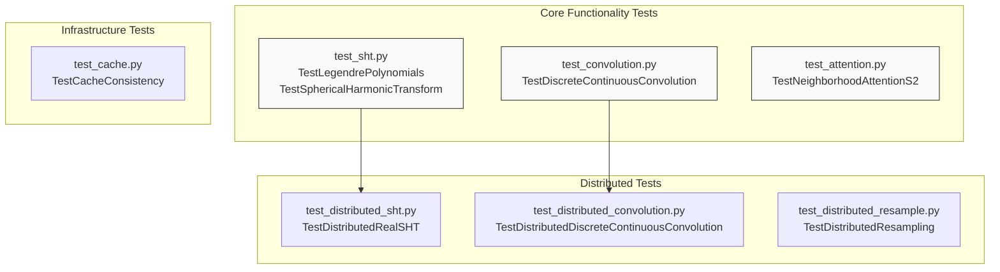
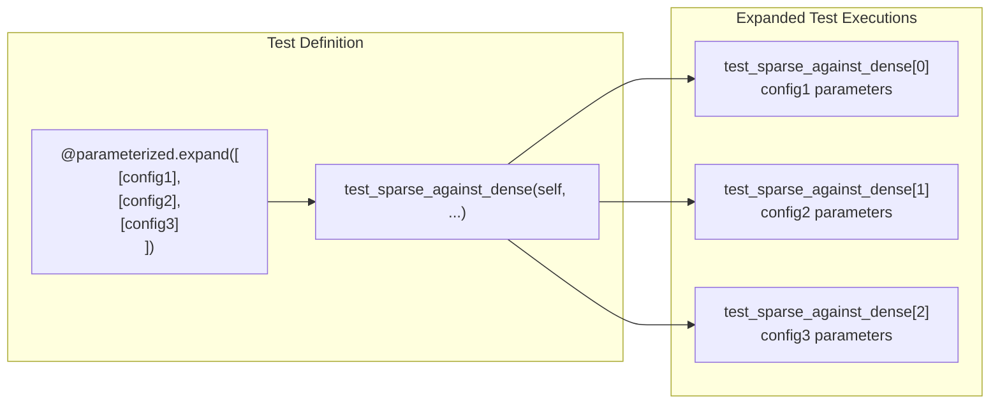
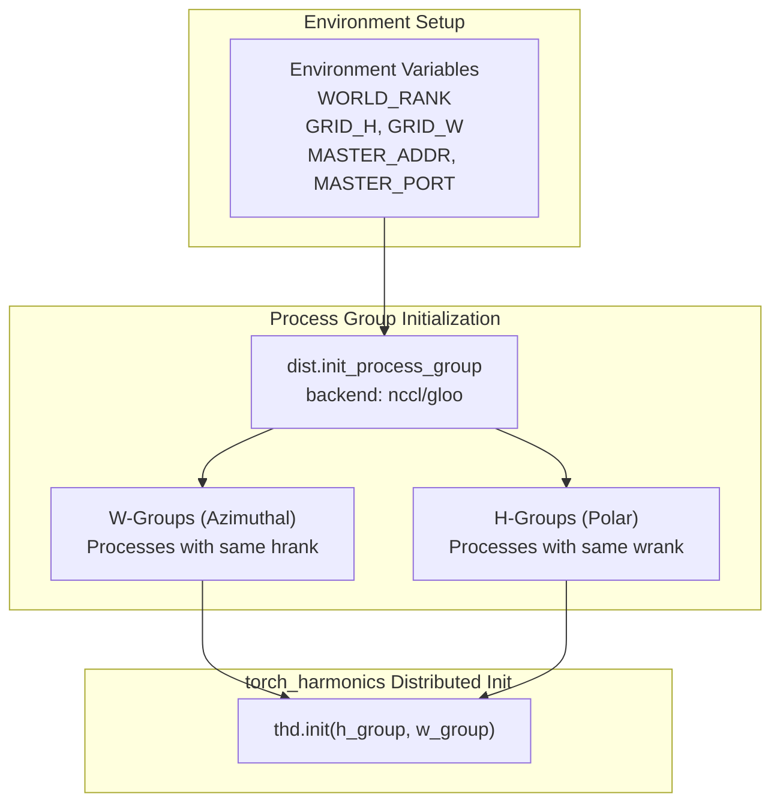
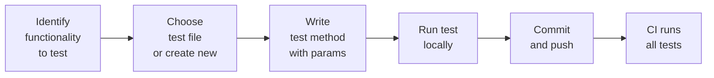
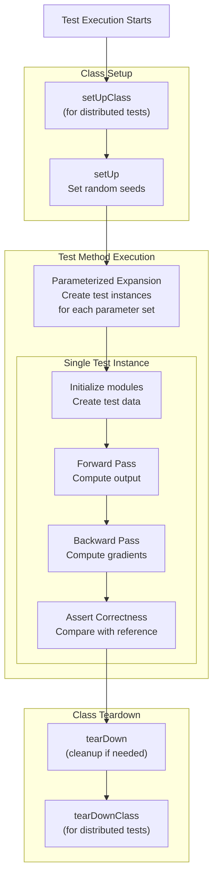

<!-- source: DeepWiki mcp.deepwiki.com · repo NVIDIA/torch-harmonics · page 10.2 Testing · fetched 2026-10-26 -->

# Testing

<details>
<summary>Relevant source files</summary>

The following files were used as context for generating this wiki page:

- [tests/test_attention.py](tests/test_attention.py)
- [tests/test_cache.py](tests/test_cache.py)
- [tests/test_convolution.py](tests/test_convolution.py)
- [tests/test_distributed_resample.py](tests/test_distributed_resample.py)
- [tests/test_sht.py](tests/test_sht.py)
- [torch_harmonics/cache.py](torch_harmonics/cache.py)

</details>


This page provides a comprehensive guide to the torch-harmonics test suite, including how to run tests locally, understand test organization, work with parameterized and distributed tests, and add new test cases. For information about the CI/CD pipeline that automatically runs these tests on GitHub Actions, see [CI/CD Pipeline](#10.3). For building the project from source before running tests, see [Building from Source](#10.1).

**Sources:** [tests/test_convolution.py:1-692](), [tests/test_attention.py:1-408](), [tests/test_sht.py:1-244]()

## Test Framework Overview

The torch-harmonics test suite uses Python's `unittest` framework combined with the `parameterized` library for extensive parameterized testing. Tests are organized into test classes that inherit from `unittest.TestCase`, with each class testing a specific module or functionality.

### Key Testing Libraries

| Library | Purpose | Usage in Tests |
|---------|---------|----------------|
| `unittest` | Base test framework | All test classes inherit from `unittest.TestCase` |
| `parameterized` | Parameterized test expansion | `@parameterized.expand` and `@parameterized_class` decorators |
| `torch.autograd.gradcheck` | Numerical gradient verification | Validates backward pass correctness |
| `torch.library.opcheck` | PyTorch 2.0 operator verification | Validates custom CUDA/C++ operator registration |
| `torch.distributed` | Multi-process testing | Distributed SHT and convolution tests |

**Sources:** [tests/test_convolution.py:34-40](), [tests/test_attention.py:34-44](), [tests/test_sht.py:32-37]()

## Running Tests

### Local Test Execution

Run all tests using pytest or unittest:

```bash
# Using pytest (recommended)
pytest tests/

# Using unittest
python -m unittest discover tests/

# Run specific test file
pytest tests/test_sht.py

# Run specific test class
pytest tests/test_convolution.py::TestDiscreteContinuousConvolution

# Run specific test method
pytest tests/test_sht.py::TestSphericalHarmonicTransform::test_forward_inverse
```

### Running Tests on Specific Devices

Tests automatically run on both CPU and CUDA devices if CUDA is available. The device selection is handled via `@parameterized_class`:

```python
_devices = [(torch.device("cpu"),)]
if torch.cuda.is_available():
    _devices.append((torch.device("cuda"),))

@parameterized_class(("device"), _devices)
class TestDiscreteContinuousConvolution(unittest.TestCase):
    # Tests run once per device
```

**Sources:** [tests/test_convolution.py:49-51](), [tests/test_attention.py:49-51](), [tests/test_sht.py:39-41]()

### Performance Tests

Performance tests are disabled by default and can be enabled with an environment variable:

```bash
# Enable performance tests
export TORCH_HARMONICS_RUN_PERF_TESTS=1
pytest tests/test_convolution.py::TestDiscreteContinuousConvolution::test_perf
```

Performance tests validate that execution times don't exceed predefined thresholds:

| Device | DISCO Conv FWD | DISCO Conv BWD | Attention FWD | Attention BWD |
|--------|----------------|----------------|---------------|---------------|
| CPU (16 threads) | 100 ms | 90 ms | 1000 ms | 8000 ms |
| CUDA (V100) | 2 ms | 3 ms | 50 ms | 150 ms |

**Sources:** [tests/test_convolution.py:53-59](), [tests/test_attention.py:53-59]()

## Test Organization

### Test File Structure



**Test File Organization**

Each test file focuses on a specific module:
- `test_sht.py`: Tests `RealSHT`, `InverseRealSHT`, and Legendre polynomial computation
- `test_convolution.py`: Tests `DiscreteContinuousConvS2` and `DiscreteContinuousConvTransposeS2`
- `test_attention.py`: Tests `AttentionS2` and `NeighborhoodAttentionS2`
- `test_distributed_*.py`: Tests distributed implementations with multi-process setup
- `test_cache.py`: Tests LRU cache consistency and correctness

**Sources:** [tests/test_sht.py:1-244](), [tests/test_convolution.py:1-692](), [tests/test_attention.py:1-408](), [tests/test_distributed_resample.py:1-269](), [tests/test_cache.py:1-55]()

## Parameterized Testing

### Test Case Expansion

The `@parameterized.expand` decorator allows testing multiple configurations with a single test function:



**Sources:** [tests/test_convolution.py:186-216]()

### Common Test Parameters

**DISCO Convolution Tests**

Parameter format: `[batch_size, in_channels, out_channels, in_shape, out_shape, kernel_shape, basis_type, basis_norm_mode, grid_in, grid_out, transpose, tol, verbose]`

Example from [tests/test_convolution.py:186-214]():
```python
@parameterized.expand([
    [8, 4, 2, (16, 32), (16, 32), (3), "piecewise linear", "mean", "equiangular", "equiangular", False, 1e-4, False],
    [8, 4, 2, (24, 48), (12, 24), (2, 2), "morlet", "mean", "equiangular", "equiangular", False, 1e-4, False],
    [8, 4, 2, (24, 48), (12, 24), (3), "zernike", "mean", "equiangular", "equiangular", False, 1e-4, False],
])
def test_sparse_against_dense(self, batch_size, in_channels, out_channels, ...):
```

**SHT Tests**

Parameter format: `[nlat, nlon, batch_size, norm, grid, tol, verbose]`

Example from [tests/test_sht.py:88-112]():
```python
@parameterized.expand([
    [32, 64, 32, "ortho", "equiangular", 1e-9, False],
    [32, 64, 32, "ortho", "legendre-gauss", 1e-9, False],
    [32, 64, 32, "four-pi", "equiangular", 1e-9, False],
])
def test_forward_inverse(self, nlat, nlon, batch_size, norm, grid, tol, verbose):
```

**Sources:** [tests/test_convolution.py:186-214](), [tests/test_sht.py:88-112]()

### Device Parameterization

Tests are automatically run on all available devices using `@parameterized_class`:

```python
_devices = [(torch.device("cpu"),)]
if torch.cuda.is_available():
    _devices.append((torch.device("cuda"),))

@parameterized_class(("device"), _devices)
class TestDiscreteContinuousConvolution(unittest.TestCase):
    def setUp(self):
        torch.manual_seed(333)
        if self.device.type == "cuda":
            torch.cuda.manual_seed(333)
```

The `device` attribute is accessible in all test methods via `self.device`.

**Sources:** [tests/test_convolution.py:49-51,177-184](), [tests/test_attention.py:49-51,62-69]()

## Test Categories

### 1. Numerical Correctness Tests

These tests validate mathematical correctness by comparing against reference implementations.

**Sparse vs Dense Convolution** ([tests/test_convolution.py:217-334]()):
- Computes dense convolution tensor for reference
- Compares against sparse implementation used in production
- Tests forward and backward passes

**Optimized vs PyTorch Fallback** ([tests/test_convolution.py:361-450]()):
- Compares custom CUDA/Triton kernels against PyTorch reference
- Validates both `optimized_kernel=True` and `optimized_kernel=False` paths
- Tests `DiscreteContinuousConvS2` and `DiscreteContinuousConvTransposeS2`

**Neighborhood vs Global Attention** ([tests/test_attention.py:232-286]()):
- Validates that `NeighborhoodAttentionS2` with `theta_cutoff=2*π` equals `AttentionS2`
- Tests forward and backward equivalence

**Sources:** [tests/test_convolution.py:217-334,361-450](), [tests/test_attention.py:232-286]()

### 2. Gradient Verification Tests

Uses `torch.autograd.gradcheck` to numerically verify gradient correctness:

```python
def test_grads(self, nlat, nlon, batch_size, norm, grid, tol, verbose):
    sht = th.RealSHT(nlat, nlon, mmax=mmax, lmax=lmax, grid=grid, norm=norm)
    
    # Test SHT gradients
    grad_input = torch.randn_like(signal, requires_grad=True)
    err_handle = lambda x: torch.mean(
        torch.norm(sht(x) - coeffs, p="fro", dim=(-1, -2)) / 
        torch.norm(coeffs, p="fro", dim=(-1, -2))
    )
    test_result = gradcheck(err_handle, grad_input, eps=1e-6, atol=tol)
    self.assertTrue(test_result)
```

**Sources:** [tests/test_sht.py:175-205]()

### 3. PyTorch 2.0 Compatibility Tests

Validates custom operator registration using `torch.library.opcheck`:

```python
@unittest.skipUnless(optimized_kernels_is_available(), "...")
def test_optimized_pt2_compatibility(self, ...):
    # Setup module and inputs
    conv = DiscreteContinuousConvS2(..., optimized_kernel=True)
    test_inputs = (inp, conv.psi_roff_idx, conv.psi_ker_idx, ...)
    
    # Validate operator registration
    opcheck(torch.ops.disco_kernels._disco_s2_contraction_optimized, test_inputs)
```

This validates:
- Operator schema correctness
- FakeTensor mode support
- AOT compilation compatibility

**Sources:** [tests/test_convolution.py:529-601](), [tests/test_attention.py:295-324]()

### 4. Performance Tests

Measure execution time and validate against thresholds:

```python
@unittest.skipUnless(optimized_kernels_is_available() and _run_perf_tests, "...")
def test_perf(self, ...):
    # Warmup
    for i in range(2):
        out = conv(inp)
    
    # Time forward pass
    torch.cuda.synchronize()
    start = perf_counter_ns()
    out = conv(inp)
    torch.cuda.synchronize()
    end = perf_counter_ns()
    duration = (end - start) / 1e6
    
    self.assertTrue(duration <= _perf_test_thresholds[self.device.type]["fwd_ms"])
```

**Sources:** [tests/test_convolution.py:603-689](), [tests/test_attention.py:326-404]()

### 5. Device Instantiation Tests

Verify that modules can be instantiated directly on GPU without going through CPU:

```python
@unittest.skipIf(not torch.cuda.is_available(), "CUDA is not available")
def test_device_instantiation(self, ...):
    # Init on CPU
    conv_host = DiscreteContinuousConvS2(...)
    
    # Init directly on GPU
    with torch.device(self.device):
        conv_device = DiscreteContinuousConvS2(...)
    
    # Compare internal tensors
    self.assertTrue(torch.allclose(conv_host.psi_vals.cpu(), conv_device.psi_vals.cpu()))
```

**Sources:** [tests/test_convolution.py:462-516](), [tests/test_sht.py:216-239]()

## Distributed Testing

### Distributed Test Setup

Distributed tests use `torch.distributed` with a 2D process grid:



**Sources:** [tests/test_distributed_resample.py:46-114]()

### Running Distributed Tests

Distributed tests require multi-process execution:

```bash
# 2x2 process grid (4 GPUs total)
export GRID_H=2
export GRID_W=2

# Using torchrun
torchrun --nproc_per_node=4 \
    tests/test_distributed_sht.py

# Using mpirun (if MPI-enabled PyTorch)
mpirun -np 4 \
    -x GRID_H=2 \
    -x GRID_W=2 \
    python tests/test_distributed_sht.py
```

### Distributed Test Pattern

Distributed tests compare distributed operations against local reference:

```python
class TestDistributedResampling(unittest.TestCase):
    @classmethod
    def setUpClass(cls):
        # Initialize distributed process groups
        cls.world_rank = int(os.getenv("WORLD_RANK", 0))
        cls.grid_size_h = int(os.getenv("GRID_H", 1))
        cls.grid_size_w = int(os.getenv("GRID_W", 1))
        
        dist.init_process_group(...)
        thd.init(h_group, w_group)
    
    def test_distributed_resampling(self, ...):
        # Create full tensor and compute reference
        inp_full = torch.randn((B, C, H, W))
        out_full = res_local(inp_full)
        
        # Split input across processes
        inp_local = self._split_helper(inp_full)
        
        # Distributed computation
        out_local = res_dist(inp_local)
        
        # Gather and compare
        out_gather_full = self._gather_helper(out_local)
        err = torch.norm(out_full - out_gather_full) / torch.norm(out_full)
        self.assertTrue(err <= tol)
```

**Sources:** [tests/test_distributed_resample.py:43-264]()

## Cache Testing

The cache consistency test validates that LRU-cached results are not modified in-place:

```python
def test_consistency(self, verbose=False):
    from torch_harmonics.legendre import _precompute_legpoly
    
    with torch.no_grad():
        cost = torch.cos(torch.linspace(0.0, 2.0 * math.pi, 10))
        leg1 = _precompute_legpoly(10, 10, cost)
        # In-place modification should not affect cached value
        leg1 *= -1.0
        leg2 = _precompute_legpoly(10, 10, cost)
        self.assertFalse(torch.allclose(leg1, leg2))
```

This validates the `copy=True` behavior in `@lru_cache` decorator from [torch_harmonics/cache.py:37-74]().

**Sources:** [tests/test_cache.py:38-50](), [torch_harmonics/cache.py:37-74]()

## Adding New Tests

### Test Development Workflow



### Adding a Test Method

1. **Choose the appropriate test class** based on functionality:
   - SHT operations → `TestSphericalHarmonicTransform`
   - Convolutions → `TestDiscreteContinuousConvolution`
   - Attention → `TestNeighborhoodAttentionS2`
   - Distributed ops → corresponding `TestDistributed*` class

2. **Define test parameters** using `@parameterized.expand`:

```python
@parameterized.expand([
    # [param1, param2, ..., tol, verbose]
    [value1a, value2a, ..., 1e-5, False],
    [value1b, value2b, ..., 1e-5, False],
])
def test_new_feature(self, param1, param2, ..., tol, verbose):
    # Test implementation
    pass
```

3. **Implement test logic**:
   - Setup test inputs
   - Compute expected output (reference implementation)
   - Compute actual output (implementation under test)
   - Assert correctness with tolerance

4. **Use appropriate assertions**:
   - `self.assertTrue(condition)` for boolean checks
   - `self.assertTrue(torch.allclose(a, b, rtol=rtol, atol=atol))` for tensor comparisons
   - `gradcheck(func, inputs, eps=1e-6, atol=tol)` for gradient validation

### Example: Adding a New Convolution Test

```python
@parameterized.expand([
    [8, 4, 2, (32, 64), (16, 32), (5), "zernike", "individual", "equiangular", "equiangular", False, 1e-4, False],
])
def test_new_basis_normalization(
    self, batch_size, in_channels, out_channels, in_shape, out_shape,
    kernel_shape, basis_type, basis_norm_mode, grid_in, grid_out,
    transpose, tol, verbose
):
    # Create convolution with new normalization mode
    conv = DiscreteContinuousConvS2(
        in_channels, out_channels, in_shape, out_shape, kernel_shape,
        basis_type=basis_type, basis_norm_mode=basis_norm_mode,
        grid_in=grid_in, grid_out=grid_out
    ).to(self.device)
    
    # Test forward pass
    x = torch.randn(batch_size, in_channels, *in_shape, device=self.device)
    y = conv(x)
    
    # Validate output properties
    self.assertEqual(y.shape, (batch_size, out_channels, *out_shape))
    
    # Test backward pass
    x.requires_grad = True
    y = conv(x)
    grad_output = torch.randn_like(y)
    y.backward(grad_output)
    
    self.assertIsNotNone(x.grad)
    self.assertIsNotNone(conv.weight.grad)
```

### Test Naming Conventions

| Test Type | Naming Pattern | Example |
|-----------|---------------|---------|
| Correctness | `test_<what>_against_<reference>` | `test_sparse_against_dense` |
| Equivalence | `test_<impl1>_<impl2>_equivalence` | `test_neighborhood_global_equivalence` |
| Gradients | `test_grads` | `test_grads` |
| Performance | `test_perf` | `test_perf` |
| Compatibility | `test_<what>_compatibility` | `test_optimized_pt2_compatibility` |
| Device | `test_device_<aspect>` | `test_device_instantiation` |

**Sources:** [tests/test_convolution.py:217-334,361-450,529-601](), [tests/test_attention.py:87-143,232-286,295-324]()

## Test Execution Flow



**Sources:** [tests/test_convolution.py:181-184](), [tests/test_distributed_resample.py:46-119]()

## Best Practices

### Tolerance Selection

Choose appropriate tolerances based on operation type:

| Operation Type | Typical Tolerance | Reason |
|----------------|------------------|--------|
| FFT operations | 1e-9 to 1e-7 | High numerical precision |
| Spectral transforms | 1e-9 to 1e-7 | Accumulation in quadrature |
| Convolutions | 1e-4 to 1e-5 | Multiple sparse operations |
| Attention | 1e-2 to 1e-5 | Softmax numerical stability |
| Gradients | 1e-5 to 1e-6 | Finite difference approximation |

**Sources:** [tests/test_sht.py:88-112](), [tests/test_convolution.py:186-214](), [tests/test_attention.py:71-84]()

### Random Seed Management

Always set random seeds in `setUp` for reproducibility:

```python
def setUp(self):
    torch.manual_seed(333)
    if self.device.type == "cuda":
        torch.cuda.manual_seed(333)
```

**Sources:** [tests/test_convolution.py:181-184](), [tests/test_attention.py:66-69](), [tests/test_sht.py:83-86]()

### Skip Conditions

Use `@unittest.skipUnless` and `@unittest.skipIf` for conditional tests:

```python
# Skip if optimized kernels not available
@unittest.skipUnless(optimized_kernels_is_available(), 
                     "skipping test because optimized kernels are not available")

# Skip if CUDA not available
@unittest.skipIf(not torch.cuda.is_available(), "CUDA is not available")

# Skip if performance tests disabled
@unittest.skipUnless(_run_perf_tests, 
                     "skipping performance test")
```

**Sources:** [tests/test_convolution.py:360,462,609](), [tests/test_attention.py:86,153,333]()

### Verbose Output

Use the `verbose` parameter for debugging:

```python
def test_example(self, ..., verbose=False):
    if verbose:
        print(f"Testing with config: {config}")
    
    # Test implementation
    
    if verbose:
        print(f"Error: {err.item()}")
```

Enable verbose output when running specific tests:
```bash
pytest tests/test_convolution.py::test_sparse_against_dense -v
```

**Sources:** [tests/test_sht.py:113-148]()

---

