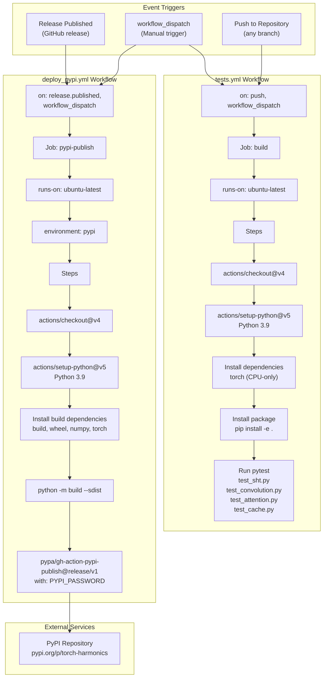
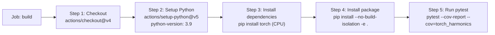
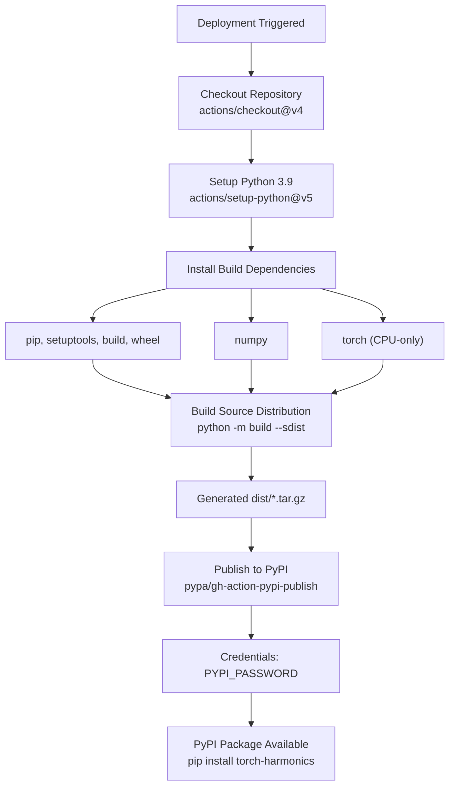
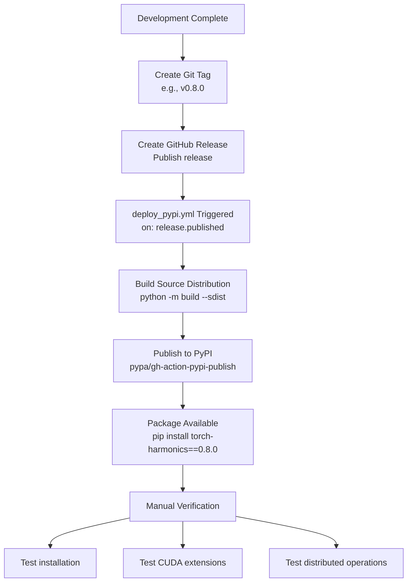

<!-- source: DeepWiki mcp.deepwiki.com · repo NVIDIA/torch-harmonics · page 10.3 CI/CD Pipeline · fetched 2026-10-26 -->

# CI/CD Pipeline

<details>
<summary>Relevant source files</summary>

The following files were used as context for generating this wiki page:

- [.coveragerc](.coveragerc)
- [.github/dependabot.yml](.github/dependabot.yml)
- [.github/workflows/deploy_pypi.yml](.github/workflows/deploy_pypi.yml)
- [.github/workflows/tests.yml](.github/workflows/tests.yml)

</details>


## Purpose and Scope

This document describes the continuous integration and continuous deployment (CI/CD) infrastructure for torch-harmonics. The CI/CD pipeline automates testing on every push and handles package deployment to PyPI for releases. 

For information about running tests locally, see [Testing](#10.2). For build system details including CUDA extension compilation, see [Building from Source](#10.1). For code formatting standards enforced in the pipeline, see [Code Style and Formatting](#10.4).

## Overview

The torch-harmonics CI/CD pipeline consists of two primary GitHub Actions workflows:

- **`tests.yml`**: Executes automated test suite on every push to validate code changes
- **`deploy_pypi.yml`**: Builds and publishes source distribution to PyPI when releases are created

Both workflows run on Ubuntu-based runners and use Python 3.9 for consistency. The pipeline does not currently include GPU-accelerated test runners, so distributed tests requiring multi-GPU setup must be validated manually.

Sources: [.github/workflows/tests.yml:1-32](), [.github/workflows/deploy_pypi.yml:1-39]()

## Workflow Architecture

The following diagram shows the CI/CD workflow structure and how different events trigger different pipelines:



Sources: [.github/workflows/tests.yml:3-6](), [.github/workflows/deploy_pypi.yml:3-8]()

## Test Workflow (`tests.yml`)

### Trigger Configuration

The test workflow executes on two event types:

| Event | Description | Configuration |
|-------|-------------|---------------|
| `push` | Any push to repository | [.github/workflows/tests.yml:4]() |
| `workflow_dispatch` | Manual trigger via GitHub UI | [.github/workflows/tests.yml:5]() |

### Job Structure

The workflow defines a single job named `build` with the display name "Run local tests":



Sources: [.github/workflows/tests.yml:8-32]()

### Dependency Installation

Dependencies are installed in two phases:

**Phase 1 - Core dependencies** [.github/workflows/tests.yml:20-23]():
```bash
python3 -m pip install --upgrade pip setuptools wheel
python3 -m pip install torch --extra-index-url https://download.pytorch.org/whl/cpu
```

PyTorch is installed from the CPU-only wheel to avoid CUDA dependencies on CI runners. This limits the test workflow to CPU-only operations.

**Phase 2 - Package installation** [.github/workflows/tests.yml:25-27]():
```bash
python3 -m pip install --no-build-isolation -e .
```

The `--no-build-isolation` flag uses the environment's existing PyTorch installation rather than creating an isolated build environment, ensuring the CPU-only torch is used.

### Test Execution

Tests are executed using `pytest` with coverage reporting [.github/workflows/tests.yml:29-32]():

```bash
python3 -m pip install pytest pytest-cov parameterized
python3 -m pytest --cov-report term --cov-config=.coveragerc --cov=torch_harmonics \
    ./tests/test_sht.py \
    ./tests/test_convolution.py \
    ./tests/test_attention.py \
    ./tests/test_cache.py
```

#### Test Files Executed

| Test File | Coverage |
|-----------|----------|
| `test_sht.py` | Spherical harmonic transforms |
| `test_convolution.py` | DISCO convolutions |
| `test_attention.py` | Spherical attention mechanisms |
| `test_cache.py` | LRU cache system |

#### Excluded Test Files

The following test files are **not** executed in CI due to hardware requirements:

- `test_distributed_sht.py` - Requires multi-GPU setup
- `test_distributed_convolution.py` - Requires multi-GPU setup
- Any tests requiring CUDA extensions compiled for GPU

Sources: [.github/workflows/tests.yml:29-32]()

### Coverage Configuration

Coverage reporting is configured via `.coveragerc` to exclude specific directories [.coveragerc:1-4]():

```ini
[run]
omit =
    */distributed/*
    */examples/*
```

This configuration omits:
- **Distributed modules**: Cannot be tested without multi-GPU infrastructure
- **Example applications**: User-facing code not part of core library

Sources: [.coveragerc:1-4]()

## Deployment Workflow (`deploy_pypi.yml`)

### Trigger Configuration

The deployment workflow executes on two event types:

| Event | Description | When Used |
|-------|-------------|-----------|
| `release.published` | GitHub release created and published | Automatic deployment on release |
| `workflow_dispatch` | Manual trigger | Emergency deployments or testing |

Sources: [.github/workflows/deploy_pypi.yml:3-7]()

### Environment Configuration

The workflow uses a protected GitHub environment [.github/workflows/deploy_pypi.yml:13-15]():

```yaml
environment:
  name: pypi
  url: https://pypi.org/p/torch-harmonics
```

This environment configuration:
- Requires manual approval for deployments (if configured in GitHub settings)
- Links to the published package URL
- Protects the `PYPI_PASSWORD` secret

### Build Process

The deployment workflow follows this sequence:



Sources: [.github/workflows/deploy_pypi.yml:17-39]()

### Build Dependencies Installation

Build dependencies are installed in a specific order [.github/workflows/deploy_pypi.yml:25-29]():

```bash
python3 -m pip install --upgrade pip setuptools build wheel
python3 -m pip install numpy
python3 -m pip install torch --extra-index-url https://download.pytorch.org/whl/cpu
```

**Rationale**:
- `numpy` must be installed before the package build (required by setup.py)
- `torch` must be available during source distribution creation
- CPU-only torch is sufficient for metadata generation

### Source Distribution Build

Only source distributions (`sdist`) are built, not binary wheels [.github/workflows/deploy_pypi.yml:31-33]():

```bash
python3 -m build --sdist
```

**Why source-only**:
- CUDA extensions require compilation against user's specific PyTorch/CUDA versions
- Binary wheels would need separate builds for each PyTorch version and CUDA version
- Users compile extensions during installation based on their environment

### PyPI Publication

Package publication uses the official PyPI GitHub Action [.github/workflows/deploy_pypi.yml:35-39]():

```yaml
- name: Publish package to PyPI
  uses: pypa/gh-action-pypi-publish@release/v1
  with:
    user: __token__
    password: ${{ secrets.PYPI_PASSWORD }}
```

#### Authentication

- Uses API token authentication (`user: __token__`)
- Token stored in GitHub Secrets as `PYPI_PASSWORD`
- Token must have upload permissions for the `torch-harmonics` project

Sources: [.github/workflows/deploy_pypi.yml:35-39]()

## Dependency Management

### Dependabot Configuration

Automated dependency updates are managed via Dependabot [.github/dependabot.yml:1-11]():

```yaml
version: 2
updates:
  - package-ecosystem: "github-actions"
    directory: "/"
    schedule:
      interval: "daily"
    ignore:
      - dependency-name: "actions/*"
```

**Configuration details**:
- Checks GitHub Actions versions daily
- Ignores official `actions/*` packages (use moving tags like `v4`)
- Creates pull requests for outdated third-party actions

**Ignored actions**:
Actions using moving tags don't require Dependabot updates:
- `actions/checkout@v4` - Moving tag
- `actions/setup-python@v5` - Moving tag

**Monitored actions**:
- `pypa/gh-action-pypi-publish@release/v1` - Third-party action with version pinning

Sources: [.github/dependabot.yml:1-11]()

## Workflow Execution Matrix

The following table summarizes when each workflow executes and what it validates:

| Workflow | Trigger | Runner | Python | PyTorch | Tests Run | Output |
|----------|---------|--------|--------|---------|-----------|--------|
| `tests.yml` | Every push | ubuntu-latest | 3.9 | CPU-only | `test_sht.py`<br/>`test_convolution.py`<br/>`test_attention.py`<br/>`test_cache.py` | Test results<br/>Coverage report |
| `deploy_pypi.yml` | Release published | ubuntu-latest | 3.9 | CPU-only | None | Source distribution<br/>PyPI package |

## Manual Workflow Triggers

Both workflows support manual triggering via `workflow_dispatch`:

1. Navigate to **Actions** tab in GitHub repository
2. Select workflow (`Run local tests` or `Deploy to Pypi`)
3. Click **Run workflow** button
4. Select branch
5. Click **Run workflow**

This enables:
- Testing specific branches before merging
- Emergency deployments outside the normal release process
- Debugging workflow issues

Sources: [.github/workflows/tests.yml:5](), [.github/workflows/deploy_pypi.yml:7]()

## Limitations and Manual Testing Requirements

### GPU and CUDA Testing

The CI pipeline **does not** test:
- CUDA extension compilation
- GPU-accelerated kernels
- Distributed multi-GPU operations

These must be validated manually before release on appropriate hardware.

### Distributed Testing

Tests requiring `torch.distributed` are excluded from CI [.coveragerc:3]():
- `test_distributed_sht.py`
- `test_distributed_convolution.py`

Manual validation required using multi-GPU setup (see [Testing](#10.2)).

### Platform Coverage

Only Ubuntu Linux is tested in CI. The following platforms require manual validation:
- macOS
- Windows
- Different Linux distributions

Sources: [.github/workflows/tests.yml:10](), [.github/workflows/deploy_pypi.yml:12](), [.coveragerc:1-4]()

## Release Process

The complete release workflow:



**Steps**:
1. Complete development and testing
2. Create and push Git tag (e.g., `v0.8.0`)
3. Create GitHub release from tag and publish
4. `deploy_pypi.yml` automatically triggers
5. Source distribution built and uploaded to PyPI
6. Manual verification on target platforms with GPU hardware

Sources: [.github/workflows/deploy_pypi.yml:3-6]()

## Security Considerations

### Secret Management

The `PYPI_PASSWORD` secret must be configured in GitHub repository settings:

**Path**: Repository Settings → Secrets and variables → Actions → Repository secrets

**Requirements**:
- Must be a PyPI API token (not username/password)
- Token must have upload permissions for `torch-harmonics`
- Token should be scoped to single project (not account-wide)

### Environment Protection

The `pypi` environment [.github/workflows/deploy_pypi.yml:13-15]() can be configured with protection rules:
- Required reviewers before deployment
- Deployment branches (e.g., only `main`)
- Wait timer before deployment

Sources: [.github/workflows/deploy_pypi.yml:13-15](), [.github/workflows/deploy_pypi.yml:38-39]()

## Monitoring and Troubleshooting

### Viewing Workflow Runs

Workflow execution status is visible in GitHub:
- **Repository Actions tab**: All workflow runs
- **Pull Request checks**: Test results for PR branches
- **Release page**: Deployment status for releases

### Common Failure Scenarios

| Failure | Likely Cause | Resolution |
|---------|--------------|------------|
| Test workflow fails | Code changes broke tests | Fix code or update tests |
| Cannot install package | Missing dependency in setup.py | Update `install_requires` |
| PyPI upload fails | Invalid `PYPI_PASSWORD` | Update secret with valid token |
| Build fails | setup.py configuration error | Test build locally with `python -m build --sdist` |
| Coverage check fails | New code not tested | Add tests or update `.coveragerc` |

### Local Reproduction

To reproduce CI test environment locally:

```bash
# Create clean environment
python3 -m venv venv
source venv/bin/activate

# Install dependencies (CPU torch)
pip install --upgrade pip setuptools wheel
pip install torch --extra-index-url https://download.pytorch.org/whl/cpu

# Install package
pip install --no-build-isolation -e .

# Run tests
pip install pytest pytest-cov parameterized
pytest --cov-report term --cov-config=.coveragerc --cov=torch_harmonics \
    ./tests/test_sht.py \
    ./tests/test_convolution.py \
    ./tests/test_attention.py \
    ./tests/test_cache.py
```

Sources: [.github/workflows/tests.yml:20-32]()

## Future Enhancements

Potential improvements to the CI/CD pipeline:

- **GPU runners**: Enable CUDA extension and distributed testing
- **Multi-platform testing**: Add macOS and Windows runners  
- **Binary wheel builds**: Pre-compile for common PyTorch/CUDA combinations
- **Performance regression testing**: Track benchmark results over time
- **Documentation deployment**: Automatically build and publish Sphinx documentation

Sources: [.github/workflows/tests.yml:1-32](), [.github/workflows/deploy_pypi.yml:1-39]()

---

