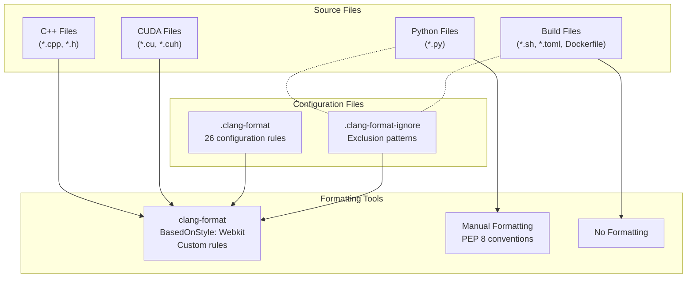
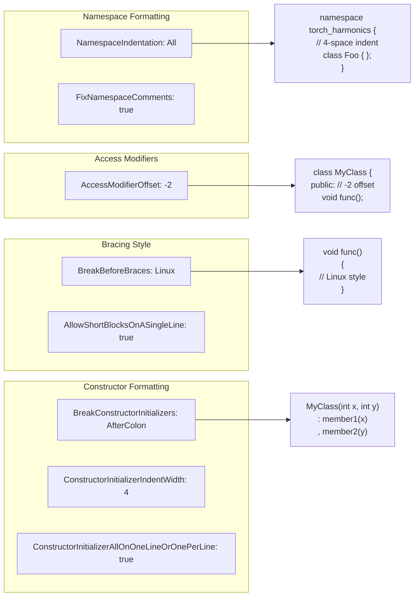
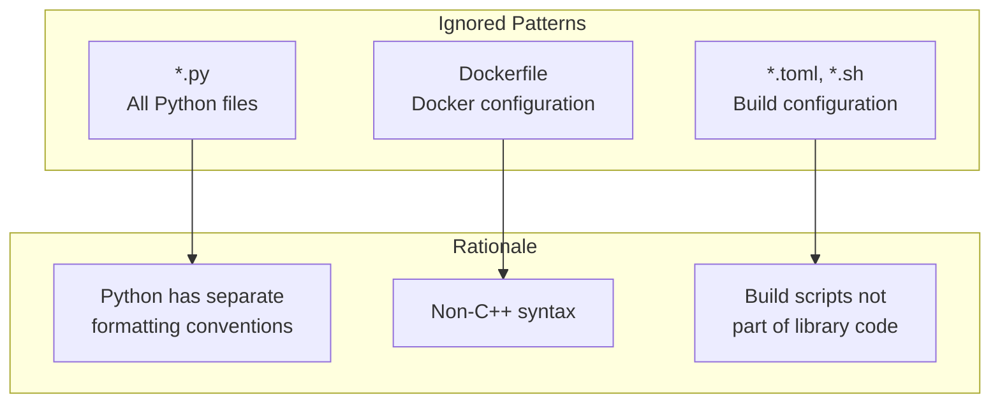
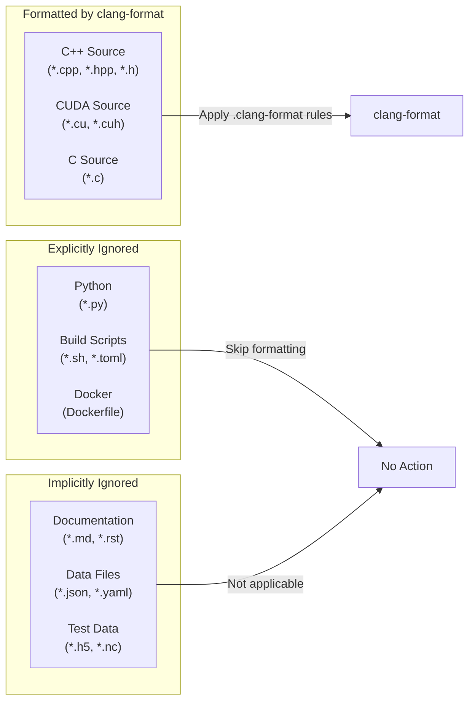
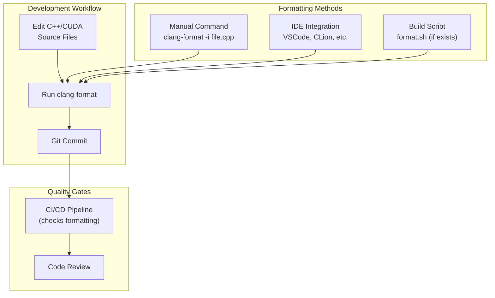
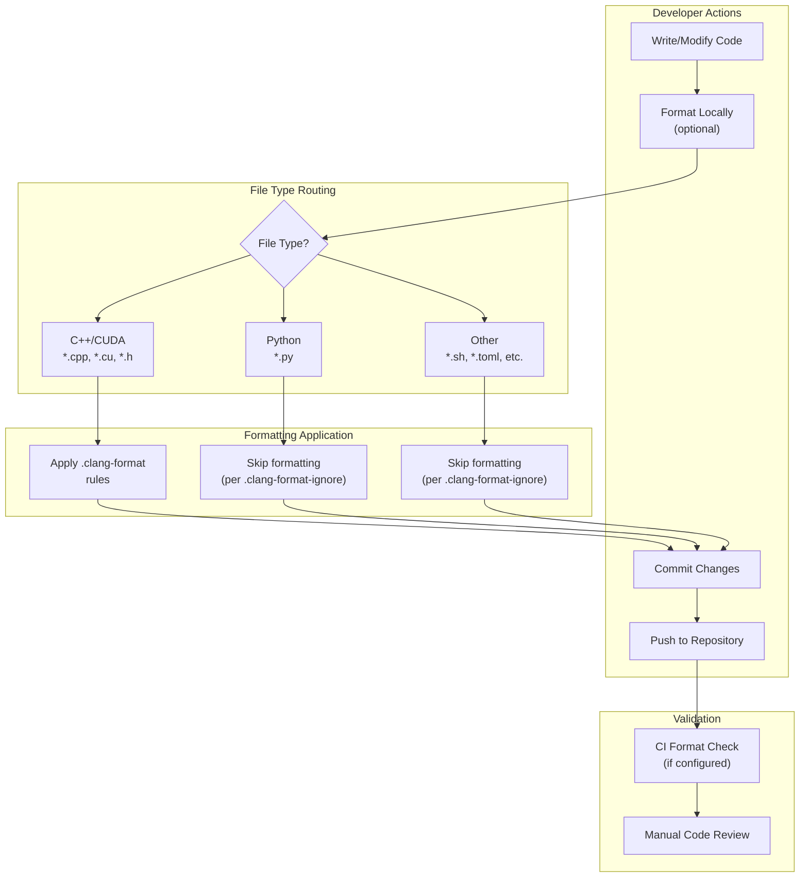
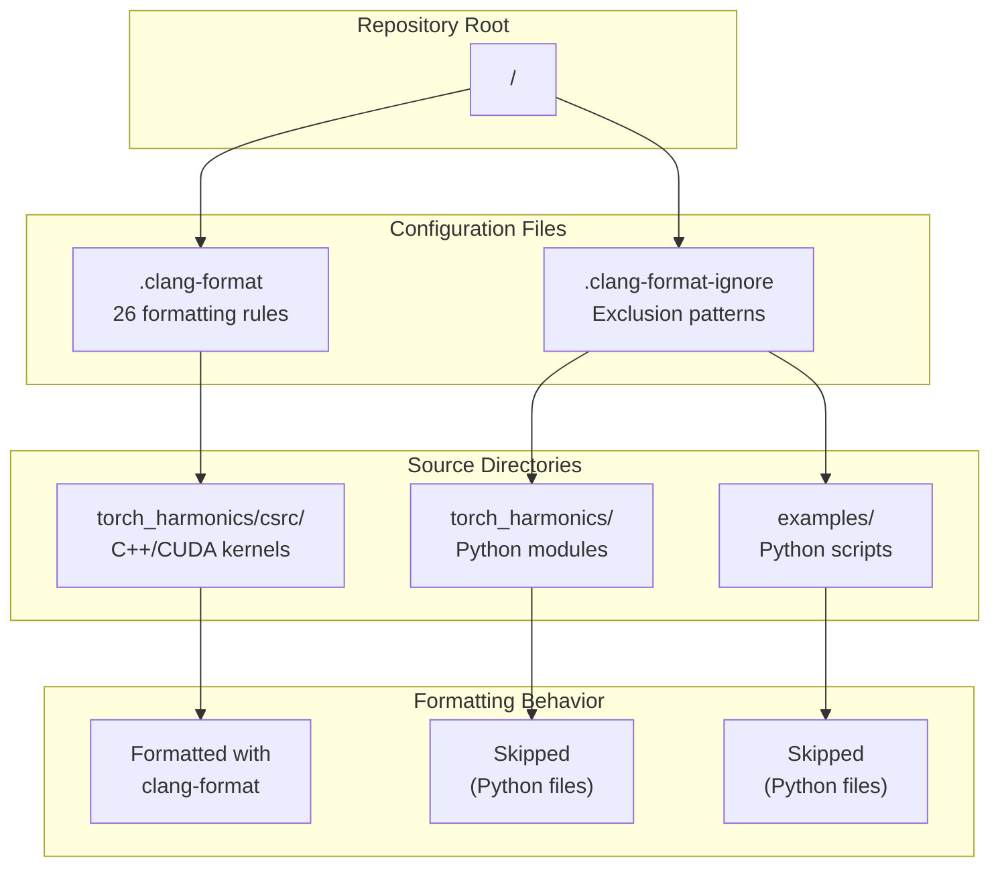

<!-- source: DeepWiki mcp.deepwiki.com · repo NVIDIA/torch-harmonics · page 10.4 Code Style and Formatting · fetched 2026-10-26 -->

# Code Style and Formatting

<details>
<summary>Relevant source files</summary>

The following files were used as context for generating this wiki page:

- [.clang-format](.clang-format)
- [.clang-format-ignore](.clang-format-ignore)

</details>


## Purpose and Scope

This document describes the code formatting standards and style guidelines for the torch-harmonics codebase. It covers the automated formatting tools used for C++/CUDA code, the configuration of these tools, and which files are excluded from automated formatting. For information about building the codebase from source, see [Building from Source](#10.1). For testing guidelines, see [Testing](#10.2).

The torch-harmonics project uses automated formatting for C++/CUDA source files to maintain consistency across contributions. Python code follows conventional standards but does not currently use automated formatting tools.

---

## Code Formatting Overview

The codebase contains a mix of Python, C++, and CUDA source files. Different file types are handled by different formatting approaches:



**Sources:** [.clang-format:1-26](), [.clang-format-ignore:1-10]()

---

## C++/CUDA Formatting with clang-format

The project uses `clang-format` for all C++ and CUDA source files. The configuration is defined in [.clang-format:1-26]() at the repository root.

### Base Style and Key Parameters

The formatting configuration is based on the **Webkit** style with several customizations:

| Parameter | Value | Description |
|-----------|-------|-------------|
| `BasedOnStyle` | `Webkit` | Foundation style from the Webkit project |
| `IndentWidth` | `4` | Four spaces per indentation level |
| `ColumnLimit` | `120` | Maximum line length of 120 characters |
| `UseTab` | `Never` | Always use spaces, never tabs |
| `PointerAlignment` | `Right` | Align pointers to the right (e.g., `int *ptr`) |

**Sources:** [.clang-format:2-4](), [.clang-format:14](), [.clang-format:22](), [.clang-format:26]()

### Code Organization Rules



**Sources:** [.clang-format:4-5](), [.clang-format:11](), [.clang-format:13](), [.clang-format:15-16](), [.clang-format:20]()

### Detailed Configuration Rules

The following table breaks down all formatting rules defined in [.clang-format:1-26]():

| Rule | Value | Purpose |
|------|-------|---------|
| `AlignAfterOpenBracket` | `Align` | Align parameters after opening brackets |
| `AlignTrailingComments` | `true` | Align comments at end of lines |
| `AllowShortBlocksOnASingleLine` | `true` | Allow `{ return x; }` style blocks |
| `AllowShortCaseLabelsOnASingleLine` | `true` | Allow compact case statements |
| `AllowShortIfStatementsOnASingleLine` | `true` | Allow `if (x) return;` style |
| `AllowShortLoopsOnASingleLine` | `true` | Allow compact loop bodies |
| `BreakBeforeTernaryOperators` | `false` | Ternary operators break after `?` |
| `ContinuationIndentWidth` | `4` | Indent for line continuations |
| `Cpp11BracedListStyle` | `true` | Use C++11 brace initialization style |
| `PenaltyExcessCharacter` | `10` | Cost for exceeding column limit |
| `SortIncludes` | `false` | Do not automatically reorder includes |
| `SpaceBeforeAssignmentOperators` | `true` | Space around `=` operator |
| `CommentPragmas` | `'^\\.+'` | Regex for special comment formatting |

**Sources:** [.clang-format:5-25]()

### Example Formatted Code

Based on the configuration, C++/CUDA code will be formatted as follows:

```cpp
// Namespace with full indentation
namespace torch_harmonics {
    // Class with -2 access modifier offset
    class DiscreteContinuousConvS2 {
      public:
        // Constructor initialization after colon
        DiscreteContinuousConvS2(int nlat, int nlon, int kernel_size)
            : nlat_(nlat)
            , nlon_(nlon)
            , kernel_size_(kernel_size)
        {
            // 4-space indentation
            if (kernel_size < 1) throw std::invalid_argument("Invalid size");
        }

        // Function with aligned parameters
        void forward(const torch::Tensor& input,
                     torch::Tensor& output,
                     int stride = 1) {
            // Linux-style braces
        }

      private:
        int nlat_, nlon_, kernel_size_;
    };
} // namespace torch_harmonics - fixed by FixNamespaceComments
```

This style is consistent with the configuration in [.clang-format:1-26]().

**Sources:** [.clang-format:1-26]()

---

## Ignored Files and Patterns

The [.clang-format-ignore:1-10]() file specifies which files should be excluded from `clang-format` processing:



### Exclusion List

| Pattern | Files Affected | Reason |
|---------|----------------|--------|
| `*.py` | All Python files | Python follows PEP 8; clang-format does not understand Python syntax |
| `Dockerfile` | Docker configuration | Not C/C++ code |
| `*.toml` | TOML configuration files (e.g., `pyproject.toml`) | Configuration format, not source code |
| `*.sh` | Shell scripts | Build automation scripts |

**Sources:** [.clang-format-ignore:1-10]()

### File Type Handling



**Sources:** [.clang-format-ignore:1-10]()

---

## Applying Code Formatting

### Command Line Usage

To format a specific C++ or CUDA file:

```bash
# Format a single file in-place
clang-format -i torch_harmonics/csrc/disco_cuda_kernels.cu

# Format all C++ files in a directory
find torch_harmonics/csrc -name "*.cpp" -o -name "*.cu" -o -name "*.h" | xargs clang-format -i

# Check formatting without modifying files
clang-format --dry-run --Werror torch_harmonics/csrc/disco_cuda_kernels.cu
```

The `.clang-format-ignore` file will be automatically respected by `clang-format` version 13 and later.

### Integration Points



**Sources:** [.clang-format:1-26](), [.clang-format-ignore:1-10]()

### IDE Configuration

Most modern IDEs support `clang-format` and will automatically detect the `.clang-format` file:

| IDE | Configuration |
|-----|---------------|
| **Visual Studio Code** | Install the "C/C++" extension; formatting is automatic |
| **CLion** | Go to Settings → Editor → Code Style → C/C++ → Set from → clang-format |
| **Vim/Neovim** | Use `clang-format.py` or plugins like `vim-clang-format` |
| **Emacs** | Use `clang-format.el` package |

---

## Python Code Style

While the codebase includes extensive Python code in `torch_harmonics/` and `examples/`, there is no automated Python formatter configured (as indicated by `*.py` in [.clang-format-ignore:1-10]()).

### Python Conventions

The Python code in the repository generally follows these conventions:

| Convention | Description |
|------------|-------------|
| **PEP 8** | Standard Python style guide for naming and layout |
| **Indentation** | 4 spaces (consistent with C++ `IndentWidth`) |
| **Line Length** | Approximately 120 characters (matching C++ `ColumnLimit`) |
| **Imports** | Grouped: standard library, third-party, local imports |
| **Docstrings** | NumPy or Google style for public APIs |

### Example Python Style

```python
# Typical formatting in torch_harmonics Python code
class RealSHT(nn.Module):
    """
    Spherical Harmonic Transform for real-valued signals.
    
    Parameters
    ----------
    nlat : int
        Number of latitudinal grid points
    nlon : int
        Number of longitudinal grid points
    """
    
    def __init__(self, nlat, nlon, lmax=None, mmax=None, grid="equiangular"):
        super().__init__()
        self.nlat = nlat
        self.nlon = nlon
        # Maximum 120 character line length
        self.lmax = lmax if lmax is not None else nlat
        self.mmax = mmax if mmax is not None else nlon // 2 + 1
```

**Sources:** [.clang-format-ignore:1-2]()

---

## Formatting Workflow

The following diagram shows how code formatting integrates into the development process:



**Sources:** [.clang-format:1-26](), [.clang-format-ignore:1-10]()

---

## Summary of Formatting Rules

### Quick Reference Table

| Aspect | Setting | Files Affected |
|--------|---------|----------------|
| **Base Style** | Webkit | All C++/CUDA |
| **Indentation** | 4 spaces | All C++/CUDA |
| **Line Length** | 120 characters | All C++/CUDA |
| **Bracing** | Linux style (opening brace on new line for functions) | All C++/CUDA |
| **Pointer Alignment** | Right (`int *ptr`) | All C++/CUDA |
| **Namespace Indentation** | All levels indented | All C++/CUDA |
| **Include Sorting** | Disabled (manual ordering) | All C++/CUDA |
| **Python Formatting** | Manual (PEP 8 conventions) | All Python |
| **Build Scripts** | No automated formatting | Shell, TOML, Dockerfile |

**Sources:** [.clang-format:1-26](), [.clang-format-ignore:1-10]()

---

## Configuration File Mapping

The following shows how configuration files in the repository control code formatting:



**Sources:** [.clang-format:1-26](), [.clang-format-ignore:1-10]()

---

