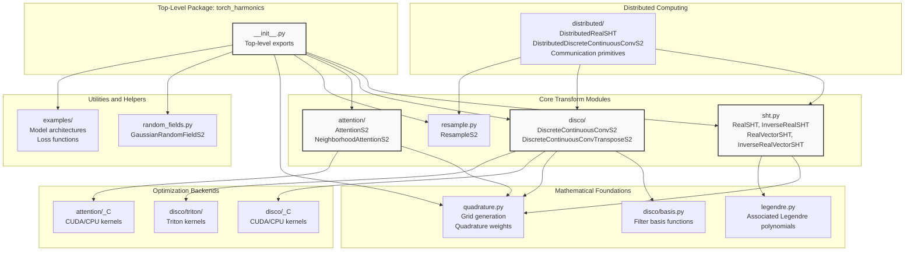
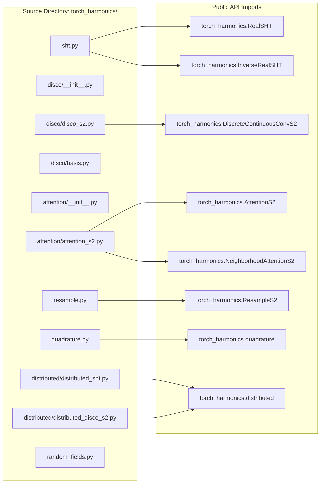
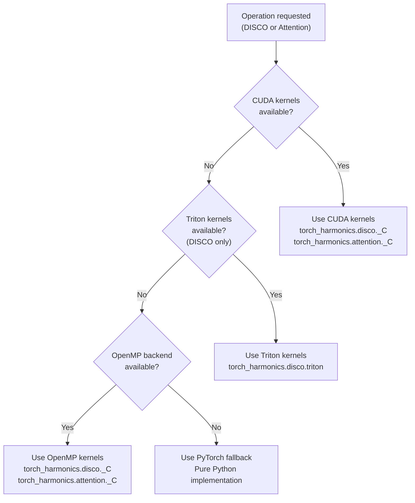

<!-- source: DeepWiki mcp.deepwiki.com · repo NVIDIA/torch-harmonics · page 11 API Reference · fetched 2026-10-26 -->

# API Reference

<details>
<summary>Relevant source files</summary>

The following files were used as context for generating this wiki page:

- [Changelog.md](Changelog.md)
- [README.md](README.md)
- [notebooks/partial_derivatives.ipynb](notebooks/partial_derivatives.ipynb)
- [setup.py](setup.py)
- [torch_harmonics/__init__.py](torch_harmonics/__init__.py)

</details>


This page provides a comprehensive reference to the torch-harmonics public API. It describes the organization of the library's modules, the primary classes and functions available, and conventions used throughout the API.

For detailed documentation of specific modules, see:
- [torch_harmonics.sht](#11.1) - Spherical harmonic transforms
- [torch_harmonics.convolution](#11.2) - DISCO convolutions
- [torch_harmonics.attention](#11.3) - Spherical attention mechanisms
- [torch_harmonics.distributed](#11.4) - Distributed implementations
- [torch_harmonics.quadrature](#11.5) - Quadrature rules and grid generation

For conceptual background, see [Core Concepts](#1.2). For usage examples, see [Getting Started](#1) and [Example Applications](#8).

## API Organization

The torch-harmonics API is organized into several top-level modules, each providing related functionality for spherical signal processing.

### Module Structure



**Sources:** [torch_harmonics/__init__.py:1-41]()

### File System Layout to API Mapping



**Sources:** [torch_harmonics/__init__.py:34-40](), file structure in repository

## Core API Surface

The primary user-facing API consists of `torch.nn.Module` subclasses that can be composed into neural network architectures. These modules are differentiable and support both CPU and GPU execution.

### Primary Transform Classes

| Class | Purpose | Module | Sub-page |
|-------|---------|--------|----------|
| `RealSHT` | Forward spherical harmonic transform | `torch_harmonics.sht` | [11.1](#11.1) |
| `InverseRealSHT` | Inverse spherical harmonic transform | `torch_harmonics.sht` | [11.1](#11.1) |
| `RealVectorSHT` | Forward vector spherical harmonic transform | `torch_harmonics.sht` | [11.1](#11.1) |
| `InverseRealVectorSHT` | Inverse vector spherical harmonic transform | `torch_harmonics.sht` | [11.1](#11.1) |
| `DiscreteContinuousConvS2` | Discrete-continuous convolution on sphere | `torch_harmonics.disco` | [11.2](#11.2) |
| `DiscreteContinuousConvTransposeS2` | Transpose convolution on sphere | `torch_harmonics.disco` | [11.2](#11.2) |
| `AttentionS2` | Global spherical attention | `torch_harmonics.attention` | [11.3](#11.3) |
| `NeighborhoodAttentionS2` | Localized spherical attention | `torch_harmonics.attention` | [11.3](#11.3) |
| `ResampleS2` | Resample between different grids | `torch_harmonics.resample` | [11.2](#11.2) |

**Sources:** [torch_harmonics/__init__.py:34-37]()

### Distributed Variants

| Class | Purpose | Module | Sub-page |
|-------|---------|--------|----------|
| `DistributedRealSHT` | Distributed forward SHT | `torch_harmonics.distributed` | [11.4](#11.4) |
| `DistributedInverseRealSHT` | Distributed inverse SHT | `torch_harmonics.distributed` | [11.4](#11.4) |
| `DistributedRealVectorSHT` | Distributed forward vector SHT | `torch_harmonics.distributed` | [11.4](#11.4) |
| `DistributedInverseRealVectorSHT` | Distributed inverse vector SHT | `torch_harmonics.distributed` | [11.4](#11.4) |
| `DistributedDiscreteContinuousConvS2` | Distributed DISCO convolution | `torch_harmonics.distributed` | [11.4](#11.4) |
| `DistributedDiscreteContinuousConvTransposeS2` | Distributed transpose convolution | `torch_harmonics.distributed` | [11.4](#11.4) |
| `DistributedResampleS2` | Distributed resampling | `torch_harmonics.distributed` | [11.4](#11.4) |

**Sources:** Repository structure under `torch_harmonics/distributed/`

## Operation to Class Mapping

This diagram maps common operations users want to perform to the specific classes that implement them.

```mermaid
graph TB
    subgraph "User Operations"
        OP1["Transform spatial<br/>signal to spectral"]
        OP2["Transform spectral<br/>coefficients to spatial"]
        OP3["Transform vector<br/>field to spectral"]
        OP4["Convolve signal<br/>with local kernel"]
        OP5["Upsample signal<br/>to higher resolution"]
        OP6["Apply attention<br/>globally on sphere"]
        OP7["Apply attention<br/>in local neighborhood"]
        OP8["Change grid<br/>resolution or type"]
        OP9["Compute divergence<br/>or curl"]
        OP10["Generate random<br/>field on sphere"]
    end
    
    subgraph "Implementing Classes"
        C1["RealSHT"]
        C2["InverseRealSHT"]
        C3["RealVectorSHT"]
        C4["InverseRealVectorSHT"]
        C5["DiscreteContinuousConvS2"]
        C6["DiscreteContinuousConvTransposeS2"]
        C7["AttentionS2"]
        C8["NeighborhoodAttentionS2"]
        C9["ResampleS2"]
        C10["GaussianRandomFieldS2"]
    end
    
    OP1 --> C1
    OP2 --> C2
    OP3 --> C3
    OP9 --> C3
    OP4 --> C5
    OP5 --> C6
    OP6 --> C7
    OP7 --> C8
    OP8 --> C9
    OP10 --> C10
    OP9 --> C4
```



**Sources:** [torch_harmonics/__init__.py:34-40](), [README.md:183-198]()

## Common Tensor Shape Conventions

Throughout the API, tensors follow consistent shape conventions. Understanding these conventions is essential for using the library effectively.

### Spatial Domain Tensors

Tensors in the spatial domain represent signals sampled on a spherical grid:

| Domain | Shape | Description |
|--------|-------|-------------|
| Scalar fields | `(B, C, nlat, nlon)` | Batch, channels, latitude points, longitude points |
| Vector fields | `(B, C, 2, nlat, nlon)` or `(B, C, 3, nlat, nlon)` | Additional dimension for vector components |

Where:
- `B` = batch size
- `C` = number of channels
- `nlat` = number of latitude grid points
- `nlon` = number of longitude grid points

### Spectral Domain Tensors

Tensors in the spectral domain represent spherical harmonic coefficients:

| Domain | Shape | Description |
|--------|-------|-------------|
| Scalar coefficients | `(B, C, mmax, lmax)` | Batch, channels, azimuthal modes, spherical harmonic degrees |
| Vector coefficients | `(B, C, 2, mmax, lmax)` | Additional dimension for spheroidal/toroidal components |

Where:
- `mmax` = maximum azimuthal wavenumber + 1
- `lmax` = maximum spherical harmonic degree + 1

Note: The spectral coefficients are stored as complex tensors with `dtype=torch.complex64` or `torch.complex128`.

**Sources:** [README.md:183-198](), common usage patterns in codebase

## Grid Type Conventions

The library supports multiple grid types for spherical quadrature. Grid types affect the latitude distribution of points and corresponding quadrature weights.

| Grid Type | String Identifier | Quadrature Rule | Use Case |
|-----------|------------------|-----------------|----------|
| Equiangular | `"equiangular"` | Clenshaw-Curtis / Fejér | Default, simple uniform spacing |
| Legendre-Gauss | `"legendre-gauss"` | Gauss-Legendre | High accuracy transforms |
| Lobatto | `"lobatto"` | Gauss-Lobatto | Includes poles |

The grid type is specified as a string parameter when constructing transform objects (e.g., `RealSHT(nlat, nlon, grid="equiangular")`).

**Sources:** [README.md:183-198](), [Changelog.md:136-139]()

## Import Patterns

### Basic Usage Pattern

```python
import torch
import torch_harmonics as th

# Create transforms
sht = th.RealSHT(nlat, nlon, grid="equiangular")
isht = th.InverseRealSHT(nlat, nlon, grid="equiangular")

# Use in model
coeffs = sht(spatial_signal)
reconstructed = isht(coeffs)
```

### Accessing Submodules

```python
# Import specific submodules
from torch_harmonics import quadrature
from torch_harmonics import distributed
from torch_harmonics.examples import models

# Access quadrature functions
lat, quad_weights = quadrature.legendre_gauss_weights(nlat)

# Use distributed transforms
dist_sht = distributed.DistributedRealSHT(nlat, nlon, ...)
```

### Importing Backend-Specific Functions

```python
# Check for optimized kernel availability
from torch_harmonics.disco import optimized_kernels_is_available as disco_has_cuda
from torch_harmonics.attention import optimized_kernels_is_available as att_has_cuda

if disco_has_cuda():
    print("DISCO CUDA kernels available")
if att_has_cuda():
    print("Attention CUDA kernels available")
```

**Sources:** [torch_harmonics/__init__.py:34-40](), [README.md:183-198](), [Changelog.md:9-10]()

## Module Overview

### torch_harmonics.sht

Provides spherical harmonic transform implementations for scalar and vector fields. Implements forward and inverse transforms using FFT in longitude and Legendre transforms in latitude.

**Key classes:** `RealSHT`, `InverseRealSHT`, `RealVectorSHT`, `InverseRealVectorSHT`

**See:** [API Reference: torch_harmonics.sht](#11.1)

### torch_harmonics.disco

Implements discrete-continuous (DISCO) convolutions on the sphere with local support. Provides various filter basis functions including Morlet wavelets and Zernike polynomials.

**Key classes:** `DiscreteContinuousConvS2`, `DiscreteContinuousConvTransposeS2`

**Key functions:** `optimized_kernels_is_available()`

**See:** [API Reference: torch_harmonics.convolution](#11.2)

### torch_harmonics.attention

Provides spherical attention mechanisms with global and neighborhood variants. Implements geodesic distance-based neighborhoods for local attention.

**Key classes:** `AttentionS2`, `NeighborhoodAttentionS2`

**Key functions:** `optimized_kernels_is_available()`

**See:** [API Reference: torch_harmonics.attention](#11.3)

### torch_harmonics.distributed

Distributed implementations of core operations for multi-GPU/multi-node execution. Uses 2D process grid partitioning along latitude and longitude dimensions.

**Key classes:** `DistributedRealSHT`, `DistributedInverseRealSHT`, `DistributedDiscreteContinuousConvS2`, `DistributedResampleS2`

**Key functions:** `distributed_transpose_azimuth`, `distributed_transpose_polar`, `reduce_from_polar_region`, `scatter_to_polar_region`

**See:** [API Reference: torch_harmonics.distributed](#11.4)

### torch_harmonics.quadrature

Provides quadrature rules and grid generation functions for different grid types. Used internally by transform classes but also available for direct use.

**Key functions:** `legendre_gauss_weights`, `lobatto_weights`, `clenshaw_curtiss_weights`

**See:** [API Reference: torch_harmonics.quadrature](#11.5)

### torch_harmonics.resample

Resampling and interpolation between different spherical grids and resolutions.

**Key classes:** `ResampleS2`

### torch_harmonics.random_fields

Utilities for generating Gaussian random fields on the sphere using Karhunen-Loève expansion.

**Key classes:** `GaussianRandomFieldS2`

### torch_harmonics.examples

Example model architectures and training utilities for common tasks.

**Submodules:**
- `torch_harmonics.examples.models` - SFNO, LSNO, S2 Transformer, S2 Segformer architectures
- `torch_harmonics.examples.losses` - Spherical loss functions
- `torch_harmonics.examples.datasets` - Dataset loaders for 2D3DS and PDE tasks

**Sources:** [torch_harmonics/__init__.py:34-40](), [Changelog.md:1-156]()

## Backend Selection and Optimization

The library automatically selects optimized backends when available. The selection hierarchy is:



**Environment variables controlling compilation:**
- `FORCE_CUDA_EXTENSION=1` - Force CUDA extension compilation
- `TORCH_HARMONICS_ENABLE_OPENMP=1` - Enable OpenMP support
- `TORCH_HARMONICS_DEBUG=1` - Build with debugging symbols
- `TORCH_HARMONICS_PROFILE=1` - Build with profiling information
- `TORCH_CUDA_ARCH_LIST` - Specify target CUDA architectures

**Sources:** [setup.py:39-83](), [Changelog.md:9-10]()

## Parameter Validation and Error Handling

Most classes perform parameter validation at initialization. Common validation checks include:

| Parameter | Validation | Error Type |
|-----------|-----------|------------|
| `nlat`, `nlon` | Must be positive integers | `ValueError` |
| `lmax`, `mmax` | Must not exceed grid capacity | `ValueError` |
| `grid` | Must be valid grid type string | `ValueError` |
| `theta_cutoff` | Must be in range (0, π) | `ValueError` |
| Tensor shapes | Must match expected dimensions | `RuntimeError` |
| Tensor dtypes | Must be compatible with operation | `TypeError` |

**Sources:** Common patterns throughout codebase

## Version and Compatibility Information

Current version: `0.8.1`

**Compatibility:**
- PyTorch: 2.0+ (recommended), supports 1.x with limitations
- CUDA: Architectures 7.0+ for custom CUDA extensions
- Python: 3.8+

**Breaking changes by version:**
- v0.8.0: Added attention mechanisms, reorganized examples
- v0.7.0: CUDA-accelerated DISCO, distributed DISCO
- v0.6.5: Initial DISCO implementation
- v0.6.0: PyPI release, SFNO examples

**Sources:** [torch_harmonics/__init__.py:32](), [Changelog.md:1-156](), [setup.py:52](), [README.md:88]()

## Extension and Customization Points

The API provides several extension points for advanced users:

### Custom Filter Basis Functions

Users can define custom filter basis functions for DISCO convolutions by subclassing or providing compatible callables. See [torch_harmonics.convolution](#11.2) for details on the filter basis API.

### Custom Quadrature Rules

Custom quadrature points and weights can be provided to transform classes. The quadrature module provides utilities for generating standard rules, but users can supply custom arrays if needed.

### Process Group Configuration

Distributed implementations accept custom process groups, allowing integration with existing distributed training setups. See [torch_harmonics.distributed](#11.4) for details.

**Sources:** Module structures in `torch_harmonics/disco/basis.py`, `torch_harmonics/quadrature.py`, `torch_harmonics/distributed/`

---

