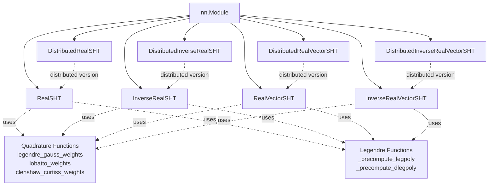
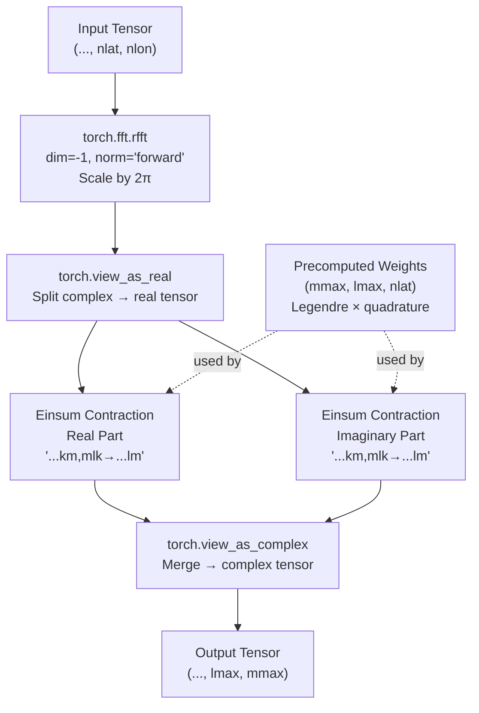

<!-- source: DeepWiki mcp.deepwiki.com · repo NVIDIA/torch-harmonics · page 11.1 torch_harmonics.sht · fetched 2026-10-26 -->

# torch_harmonics.sht

<details>
<summary>Relevant source files</summary>

The following files were used as context for generating this wiki page:

- [torch_harmonics/distributed/distributed_sht.py](torch_harmonics/distributed/distributed_sht.py)
- [torch_harmonics/sht.py](torch_harmonics/sht.py)

</details>


## Purpose and Scope

This page documents the `torch_harmonics.sht` module, which provides all spherical harmonic transform (SHT) classes and functions. This module implements both forward and inverse transforms for scalar and vector fields on the sphere.

The module contains four main transform classes in [torch_harmonics/sht.py]():
- `RealSHT` and `InverseRealSHT` for scalar fields
- `RealVectorSHT` and `InverseRealVectorSHT` for vector fields

For distributed implementations of these transforms suitable for multi-GPU execution, see [Distributed SHT](#6.1). For general concepts about spherical harmonic transforms and their mathematical background, see [Spherical Harmonic Transforms](#2).

---

## Module Overview

### Class Hierarchy



**Sources:** [torch_harmonics/sht.py:40-486](), [torch_harmonics/distributed/distributed_sht.py:45-613]()

---

## Scalar Spherical Harmonic Transforms

### RealSHT

The `RealSHT` class implements the forward spherical harmonic transform for real-valued scalar fields.

**Class Definition:** [torch_harmonics/sht.py:40-148]()

#### Constructor Parameters

| Parameter | Type | Default | Description |
|-----------|------|---------|-------------|
| `nlat` | `int` | required | Number of latitude grid points |
| `nlon` | `int` | required | Number of longitude grid points |
| `lmax` | `int` | `None` | Maximum spherical harmonic degree (defaults based on grid type) |
| `mmax` | `int` | `None` | Maximum spherical harmonic order (defaults to `nlon // 2 + 1`) |
| `grid` | `str` | `"equiangular"` | Grid type: `"equiangular"`, `"legendre-gauss"`, `"lobatto"` |
| `norm` | `str` | `"ortho"` | Normalization: `"ortho"`, `"schmidt"`, `"unnorm"` |
| `csphase` | `bool` | `True` | Whether to apply Condon-Shortley phase factor |

#### Default lmax Values by Grid Type

The default `lmax` depends on the chosen grid type and its associated quadrature exactness:

- **`"legendre-gauss"`**: `lmax = nlat` (Gauss-Legendre quadrature exact up to degree `2*nlat-1`)
- **`"lobatto"`**: `lmax = nlat - 1` (Gauss-Lobatto quadrature exact up to degree `2*nlat-3`)
- **`"equiangular"`**: `lmax = nlat` (Clenshaw-Curtis quadrature)

**Implementation:** [torch_harmonics/sht.py:88-105]()

#### Forward Method

```python
def forward(x: torch.Tensor) -> torch.Tensor
```

**Input:**
- `x`: Tensor of shape `(..., nlat, nlon)` representing spatial data on the sphere

**Output:**
- Tensor of shape `(..., lmax, mmax)` containing complex spherical harmonic coefficients

**Implementation Details:**
1. Apply real FFT along longitude dimension [torch_harmonics/sht.py:132]()
2. Perform Legendre-Gauss quadrature using precomputed weights [torch_harmonics/sht.py:144-145]()

**Sources:** [torch_harmonics/sht.py:123-148]()

#### Precomputed Buffers

The class precomputes and registers the following buffers during initialization:

- **`weights`**: Combined quadrature and Legendre polynomial weights of shape `(mmax, lmax, nlat)` [torch_harmonics/sht.py:114-118]()

These buffers are registered as non-persistent to avoid saving them with model checkpoints.

**Sources:** [torch_harmonics/sht.py:74-118]()

---

### InverseRealSHT

The `InverseRealSHT` class implements the inverse spherical harmonic transform, converting spectral coefficients back to spatial representation.

**Class Definition:** [torch_harmonics/sht.py:151-249]()

#### Constructor Parameters

Identical to `RealSHT`. See above table.

#### Forward Method

```python
def forward(x: torch.Tensor) -> torch.Tensor
```

**Input:**
- `x`: Tensor of shape `(..., lmax, mmax)` containing complex spherical harmonic coefficients

**Output:**
- Tensor of shape `(..., nlat, nlon)` representing spatial data on the sphere

**Implementation Details:**
1. Evaluate associated Legendre polynomials at grid points [torch_harmonics/sht.py:235]()
2. Apply inverse real FFT along longitude dimension [torch_harmonics/sht.py:247]()
3. Zero out imaginary parts of DC and Nyquist components [torch_harmonics/sht.py:243-245]()

**Sources:** [torch_harmonics/sht.py:225-249]()

#### Precomputed Buffers

- **`pct`**: Precomputed Legendre polynomials of shape `(mmax, lmax, nlat)` [torch_harmonics/sht.py:217-220]()

**Sources:** [torch_harmonics/sht.py:188-220]()

---

## Vector Spherical Harmonic Transforms

### Transform Pipeline Diagram

```mermaid
graph LR
    subgraph "Vector Field Input"
        VecField["Vector Field<br/>(..., 2, nlat, nlon)<br/>theta and phi components"]
    end
    
    subgraph "Forward Transform"
        FFT_V["torch.fft.rfft<br/>longitude dimension"]
        LegQuad["Legendre Quadrature<br/>with derivative weights"]
        SpheroidalToroidal["Decompose into<br/>Spheroidal & Toroidal"]
    end
    
    subgraph "Spectral Domain"
        Coeffs["Spectral Coefficients<br/>(..., 2, lmax, mmax)<br/>[0]: spheroidal<br/>[1]: toroidal"]
    end
    
    subgraph "Inverse Transform"
        Reconstruct["Reconstruct from<br/>Spheroidal & Toroidal"]
        LegEval["Evaluate Legendre<br/>derivatives at grid"]
        IFFT_V["torch.fft.irfft<br/>longitude dimension"]
    end
    
    subgraph "Vector Field Output"
        VecFieldOut["Vector Field<br/>(..., 2, nlat, nlon)"]
    end
    
    VecField --> FFT_V
    FFT_V --> LegQuad
    LegQuad --> SpheroidalToroidal
    SpheroidalToroidal --> Coeffs
    
    Coeffs --> Reconstruct
    Reconstruct --> LegEval
    LegEval --> IFFT_V
    IFFT_V --> VecFieldOut
```



**Sources:** [torch_harmonics/sht.py:252-485]()

---

### RealVectorSHT

The `RealVectorSHT` class implements the forward transform for vector fields on the sphere, decomposing them into spheroidal and toroidal components.

**Class Definition:** [torch_harmonics/sht.py:252-372]()

#### Constructor Parameters

Identical to `RealSHT`, but operates on vector fields.

#### Forward Method

```python
def forward(x: torch.Tensor) -> torch.Tensor
```

**Input:**
- `x`: Tensor of shape `(..., 2, nlat, nlon)` where dimension -3 contains `[theta_component, phi_component]`

**Output:**
- Tensor of shape `(..., 2, lmax, mmax)` where dimension -3 contains `[spheroidal, toroidal]` spectral coefficients

**Implementation Details:**

The vector transform uses derivatives of associated Legendre polynomials and performs separate contractions for spheroidal and toroidal components:

1. Apply real FFT along longitude [torch_harmonics/sht.py:340]()
2. Contract with derivative Legendre weights for spheroidal component [torch_harmonics/sht.py:353-360]()
3. Contract with derivative Legendre weights for toroidal component [torch_harmonics/sht.py:364-370]()

The weights include normalization factors `1/(l*(l+1))` to handle the curl/divergence operators [torch_harmonics/sht.py:318-323]()

**Sources:** [torch_harmonics/sht.py:331-372]()

#### Precomputed Buffers

- **`weights`**: Shape `(2, mmax, lmax, nlat)` containing:
  - `weights[0]`: First derivative component weights
  - `weights[1]`: Second derivative component weights (with sign flip for complex conjugation)

The second component has a factor of -1 applied to account for complex conjugation [torch_harmonics/sht.py:323]()

**Sources:** [torch_harmonics/sht.py:286-326]()

---

### InverseRealVectorSHT

The `InverseRealVectorSHT` class reconstructs vector fields from their spheroidal and toroidal spectral coefficients.

**Class Definition:** [torch_harmonics/sht.py:375-485]()

#### Constructor Parameters

Identical to `RealVectorSHT`.

#### Forward Method

```python
def forward(x: torch.Tensor) -> torch.Tensor
```

**Input:**
- `x`: Tensor of shape `(..., 2, lmax, mmax)` with `[spheroidal, toroidal]` coefficients

**Output:**
- Tensor of shape `(..., 2, nlat, nlon)` with `[theta_component, phi_component]`

**Implementation Details:**

The inverse transform evaluates derivative Legendre polynomials and reconstructs the vector components:

1. Compute spheroidal real/imaginary parts [torch_harmonics/sht.py:458-460]()
2. Compute toroidal real/imaginary parts [torch_harmonics/sht.py:464-466]()
3. Stack into vector field structure [torch_harmonics/sht.py:469-471]()
4. Apply inverse FFT [torch_harmonics/sht.py:483]()
5. Zero imaginary DC and Nyquist components [torch_harmonics/sht.py:479-481]()

**Sources:** [torch_harmonics/sht.py:445-485]()

#### Precomputed Buffers

- **`dpct`**: Derivative Legendre polynomials of shape `(2, mmax, lmax, nlat)` [torch_harmonics/sht.py:437-440]()

**Sources:** [torch_harmonics/sht.py:408-440]()

---

## Mathematical Foundations

### Grid Types and Quadrature

Each grid type uses a specific quadrature rule from `torch_harmonics.quadrature`:

| Grid Type | Quadrature Function | Polynomial Exactness | Default lmax |
|-----------|---------------------|---------------------|--------------|
| `"legendre-gauss"` | `legendre_gauss_weights` | `2*nlat - 1` | `nlat` |
| `"lobatto"` | `lobatto_weights` | `2*nlat - 3` | `nlat - 1` |
| `"equiangular"` | `clenshaw_curtiss_weights` | `nlat` (approximately) | `nlat` |

All quadrature functions return:
- `cost`: Cosine of colatitude values
- `weights`: Integration weights

The colatitude values are computed as `tq = arccos(cost)` and flipped to ensure proper ordering [torch_harmonics/sht.py:108]()

**Sources:** [torch_harmonics/sht.py:36-37](), [torch_harmonics/sht.py:88-105]()

---

### Normalization Schemes

The `norm` parameter controls the normalization of associated Legendre polynomials:

- **`"ortho"`**: Orthonormal basis (default)
- **`"schmidt"`**: Schmidt semi-normalization
- **`"unnorm"`**: Unnormalized

This parameter is passed to `_precompute_legpoly` and `_precompute_dlegpoly` functions [torch_harmonics/sht.py:114]()

**Sources:** [torch_harmonics/legendre.py]()

---

### Condon-Shortley Phase

The `csphase` parameter (default `True`) controls whether to include the Condon-Shortley phase factor `(-1)^m` in the associated Legendre polynomial computation. This is a convention commonly used in physics.

**Sources:** [torch_harmonics/sht.py:61](), [torch_harmonics/sht.py:114]()

---

## Implementation Details

### Computational Pipeline for RealSHT



**Sources:** [torch_harmonics/sht.py:123-148]()

### Key Implementation Patterns

#### Complex Number Handling

Both forward and inverse transforms use `torch.view_as_real` and `torch.view_as_complex` to manipulate complex tensors:

- Forward transforms perform einsum contractions on real/imaginary components separately [torch_harmonics/sht.py:135-146]()
- This approach enables efficient computation while maintaining gradient compatibility

**Sources:** [torch_harmonics/sht.py:135-146](), [torch_harmonics/sht.py:234-238]()

#### DC and Nyquist Component Handling

The inverse transforms explicitly zero out imaginary components at DC (`m=0`) and Nyquist (`m=nlon//2`) frequencies to ensure real-valued output:

```python
x[..., 0].imag = 0.0
if (self.nlon % 2 == 0) and (self.nlon // 2 < self.mmax):
    x[..., self.nlon // 2].imag = 0.0
```

This is necessary because not all FFT backend implementations guarantee this property [torch_harmonics/sht.py:240-245]()

**Sources:** [torch_harmonics/sht.py:243-245](), [torch_harmonics/sht.py:479-481]()

#### Weight Precomputation

All transform classes precompute and cache their weights during initialization:

1. Compute quadrature nodes and weights from `torch_harmonics.quadrature`
2. Evaluate Legendre polynomials at quadrature nodes using `_precompute_legpoly`
3. Combine quadrature weights with Legendre values via einsum [torch_harmonics/sht.py:114-115]()
4. Register as non-persistent buffer [torch_harmonics/sht.py:118]()

This design ensures weights are computed only once and moved to the correct device automatically.

**Sources:** [torch_harmonics/sht.py:114-118]()

---

## Distributed Implementations

The module provides distributed versions of all transform classes in [torch_harmonics/distributed/distributed_sht.py]():

- `DistributedRealSHT`
- `DistributedInverseRealSHT`
- `DistributedRealVectorSHT`
- `DistributedInverseRealVectorSHT`

These classes partition data across a 2D process grid and use communication primitives from `torch_harmonics.distributed` to perform transforms on distributed data.

For detailed documentation, see [Distributed SHT](#6.1).

**Sources:** [torch_harmonics/distributed/distributed_sht.py:45-613]()

---

## Usage Examples

### Basic Scalar Transform

```python
import torch
from torch_harmonics import RealSHT, InverseRealSHT

# Initialize transforms
nlat, nlon = 128, 256
sht = RealSHT(nlat, nlon, grid="legendre-gauss")
isht = InverseRealSHT(nlat, nlon, grid="legendre-gauss")

# Transform spatial data to spectral
x_spatial = torch.randn(4, nlat, nlon)  # batch of 4 fields
x_spectral = sht(x_spatial)  # shape: (4, lmax, mmax)

# Transform back to spatial
x_reconstructed = isht(x_spectral)  # shape: (4, nlat, nlon)
```

### Vector Field Transform

```python
from torch_harmonics import RealVectorSHT, InverseRealVectorSHT

# Initialize vector transforms
vsht = RealVectorSHT(nlat, nlon, grid="equiangular")
ivsht = InverseRealVectorSHT(nlat, nlon, grid="equiangular")

# Transform vector field
v_spatial = torch.randn(2, 2, nlat, nlon)  # 2 fields, 2 components each
v_spectral = vsht(v_spatial)  # shape: (2, 2, lmax, mmax)

# Transform back
v_reconstructed = ivsht(v_spectral)  # shape: (2, 2, nlat, nlon)
```

### Custom Grid Parameters

```python
# Specify maximum degrees manually
sht = RealSHT(nlat=128, nlon=256, lmax=100, mmax=128, 
              grid="lobatto", norm="schmidt", csphase=False)
```

**Sources:** [torch_harmonics/sht.py:40-485]()

---

## Related Pages

- [Core Concepts](#1.2) - Mathematical background on spherical harmonics
- [RealSHT and InverseRealSHT](#2.1) - Detailed usage guide for scalar transforms
- [Vector Spherical Harmonic Transforms](#2.2) - Detailed usage guide for vector transforms
- [Grid Types and Quadrature](#2.3) - In-depth discussion of grid types
- [Distributed SHT](#6.1) - Multi-GPU distributed implementations
- [torch_harmonics.quadrature](#11.5) - Quadrature functions reference
- [torch_harmonics.distributed](#11.4) - Distributed primitives reference

---

