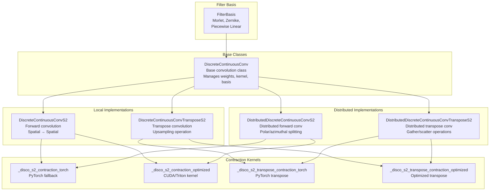
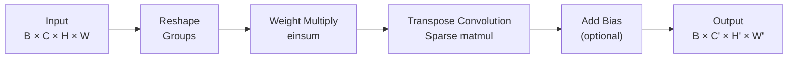
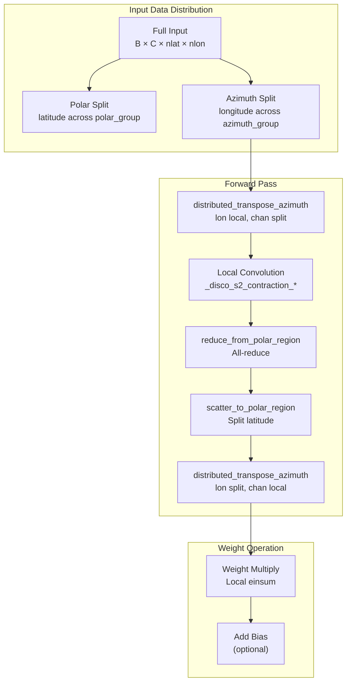
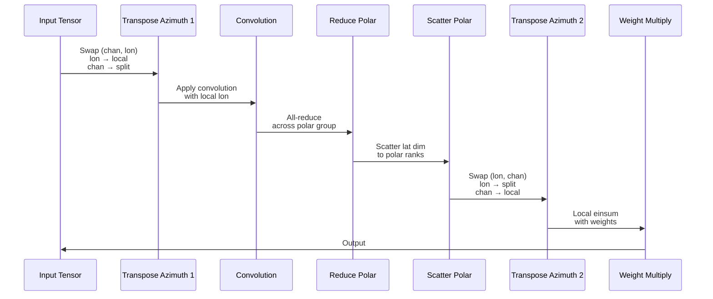
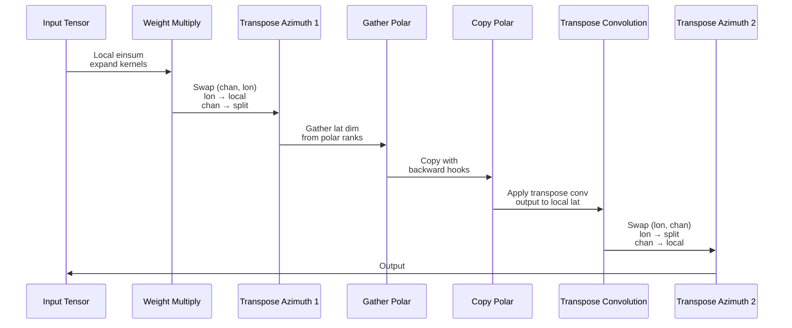
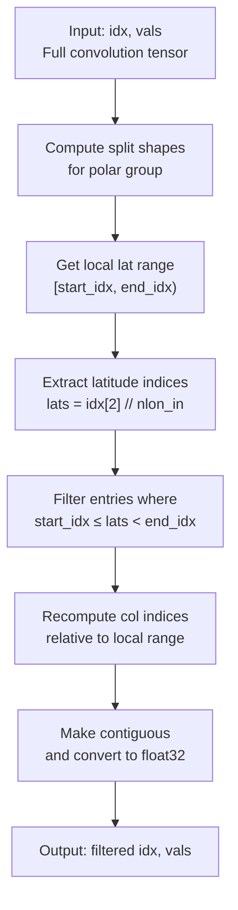
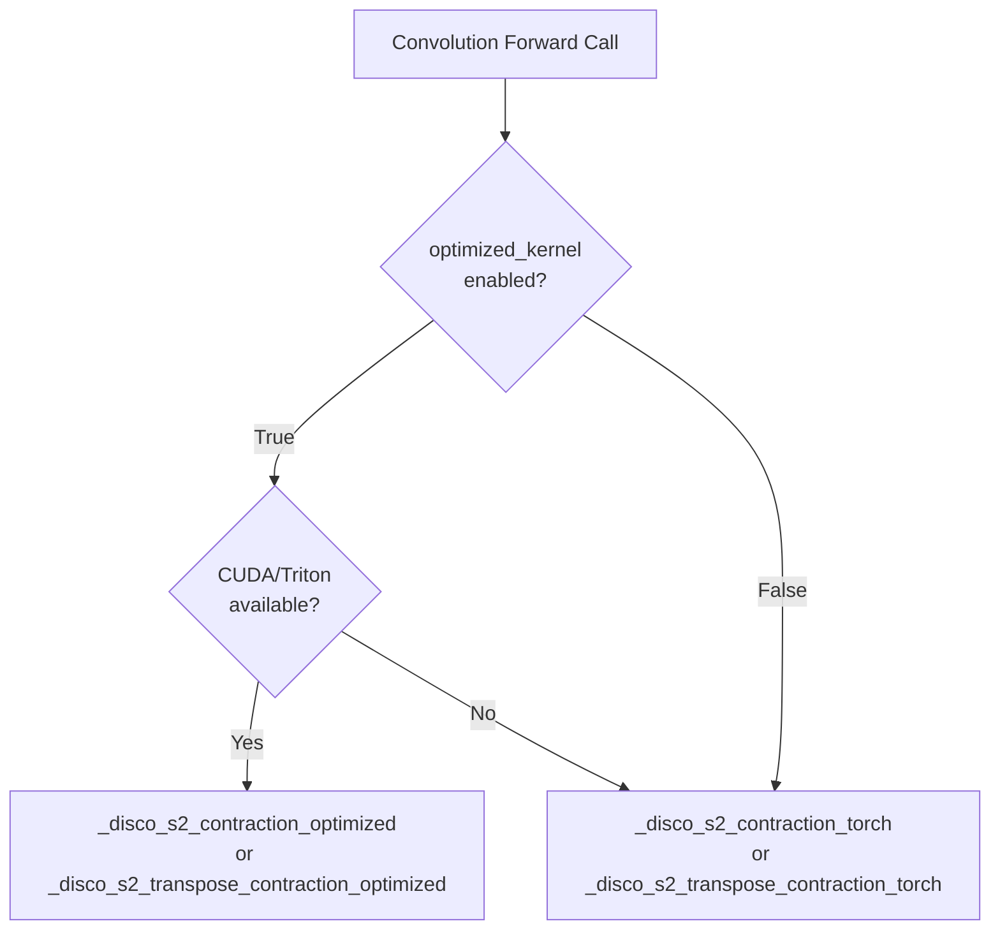

<!-- source: DeepWiki mcp.deepwiki.com · repo NVIDIA/torch-harmonics · page 11.2 torch_harmonics.convolution · fetched 2026-10-26 -->

# torch_harmonics.convolution

<details>
<summary>Relevant source files</summary>

The following files were used as context for generating this wiki page:

- [torch_harmonics/distributed/distributed_convolution.py](torch_harmonics/distributed/distributed_convolution.py)

</details>


## Purpose and Scope

This page provides a comprehensive API reference for the `torch_harmonics.convolution` module, which implements Discrete-Continuous (DISCO) convolutions on the 2-sphere. This module contains classes for both local (single-GPU) and distributed (multi-GPU/multi-node) convolution operations.

For conceptual understanding and usage examples, see [DISCO Convolutions](#3). For filter basis functions used by these convolutions, see [Filter Basis Functions](#3.2). For distributed computing architecture, see [Distributed DISCO Convolutions](#6.2).

---

## Module Components

The `torch_harmonics.convolution` module provides the following core components:

| Component | Location | Purpose |
|-----------|----------|---------|
| `DiscreteContinuousConv` | `torch_harmonics.disco.convolution` | Base class for DISCO convolutions |
| `DiscreteContinuousConvS2` | `torch_harmonics.disco.convolution` | Forward DISCO convolution on sphere |
| `DiscreteContinuousConvTransposeS2` | `torch_harmonics.disco.convolution` | Transpose DISCO convolution (upsampling) |
| `DistributedDiscreteContinuousConvS2` | `torch_harmonics.distributed.distributed_convolution` | Distributed forward convolution |
| `DistributedDiscreteContinuousConvTransposeS2` | `torch_harmonics.distributed.distributed_convolution` | Distributed transpose convolution |
| `_precompute_convolution_tensor_s2` | `torch_harmonics.disco.convolution` | Utility for precomputing convolution tensors |

Sources: [torch_harmonics/distributed/distributed_convolution.py:40-48]()

---

## Class Hierarchy



Sources: [torch_harmonics/distributed/distributed_convolution.py:115-156](), [torch_harmonics/distributed/distributed_convolution.py:288-329]()

---

## DiscreteContinuousConv (Base Class)

The base class for all DISCO convolution implementations. This class manages weight parameters, kernel configuration, and filter basis selection.

### Key Responsibilities

- Initialize and manage learnable weight tensors
- Configure kernel shape (scalar or 2-tuple)
- Select and initialize filter basis functions
- Handle grouped convolutions
- Support optional bias terms
- Toggle between optimized and fallback implementations

### Constructor Parameters

| Parameter | Type | Description |
|-----------|------|-------------|
| `in_channels` | `int` | Number of input channels |
| `out_channels` | `int` | Number of output channels |
| `kernel_shape` | `Union[int, Tuple[int], Tuple[int, int]]` | Kernel dimensions (radial, angular) |
| `basis_type` | `Optional[str]` | Filter basis: `"morlet"`, `"zernike"`, `"piecewise linear"` |
| `groups` | `Optional[int]` | Number of groups for grouped convolution |
| `bias` | `Optional[bool]` | Whether to include bias term |
| `optimized_kernel` | `Optional[bool]` | Use optimized CUDA/Triton kernels |

Sources: [torch_harmonics/distributed/distributed_convolution.py:173]()

---

## DiscreteContinuousConvS2

Forward DISCO convolution on the sphere. Applies learnable filters to spherical data while respecting spherical geometry.

### Parameters

| Parameter | Type | Default | Description |
|-----------|------|---------|-------------|
| `in_channels` | `int` | - | Number of input channels |
| `out_channels` | `int` | - | Number of output channels |
| `in_shape` | `Tuple[int]` | - | Input spatial shape `(nlat, nlon)` |
| `out_shape` | `Tuple[int]` | - | Output spatial shape `(nlat, nlon)` |
| `kernel_shape` | `Union[int, Tuple[int], Tuple[int, int]]` | - | Filter kernel shape |
| `basis_type` | `Optional[str]` | `"piecewise linear"` | Type of filter basis |
| `basis_norm_mode` | `Optional[str]` | `"mean"` | Normalization mode for basis |
| `groups` | `Optional[int]` | `1` | Number of groups |
| `grid_in` | `Optional[str]` | `"equiangular"` | Input grid type |
| `grid_out` | `Optional[str]` | `"equiangular"` | Output grid type |
| `bias` | `Optional[bool]` | `True` | Include bias term |
| `theta_cutoff` | `Optional[float]` | `None` | Local support cutoff angle (radians) |
| `optimized_kernel` | `Optional[bool]` | `True` | Use optimized implementation |

### Theta Cutoff Behavior

The `theta_cutoff` parameter controls the local support of the convolution:
- **Default (`None`)**: Automatically set to `π / (nlat_out - 1)` based on output resolution
- **Positive value**: Limits filter support to geodesic distance ≤ `theta_cutoff`
- **Must be positive**: Raises `ValueError` if ≤ 0

### Internal Data Structures

The convolution is implemented using a sparse tensor representation:
- `psi_ker_idx`: Kernel dimension indices
- `psi_row_idx`: Output spatial indices
- `psi_col_idx`: Input spatial indices (flattened `lat * nlon + lon`)
- `psi_vals`: Convolution weights for each non-zero entry

For optimized kernels, these are preprocessed into `psi_roff_idx` for efficient GPU execution.

Sources: [torch_harmonics/distributed/distributed_convolution.py:157-244]()

---

## DiscreteContinuousConvTransposeS2

Transpose DISCO convolution, used for upsampling operations and generative models. This is the adjoint operation to forward convolution.

### Key Differences from Forward Convolution

1. **Shape semantics reversed**: `in_shape` and `out_shape` are swapped internally
2. **Normalization**: Uses `transpose_normalization=True` when precomputing convolution tensor
3. **Grid types**: `grid_in` and `grid_out` are swapped when calling `_precompute_convolution_tensor_s2`
4. **Theta cutoff default**: Based on `nlat_in` instead of `nlat_out`

### Parameters

Same as `DiscreteContinuousConvS2`, but with swapped semantic meaning of input/output shapes.

### Forward Pass Logic



Sources: [torch_harmonics/distributed/distributed_convolution.py:288-329]()

---

## DistributedDiscreteContinuousConvS2

Distributed implementation of forward DISCO convolution for multi-GPU/multi-node training.

### Distribution Strategy

The class employs a 2D process grid with polar (latitude) and azimuthal (longitude) partitioning:



### Initialization

During initialization, the convolution tensor is computed globally and then split:

1. Compute full convolution tensor via `_precompute_convolution_tensor_s2`
2. Filter entries using `_split_distributed_convolution_tensor_s2` to keep only local latitude slice
3. Preprocess for optimized kernel if enabled

Sources: [torch_harmonics/distributed/distributed_convolution.py:115-286]()

### Local Shape Computation

| Attribute | Description | Computation |
|-----------|-------------|-------------|
| `lat_in_shapes` | Latitude splits for input | `compute_split_shapes(nlat_in, comm_size_polar)` |
| `lon_in_shapes` | Longitude splits for input | `compute_split_shapes(nlon_in, comm_size_azimuth)` |
| `lat_out_shapes` | Latitude splits for output | `compute_split_shapes(nlat_out, comm_size_polar)` |
| `lon_out_shapes` | Longitude splits for output | `compute_split_shapes(nlon_out, comm_size_azimuth)` |
| `nlat_in_local` | Local input latitude size | `lat_in_shapes[comm_rank_polar]` |
| `nlat_out_local` | Local output latitude size | `nlat_out` (full, before scatter) |

Sources: [torch_harmonics/distributed/distributed_convolution.py:185-204]()

### Forward Pass Communication Pattern



Sources: [torch_harmonics/distributed/distributed_convolution.py:249-285]()

---

## DistributedDiscreteContinuousConvTransposeS2

Distributed transpose convolution with reversed communication pattern.

### Key Differences from Distributed Forward Convolution

| Aspect | Forward Conv | Transpose Conv |
|--------|-------------|----------------|
| `nlat_in_local` | `lat_in_shapes[rank]` (local) | `nlat_in` (full) |
| `nlat_out_local` | `nlat_out` (full) | `lat_out_shapes[rank]` (local) |
| Before convolution | Reduce then scatter | Gather then copy |
| After convolution | Scatter latitude | Already local |
| Convolution tensor | Forward normalization | Transpose normalization |

### Communication Pattern



Sources: [torch_harmonics/distributed/distributed_convolution.py:426-460]()

### Gather and Copy Operations

The transpose convolution requires gathering the full input tensor along the latitude dimension before applying the transpose operation:

1. **`gather_from_polar_region`**: Collects latitude slices from all ranks in polar group
2. **`copy_to_polar_region`**: Sets up backward pass to perform reduce instead of broadcast

This ensures correct gradient computation during backpropagation.

Sources: [torch_harmonics/distributed/distributed_convolution.py:442-443]()

---

## Convolution Tensor Splitting Utility

### `_split_distributed_convolution_tensor_s2`

Filters a precomputed convolution tensor to retain only entries corresponding to the local latitude slice.

**Function Signature:**
```python
def _split_distributed_convolution_tensor_s2(
    idx: torch.Tensor,
    vals: torch.Tensor,
    in_shape: Tuple[int],
    out_shape: Tuple[int],
) -> Tuple[torch.Tensor, torch.Tensor]
```

**Parameters:**
- `idx`: Indices of sparse convolution tensor `[3, nnz]` where `idx[0]` = kernel dim, `idx[1]` = row (output), `idx[2]` = col (input)
- `vals`: Values corresponding to each index `[nnz]`
- `in_shape`: Input spatial shape `(nlat_in, nlon_in)`
- `out_shape`: Output spatial shape `(nlat_out, nlon_out)`

**Returns:**
- Filtered `idx` and `vals` containing only local latitude entries

**Algorithm:**



**Example:**

If `nlat_in = 128`, `polar_group_size = 4`, `polar_rank = 1`:
- Split shapes: `[32, 32, 32, 32]`
- Offsets: `[0, 32, 64, 96, 128]`
- Local range: `[32, 64)`
- Filter keeps only entries where input latitude ∈ `[32, 64)`
- Reindex: subtract 32 from latitude indices to make them relative to local tensor

Sources: [torch_harmonics/distributed/distributed_convolution.py:58-112]()

---

## Parameter Reference Tables

### Grid Type Options

| Grid Type | Description | Quadrature Rule | Use Case |
|-----------|-------------|-----------------|----------|
| `"equiangular"` | Equally spaced in lat/lon | Clenshaw-Curtis | Default, good for vision |
| `"legendre-gauss"` | Gauss-Legendre nodes | Gaussian quadrature | High accuracy spectral |
| `"lobatto"` | Gauss-Lobatto nodes | Lobatto quadrature | Boundary-inclusive |

### Basis Type Options

| Basis Type | Description | Parameters | Computational Cost |
|-----------|-------------|------------|-------------------|
| `"morlet"` | Morlet wavelets | Frequency, bandwidth | Medium |
| `"zernike"` | Zernike polynomials | Radial order | High |
| `"piecewise linear"` | Linear interpolation | Grid points | Low (default) |

For detailed information on filter basis functions, see [Filter Basis Functions](#3.2).

### Normalization Mode Options

| Mode | Description | Effect |
|------|-------------|--------|
| `"mean"` | Mean normalization | Normalizes by mean of basis |
| `"max"` | Max normalization | Normalizes by max value |
| `"none"` | No normalization | Uses raw basis values |

Sources: [torch_harmonics/distributed/distributed_convolution.py:164-170]()

---

## Optimization Backends

The convolution implementations support multiple computational backends:

### Backend Selection



### Backend Characteristics

| Backend | Implementation | Performance | Requirements |
|---------|---------------|-------------|--------------|
| Optimized | CUDA/Triton kernels | High | GPU, compiled extensions |
| PyTorch | `torch` operations | Medium | PyTorch only |

The optimized backend requires preprocessing via `preprocess_psi` function and uses custom CUDA kernels for sparse matrix operations.

Sources: [torch_harmonics/distributed/distributed_convolution.py:228-240](), [torch_harmonics/distributed/distributed_convolution.py:258-263]()

---

## Common Usage Patterns

### Basic Convolution Layer

```python
from torch_harmonics.disco.convolution import DiscreteContinuousConvS2

# Initialize convolution
conv = DiscreteContinuousConvS2(
    in_channels=64,
    out_channels=128,
    in_shape=(256, 512),      # (nlat, nlon)
    out_shape=(256, 512),
    kernel_shape=(3, 3),       # (radial, angular)
    basis_type="piecewise linear",
    theta_cutoff=None,         # Auto-compute
    bias=True
)

# Apply to spherical data
# input: [B, 64, 256, 512]
# output: [B, 128, 256, 512]
output = conv(input)
```

### Upsampling with Transpose Convolution

```python
from torch_harmonics.disco.convolution import DiscreteContinuousConvTransposeS2

# Upsample from 128x256 to 256x512
upsample = DiscreteContinuousConvTransposeS2(
    in_channels=128,
    out_channels=64,
    in_shape=(128, 256),
    out_shape=(256, 512),      # 2x resolution
    kernel_shape=(3, 3),
    bias=True
)

# input: [B, 128, 128, 256]
# output: [B, 64, 256, 512]
upsampled = upsample(input)
```

### Distributed Convolution

```python
from torch_harmonics.distributed.distributed_convolution import DistributedDiscreteContinuousConvS2
import torch.distributed as dist

# Initialize distributed environment
dist.init_process_group(backend='nccl')

# Create distributed convolution
dist_conv = DistributedDiscreteContinuousConvS2(
    in_channels=64,
    out_channels=128,
    in_shape=(512, 1024),
    out_shape=(512, 1024),
    kernel_shape=(5, 5),
    basis_type="morlet",
    theta_cutoff=0.1           # Local support: ~5.7 degrees
)

# Input is already distributed across polar/azimuth groups
# output shape depends on distribution strategy
output = dist_conv(distributed_input)
```

Sources: [torch_harmonics/distributed/distributed_convolution.py:157-174]()

---

## Memory and Performance Considerations

### Convolution Tensor Sparsity

The convolution tensor is stored in COO (coordinate) sparse format to save memory:
- **Dense size**: `kernel_size × nlat_out × (nlat_in × nlon_in)` → often gigabytes
- **Sparse size**: Depends on `theta_cutoff` and grid resolution
- **Typical sparsity**: 90-99% sparse for local convolutions with small `theta_cutoff`

### Theta Cutoff Impact

| Theta Cutoff | Support Radius | Sparsity | Use Case |
|--------------|----------------|----------|----------|
| `π` | Global | ~0% | Full spherical convolution |
| `π/4` (~45°) | Hemisphere | ~50% | Medium locality |
| `π/16` (~11°) | Local patch | ~95% | High locality, fast |
| `π/64` (~3°) | Small patch | ~99% | Very local, fastest |

### Distributed Overhead

Communication costs for distributed convolutions:

| Operation | Cost | Frequency |
|-----------|------|-----------|
| `distributed_transpose_azimuth` | All-to-all | 2× per forward pass |
| `reduce_from_polar_region` | All-reduce | 1× per forward pass |
| `scatter_to_polar_region` | Reduce-scatter | 1× per forward pass |
| `gather_from_polar_region` | All-gather | 1× per forward (transpose) |

For optimal performance, use distributed convolutions only when:
- Input resolution is large (e.g., ≥ 512×1024)
- Number of GPUs is a divisor of both `nlat` and `nlon`
- Network bandwidth is high (NCCL on InfiniBand/NVLink)

Sources: [torch_harmonics/distributed/distributed_convolution.py:197-199](), [torch_harmonics/distributed/distributed_convolution.py:249-273]()

---

## Related Modules and Functions

### Import Paths

```python
# Main convolution classes
from torch_harmonics.disco.convolution import (
    DiscreteContinuousConv,
    DiscreteContinuousConvS2,
    DiscreteContinuousConvTransposeS2,
    _precompute_convolution_tensor_s2
)

# Distributed convolution classes
from torch_harmonics.distributed.distributed_convolution import (
    DistributedDiscreteContinuousConvS2,
    DistributedDiscreteContinuousConvTransposeS2,
    _split_distributed_convolution_tensor_s2
)

# Convolution utilities
from torch_harmonics.disco._disco_utils import (
    _get_psi,
    _disco_s2_contraction_torch,
    _disco_s2_contraction_optimized,
    _disco_s2_transpose_contraction_torch,
    _disco_s2_transpose_contraction_optimized
)

# Helper functions
from torch_harmonics.disco.disco_helpers import (
    optimized_kernels_is_available,
    preprocess_psi
)
```

### Related Components

- **Filter Basis**: See [torch_harmonics.quadrature](#11.5) for `get_filter_basis` and basis function implementations
- **Grid Generation**: See [torch_harmonics.quadrature](#11.5) for `_precompute_grid`, `_precompute_latitudes`, `_precompute_longitudes`
- **Distributed Primitives**: See [torch_harmonics.distributed](#11.4) for communication operations

Sources: [torch_harmonics/distributed/distributed_convolution.py:40-56]()

---

