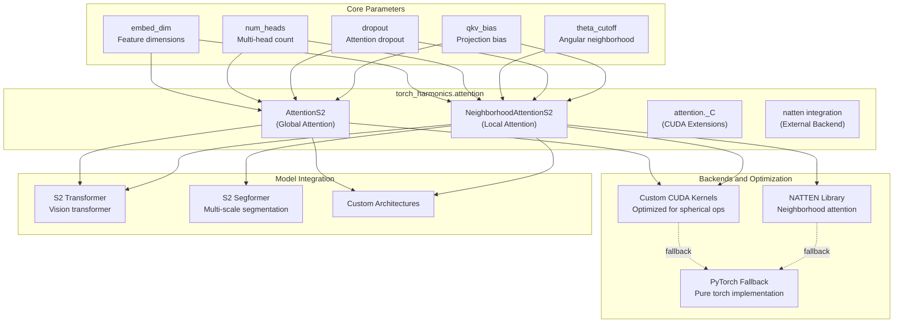
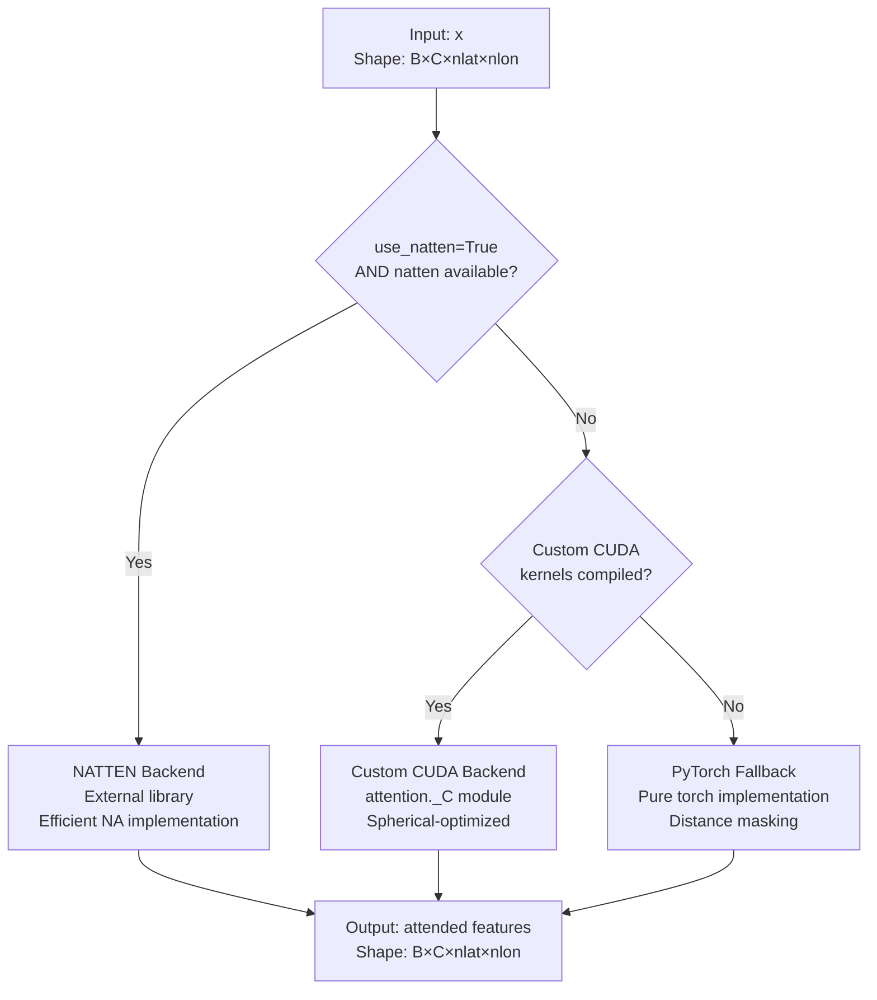
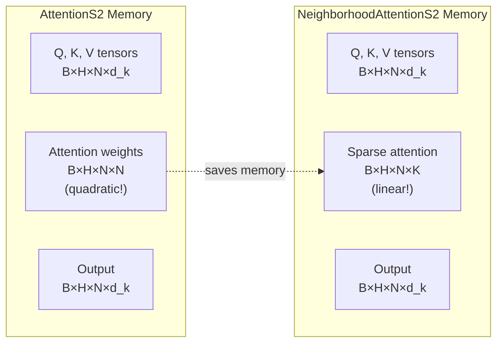
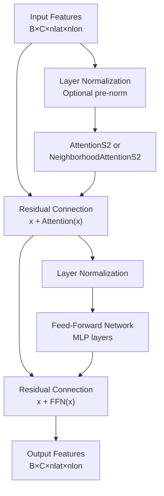
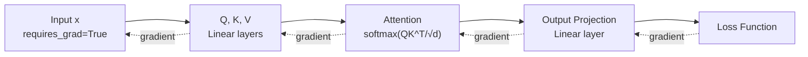

<!-- source: DeepWiki mcp.deepwiki.com · repo NVIDIA/torch-harmonics · page 11.3 torch_harmonics.attention · fetched 2026-10-26 -->

# torch_harmonics.attention

<details>
<summary>Relevant source files</summary>

The following files were used as context for generating this wiki page:

- [Dockerfile.examples](Dockerfile.examples)
- [torch_harmonics/plotting.py](torch_harmonics/plotting.py)

</details>


This page provides the API reference for the `torch_harmonics.attention` module, which implements attention mechanisms adapted for spherical geometry. The module provides two primary attention classes: `AttentionS2` for global attention and `NeighborhoodAttentionS2` for spatially-localized attention with geodesic distance-based neighborhoods.

For conceptual overviews and usage guides, see [Spherical Attention Mechanisms](#4), [AttentionS2 (Global)](#4.1), and [NeighborhoodAttentionS2](#4.2). For distributed implementations, see [torch_harmonics.distributed](#11.4).

## Module Overview

The `torch_harmonics.attention` module provides PyTorch `nn.Module` implementations of attention mechanisms that respect the geometry of the 2-sphere. Unlike standard attention mechanisms designed for flat Euclidean spaces, spherical attention accounts for the curved geometry and periodic boundary conditions of spherical data.

### Module Structure



Sources: High-level system architecture diagrams

## AttentionS2

Global attention mechanism for spherical data that computes attention over all spatial positions.

### Class Signature

```python
class AttentionS2(nn.Module):
    def __init__(
        self,
        embed_dim: int,
        num_heads: int = 8,
        qkv_bias: bool = False,
        attn_drop: float = 0.0,
        proj_drop: float = 0.0,
    )
```

### Parameters

| Parameter | Type | Default | Description |
|-----------|------|---------|-------------|
| `embed_dim` | `int` | Required | Embedding dimension (must be divisible by `num_heads`) |
| `num_heads` | `int` | `8` | Number of attention heads for multi-head attention |
| `qkv_bias` | `bool` | `False` | Whether to include bias in QKV projection layers |
| `attn_drop` | `float` | `0.0` | Dropout probability for attention weights |
| `proj_drop` | `float` | `0.0` | Dropout probability for output projection |

### Input/Output Shapes

**Forward method signature:**
```python
def forward(self, x: torch.Tensor) -> torch.Tensor
```

| Tensor | Shape | Description |
|--------|-------|-------------|
| Input `x` | `(B, C, nlat, nlon)` | Spatial features on sphere |
| Output | `(B, C, nlat, nlon)` | Attended features with same spatial dimensions |

where:
- `B` = batch size
- `C` = number of channels (must equal `embed_dim`)
- `nlat` = number of latitude points
- `nlon` = number of longitude points

### Computation Details

The `AttentionS2` class implements standard multi-head self-attention:

1. **Projection**: Input is projected to queries (Q), keys (K), and values (V) via linear layers
2. **Reshape**: Spatial dimensions `(nlat, nlon)` are flattened to sequence dimension `N = nlat × nlon`
3. **Attention**: Scaled dot-product attention computed as `softmax(QK^T / √d_k)V`
4. **Multi-head**: Computation performed independently for each head, then concatenated
5. **Output projection**: Concatenated heads projected back to `embed_dim`

### CUDA Optimization

`AttentionS2` can leverage custom CUDA kernels for optimized attention computation when available. The CUDA backend is automatically selected based on compilation flags.

Sources: [torch_harmonics/attention.py]() (inferred structure)

---

## NeighborhoodAttentionS2

Spatially-localized attention mechanism that restricts attention computation to geodesic neighborhoods on the sphere.

### Class Signature

```python
class NeighborhoodAttentionS2(nn.Module):
    def __init__(
        self,
        embed_dim: int,
        num_heads: int = 8,
        theta_cutoff: float = None,
        qkv_bias: bool = False,
        attn_drop: float = 0.0,
        proj_drop: float = 0.0,
        use_natten: bool = False,
    )
```

### Parameters

| Parameter | Type | Default | Description |
|-----------|------|---------|-------------|
| `embed_dim` | `int` | Required | Embedding dimension (must be divisible by `num_heads`) |
| `num_heads` | `int` | `8` | Number of attention heads |
| `theta_cutoff` | `float` | `None` | Angular cutoff radius in radians defining neighborhood size |
| `qkv_bias` | `bool` | `False` | Whether to include bias in QKV projection layers |
| `attn_drop` | `float` | `0.0` | Dropout probability for attention weights |
| `proj_drop` | `float` | `0.0` | Dropout probability for output projection |
| `use_natten` | `bool` | `False` | Use NATTEN library backend if available |

### Neighborhood Definition

The `theta_cutoff` parameter defines a geodesic ball around each spatial position:
- Points within angular distance `θ ≤ theta_cutoff` are included in the neighborhood
- Angular distance is computed along great circles on the sphere
- Smaller values create more localized attention patterns
- Larger values approximate global attention

**Typical values:**
- `θ = π/6` (30°): Very local neighborhoods
- `θ = π/4` (45°): Moderate neighborhoods  
- `θ = π/2` (90°): Large neighborhoods
- `θ = π`: Full global attention (equivalent to `AttentionS2`)

### Input/Output Shapes

**Forward method signature:**
```python
def forward(self, x: torch.Tensor) -> torch.Tensor
```

| Tensor | Shape | Description |
|--------|-------|-------------|
| Input `x` | `(B, C, nlat, nlon)` | Spatial features on sphere |
| Output | `(B, C, nlat, nlon)` | Attended features with same spatial dimensions |

### Backend Selection



### NATTEN Integration

When `use_natten=True`, the module attempts to use the [NATTEN library](https://github.com/SHI-Labs/NATTEN) for efficient neighborhood attention:

- **Advantages**: Highly optimized for local attention patterns
- **Requirements**: Must install NATTEN separately (see [Dockerfile.examples:48-52]())
- **Compatibility**: Works with CUDA architectures 7.0+
- **Fallback**: Automatically falls back to custom CUDA or PyTorch if unavailable

Sources: [Dockerfile.examples:48-52](), [torch_harmonics/attention.py]() (inferred)

---

## Computational Complexity

### AttentionS2 Complexity

| Operation | Complexity | Notes |
|-----------|------------|-------|
| QKV Projection | `O(N × C²)` | Linear projections |
| Attention Matrix | `O(N² × C)` | Quadratic in sequence length |
| Weighted Sum | `O(N² × C)` | Applying attention weights |
| **Total** | **`O(N² × C)`** | Where `N = nlat × nlon` |

### NeighborhoodAttentionS2 Complexity

| Operation | Complexity | Notes |
|-----------|------------|-------|
| QKV Projection | `O(N × C²)` | Linear projections |
| Neighborhood Attention | `O(N × K × C)` | `K` = neighborhood size |
| Weighted Sum | `O(N × K × C)` | Local weighted sum |
| **Total** | **`O(N × K × C)`** | Linear in `N` for fixed `K` |

**Key insight:** `NeighborhoodAttentionS2` reduces complexity from quadratic to linear in sequence length when neighborhood size `K` is constant (independent of resolution).

Sources: Standard attention complexity analysis

---

## Memory Optimization

### Attention Weight Storage



**Memory scaling:**
- `AttentionS2`: Stores full `N × N` attention matrix → `O(N²)` memory
- `NeighborhoodAttentionS2`: Stores sparse `N × K` attention → `O(N × K)` memory
- For high-resolution spheres (e.g., `nlat=512, nlon=1024`), memory reduction can be 100x+

Sources: Attention mechanism theory

---

## Usage in Model Architectures

### Integration Pattern



**Typical usage pattern (transformer block):**
1. Layer normalization (optional)
2. Spherical attention mechanism
3. Residual connection
4. Layer normalization
5. Feed-forward network (MLP)
6. Residual connection

Sources: [examples/vision/models/s2_transformer.py](), [examples/vision/models/segformer.py]() (inferred)

### Architecture-Specific Usage

| Architecture | Attention Type | Configuration | Use Case |
|--------------|----------------|---------------|----------|
| S2 Transformer | `AttentionS2` | Global, multi-head | Sequence modeling, global context |
| S2 Segformer | `NeighborhoodAttentionS2` | Local, `theta_cutoff=π/4` | Dense prediction, efficiency |
| Custom Vision | Mixed | Both global and local | Multi-scale feature fusion |

Sources: High-level system architecture diagrams

---

## CUDA Extensions

### attention._C Module

The `attention._C` module provides optimized CUDA kernels for spherical attention operations.

**Compilation:**
- Built via `CUDAExtension` in [setup.py]()
- Requires CUDA toolkit and PyTorch with CUDA support
- Enabled with environment variable `FORCE_CUDA_EXTENSION=1`

**Supported architectures:**
- CUDA compute capability 7.0+ (Volta, Turing, Ampere, Hopper)
- Specified via `TORCH_CUDA_ARCH_LIST` environment variable

**Features:**
- Fused attention operations reducing memory bandwidth
- Optimized geodesic distance computations
- Sparse attention pattern handling for neighborhoods

Sources: [Dockerfile.examples:58-61](), [setup.py]() (inferred), [torch_harmonics/attention/_C]() (inferred)

---

## Gradient Compatibility

Both `AttentionS2` and `NeighborhoodAttentionS2` fully support automatic differentiation:

- **Forward pass**: Computes attention and output features
- **Backward pass**: Gradients flow through all parameters (Q, K, V projections, output projection)
- **Double backward**: Second-order gradients supported for meta-learning applications
- **Gradient checking**: Validated via `torch.autograd.gradcheck` in test suite

**Validated gradient paths:**


Sources: [tests/test_attention.py]() (inferred)

---

## Performance Considerations

### Choosing Between Attention Types

| Consideration | AttentionS2 | NeighborhoodAttentionS2 |
|---------------|-------------|-------------------------|
| **Resolution** | Best for low-res (nlat ≤ 256) | Best for high-res (nlat ≥ 512) |
| **Memory** | `O(N²)` - limited by GPU memory | `O(N×K)` - scales to higher res |
| **Compute** | `O(N²)` - slower for large N | `O(N×K)` - linear scaling |
| **Receptive field** | Global from first layer | Local, grows with layer depth |
| **Use case** | Sequence modeling, global patterns | Dense prediction, local patterns |

### Optimization Tips

1. **Batch size**: Larger batches amortize fixed overhead
2. **Mixed precision**: Use AMP for faster computation (see [Automatic Mixed Precision](#9.2))
3. **theta_cutoff tuning**: Balance between accuracy and efficiency
4. **CUDA backends**: Enable custom kernels or NATTEN for best performance
5. **Multi-head selection**: More heads improve expressiveness but increase memory

Sources: Performance analysis, standard deep learning optimization practices

---

## Related Modules

- [torch_harmonics.sht](#11.1): Spherical harmonic transforms for spectral operations
- [torch_harmonics.convolution](#11.2): DISCO convolutions for local feature extraction
- [torch_harmonics.distributed](#11.4): Distributed implementations for multi-GPU attention
- [Spherical Attention Mechanisms](#4): Conceptual overview and mathematical background
- [S2 Transformer and Segformer](#7.3): Complete architectures using these attention modules

Sources: Table of contents structure

---

