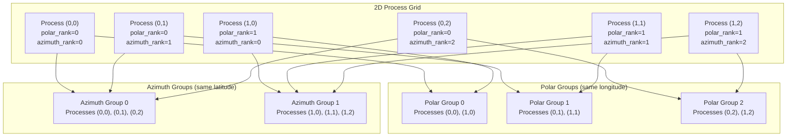
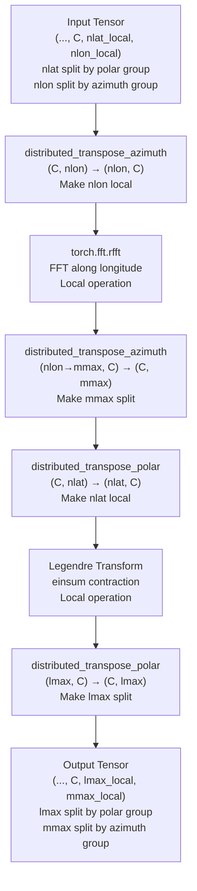
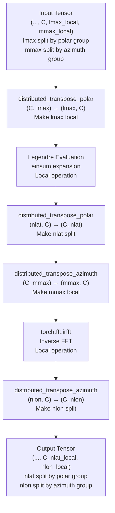
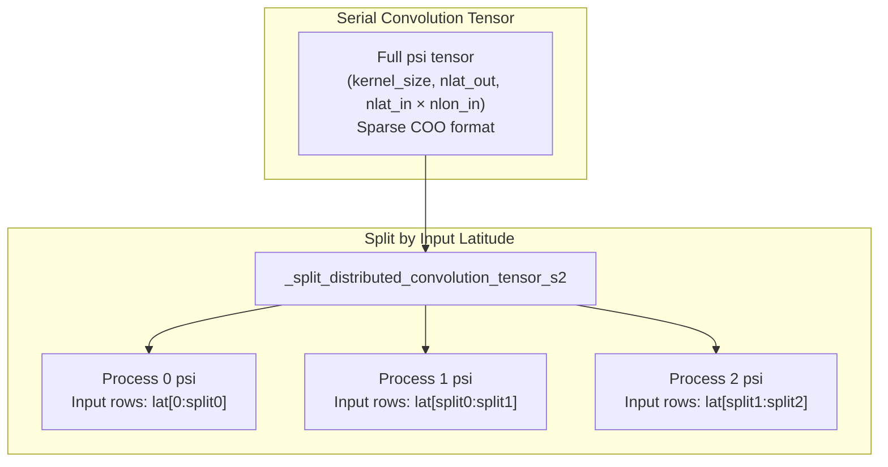
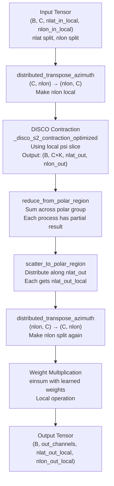
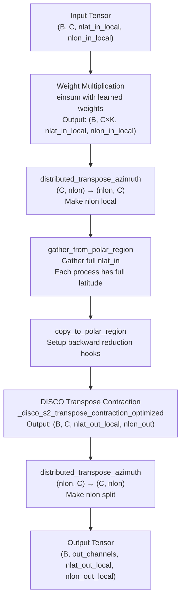

<!-- source: DeepWiki mcp.deepwiki.com · repo NVIDIA/torch-harmonics · page 11.4 torch_harmonics.distributed · fetched 2026-10-26 -->

# torch_harmonics.distributed

<details>
<summary>Relevant source files</summary>

The following files were used as context for generating this wiki page:

- [torch_harmonics/distributed/distributed_convolution.py](torch_harmonics/distributed/distributed_convolution.py)
- [torch_harmonics/distributed/distributed_sht.py](torch_harmonics/distributed/distributed_sht.py)
- [torch_harmonics/sht.py](torch_harmonics/sht.py)

</details>


## Purpose and Scope

This page provides a comprehensive API reference for the `torch_harmonics.distributed` module, which implements distributed-memory parallelism for spherical harmonic transforms and DISCO convolutions across multiple GPUs and compute nodes. The module employs a 2D process grid strategy that partitions spherical data along both latitude (polar) and longitude (azimuthal) dimensions.

For information about the non-distributed versions of these operations, see [torch_harmonics.sht](#11.1) and [torch_harmonics.convolution](#11.2). For distributed computing concepts and usage patterns, see [Distributed Computing](#6).

**Sources:** [torch_harmonics/distributed/distributed_sht.py:1-613](), [torch_harmonics/distributed/distributed_convolution.py:1-461]()

---

## Process Grid Architecture

The distributed module uses a 2D decomposition strategy where the global process group is divided into two orthogonal subgroups:

- **Polar group**: Processes that share the same longitude slices (split along latitude dimension)
- **Azimuthal group**: Processes that share the same latitude slices (split along longitude dimension)

This creates a logical `polar_size × azimuth_size` grid of processes. Each process maintains local portions of the data and coordinates with others through collective communication operations.

### Process Grid Configuration Diagram



**Sources:** [torch_harmonics/distributed/distributed_sht.py:105-122](), [torch_harmonics/distributed/distributed_convolution.py:178-188]()

---

## Communication Primitives

### Process Group Query Functions

#### `polar_group_size()`
Returns the size of the polar process group (number of processes splitting the latitude dimension).

#### `azimuth_group_size()`
Returns the size of the azimuthal process group (number of processes splitting the longitude dimension).

#### `polar_group_rank()`
Returns the rank of the current process within its polar group (0 to `polar_group_size() - 1`).

#### `azimuth_group_rank()`
Returns the rank of the current process within its azimuthal group (0 to `azimuth_group_size() - 1`).

**Sources:** [torch_harmonics/distributed/distributed_sht.py:106-109](), [torch_harmonics/distributed/distributed_convolution.py:179-182]()

---

### Tensor Partitioning Utilities

#### `compute_split_shapes(total_size, num_chunks)`
Computes how a dimension of size `total_size` should be split across `num_chunks` processes, handling uneven divisions.

**Parameters:**
- `total_size` (int): Total size of the dimension to split
- `num_chunks` (int): Number of chunks to split into

**Returns:**
- List[int]: List of chunk sizes, one per process

**Sources:** [torch_harmonics/distributed/distributed_sht.py:118-121](), [torch_harmonics/distributed/distributed_convolution.py:185-188]()

---

#### `split_tensor_along_dim(tensor, dim, num_chunks)`
Splits a tensor along a specified dimension into `num_chunks` chunks.

**Parameters:**
- `tensor` (torch.Tensor): Tensor to split
- `dim` (int): Dimension along which to split
- `num_chunks` (int): Number of chunks

**Returns:**
- List[torch.Tensor]: List of tensor chunks

**Sources:** [torch_harmonics/distributed/distributed_sht.py:128-129](), [torch_harmonics/distributed/distributed_convolution.py:219]()

---

### Transpose Operations

Transpose operations swap data distribution between channel and spatial dimensions, enabling FFTs and Legendre transforms to operate on local data.

#### `distributed_transpose_azimuth`

A custom autograd function that transposes data distribution between channel and longitude dimensions. In the forward pass, it redistributes data such that a different dimension becomes local across the azimuthal process group.

**Typical Usage Pattern:**
```python
# Make longitude local (channels split) → Make channels local (longitude split)
x = distributed_transpose_azimuth.apply(x, (channel_dim, lon_dim), lon_shapes)
```

**Sources:** [torch_harmonics/distributed/distributed_sht.py:146-157](), [torch_harmonics/distributed/distributed_convolution.py:256-272]()

---

#### `distributed_transpose_polar`

A custom autograd function that transposes data distribution between channel and latitude dimensions. Operates similarly to `distributed_transpose_azimuth` but for the polar process group.

**Typical Usage Pattern:**
```python
# Make latitude local (channels split) → Make channels local (latitude split)
x = distributed_transpose_polar.apply(x, (channel_dim, lat_dim), lat_shapes)
```

**Sources:** [torch_harmonics/distributed/distributed_sht.py:161-175](), [torch_harmonics/distributed/distributed_convolution.py:267-289]()

---

### Polar Region Communication Operations

These operations manage data movement specifically along the latitude (polar) dimension.

#### `reduce_from_polar_region(tensor)`

Performs an all-reduce operation across the polar group, summing contributions from all processes that share the same longitude slices.

**Parameters:**
- `tensor` (torch.Tensor): Tensor to reduce

**Returns:**
- torch.Tensor: Reduced tensor (same shape as input)

**Sources:** [torch_harmonics/distributed/distributed_convolution.py:266]()

---

#### `scatter_to_polar_region(tensor, dim)`

Scatters a tensor along the specified dimension across the polar group. Each process receives its portion based on the computed split shapes.

**Parameters:**
- `tensor` (torch.Tensor): Tensor to scatter
- `dim` (int): Dimension along which to scatter

**Returns:**
- torch.Tensor: Local portion of the scattered tensor

**Sources:** [torch_harmonics/distributed/distributed_convolution.py:267]()

---

#### `gather_from_polar_region(tensor, dim, shapes)`

Gathers tensor slices from all processes in the polar group along the specified dimension.

**Parameters:**
- `tensor` (torch.Tensor): Local tensor slice
- `dim` (int): Dimension along which to gather
- `shapes` (List[int]): Split shapes for each process

**Returns:**
- torch.Tensor: Gathered tensor with full data along `dim`

**Sources:** [torch_harmonics/distributed/distributed_convolution.py:442]()

---

#### `copy_to_polar_region(tensor)`

Creates a copy of the tensor that sets up backward hooks for reduction operations during backpropagation.

**Parameters:**
- `tensor` (torch.Tensor): Tensor to copy

**Returns:**
- torch.Tensor: Copied tensor with gradient reduction hooks

**Sources:** [torch_harmonics/distributed/distributed_convolution.py:443]()

---

## Distributed Spherical Harmonic Transform Classes

### DistributedRealSHT

Forward real-valued spherical harmonic transform with distributed-memory parallelism.

#### Class Definition

```python
class DistributedRealSHT(nn.Module):
    def __init__(
        self,
        nlat: int,
        nlon: int,
        lmax: int = None,
        mmax: int = None,
        grid: str = "equiangular",
        norm: str = "ortho",
        csphase: bool = True
    )
```

**Parameters:**
- `nlat` (int): Number of latitude points (global)
- `nlon` (int): Number of longitude points (global)
- `lmax` (int, optional): Maximum spherical harmonic degree
- `mmax` (int, optional): Maximum spherical harmonic order
- `grid` (str): Grid type - "equiangular", "legendre-gauss", or "lobatto"
- `norm` (str): Normalization - "ortho", "schmidt", or "unnorm"
- `csphase` (bool): Apply Condon-Shortley phase factor

**Input Shape:** `(..., C, nlat_local, nlon_local)` where spatial dimensions are split according to process grid

**Output Shape:** `(..., C, lmax_local, mmax_local)` where spectral dimensions are split

**Sources:** [torch_harmonics/distributed/distributed_sht.py:45-177]()

---

#### Communication Pattern



**Sources:** [torch_harmonics/distributed/distributed_sht.py:136-177]()

---

### DistributedInverseRealSHT

Inverse real-valued spherical harmonic transform with distributed-memory parallelism.

#### Class Definition

```python
class DistributedInverseRealSHT(nn.Module):
    def __init__(
        self,
        nlat: int,
        nlon: int,
        lmax: int = None,
        mmax: int = None,
        grid: str = "equiangular",
        norm: str = "ortho",
        csphase: bool = True
    )
```

**Parameters:** Same as `DistributedRealSHT`

**Input Shape:** `(..., C, lmax_local, mmax_local)` where spectral dimensions are split

**Output Shape:** `(..., C, nlat_local, nlon_local)` where spatial dimensions are split

**Sources:** [torch_harmonics/distributed/distributed_sht.py:180-308]()

---

#### Communication Pattern

The inverse transform reverses the communication pattern of the forward transform:



**Sources:** [torch_harmonics/distributed/distributed_sht.py:266-308]()

---

### DistributedRealVectorSHT

Forward real-valued vector spherical harmonic transform for vector fields on the sphere. Computes spheroidal and toroidal components.

#### Class Definition

```python
class DistributedRealVectorSHT(nn.Module):
    def __init__(
        self,
        nlat: int,
        nlon: int,
        lmax: int = None,
        mmax: int = None,
        grid: str = "equiangular",
        norm: str = "ortho",
        csphase: bool = True
    )
```

**Parameters:** Same as `DistributedRealSHT`

**Input Shape:** `(..., C, 2, nlat_local, nlon_local)` where dimension -3 represents vector components

**Output Shape:** `(..., C, 2, lmax_local, mmax_local)` where dimension -3 represents spheroidal/toroidal components

**Sources:** [torch_harmonics/distributed/distributed_sht.py:311-465]()

---

### DistributedInverseRealVectorSHT

Inverse real-valued vector spherical harmonic transform, converting spheroidal and toroidal spectral coefficients back to spatial vector fields.

#### Class Definition

```python
class DistributedInverseRealVectorSHT(nn.Module):
    def __init__(
        self,
        nlat: int,
        nlon: int,
        lmax: int = None,
        mmax: int = None,
        grid: str = "equiangular",
        norm: str = "ortho",
        csphase: bool = True
    )
```

**Parameters:** Same as `DistributedRealSHT`

**Input Shape:** `(..., C, 2, lmax_local, mmax_local)` where dimension -3 represents spheroidal/toroidal components

**Output Shape:** `(..., C, 2, nlat_local, nlon_local)` where dimension -3 represents vector components

**Sources:** [torch_harmonics/distributed/distributed_sht.py:468-612]()

---

## Distributed DISCO Convolution Classes

### DistributedDiscreteContinuousConvS2

Distributed version of discrete-continuous convolutions on the sphere. Splits convolution tensor computation across processes in the polar group while keeping azimuthal convolutions local.

#### Class Definition

```python
class DistributedDiscreteContinuousConvS2(DiscreteContinuousConv):
    def __init__(
        self,
        in_channels: int,
        out_channels: int,
        in_shape: Tuple[int],
        out_shape: Tuple[int],
        kernel_shape: Union[int, Tuple[int], Tuple[int, int]],
        basis_type: str = "piecewise linear",
        basis_norm_mode: str = "mean",
        groups: int = 1,
        grid_in: str = "equiangular",
        grid_out: str = "equiangular",
        bias: bool = True,
        theta_cutoff: float = None,
        optimized_kernel: bool = True
    )
```

**Parameters:**
- `in_channels` (int): Number of input channels
- `out_channels` (int): Number of output channels
- `in_shape` (Tuple[int]): Global input shape `(nlat_in, nlon_in)`
- `out_shape` (Tuple[int]): Global output shape `(nlat_out, nlon_out)`
- `kernel_shape` (Union[int, Tuple[int], Tuple[int, int]]): Kernel shape for filter basis
- `basis_type` (str): Filter basis type - see [Filter Basis Functions](#3.2)
- `basis_norm_mode` (str): Normalization mode for filter basis
- `groups` (int): Number of groups for grouped convolution
- `grid_in` (str): Input grid type
- `grid_out` (str): Output grid type
- `bias` (bool): Whether to include bias term
- `theta_cutoff` (float, optional): Angular cutoff for local support
- `optimized_kernel` (bool): Use optimized CUDA/Triton kernels if available

**Input Shape:** `(B, in_channels, nlat_in_local, nlon_in_local)`

**Output Shape:** `(B, out_channels, nlat_out_local, nlon_out_local)`

**Sources:** [torch_harmonics/distributed/distributed_convolution.py:115-285]()

---

#### Convolution Tensor Splitting

The distributed implementation splits the precomputed convolution tensor (`psi`) along the latitude dimension:



The function `_split_distributed_convolution_tensor_s2` filters the sparse convolution tensor to only include entries corresponding to each process's local input latitude slice, remapping indices to refer to local tensor coordinates.

**Sources:** [torch_harmonics/distributed/distributed_convolution.py:58-112](), [torch_harmonics/distributed/distributed_convolution.py:206-219]()

---

#### Communication Pattern in Forward Pass



**Sources:** [torch_harmonics/distributed/distributed_convolution.py:249-285]()

---

### DistributedDiscreteContinuousConvTransposeS2

Distributed version of discrete-continuous transpose convolutions, used for upsampling spherical data.

#### Class Definition

```python
class DistributedDiscreteContinuousConvTransposeS2(DiscreteContinuousConv):
    def __init__(
        self,
        in_channels: int,
        out_channels: int,
        in_shape: Tuple[int],
        out_shape: Tuple[int],
        kernel_shape: Union[int, Tuple[int], Tuple[int, int]],
        basis_type: str = "piecewise linear",
        basis_norm_mode: str = "mean",
        groups: int = 1,
        grid_in: str = "equiangular",
        grid_out: str = "equiangular",
        bias: bool = True,
        theta_cutoff: float = None,
        optimized_kernel: bool = True
    )
```

**Parameters:** Same as `DistributedDiscreteContinuousConvS2`, but `in_shape` and `out_shape` are swapped in interpretation

**Input Shape:** `(B, in_channels, nlat_in_local, nlon_in_local)`

**Output Shape:** `(B, out_channels, nlat_out_local, nlon_out_local)`

**Sources:** [torch_harmonics/distributed/distributed_convolution.py:288-460]()

---

#### Communication Pattern in Forward Pass

The transpose convolution uses a gather-then-compute pattern, opposite to the regular convolution's compute-then-scatter:



**Sources:** [torch_harmonics/distributed/distributed_convolution.py:426-460]()

---

## Data Layout and Partitioning Summary

| Operation | Initial Layout | Final Layout | Key Transposes |
|-----------|---------------|--------------|----------------|
| **DistributedRealSHT** | `(C, nlat_local, nlon_local)` | `(C, lmax_local, mmax_local)` | 2× azimuth, 2× polar |
| **DistributedInverseRealSHT** | `(C, lmax_local, mmax_local)` | `(C, nlat_local, nlon_local)` | 2× polar, 2× azimuth |
| **DistributedRealVectorSHT** | `(C, 2, nlat_local, nlon_local)` | `(C, 2, lmax_local, mmax_local)` | 2× azimuth, 2× polar |
| **DistributedInverseRealVectorSHT** | `(C, 2, lmax_local, mmax_local)` | `(C, 2, nlat_local, nlon_local)` | 2× polar, 2× azimuth |
| **DistributedDiscreteContinuousConvS2** | `(C, nlat_local, nlon_local)` | `(C, nlat_local, nlon_local)` | 2× azimuth |
| **DistributedDiscreteContinuousConvTransposeS2** | `(C, nlat_local, nlon_local)` | `(C, nlat_local, nlon_local)` | 2× azimuth |

**Note:** All layouts show the last dimensions after batch dimension. `local` suffix indicates that dimension is split across the corresponding process group.

**Sources:** [torch_harmonics/distributed/distributed_sht.py:136-308](), [torch_harmonics/distributed/distributed_convolution.py:249-460]()

---

## Implementation Notes

### Backend Requirements

Distributed operations require PyTorch's distributed package to be initialized with either NCCL (for GPU) or Gloo (for CPU) backend:

```python
import torch.distributed as dist
dist.init_process_group(backend='nccl')  # or 'gloo'
```

**Sources:** [torch_harmonics/distributed/distributed_sht.py:1-42]()

---

### Local vs Global Dimensions

Throughout the distributed module:
- Global dimensions (e.g., `nlat`, `nlon`, `lmax`, `mmax`) refer to the full size of the data if it were on a single process
- Local dimensions (e.g., `nlat_local`, `nlon_local`) refer to the portion stored on each process
- Split shapes are computed using `compute_split_shapes()` which handles uneven divisions

**Sources:** [torch_harmonics/distributed/distributed_sht.py:118-121](), [torch_harmonics/distributed/distributed_convolution.py:185-203]()

---

### Gradient Handling

All communication primitives implement custom backward passes to ensure gradients are properly communicated:
- `distributed_transpose_*`: Reverse transpose in backward pass
- `reduce_from_polar_region`: Scatter in backward pass
- `scatter_to_polar_region`: Gather+reduce in backward pass
- `gather_from_polar_region`: Scatter in backward pass
- `copy_to_polar_region`: All-reduce gradients in backward pass

**Sources:** [torch_harmonics/distributed/distributed_convolution.py:266-268](), [torch_harmonics/distributed/distributed_convolution.py:442-443]()

---

### Performance Considerations

1. **Minimize Transposes**: Each transpose operation involves collective communication. The library is designed to minimize the number of transposes needed.

2. **Optimized Kernels**: Setting `optimized_kernel=True` uses custom CUDA kernels that are more efficient for the sparse convolution tensor operations.

3. **Communication Overlap**: Future optimizations may include overlapping communication with computation where possible.

4. **Memory Usage**: Distributed operations reduce per-process memory footprint by a factor approximately equal to the total number of processes (`polar_size × azimuth_size`).

**Sources:** [torch_harmonics/distributed/distributed_convolution.py:171](), [torch_harmonics/distributed/distributed_convolution.py:228-230]()

---

