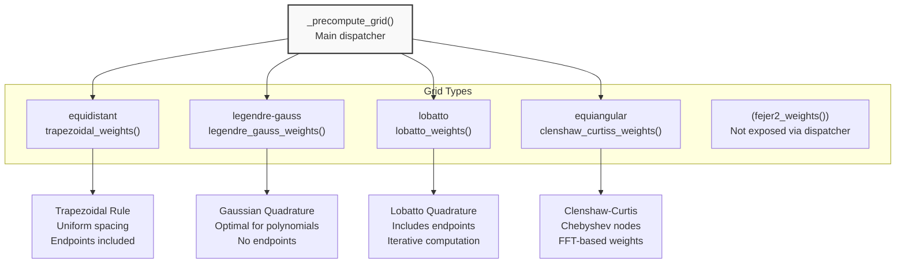
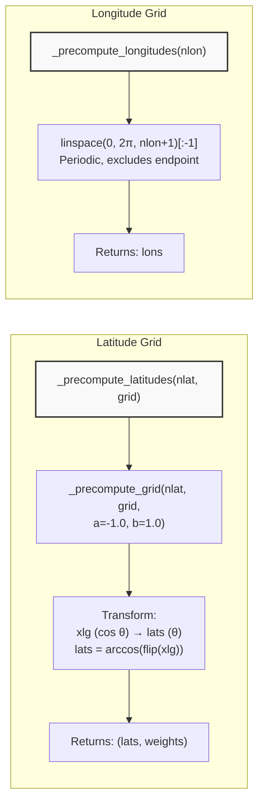
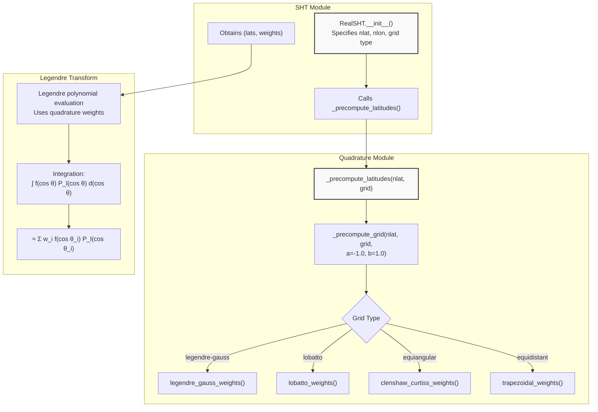
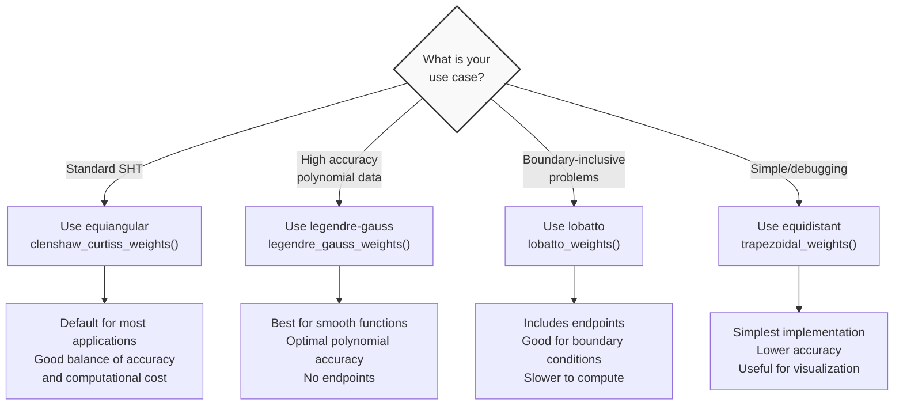

<!-- source: DeepWiki mcp.deepwiki.com · repo NVIDIA/torch-harmonics · page 11.5 torch_harmonics.quadrature · fetched 2026-10-26 -->

# torch_harmonics.quadrature

<details>
<summary>Relevant source files</summary>

The following files were used as context for generating this wiki page:

- [torch_harmonics/filter_basis.py](torch_harmonics/filter_basis.py)
- [torch_harmonics/quadrature.py](torch_harmonics/quadrature.py)

</details>


## Purpose and Scope

The `torch_harmonics.quadrature` module provides quadrature rules and grid generation utilities for numerical integration on spherical grids. This module computes grid points and associated quadrature weights for various integration schemes used throughout the library.

For information about how these quadrature rules are used in spherical harmonic transforms, see [RealSHT and InverseRealSHT](#2.1). For details on grid types and their mathematical properties, see [Grid Types and Quadrature](#2.3).

**Sources:** [torch_harmonics/quadrature.py:1-337]()

---

## Overview

Quadrature rules define discrete grid points and associated weights that enable accurate numerical integration of continuous functions. In torch-harmonics, quadrature rules are essential for:

1. **Spherical Harmonic Transforms**: Converting spatial data to spectral coefficients via Legendre transforms
2. **DISCO Convolutions**: Computing localized convolutions on spherical grids
3. **Grid Generation**: Creating latitude/longitude grids for spherical data representation

The module supports multiple quadrature schemes, each with different accuracy properties and computational characteristics.

**Sources:** [torch_harmonics/quadrature.py:38-102]()

---

## Quadrature Rule Types

### Supported Quadrature Schemes



**Sources:** [torch_harmonics/quadrature.py:38-82](), [torch_harmonics/quadrature.py:105-337]()

### Quadrature Rule Comparison

| Quadrature Type | Function | Endpoints | Optimal For | Computation |
|----------------|----------|-----------|-------------|-------------|
| Equidistant | `trapezoidal_weights()` | Yes | Uniform data, periodic functions | Simple, O(n) |
| Legendre-Gauss | `legendre_gauss_weights()` | No | Polynomial integration | NumPy library, fast |
| Lobatto | `lobatto_weights()` | Yes | Boundary-inclusive problems | Iterative, O(n·maxiter) |
| Clenshaw-Curtis | `clenshaw_curtiss_weights()` | Yes | Chebyshev-based methods | FFT-based, O(n log n) |
| Fejer-2 | `fejer2_weights()` | Yes | Alternative to C-C | FFT-based, O(n log n) |

**Sources:** [torch_harmonics/quadrature.py:105-337]()

---

## Grid Generation Functions

### Latitude and Longitude Grids



**Sources:** [torch_harmonics/quadrature.py:84-102]()

### LRU Caching Strategy

Both `_precompute_latitudes()` and `_precompute_longitudes()` use `@lru_cache` decorators with `copy=True` to cache computed grids. This avoids recomputing grids for the same resolution and grid type across multiple SHT operations.

```python
@lru_cache(typed=True, copy=True)
def _precompute_latitudes(nlat: int, grid: Optional[str]="equiangular"):
    # Cached computation...
```

**Sources:** [torch_harmonics/quadrature.py:84-102]()

---

## API Reference

### `_precompute_grid()`

Main dispatcher function that selects the appropriate quadrature rule based on the grid type.

**Signature:**
```python
_precompute_grid(
    n: int,
    grid: Optional[str] = "equidistant",
    a: Optional[float] = 0.0,
    b: Optional[float] = 1.0,
    periodic: Optional[bool] = False
) -> Tuple[torch.Tensor, torch.Tensor]
```

**Parameters:**
- `n`: Number of grid points
- `grid`: Grid type - one of `"equidistant"`, `"legendre-gauss"`, `"lobatto"`, `"equiangular"`
- `a`: Lower bound of interval
- `b`: Upper bound of interval
- `periodic`: Whether the grid is periodic (only valid for `"equidistant"`)

**Returns:**
- `xlg`: Tensor of quadrature nodes (shape: `[n]`)
- `wlg`: Tensor of quadrature weights (shape: `[n]`)

**Raises:**
- `ValueError`: If `periodic=True` for non-equidistant grids or unknown grid type

**Sources:** [torch_harmonics/quadrature.py:38-82]()

---

### `_precompute_longitudes()`

Generates a periodic grid of longitude points in the range `[0, 2π)`.

**Signature:**
```python
_precompute_longitudes(nlon: int) -> torch.Tensor
```

**Parameters:**
- `nlon`: Number of longitude points

**Returns:**
- `lons`: Tensor of longitude values (shape: `[nlon]`, dtype: `float64`)

**Implementation Details:**
- Uses `torch.linspace(0, 2*pi, nlon+1)[:-1]` to create periodic grid
- Excludes the endpoint to avoid duplication (since 0 ≡ 2π)
- Result is cached via `@lru_cache` with `copy=True`

**Sources:** [torch_harmonics/quadrature.py:84-88]()

---

### `_precompute_latitudes()`

Generates latitude grid points and quadrature weights, transforming from the cosine-theta domain to the theta (latitude) domain.

**Signature:**
```python
_precompute_latitudes(
    nlat: int,
    grid: Optional[str] = "equiangular"
) -> Tuple[torch.Tensor, torch.Tensor]
```

**Parameters:**
- `nlat`: Number of latitude points
- `grid`: Quadrature type (default: `"equiangular"`)

**Returns:**
- `lats`: Tensor of latitude values in radians (shape: `[nlat]`, dtype: `float64`)
- `wlg`: Tensor of quadrature weights (shape: `[nlat]`, dtype: `float64`)

**Implementation Details:**
1. Computes grid in cosine-theta domain: `xlg, wlg = _precompute_grid(nlat, grid, a=-1.0, b=1.0)`
2. Transforms to theta domain: `lats = arccos(flip(xlg))`
3. Flips weights to match: `wlg = flip(wlg)`
4. The cosine-theta formulation accounts for the Jacobian of spherical coordinates

**Sources:** [torch_harmonics/quadrature.py:91-102]()

---

### `trapezoidal_weights()`

Computes equidistant nodes with trapezoidal quadrature weights.

**Signature:**
```python
trapezoidal_weights(
    n: int,
    a: Optional[float] = -1.0,
    b: Optional[float] = 1.0,
    periodic: Optional[bool] = False
) -> Tuple[torch.Tensor, torch.Tensor]
```

**Parameters:**
- `n`: Number of quadrature nodes
- `a`: Lower bound of interval
- `b`: Upper bound of interval
- `periodic`: If `True`, creates periodic grid without endpoint

**Returns:**
- `xlg`: Tensor of uniformly-spaced nodes
- `wlg`: Tensor of trapezoidal weights

**Weight Formula:**
- Periodic: All weights equal to `(b-a)/n`
- Non-periodic: Interior weights `(b-a)/(n-1)`, endpoints weighted by `0.5`

**Sources:** [torch_harmonics/quadrature.py:105-136]()

---

### `legendre_gauss_weights()`

Computes Legendre-Gauss quadrature nodes and weights using NumPy's polynomial library.

**Signature:**
```python
legendre_gauss_weights(
    n: int,
    a: Optional[float] = -1.0,
    b: Optional[float] = 1.0
) -> Tuple[torch.Tensor, torch.Tensor]
```

**Parameters:**
- `n`: Number of quadrature nodes
- `a`: Lower bound of interval
- `b`: Upper bound of interval

**Returns:**
- `xlg`: Tensor of Gauss-Legendre nodes (zeros of nth Legendre polynomial)
- `wlg`: Tensor of corresponding weights

**Properties:**
- Exact integration for polynomials of degree ≤ 2n-1
- Nodes do not include endpoints
- Optimal for smooth integrands

**Sources:** [torch_harmonics/quadrature.py:139-167]()

---

### `lobatto_weights()`

Computes Legendre-Gauss-Lobatto quadrature nodes and weights through iterative refinement.

**Signature:**
```python
lobatto_weights(
    n: int,
    a: Optional[float] = -1.0,
    b: Optional[float] = 1.0,
    tol: Optional[float] = 1e-16,
    maxiter: Optional[int] = 100
) -> Tuple[torch.Tensor, torch.Tensor]
```

**Parameters:**
- `n`: Number of quadrature nodes
- `a`: Lower bound of interval
- `b`: Upper bound of interval
- `tol`: Convergence tolerance for Newton iteration
- `maxiter`: Maximum number of iterations

**Returns:**
- `tlg`: Tensor of Lobatto nodes
- `wlg`: Tensor of corresponding weights

**Algorithm:**
1. Initialize with Chebyshev nodes: `tlg[i] = -cos(π·i/(n-1))`
2. Construct Vandermonde matrix of Legendre polynomials
3. Apply Newton iteration: `tlg = tlg - (tlg·P_{n-1} - P_{n-2})/(n·P_{n-1})`
4. Compute weights: `wlg = 2/((n(n-1))·P_{n-1}²)`

**Sources:** [torch_harmonics/quadrature.py:170-231]()

---

### `clenshaw_curtiss_weights()`

Computes Clenshaw-Curtis quadrature nodes and weights using FFT-based algorithm.

**Signature:**
```python
clenshaw_curtiss_weights(
    n: int,
    a: Optional[float] = -1.0,
    b: Optional[float] = 1.0
) -> Tuple[torch.Tensor, torch.Tensor]
```

**Parameters:**
- `n`: Number of quadrature nodes (must be > 1)
- `a`: Lower bound of interval
- `b`: Upper bound of interval

**Returns:**
- `tcc`: Tensor of Chebyshev nodes
- `wcc`: Tensor of corresponding weights

**Implementation:**
- Nodes are Chebyshev points: `tcc = cos(linspace(π, 0, n))`
- Weights computed via FFT for O(n log n) complexity
- Based on Waldvogel's algorithm [1]

**Reference:**
[1] J. Waldvogel, "Fast Construction of the Fejer and Clenshaw-Curtis Quadrature Rules," BIT Numerical Mathematics, Vol. 43, No. 1, pp. 001-018.

**Sources:** [torch_harmonics/quadrature.py:234-288]()

---

### `fejer2_weights()`

Computes Fejer-2 quadrature nodes and weights (alternative to Clenshaw-Curtis).

**Signature:**
```python
fejer2_weights(
    n: int,
    a: Optional[float] = -1.0,
    b: Optional[float] = 1.0
) -> Tuple[torch.Tensor, torch.Tensor]
```

**Parameters:**
- `n`: Number of quadrature nodes (must be > 2)
- `a`: Lower bound of interval
- `b`: Upper bound of interval

**Returns:**
- `tcc`: Tensor of Chebyshev nodes
- `wcc`: Tensor of Fejer-2 weights

**Differences from Clenshaw-Curtis:**
- Simplified weight computation (no special handling for endpoints)
- Uses same Chebyshev node placement
- FFT-based algorithm similar to Clenshaw-Curtis

**Sources:** [torch_harmonics/quadrature.py:291-336]()

---

## Usage in Spherical Harmonic Transforms

### Integration with SHT Pipeline



**Sources:** [torch_harmonics/quadrature.py:91-102]()

### Cosine-Theta Domain Rationale

The quadrature is computed in the cosine-theta domain (`cos θ ∈ [-1, 1]`) rather than directly in the theta domain (`θ ∈ [0, π]`) for mathematical reasons:

1. **Jacobian Handling**: Spherical integrals naturally include `sin θ dθ = -d(cos θ)`, making the cosine domain more direct
2. **Polynomial Basis**: Legendre polynomials are functions of `cos θ`, not `θ`
3. **Numerical Stability**: Avoids issues near poles where `sin θ → 0`

The transformation `lats = arccos(flip(xlg))` converts back to latitude angles for spatial grid representation.

**Sources:** [torch_harmonics/quadrature.py:94-102]()

---

## Grid Type Selection Guide

### When to Use Each Grid Type



**Sources:** [torch_harmonics/quadrature.py:38-82]()

### Performance Characteristics

| Grid Type | Computation Time | Memory | Accuracy (smooth) | Accuracy (non-smooth) |
|-----------|-----------------|--------|-------------------|----------------------|
| Equidistant | O(n) | O(n) | Low | Low |
| Legendre-Gauss | O(n) (NumPy) | O(n) | Excellent | Good |
| Lobatto | O(n·maxiter) | O(n²) | Excellent | Good |
| Clenshaw-Curtis | O(n log n) | O(n) | Very Good | Good |
| Fejer-2 | O(n log n) | O(n) | Very Good | Good |

**Sources:** [torch_harmonics/quadrature.py:105-337]()

---

## Implementation Notes

### Data Types and Precision

All quadrature functions return tensors with `dtype=torch.float64` to ensure numerical stability during integration. This is critical for:

- Accurate Legendre polynomial evaluation
- Stable weight computation
- Reducing accumulated errors in spectral transforms

**Sources:** [torch_harmonics/quadrature.py:87-102]()

### Caching Behavior

Functions decorated with `@lru_cache(typed=True, copy=True)`:
- `_precompute_latitudes()`: Caches results based on `(nlat, grid)`
- `_precompute_longitudes()`: Caches results based on `nlon`

The `copy=True` parameter ensures each caller receives an independent copy of cached tensors, preventing unintended mutations.

**Sources:** [torch_harmonics/quadrature.py:84-102]()

### NumPy Integration

The `legendre_gauss_weights()` function leverages NumPy's `numpy.polynomial.legendre.leggauss()` for efficient and accurate computation of Gauss-Legendre nodes and weights, then converts to PyTorch tensors.

**Sources:** [torch_harmonics/quadrature.py:161-167]()

---

## Related Modules

- [torch_harmonics.sht](#11.1): Uses quadrature weights for Legendre transforms
- [torch_harmonics.convolution](#11.2): Uses grids for DISCO convolution spatial support
- [Grid Types and Quadrature](#2.3): Mathematical background and theory