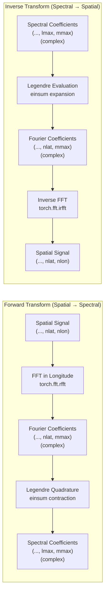
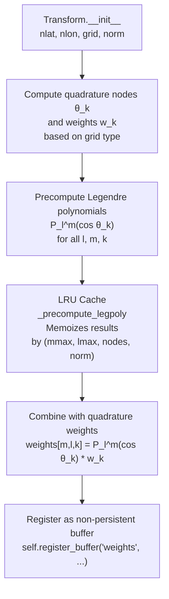
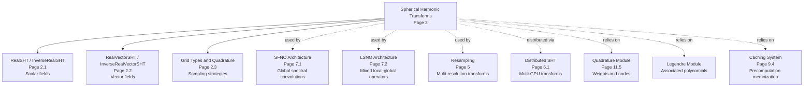

<!-- source: DeepWiki mcp.deepwiki.com · repo NVIDIA/torch-harmonics · page 2 Spherical Harmonic Transforms · fetched 2026-10-26 -->

# Spherical Harmonic Transforms

<details>
<summary>Relevant source files</summary>

The following files were used as context for generating this wiki page:

- [tests/test_cache.py](tests/test_cache.py)
- [tests/test_distributed_resample.py](tests/test_distributed_resample.py)
- [tests/test_sht.py](tests/test_sht.py)
- [torch_harmonics/cache.py](torch_harmonics/cache.py)
- [torch_harmonics/distributed/distributed_sht.py](torch_harmonics/distributed/distributed_sht.py)
- [torch_harmonics/sht.py](torch_harmonics/sht.py)

</details>


**Purpose and Scope**: This page provides an overview of spherical harmonic transform (SHT) operations in torch-harmonics, explaining the mathematical foundation, implementation strategy, and usage patterns. For detailed documentation of scalar transform classes see [RealSHT and InverseRealSHT](#2.1), for vector transforms see [Vector Spherical Harmonic Transforms](#2.2), and for grid types and quadrature rules see [Grid Types and Quadrature](#2.3). For distributed multi-GPU implementations, see [Distributed SHT](#6.1).

## Overview

Spherical harmonic transforms convert data between **spatial domain** (latitude-longitude grids on the sphere) and **spectral domain** (spherical harmonic coefficients). This transformation is analogous to the Fourier transform but operates on the 2-sphere instead of Euclidean space.

The library provides four core transform classes:

| Class | Purpose | Input Shape | Output Shape |
|-------|---------|-------------|--------------|
| `RealSHT` | Forward scalar transform | `(..., nlat, nlon)` | `(..., lmax, mmax)` |
| `InverseRealSHT` | Inverse scalar transform | `(..., lmax, mmax)` | `(..., nlat, nlon)` |
| `RealVectorSHT` | Forward vector transform | `(..., 2, nlat, nlon)` | `(..., 2, lmax, mmax)` |
| `InverseRealVectorSHT` | Inverse vector transform | `(..., 2, lmax, mmax)` | `(..., 2, nlat, nlon)` |

These transforms are differentiable PyTorch modules that support automatic differentiation for training neural networks.

**Sources**: [torch_harmonics/sht.py:40-486]()

## Mathematical Foundation

Spherical harmonics $Y_l^m(\theta, \phi)$ are orthogonal basis functions on the sphere, parameterized by degree $l \geq 0$ and order $|m| \leq l$. For a real-valued function $f(\theta, \phi)$ on the sphere:

**Forward Transform**: 
$$\hat{f}_l^m = \int_0^{2\pi} \int_0^{\pi} f(\theta, \phi) Y_l^m(\theta, \phi) \sin\theta \, d\theta \, d\phi$$

**Inverse Transform**:
$$f(\theta, \phi) = \sum_{l=0}^{l_{max}} \sum_{m=-l}^{l} \hat{f}_l^m Y_l^m(\theta, \phi)$$

The real-valued spherical harmonics can be written as:
$$Y_l^m(\theta, \phi) = P_l^{|m|}(\cos\theta) \times \begin{cases} \cos(m\phi) & m \geq 0 \\ \sin(|m|\phi) & m < 0 \end{cases}$$

where $P_l^m$ are associated Legendre polynomials. This separability enables efficient computation via FFT in $\phi$ (longitude) and Legendre quadrature in $\theta$ (latitude).

**Sources**: [torch_harmonics/sht.py:69-72]()

## Two-Stage Transform Pipeline

The implementation decomposes each transform into two sequential operations:



**Forward Transform Pipeline**:
1. **FFT Stage**: Apply real FFT along longitude dimension to obtain Fourier coefficients for each latitude
2. **Legendre Stage**: Perform Gaussian quadrature integration over latitude using precomputed Legendre polynomial weights

**Inverse Transform Pipeline**:
1. **Legendre Stage**: Evaluate associated Legendre polynomials at quadrature nodes
2. **IFFT Stage**: Apply inverse real FFT to reconstruct spatial values along longitude

**Sources**: [torch_harmonics/sht.py:131-148](), [torch_harmonics/sht.py:233-248]()

## Transform Class Architecture

```mermaid
graph TB
    subgraph "Scalar Transforms"
        RealSHT["RealSHT<br/>torch_harmonics.sht<br/>Forward: spatial → spectral"]
        InverseRealSHT["InverseRealSHT<br/>torch_harmonics.sht<br/>Inverse: spectral → spatial"]
    end
    
    subgraph "Vector Transforms"
        RealVectorSHT["RealVectorSHT<br/>torch_harmonics.sht<br/>Forward: vector field → spheroidal/toroidal"]
        InverseRealVectorSHT["InverseRealVectorSHT<br/>torch_harmonics.sht<br/>Inverse: spheroidal/toroidal → vector field"]
    end
    
    subgraph "Distributed Variants"
        DistRealSHT["DistributedRealSHT<br/>torch_harmonics.distributed<br/>Multi-GPU scalar forward"]
        DistInverseRealSHT["DistributedInverseRealSHT<br/>torch_harmonics.distributed<br/>Multi-GPU scalar inverse"]
        DistRealVectorSHT["DistributedRealVectorSHT<br/>torch_harmonics.distributed<br/>Multi-GPU vector forward"]
        DistInverseRealVectorSHT["DistributedInverseRealVectorSHT<br/>torch_harmonics.distributed<br/>Multi-GPU vector inverse"]
    end
    
    subgraph "Precomputation Layer"
        LEGENDRE["_precompute_legpoly<br/>torch_harmonics.legendre<br/>Associated Legendre polynomials"]
        DLEGENDRE["_precompute_dlegpoly<br/>torch_harmonics.legendre<br/>Derivatives of Legendre polynomials"]
        CACHE["lru_cache decorator<br/>torch_harmonics.cache<br/>Memoization of precomputed values"]
    end
    
    subgraph "Quadrature Layer"
        LGWEIGHTS["legendre_gauss_weights<br/>torch_harmonics.quadrature"]
        LOBWEIGHTS["lobatto_weights<br/>torch_harmonics.quadrature"]
        CCWEIGHTS["clenshaw_curtiss_weights<br/>torch_harmonics.quadrature"]
    end
    
    RealSHT --> LEGENDRE
    RealSHT --> LGWEIGHTS
    RealSHT --> LOBWEIGHTS
    RealSHT --> CCWEIGHTS
    
    InverseRealSHT --> LEGENDRE
    InverseRealSHT --> LGWEIGHTS
    InverseRealSHT --> LOBWEIGHTS
    InverseRealSHT --> CCWEIGHTS
    
    RealVectorSHT --> DLEGENDRE
    RealVectorSHT --> LGWEIGHTS
    RealVectorSHT --> LOBWEIGHTS
    RealVectorSHT --> CCWEIGHTS
    
    InverseRealVectorSHT --> DLEGENDRE
    InverseRealVectorSHT --> LGWEIGHTS
    InverseRealVectorSHT --> LOBWEIGHTS
    InverseRealVectorSHT --> CCWEIGHTS
    
    DistRealSHT --> LEGENDRE
    DistInverseRealSHT --> LEGENDRE
    DistRealVectorSHT --> DLEGENDRE
    DistInverseRealVectorSHT --> DLEGENDRE
    
    LEGENDRE --> CACHE
    DLEGENDRE --> CACHE
```



**Scalar Transforms** operate on single-channel spherical data (e.g., temperature, pressure fields). The forward transform produces complex coefficients indexed by degree $l$ and order $m$.

**Vector Transforms** operate on 2D tangent vector fields (e.g., wind velocity). They decompose vectors into spheroidal (curl-free) and toroidal (divergence-free) components using derivatives of associated Legendre polynomials.

**Distributed Variants** partition data across multiple GPUs using a 2D process grid strategy. See [Distributed Computing](#6) for details.

**Sources**: [torch_harmonics/sht.py:40-486](), [torch_harmonics/distributed/distributed_sht.py:45-613]()

## Precomputation and Caching Strategy

Transform modules precompute associated Legendre polynomials $P_l^m(\cos\theta_k)$ at quadrature nodes during initialization:



**Caching Mechanism**: The `_precompute_legpoly` function uses an LRU cache with deep copying to prevent external modifications:

- **Cache Key**: `(mmax, lmax, quadrature_nodes, norm, inverse, csphase)`
- **Cache Size**: 20 entries by default
- **Deep Copy**: Returns clones to prevent in-place modifications of cached values
- **Memory Impact**: Precomputed polynomials are stored on device with shape `(mmax, lmax, nlat)`

This strategy avoids recomputing expensive polynomial evaluations when creating multiple transform instances with identical parameters.

**Sources**: [torch_harmonics/sht.py:114-118](), [torch_harmonics/legendre.py](), [torch_harmonics/cache.py:37-74](), [tests/test_cache.py:39-50]()

## Common Parameters

All transform classes share a consistent parameter interface:

| Parameter | Type | Description | Default |
|-----------|------|-------------|---------|
| `nlat` | `int` | Number of latitude points | Required |
| `nlon` | `int` | Number of longitude points | Required |
| `lmax` | `int` | Maximum spherical harmonic degree | `nlat` (grid-dependent) |
| `mmax` | `int` | Maximum spherical harmonic order | `nlon // 2 + 1` |
| `grid` | `str` | Grid type: `"equiangular"`, `"legendre-gauss"`, `"lobatto"` | `"equiangular"` |
| `norm` | `str` | Normalization: `"ortho"`, `"schmidt"`, `"four-pi"` | `"ortho"` |
| `csphase` | `bool` | Apply Condon-Shortley phase factor $(-1)^m$ | `True` |

**Grid Type Selection**: Different quadrature rules provide different polynomial exactness:

| Grid Type | Quadrature Rule | Max Exact Degree | Default `lmax` |
|-----------|----------------|------------------|----------------|
| `legendre-gauss` | Gauss-Legendre | $2n - 1$ | `nlat` |
| `lobatto` | Gauss-Lobatto | $2n - 3$ | `nlat - 1` |
| `equiangular` | Clenshaw-Curtis | ~$n$ | `nlat` |

**Normalization Schemes**:
- `"ortho"`: Orthonormal basis with $\int Y_l^m Y_{l'}^{m'} = \delta_{ll'}\delta_{mm'}$
- `"schmidt"`: Schmidt semi-normalization used in geodesy
- `"four-pi"`: Legacy normalization with $4\pi$ factor

**Sources**: [torch_harmonics/sht.py:74-115](), [torch_harmonics/sht.py:88-105]()

## Forward Transform: Spatial to Spectral

The forward transform converts spatial data to spectral coefficients:

```python
import torch
import torch_harmonics as th

# Create transform
sht = th.RealSHT(nlat=64, nlon=128, grid="equiangular")

# Spatial data: batch_size × channels × nlat × nlon
x_spatial = torch.randn(4, 16, 64, 128)

# Forward transform: batch_size × channels × lmax × mmax
x_spectral = sht(x_spatial)  # complex-valued coefficients
```

**Implementation Details**:

1. **FFT Stage** [torch_harmonics/sht.py:132]():
   ```python
   x = 2.0 * torch.pi * torch.fft.rfft(x, dim=-1, norm="forward")
   ```
   Applies real FFT along longitude with normalization factor $2\pi$.

2. **Legendre Quadrature** [torch_harmonics/sht.py:144-146]():
   ```python
   xout[..., 0] = torch.einsum("...km,mlk->...lm", x[..., :mmax, 0], weights)
   xout[..., 1] = torch.einsum("...km,mlk->...lm", x[..., :mmax, 1], weights)
   ```
   Contracts Fourier coefficients with precomputed Legendre-weight products.

**Sources**: [torch_harmonics/sht.py:123-148]()

## Inverse Transform: Spectral to Spatial

The inverse transform reconstructs spatial data from spectral coefficients:

```python
import torch
import torch_harmonics as th

# Create transform
isht = th.InverseRealSHT(nlat=64, nlon=128, grid="equiangular")

# Spectral coefficients: batch_size × channels × lmax × mmax
x_spectral = torch.randn(4, 16, 64, 65, dtype=torch.complex64)

# Inverse transform: batch_size × channels × nlat × nlon
x_spatial = isht(x_spectral)  # real-valued spatial data
```

**Implementation Details**:

1. **Legendre Evaluation** [torch_harmonics/sht.py:235]():
   ```python
   xs = torch.einsum('...lmr, mlk->...kmr', x, pct).contiguous()
   ```
   Evaluates spherical harmonics at quadrature nodes using precomputed polynomials.

2. **IFFT Stage** [torch_harmonics/sht.py:243-247]():
   ```python
   x[..., 0].imag = 0.0
   if (nlon % 2 == 0) and (nlon // 2 < mmax):
       x[..., nlon // 2].imag = 0.0
   x = torch.fft.irfft(x, n=nlon, dim=-1, norm="forward")
   ```
   Ensures DC and Nyquist components are real before inverse FFT.

**Sources**: [torch_harmonics/sht.py:225-249]()

## Exactness and Round-Trip Error

For band-limited signals (all coefficients zero for $l > l_{max}$, $m > m_{max}$), the transform pair should be numerically exact up to floating-point precision:

```python
# Round-trip test
signal_original = isht(coeffs)
coeffs_reconstructed = sht(signal_original)
error = torch.norm(coeffs - coeffs_reconstructed) / torch.norm(coeffs)
# error ≈ 1e-9 for float64
```

The test suite validates this property across different grid types and normalizations [tests/test_sht.py:113-148]():

- **Iterations**: Tests accumulation over 1, 2, 4, 8, 16 round-trip iterations
- **Tolerance**: $10^{-9}$ relative error for `float64`
- **Grid Coverage**: Equiangular, Legendre-Gauss, Lobatto grids
- **Normalization**: Orthonormal, Schmidt, four-pi schemes

**Sources**: [tests/test_sht.py:88-148]()

## Gradient Computation and Backpropagation

All transform classes are differentiable PyTorch modules with custom backward passes:

```python
# Enable gradient tracking
x_spatial = torch.randn(2, 8, 64, 128, requires_grad=True)

# Forward pass
x_spectral = sht(x_spatial)

# Compute loss in spectral domain
loss = x_spectral.abs().sum()

# Backward pass computes ∂loss/∂x_spatial
loss.backward()
gradient = x_spatial.grad
```

The gradient tests verify numerical correctness using `torch.autograd.gradcheck` [tests/test_sht.py:175-205]():

```python
grad_input = torch.randn_like(signal, requires_grad=True)
test_result = gradcheck(sht, grad_input, eps=1e-6, atol=1e-5)
```

**Sources**: [tests/test_sht.py:150-205]()

## Usage Patterns

### Pattern 1: Global Spectral Operations

Apply operations in spectral domain for efficiency:

```python
sht = th.RealSHT(nlat, nlon)
isht = th.InverseRealSHT(nlat, nlon)

# Transform to spectral domain
coeffs = sht(spatial_data)

# Spectral filtering (e.g., low-pass filter)
l = torch.arange(lmax)
filter = (l < cutoff).float()
coeffs_filtered = coeffs * filter.unsqueeze(-1)

# Transform back to spatial domain
spatial_filtered = isht(coeffs_filtered)
```

### Pattern 2: Derivatives on the Sphere

Compute gradients using spectral differentiation:

```python
# Transform to spectral
coeffs = sht(scalar_field)

# Spectral differentiation operators
# ∂/∂θ involves l(l+1) factor
# ∂/∂φ involves im factor
```

See [RealVectorSHT](#2.2) for vector field operations.

### Pattern 3: Multi-Resolution Analysis

Different grid resolutions for different scales:

```python
# Coarse resolution
sht_coarse = th.RealSHT(nlat=32, nlon=64)
coeffs_coarse = sht_coarse(data_coarse)

# Fine resolution  
sht_fine = th.RealSHT(nlat=128, nlon=256)
coeffs_fine = sht_fine(data_fine)

# Coefficients can be compared/combined at matching (l,m)
```

**Sources**: Derived from usage patterns in neural operator architectures

## Device Placement and Instantiation

Transform modules can be instantiated directly on GPU to avoid host-device transfers of precomputed weights:

```python
# CPU instantiation (default)
sht_cpu = th.RealSHT(nlat=64, nlon=128)
sht_gpu = sht_cpu.to("cuda")  # Transfers precomputed weights

# Direct GPU instantiation
with torch.device("cuda"):
    sht_gpu_direct = th.RealSHT(nlat=64, nlon=128)
    # Precomputation happens on GPU
```

The test suite verifies consistent results between instantiation methods [tests/test_sht.py:216-239]():

```python
# Weights should match regardless of instantiation device
assert torch.allclose(sht_cpu.weights.cpu(), sht_gpu.weights.cpu())
```

**Sources**: [tests/test_sht.py:207-239]()

## Relation to Other Components



The SHT module serves as a foundational primitive for:

- **Neural Operators** [Page 7](#7): SFNO uses SHT for global spectral convolutions, LSNO combines SHT with local DISCO convolutions
- **Resampling** [Page 5](#5): Multi-resolution transforms via spectral truncation/padding
- **Distributed Computing** [Page 6](#6): Scalable multi-GPU implementations for large-scale problems

**Sources**: High-level architecture diagrams, neural operator implementations

## Performance Considerations

**Computational Complexity**:
- Forward/inverse transform: $O(n_{lat} \times n_{lon} \times m_{max}) + O(FFT)$
- Precomputation (one-time): $O(m_{max} \times l_{max} \times n_{lat})$
- Memory: $O(m_{max} \times l_{max} \times n_{lat})$ for cached polynomials

**Optimization Opportunities**:
- Use LRU cache to avoid redundant precomputation
- Instantiate on target device to minimize data movement
- For large-scale problems, use distributed implementations [Page 6.1](#6.1)
- Consider grid-dependent `lmax` limits for optimal quadrature accuracy

**Sources**: Implementation analysis of einsum operations and caching strategy

## References

The implementation follows established numerical methods for spherical harmonic transforms:

[1] Schaeffer, N. "Efficient spherical harmonic transforms aimed at pseudospectral numerical simulations", G3: Geochemistry, Geophysics, Geosystems (2013)

[2] Wang, B., Wang, L., Xie, Z. "Accurate calculation of spherical and vector spherical harmonic expansions via spectral element grids", Advances in Computational Mathematics (2017)

**Sources**: [torch_harmonics/sht.py:69-72](), [torch_harmonics/sht.py:183-185]()

---

