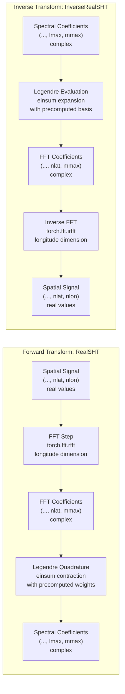
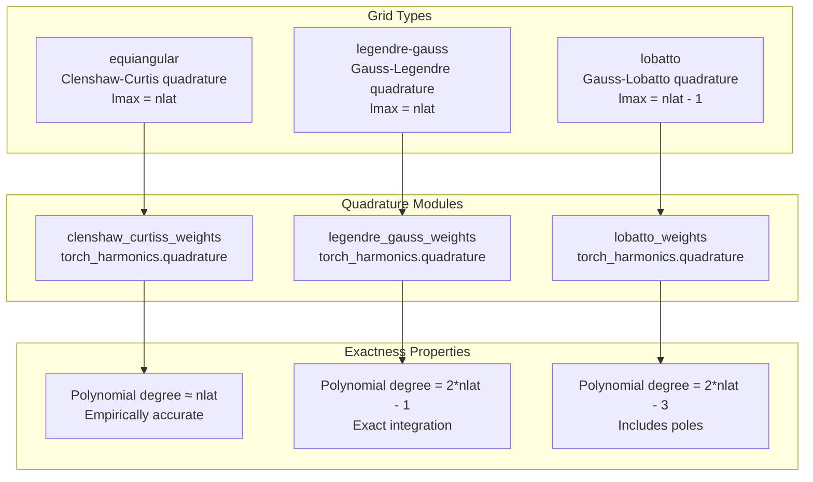
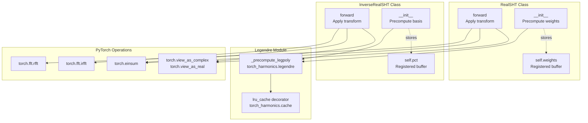
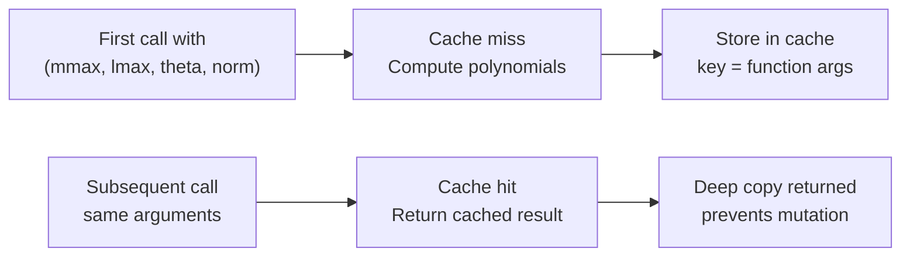
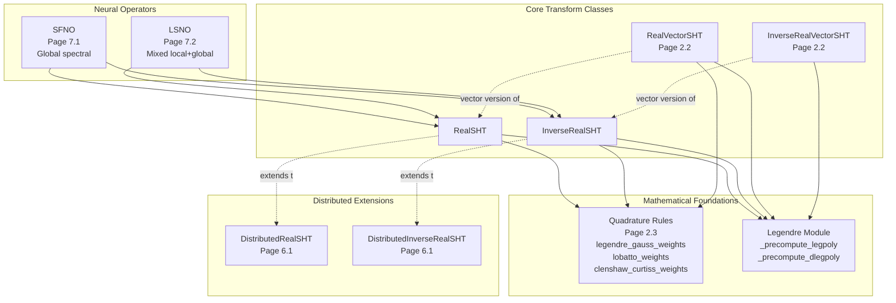

<!-- source: DeepWiki mcp.deepwiki.com · repo NVIDIA/torch-harmonics · page 2.1 RealSHT and InverseRealSHT · fetched 2026-10-26 -->

# RealSHT and InverseRealSHT

<details>
<summary>Relevant source files</summary>

The following files were used as context for generating this wiki page:

- [tests/test_cache.py](tests/test_cache.py)
- [tests/test_distributed_resample.py](tests/test_distributed_resample.py)
- [tests/test_sht.py](tests/test_sht.py)
- [torch_harmonics/cache.py](torch_harmonics/cache.py)
- [torch_harmonics/distributed/distributed_sht.py](torch_harmonics/distributed/distributed_sht.py)
- [torch_harmonics/sht.py](torch_harmonics/sht.py)

</details>


## Purpose and Scope

This document describes the core scalar spherical harmonic transform (SHT) classes in torch-harmonics: `RealSHT` and `InverseRealSHT`. These classes provide differentiable conversions between spatial representations on the sphere (latitude-longitude grids) and spectral representations (spherical harmonic coefficients).

**Scope:**
- Scalar spherical harmonic transforms for real-valued signals
- Forward transform (spatial → spectral) via `RealSHT`
- Inverse transform (spectral → spatial) via `InverseRealSHT`
- Grid types, normalization schemes, and configuration options

**Related Pages:**
- For vector field transforms, see [Vector Spherical Harmonic Transforms](#2.2)
- For distributed multi-GPU implementations, see [Distributed SHT](#6.1)
- For grid types and quadrature details, see [Grid Types and Quadrature](#2.3)

Sources: [torch_harmonics/sht.py:40-250]()

---

## Mathematical Background

Spherical harmonic transforms decompose functions defined on the sphere into a basis of spherical harmonics $Y_l^m(\theta, \phi)$, analogous to how Fourier transforms decompose periodic functions. A scalar function $f(\theta, \phi)$ on the sphere can be represented as:

$$f(\theta, \phi) = \sum_{l=0}^{l_{max}} \sum_{m=-l}^{l} \hat{f}_l^m Y_l^m(\theta, \phi)$$

where $\hat{f}_l^m$ are the spherical harmonic coefficients (spectral domain) and $l, m$ are the degree and order indices.

The **forward transform** computes coefficients from spatial values using numerical integration:
$$\hat{f}_l^m = \int_0^{2\pi} \int_0^{\pi} f(\theta, \phi) \overline{Y_l^m(\theta, \phi)} \sin\theta \, d\theta \, d\phi$$

The **inverse transform** reconstructs spatial values from coefficients by evaluating the series.

For real-valued functions, the transforms exploit symmetry properties: only non-negative $m$ values are stored, and the FFT along longitude yields real-to-complex transforms.

Sources: [torch_harmonics/sht.py:40-72](), [torch_harmonics/sht.py:151-186]()

---

## Transform Pipeline Architecture



**Transform Process:**
1. **Forward (RealSHT):** Spatial data undergoes FFT in longitude, then Legendre quadrature in latitude
2. **Inverse (InverseRealSHT):** Spectral coefficients are evaluated as Legendre polynomials, then inverse FFT in longitude
3. Both operations are fully differentiable for gradient-based optimization

Sources: [torch_harmonics/sht.py:123-148](), [torch_harmonics/sht.py:225-249]()

---

## RealSHT: Forward Transform

The `RealSHT` class transforms spatial signals on the sphere into spherical harmonic coefficients.

### Class Definition and Parameters

| Parameter | Type | Default | Description |
|-----------|------|---------|-------------|
| `nlat` | `int` | required | Number of latitude points in spatial grid |
| `nlon` | `int` | required | Number of longitude points in spatial grid |
| `lmax` | `int` | `None` | Maximum spherical harmonic degree (auto-computed if None) |
| `mmax` | `int` | `None` | Maximum spherical harmonic order (default: `nlon // 2 + 1`) |
| `grid` | `str` | `"equiangular"` | Grid type: `"equiangular"`, `"legendre-gauss"`, or `"lobatto"` |
| `norm` | `str` | `"ortho"` | Normalization: `"ortho"`, `"schmidt"`, or `"unnorm"` |
| `csphase` | `bool` | `True` | Whether to apply Condon-Shortley phase factor |

### Input/Output Specifications

**Input:** Tensor of shape `(..., nlat, nlon)` containing real-valued spatial data
- Arbitrary leading batch dimensions supported
- Last two dimensions must match `nlat` and `nlon`

**Output:** Complex tensor of shape `(..., lmax, mmax)` containing spherical harmonic coefficients
- Complex64 or Complex128 depending on input precision
- Only non-negative $m$ values stored (real-valued signal symmetry)

### Initialization and Precomputation

During initialization, `RealSHT` precomputes:
1. **Quadrature points and weights** based on grid type
2. **Associated Legendre polynomials** at quadrature points
3. **Combined weights** integrating quadrature and Legendre normalization

These are stored in a registered buffer `weights` for efficient repeated application.

Sources: [torch_harmonics/sht.py:40-122]()

---

## InverseRealSHT: Inverse Transform

The `InverseRealSHT` class reconstructs spatial signals from spherical harmonic coefficients.

### Class Definition and Parameters

Parameters are identical to `RealSHT`:

| Parameter | Type | Default | Description |
|-----------|------|---------|-------------|
| `nlat` | `int` | required | Number of latitude points in output spatial grid |
| `nlon` | `int` | required | Number of longitude points in output spatial grid |
| `lmax` | `int` | `None` | Maximum spherical harmonic degree |
| `mmax` | `int` | `None` | Maximum spherical harmonic order |
| `grid` | `str` | `"equiangular"` | Grid type for output spatial representation |
| `norm` | `str` | `"ortho"` | Normalization scheme (must match forward transform) |
| `csphase` | `bool` | `True` | Condon-Shortley phase factor (must match forward transform) |

### Input/Output Specifications

**Input:** Complex tensor of shape `(..., lmax, mmax)` containing spherical harmonic coefficients
- Must match the spectral dimensions from corresponding `RealSHT`

**Output:** Real tensor of shape `(..., nlat, nlon)` containing reconstructed spatial data
- Leading batch dimensions preserved
- Output grid determined by `nlat`, `nlon`, and `grid` parameters

### Initialization and Precomputation

During initialization, `InverseRealSHT` precomputes:
1. **Quadrature points** (same as forward transform)
2. **Associated Legendre polynomial basis** for evaluation (not quadrature)
3. Stored in registered buffer `pct` (polynomial coefficient table)

### Nyquist Frequency Handling

The inverse transform explicitly zeros the imaginary parts of DC and Nyquist frequency components to ensure real-valued output:

```python
x[..., 0].imag = 0.0
if (self.nlon % 2 == 0) and (self.nlon // 2 < self.mmax):
    x[..., self.nlon // 2].imag = 0.0
```

Sources: [torch_harmonics/sht.py:151-250](), [torch_harmonics/sht.py:240-246]()

---

## Grid Types and Spectral Resolution

The choice of grid type affects quadrature accuracy and the relationship between spatial and spectral resolution.



### Grid Type Details

| Grid Type | Quadrature | Default `lmax` | Pole Points | Use Case |
|-----------|------------|----------------|-------------|----------|
| `"equiangular"` | Clenshaw-Curtis | `nlat` | Excludes poles | General-purpose, uniform spacing |
| `"legendre-gauss"` | Gauss-Legendre | `nlat` | Excludes poles | Maximum quadrature accuracy |
| `"lobatto"` | Gauss-Lobatto | `nlat - 1` | Includes poles | Spectral element methods |

**Key Considerations:**
- Legendre-Gauss provides exact integration for polynomials up to degree $2n-1$
- Equiangular grid empirically performs well beyond theoretical exactness bounds
- Lobatto includes pole points, useful for certain boundary conditions

Sources: [torch_harmonics/sht.py:88-106](), [torch_harmonics/sht.py:199-209](), [torch_harmonics/quadrature.py:1-100]()

---

## Normalization Schemes

Three normalization schemes are supported, affecting the scaling of spherical harmonic basis functions.

| Normalization | Description | Orthonormality | Use Case |
|---------------|-------------|----------------|----------|
| `"ortho"` | Orthonormal basis | $\langle Y_l^m, Y_{l'}^{m'} \rangle = \delta_{ll'}\delta_{mm'}$ | Default, numerical stability |
| `"schmidt"` | Schmidt semi-normalization | Geodesy convention | Geophysical applications |
| `"unnorm"` | Unnormalized | No normalization constraint | Compatibility with legacy code |

**Important:** The same normalization must be used for both forward and inverse transforms to ensure perfect reconstruction.

Sources: [torch_harmonics/sht.py:58-59](), [torch_harmonics/legendre.py:1-50]()

---

## Condon-Shortley Phase Convention

The `csphase` parameter controls the Condon-Shortley phase factor $(-1)^m$ in the definition of associated Legendre polynomials:

- `csphase=True` (default): Includes $(-1)^m$ factor, standard in physics
- `csphase=False`: Omits the factor, sometimes used in mathematics

**Consistency requirement:** Both forward and inverse transforms must use the same `csphase` value.

Sources: [torch_harmonics/sht.py:60-61](), [torch_harmonics/legendre.py:80-120]()

---

## Implementation Details

### Code Entity Mapping



### Forward Transform Implementation

The forward transform in `RealSHT.forward()` executes these steps:

1. **FFT in Longitude** ([torch_harmonics/sht.py:132]()):
   ```python
   x = 2.0 * torch.pi * torch.fft.rfft(x, dim=-1, norm="forward")
   ```
   - Real-to-complex FFT along longitude dimension
   - Factor of $2\pi$ from integration measure
   - Results in shape `(..., nlat, mmax)`

2. **Convert to Real View** ([torch_harmonics/sht.py:135]()):
   ```python
   x = torch.view_as_real(x)
   ```
   - Splits complex tensor into real/imaginary components
   - Shape becomes `(..., nlat, mmax, 2)`

3. **Legendre Quadrature** ([torch_harmonics/sht.py:144-146]()):
   ```python
   xout[..., 0] = torch.einsum("...km,mlk->...lm", x[..., :self.mmax, 0], self.weights)
   xout[..., 1] = torch.einsum("...km,mlk->...lm", x[..., :self.mmax, 1], self.weights)
   ```
   - Separate contractions for real and imaginary parts
   - `self.weights` has shape `(mmax, lmax, nlat)`
   - Einstein summation over latitude dimension

4. **Convert to Complex Output** ([torch_harmonics/sht.py:146]()):
   ```python
   x = torch.view_as_complex(xout)
   ```

### Inverse Transform Implementation

The inverse transform in `InverseRealSHT.forward()` executes these steps:

1. **Convert to Real View** ([torch_harmonics/sht.py:234]()):
   ```python
   x = torch.view_as_real(x)
   ```

2. **Legendre Polynomial Evaluation** ([torch_harmonics/sht.py:235]()):
   ```python
   xs = torch.einsum("...lmr, mlk->...kmr", x, self.pct).contiguous()
   ```
   - `self.pct` has shape `(mmax, lmax, nlat)`
   - Evaluates polynomial series at each latitude point

3. **Convert to Complex** ([torch_harmonics/sht.py:238]()):
   ```python
   x = torch.view_as_complex(xs)
   ```

4. **Zero Nyquist Components** ([torch_harmonics/sht.py:243-245]()):
   ```python
   x[..., 0].imag = 0.0
   if (self.nlon % 2 == 0) and (self.nlon // 2 < self.mmax):
       x[..., self.nlon // 2].imag = 0.0
   ```

5. **Inverse FFT in Longitude** ([torch_harmonics/sht.py:247]()):
   ```python
   x = torch.fft.irfft(x, n=self.nlon, dim=-1, norm="forward")
   ```

Sources: [torch_harmonics/sht.py:123-148](), [torch_harmonics/sht.py:225-249]()

---

## Precomputation and Caching

### Registered Buffers

Both classes use PyTorch's `register_buffer` mechanism to store precomputed data:

**RealSHT:**
- `self.weights`: Combined quadrature weights and Legendre polynomial values
- Shape: `(mmax, lmax, nlat)`
- Created in `__init__` via `_precompute_legpoly` and weighted by quadrature

**InverseRealSHT:**
- `self.pct`: Legendre polynomial basis for evaluation
- Shape: `(mmax, lmax, nlat)`
- Created in `__init__` via `_precompute_legpoly` with `inverse=True`

The `persistent=False` flag prevents these from being saved in `state_dict()`, reducing checkpoint size.

### LRU Caching

The `_precompute_legpoly` function uses an LRU cache decorator to avoid redundant computation:



The cache uses deep copying to prevent external modifications from corrupting cached values, as verified in [tests/test_cache.py:39-51]().

Sources: [torch_harmonics/sht.py:114-118](), [torch_harmonics/sht.py:217-220](), [torch_harmonics/cache.py:37-74](), [torch_harmonics/legendre.py:1-100]()

---

## Usage Patterns

### Basic Forward-Inverse Roundtrip

```python
import torch
import torch_harmonics as th

# Configuration
nlat, nlon = 128, 256
batch_size = 4

# Initialize transforms
sht = th.RealSHT(nlat, nlon, grid="equiangular", norm="ortho")
isht = th.InverseRealSHT(nlat, nlon, grid="equiangular", norm="ortho")

# Create spatial data
spatial_data = torch.randn(batch_size, nlat, nlon)

# Forward transform: spatial -> spectral
spectral_coeffs = sht(spatial_data)  # shape: (batch_size, lmax, mmax)

# Inverse transform: spectral -> spatial
reconstructed = isht(spectral_coeffs)  # shape: (batch_size, nlat, nlon)

# Verify reconstruction
error = torch.norm(spatial_data - reconstructed) / torch.norm(spatial_data)
print(f"Relative reconstruction error: {error.item():.2e}")
```

### Integration with Neural Networks

```python
import torch.nn as nn

class SpectralLayer(nn.Module):
    def __init__(self, nlat, nlon, lmax, mmax):
        super().__init__()
        self.sht = th.RealSHT(nlat, nlon, lmax=lmax, mmax=mmax)
        self.isht = th.InverseRealSHT(nlat, nlon, lmax=lmax, mmax=mmax)
        
        # Learnable spectral filter
        self.filter = nn.Parameter(torch.ones(lmax, mmax, dtype=torch.complex64))
        
    def forward(self, x):
        # Transform to spectral domain
        x_spec = self.sht(x)
        
        # Apply spectral filtering
        x_spec = x_spec * self.filter
        
        # Transform back to spatial domain
        return self.isht(x_spec)
```

### Multi-Channel Processing

The transforms support arbitrary leading batch dimensions:

```python
# Multi-channel input: (batch, channels, lat, lon)
nlat, nlon = 64, 128
batch_size, channels = 8, 16

sht = th.RealSHT(nlat, nlon)
isht = th.InverseRealSHT(nlat, nlon)

# Input shape: (8, 16, 64, 128)
spatial = torch.randn(batch_size, channels, nlat, nlon)

# Output shape: (8, 16, lmax, mmax)
spectral = sht(spatial)

# Reconstruct: (8, 16, 64, 128)
reconstructed = isht(spectral)
```

Sources: [tests/test_sht.py:113-148]()

---

## Gradient Support and Differentiability

Both `RealSHT` and `InverseRealSHT` are fully differentiable and support automatic differentiation through PyTorch's autograd system.

### Gradient Flow


### Gradient Validation

The test suite verifies gradient correctness using `torch.autograd.gradcheck`:

```python
# From test_sht.py
def test_grads(self, nlat, nlon, batch_size, norm, grid, tol, verbose):
    sht = th.RealSHT(nlat, nlon, grid=grid, norm=norm)
    isht = th.InverseRealSHT(nlat, nlon, grid=grid, norm=norm)
    
    # Test forward transform gradients
    grad_input = torch.randn_like(signal, requires_grad=True)
    err_handle = lambda x: torch.mean(
        torch.norm(sht(x) - coeffs, p="fro", dim=(-1, -2)) / 
        torch.norm(coeffs, p="fro", dim=(-1, -2))
    )
    test_result = gradcheck(err_handle, grad_input, eps=1e-6, atol=tol)
    
    # Test inverse transform gradients
    grad_input = torch.randn_like(coeffs, requires_grad=True)
    err_handle = lambda x: torch.mean(
        torch.norm(isht(x) - signal, p="fro", dim=(-1, -2)) / 
        torch.norm(signal, p="fro", dim=(-1, -2))
    )
    test_result = gradcheck(err_handle, grad_input, eps=1e-6, atol=tol)
```

Gradients are validated to relative tolerances of 1e-5 across all grid types and normalization schemes.

Sources: [tests/test_sht.py:175-205]()

---

## Device Compatibility

Both classes support CPU and CUDA devices with automatic buffer placement.

### Device Instantiation

```python
# CPU instantiation
sht_cpu = th.RealSHT(nlat, nlon)
isht_cpu = th.InverseRealSHT(nlat, nlon)

# Move to GPU
sht_gpu = sht_cpu.to('cuda')
isht_gpu = isht_cpu.to('cuda')

# Direct GPU instantiation (buffers created on GPU)
with torch.device('cuda'):
    sht_gpu = th.RealSHT(nlat, nlon)
    isht_gpu = th.InverseRealSHT(nlat, nlon)
```

### Buffer Device Management

Registered buffers automatically move with the module:
- `self.weights` in `RealSHT`
- `self.pct` in `InverseRealSHT`

When using `.to(device)`, buffers are transferred and subsequent operations run on the target device. The test suite verifies buffer consistency across devices in [tests/test_sht.py:217-240]().

Sources: [tests/test_sht.py:39-42](), [tests/test_sht.py:217-240]()

---

## Performance Considerations

### Computational Complexity

| Operation | Complexity | Dominant Operations |
|-----------|-----------|-------------------|
| `RealSHT` forward | $O(n \log n + nm)$ | FFT: $O(n \log n)$, Einsum: $O(nm)$ where $n = \text{nlat} \times \text{nlon}$, $m = \text{lmax} \times \text{mmax}$ |
| `InverseRealSHT` forward | $O(n \log n + nm)$ | Same as forward |
| Precomputation | $O(lm \cdot n)$ | One-time cost during initialization |

### Memory Usage

**Precomputed Buffers:**
- `RealSHT.weights`: $(m_{\text{max}} \times l_{\text{max}} \times n_{\text{lat}})$ elements
- `InverseRealSHT.pct`: $(m_{\text{max}} \times l_{\text{max}} \times n_{\text{lat}})$ elements

**Runtime Memory:**
- Intermediate FFT results: batch dimensions × $n_{\text{lat}} \times m_{\text{max}}$ (complex)
- Output buffers: batch dimensions × spectral/spatial dimensions

### Optimization Tips

1. **Reuse Transform Objects:** Precomputation happens once per instance
2. **Batch Processing:** Process multiple samples simultaneously for better GPU utilization
3. **Grid Selection:** Use `legendre-gauss` for highest accuracy, `equiangular` for general use
4. **Precision:** Use `float32` unless high precision is required; `float64` increases memory and computation

Sources: [torch_harmonics/sht.py:114-118](), [torch_harmonics/sht.py:217-220]()

---

## Relationship to Other Components



### Dependencies

**Direct Dependencies:**
- `torch_harmonics.quadrature`: Provides quadrature points and weights for different grid types
- `torch_harmonics.legendre`: Provides Legendre polynomial computation and caching
- `torch_harmonics.cache`: LRU cache decorator for memoization

**Used By:**
- **Neural Operators:** SFNO and LSNO use these transforms for global spectral convolutions
- **Distributed Implementations:** `DistributedRealSHT` and `DistributedInverseRealSHT` extend functionality to multi-GPU
- **Vector Transforms:** `RealVectorSHT` uses similar architecture for vector field decomposition

### Extension Points

1. **Vector Fields:** For tangent vector fields, use `RealVectorSHT` / `InverseRealVectorSHT` (page [2.2](#2.2))
2. **Multi-GPU:** For distributed execution, use `DistributedRealSHT` / `DistributedInverseRealSHT` (page [6.1](#6.1))
3. **Custom Grids:** Add new grid types by extending the quadrature module (page [2.3](#2.3))

Sources: [torch_harmonics/sht.py:36-37](), [torch_harmonics/distributed/distributed_sht.py:45-178]()

---

## Common Pitfalls and Best Practices

### Matching Parameters

**Always use matching parameters for forward and inverse transforms:**

```python
# Correct: matching parameters
sht = th.RealSHT(nlat, nlon, grid="legendre-gauss", norm="ortho", csphase=True)
isht = th.InverseRealSHT(nlat, nlon, grid="legendre-gauss", norm="ortho", csphase=True)

# Incorrect: mismatched grid types will not reconstruct properly
sht = th.RealSHT(nlat, nlon, grid="equiangular")
isht = th.InverseRealSHT(nlat, nlon, grid="legendre-gauss")  # Wrong!
```

### Dimension Requirements

**Input tensors must have exactly `nlat` × `nlon` in the last two dimensions:**

```python
sht = th.RealSHT(128, 256)

# Correct shapes
x1 = torch.randn(128, 256)           # OK
x2 = torch.randn(4, 128, 256)        # OK
x3 = torch.randn(2, 8, 128, 256)     # OK

# Incorrect shapes - will raise AssertionError
x4 = torch.randn(64, 256)            # Wrong nlat
x5 = torch.randn(128, 128)           # Wrong nlon
```

### Complex vs Real Types

**Forward transform expects real input, produces complex output:**

```python
spatial = torch.randn(nlat, nlon)              # Real tensor
spectral = sht(spatial)                         # Complex tensor
assert spectral.is_complex()                    # True
```

**Inverse transform expects complex input, produces real output:**

```python
coeffs = torch.randn(lmax, mmax, dtype=torch.complex64)  # Complex tensor
spatial = isht(coeffs)                                    # Real tensor
assert not spatial.is_complex()                           # True
```

### Spectral Resolution

**The effective spectral resolution depends on the grid type:**

For `nlat = 128`:
- `grid="equiangular"`: `lmax = 128`, `mmax = 129` (default `nlon // 2 + 1` with `nlon=256`)
- `grid="legendre-gauss"`: `lmax = 128`, `mmax = 129`
- `grid="lobatto"`: `lmax = 127`, `mmax = 129`

Choose `lmax` and `mmax` to avoid spectral aliasing based on your application's needs.

Sources: [torch_harmonics/sht.py:88-106](), [torch_harmonics/sht.py:125-129](), [torch_harmonics/sht.py:227-231]()

---

## Testing and Validation

The test suite validates correctness across multiple configurations:

### Test Coverage

| Test Category | Configurations | Tolerance |
|--------------|----------------|-----------|
| Forward-Inverse Roundtrip | 3 grid types × 3 normalizations × 2 parities | 1e-9 |
| Gradient Correctness | 3 grid types × 3 normalizations × 2 parities | 1e-5 |
| Device Compatibility | CPU and CUDA | Exact match |
| Associated Legendre Polynomials | Degrees 0-3, Orders 0-3 | 1e-9 |

### Iterative Error Accumulation

Tests verify that errors do not accumulate excessively over repeated forward-inverse cycles:

```python
testiters = [1, 2, 4, 8, 16]
for iter in testiters:
    base = signal
    for _ in range(iter):
        base = isht(sht(base))
    
    err = torch.mean(
        torch.norm(base - signal, p="fro", dim=(-1, -2)) / 
        torch.norm(signal, p="fro", dim=(-1, -2))
    )
    assert err.item() <= tol  # tol = 1e-9
```

Even after 16 iterations, relative errors remain below $10^{-9}$ for double precision.

Sources: [tests/test_sht.py:88-148](), [tests/test_sht.py:150-205](), [tests/test_sht.py:44-78]()

---

