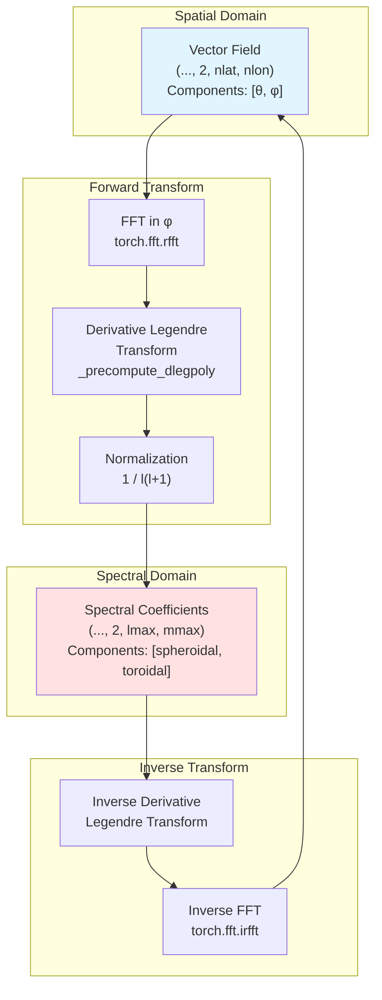
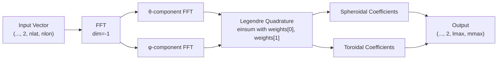
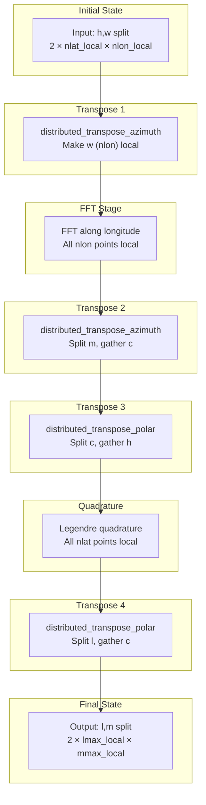

<!-- source: DeepWiki mcp.deepwiki.com · repo NVIDIA/torch-harmonics · page 2.2 Vector Spherical Harmonic Transforms · fetched 2026-10-26 -->

# Vector Spherical Harmonic Transforms

<details>
<summary>Relevant source files</summary>

The following files were used as context for generating this wiki page:

- [tests/test_cache.py](tests/test_cache.py)
- [tests/test_distributed_resample.py](tests/test_distributed_resample.py)
- [tests/test_sht.py](tests/test_sht.py)
- [torch_harmonics/cache.py](torch_harmonics/cache.py)
- [torch_harmonics/distributed/distributed_sht.py](torch_harmonics/distributed/distributed_sht.py)
- [torch_harmonics/sht.py](torch_harmonics/sht.py)

</details>


## Purpose and Scope

This page documents the vector spherical harmonic transform (VSHT) operations in torch-harmonics, which extend scalar transforms to handle vector fields defined on the sphere. Vector SHTs are essential for representing physical quantities with directional components such as velocity fields, surface currents, electromagnetic fields, and gradients on spherical domains.

For scalar spherical harmonic transforms, see [RealSHT and InverseRealSHT](#2.1). For distributed computing strategies, see [Distributed SHT](#6.1).

Vector spherical harmonics decompose tangent vector fields on the sphere into spheroidal (poloidal) and toroidal components, which are analogous to divergence-like and curl-like modes. This decomposition is particularly useful for analyzing and processing vector-valued data on spherical manifolds while preserving the geometric structure.

## Mathematical Foundation

### Vector Fields on the Sphere

A tangent vector field on the unit sphere can be represented using two components in the local coordinate system: the colatitude (θ) component and the azimuthal (φ) component. Any such vector field can be uniquely decomposed into spheroidal and toroidal parts:

**Spheroidal (Poloidal) Component**: Derived from a scalar potential, represents the gradient-like part of the field. Related to the divergence of the vector field.

**Toroidal Component**: Derived from a different scalar potential, represents the curl-like part of the field. Related to the vorticity of the vector field.

This decomposition is mathematically expressed using derivatives of associated Legendre polynomials and complex exponentials. The forward transform converts spatial vector components (θ, φ) into spectral coefficients (spheroidal, toroidal), while the inverse transform reconstructs the spatial representation from spectral coefficients.



**Diagram: Vector SHT Data Flow**

The key difference from scalar SHT is the use of derivative Legendre polynomials and the decomposition into two independent scalar fields (spheroidal and toroidal).

Sources: [torch_harmonics/sht.py:252-373](), [torch_harmonics/sht.py:375-486]()

### Derivative Legendre Polynomials

Vector spherical harmonics require derivatives of associated Legendre polynomials with respect to colatitude θ. The library precomputes these using `_precompute_dlegpoly` from the `legendre` module, which provides numerically stable evaluation of these derivatives.

The forward transform combines the θ and φ components with different derivative Legendre weights to extract spheroidal and toroidal modes. The inverse transform uses the same derivative polynomials to reconstruct the spatial vector components.

Sources: [torch_harmonics/sht.py:315](), [torch_harmonics/sht.py:437]()

## Core Classes

### RealVectorSHT

The `RealVectorSHT` class implements the forward vector spherical harmonic transform. It transforms vector fields from the spatial domain to spectral coefficients.

**Class Location**: [torch_harmonics/sht.py:252-373]()

**Constructor Parameters**:

| Parameter | Type | Default | Description |
|-----------|------|---------|-------------|
| `nlat` | int | - | Number of latitude points in spatial grid |
| `nlon` | int | - | Number of longitude points in spatial grid |
| `lmax` | int | None | Maximum spherical harmonic degree (defaults based on grid) |
| `mmax` | int | None | Maximum spherical harmonic order (defaults to nlon // 2 + 1) |
| `grid` | str | "equiangular" | Grid type: "equiangular", "legendre-gauss", or "lobatto" |
| `norm` | str | "ortho" | Normalization: "ortho", "schmidt", or "unnorm" |
| `csphase` | bool | True | Whether to apply Condon-Shortley phase factor |

**Input Shape**: `(..., 2, nlat, nlon)`
- The second-to-last dimension (size 2) contains the vector components: [θ-component, φ-component]
- Operates on the last three dimensions

**Output Shape**: `(..., 2, lmax, mmax)`
- The second-to-last dimension (size 2) contains: [spheroidal coefficients, toroidal coefficients]
- Complex-valued tensor

**Key Implementation Details**:



**Diagram: RealVectorSHT Forward Transform Pipeline**

Sources: [torch_harmonics/sht.py:252-373]()

The transform computes spheroidal and toroidal coefficients using weighted combinations of the θ and φ components. The weights are precomputed during initialization and include:
- Derivative Legendre polynomials at quadrature points [torch_harmonics/sht.py:315]()
- Quadrature weights combined with normalization factor `1 / l(l+1)` [torch_harmonics/sht.py:318-323]()
- Adjustments for complex conjugation in the second component [torch_harmonics/sht.py:323]()

**Spheroidal Component Calculation** [torch_harmonics/sht.py:351-360]():
```
Real part = einsum(θ_real, weights[0]) - einsum(φ_imag, weights[1])
Imag part = einsum(θ_imag, weights[0]) + einsum(φ_real, weights[1])
```

**Toroidal Component Calculation** [torch_harmonics/sht.py:362-370]():
```
Real part = -einsum(θ_imag, weights[1]) - einsum(φ_real, weights[0])
Imag part = einsum(θ_real, weights[1]) - einsum(φ_imag, weights[0])
```

Sources: [torch_harmonics/sht.py:331-372]()

### InverseRealVectorSHT

The `InverseRealVectorSHT` class implements the inverse vector spherical harmonic transform, reconstructing spatial vector fields from spectral coefficients.

**Class Location**: [torch_harmonics/sht.py:375-486]()

**Constructor Parameters**: Same as `RealVectorSHT`

**Input Shape**: `(..., 2, lmax, mmax)`
- Complex-valued spectral coefficients
- First component: spheroidal coefficients
- Second component: toroidal coefficients

**Output Shape**: `(..., 2, nlat, nlon)`
- Real-valued vector field
- First component: θ-component
- Second component: φ-component

**Reconstruction Process**:

The inverse transform evaluates derivative Legendre polynomials at the spatial grid points and combines spheroidal and toroidal coefficients to reconstruct the θ and φ components [torch_harmonics/sht.py:456-471]():

```
θ_real = einsum(spheroidal_real, dpct[0]) - einsum(toroidal_imag, dpct[1])
θ_imag = einsum(spheroidal_imag, dpct[0]) + einsum(toroidal_real, dpct[1])
φ_real = -einsum(spheroidal_imag, dpct[1]) - einsum(toroidal_real, dpct[0])
φ_imag = einsum(spheroidal_real, dpct[1]) - einsum(toroidal_imag, dpct[0])
```

The transform then applies inverse FFT to obtain real-valued spatial components, with special handling to ensure zero imaginary parts at DC and Nyquist frequencies [torch_harmonics/sht.py:479-481]().

Sources: [torch_harmonics/sht.py:445-485]()

## Usage Examples

### Basic Forward and Inverse Transform

```python
import torch
import torch_harmonics as th

# Initialize transform pair
nlat, nlon = 128, 256
vsht = th.RealVectorSHT(nlat, nlon, grid="equiangular")
ivsht = th.InverseRealVectorSHT(nlat, nlon, grid="equiangular")

# Create vector field: (batch, 2, nlat, nlon)
batch_size = 4
vector_field = torch.randn(batch_size, 2, nlat, nlon)

# Forward transform: spatial -> spectral
coeffs = vsht(vector_field)  # Shape: (4, 2, 128, 129)

# Inverse transform: spectral -> spatial
reconstructed = ivsht(coeffs)  # Shape: (4, 2, 128, 256)

# Round-trip error
error = torch.norm(vector_field - reconstructed) / torch.norm(vector_field)
```

### Different Grid Types

Vector SHT supports the same grid types as scalar SHT:

```python
# Legendre-Gauss quadrature (optimal for exact transforms)
vsht_lg = th.RealVectorSHT(64, 128, grid="legendre-gauss")

# Lobatto quadrature (includes poles)
vsht_lob = th.RealVectorSHT(65, 128, grid="lobatto")

# Equiangular (default, widely used)
vsht_eq = th.RealVectorSHT(64, 128, grid="equiangular")
```

Sources: [torch_harmonics/sht.py:298-308](), [tests/test_sht.py:88-206]()

### Working with Spheroidal and Toroidal Components

The spectral coefficients can be separated and manipulated independently:

```python
# Transform to spectral domain
coeffs = vsht(vector_field)  # Shape: (batch, 2, lmax, mmax)

# Access components
spheroidal = coeffs[:, 0, :, :]  # Gradient-like modes
toroidal = coeffs[:, 1, :, :]    # Curl-like modes

# Filter or modify components independently
# Example: Remove toroidal component
coeffs_filtered = coeffs.clone()
coeffs_filtered[:, 1, :, :] = 0

# Reconstruct: only spheroidal part remains
vector_field_filtered = ivsht(coeffs_filtered)
```

This decomposition is useful for analyzing physical phenomena, as many applications require separating divergent and rotational components of vector fields.

Sources: [torch_harmonics/sht.py:351-370]()

## Distributed Vector SHT

For large-scale problems requiring multi-GPU or multi-node execution, torch-harmonics provides distributed implementations that partition data across process grids.

### DistributedRealVectorSHT

**Class Location**: [torch_harmonics/distributed/distributed_sht.py:311-466]()

**Key Differences from Local Version**:
- Data partitioned across 2D process grid (polar × azimuthal)
- Uses distributed transpose operations for communication
- Weights split along azimuthal dimension
- Input tensor shape: `(..., 2, nlat_local, nlon_local)` where local dimensions depend on process rank

**Communication Pattern**:



**Diagram: Distributed Vector SHT Communication Flow**

Sources: [torch_harmonics/distributed/distributed_sht.py:408-465]()

The distributed forward transform performs the following steps:
1. Transpose to make longitude local [torch_harmonics/distributed/distributed_sht.py:417-418]()
2. Apply FFT across full longitude dimension [torch_harmonics/distributed/distributed_sht.py:421]()
3. Transpose to split spectral order `m` [torch_harmonics/distributed/distributed_sht.py:427-429]()
4. Transpose to make latitude local [torch_harmonics/distributed/distributed_sht.py:432-433]()
5. Perform Legendre quadrature with local weights [torch_harmonics/distributed/distributed_sht.py:441-455]()
6. Transpose to split spectral degree `l` [torch_harmonics/distributed/distributed_sht.py:461-463]()

### DistributedInverseRealVectorSHT

**Class Location**: [torch_harmonics/distributed/distributed_sht.py:468-613]()

The distributed inverse transform follows a reversed communication pattern:
1. Transpose to make degree `l` local [torch_harmonics/distributed/distributed_sht.py:561-562]()
2. Evaluate derivative Legendre polynomials [torch_harmonics/distributed/distributed_sht.py:567-582]()
3. Transpose to make latitude split [torch_harmonics/distributed/distributed_sht.py:591-593]()
4. Transpose to make order `m` local [torch_harmonics/distributed/distributed_sht.py:596-597]()
5. Apply inverse FFT [torch_harmonics/distributed/distributed_sht.py:605]()
6. Transpose to original spatial partitioning [torch_harmonics/distributed/distributed_sht.py:608-610]()

**Process Group Requirements**:

Both distributed classes require proper initialization of polar and azimuthal process groups via `torch_harmonics.distributed.init()`. See [Distributed Computing](#6) for details on setting up the distributed environment.

Sources: [torch_harmonics/distributed/distributed_sht.py:468-613](), [torch_harmonics/distributed/distributed_sht.py:106-109]()

## Implementation Details

### Normalization and Weights

The forward transform combines multiple normalization factors into precomputed weights [torch_harmonics/sht.py:318-323]():

1. **Derivative Legendre polynomials** evaluated at quadrature points
2. **Quadrature weights** from the chosen quadrature rule
3. **Normalization factor** `1 / l(l+1)` for each degree `l`, with special handling for `l=0` [torch_harmonics/sht.py:319-320]()
4. **Complex conjugation adjustment** for the second derivative component [torch_harmonics/sht.py:323]()

These are combined using einsum operations:
```python
weights = torch.einsum("dmlk,k,l->dmlk", dpct, quadrature_weights, norm_factor)
weights[1] = -1 * weights[1]  # Complex conjugation adjustment
```

### Memory Layout and Contiguity

Both forward and inverse transforms ensure memory contiguity after einsum operations to optimize subsequent computations. The transforms use `torch.view_as_real` and `torch.view_as_complex` to handle complex arithmetic efficiently [torch_harmonics/sht.py:342-343](), [torch_harmonics/sht.py:454]().

### Grid-Specific Behavior

The maximum spectral degree `lmax` depends on the grid type [torch_harmonics/sht.py:298-308]():

| Grid Type | Default lmax | Quadrature Exactness |
|-----------|--------------|---------------------|
| `legendre-gauss` | nlat | Exact up to degree 2×nlat - 1 |
| `lobatto` | nlat - 1 | Exact up to degree 2×nlat - 3 |
| `equiangular` | nlat | High accuracy beyond formal exactness |

This affects the accuracy of round-trip transforms. For critical applications requiring exact invertibility, Legendre-Gauss quadrature is recommended.

Sources: [torch_harmonics/sht.py:298-308]()

### Autograd Support

All vector SHT classes support automatic differentiation through PyTorch's autograd mechanism. Gradients flow correctly through both forward and inverse transforms, enabling their use in neural network architectures and optimization problems.

The test suite verifies gradient correctness using `torch.autograd.gradcheck` for various configurations. See [tests/test_sht.py]() for gradient validation examples (note: the provided test file primarily covers scalar SHT, but the same testing methodology applies to vector SHT).

Sources: [tests/test_sht.py:175-205]()

### Device Placement

Transforms can be instantiated directly on GPU or CPU and moved between devices using standard PyTorch methods:

```python
# GPU instantiation
with torch.device("cuda:0"):
    vsht_gpu = th.RealVectorSHT(128, 256)

# CPU instantiation then move to GPU
vsht_cpu = th.RealVectorSHT(128, 256)
vsht_gpu = vsht_cpu.to("cuda:0")
```

Precomputed weights and derivative Legendre polynomials are registered as non-persistent buffers, automatically moved with the module [torch_harmonics/sht.py:326](), [torch_harmonics/sht.py:440]().

Sources: [torch_harmonics/sht.py:326](), [torch_harmonics/sht.py:440](), [tests/test_sht.py:216-239]()

## Relationship to Scalar SHT

Vector SHT extends scalar SHT concepts but with important differences:

**Similarities**:
- Same quadrature rules and grid types supported
- Same normalization schemes (ortho, schmidt, unnorm)
- Same Condon-Shortley phase convention
- Both use FFT for longitudinal transform
- Both use Legendre polynomial evaluation for latitudinal transform

**Differences**:

| Aspect | Scalar SHT | Vector SHT |
|--------|-----------|------------|
| Input dimensions | `(..., nlat, nlon)` | `(..., 2, nlat, nlon)` |
| Output dimensions | `(..., lmax, mmax)` | `(..., 2, lmax, mmax)` |
| Legendre basis | Associated Legendre polynomials | Derivatives of associated Legendre polynomials |
| Components | Single scalar field | Two components (spheroidal, toroidal) |
| Normalization | Standard | Includes `1/l(l+1)` factor |
| Use case | Scalar fields (temperature, pressure) | Vector fields (velocity, current) |

For purely scalar problems, use `RealSHT` and `InverseRealSHT` (see [RealSHT and InverseRealSHT](#2.1)). Vector SHT is specifically designed for vector-valued data with directional components.

Sources: [torch_harmonics/sht.py:40-149](), [torch_harmonics/sht.py:252-373]()

## Performance Considerations

### Computational Complexity

Vector SHT operations have similar computational complexity to scalar SHT but with additional overhead:
- **FFT stage**: O(2 × nlat × nlon × log(nlon)) for both θ and φ components
- **Legendre quadrature**: O(2 × lmax × mmax × nlat) with doubled einsum operations
- The factor of 2 comes from processing both vector components

### Memory Requirements

Vector SHT requires approximately twice the memory of scalar SHT due to:
- Storing two spatial components instead of one
- Precomputing two sets of derivative weights `weights[0]` and `weights[1]` [torch_harmonics/sht.py:326]()
- Intermediate tensors for spheroidal and toroidal calculations

For distributed implementations, memory is distributed across the process grid, making very large problems tractable. See [Distributed Computing](#6) for scaling strategies.

### Optimization Recommendations

1. **Batch processing**: Process multiple vector fields together to amortize setup costs
2. **Grid selection**: Use Legendre-Gauss for highest accuracy, equiangular for speed
3. **Device placement**: Keep transforms on GPU for large problems (nlat, nlon > 128)
4. **Distributed execution**: Use distributed variants for nlat, nlon > 512 on multi-GPU systems
5. **Cache reuse**: Reuse transform objects; weights are cached internally

Sources: [torch_harmonics/cache.py:37-74](), [torch_harmonics/sht.py:114-118]()

---

**Key Takeaways**:
- Vector SHT decomposes vector fields into spheroidal and toroidal components
- `RealVectorSHT` and `InverseRealVectorSHT` provide forward and inverse transforms
- Uses derivative Legendre polynomials instead of standard Legendre polynomials
- Distributed versions available for large-scale multi-GPU execution
- Fully compatible with PyTorch autograd for gradient-based optimization
- Essential for analyzing vector-valued data on spherical domains

---

