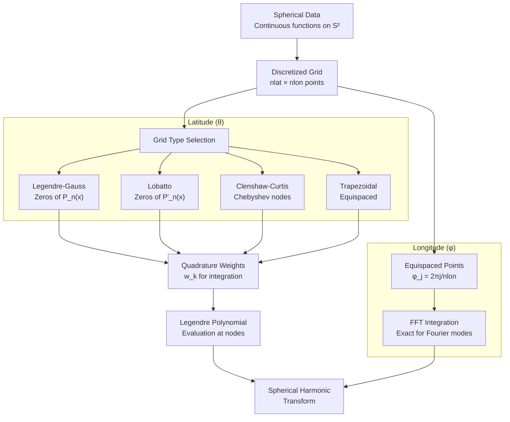
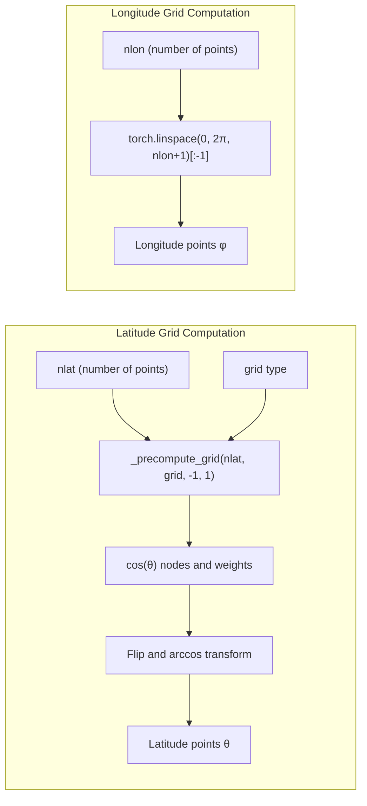
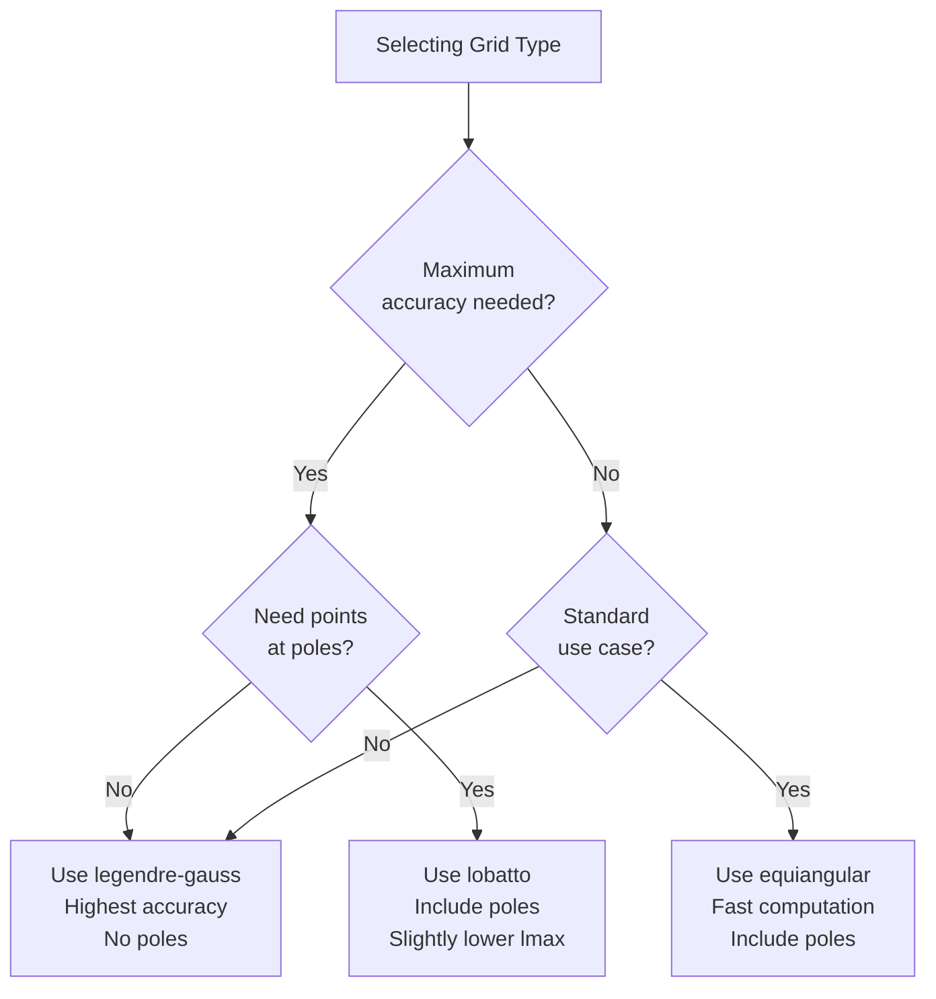
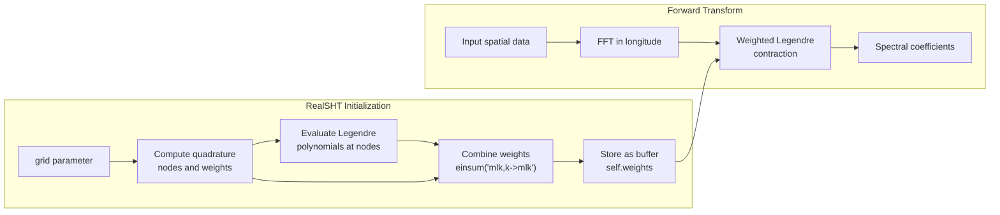
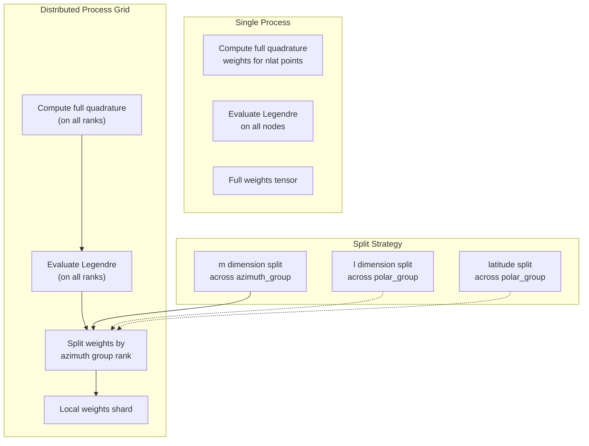

<!-- source: DeepWiki mcp.deepwiki.com · repo NVIDIA/torch-harmonics · page 2.3 Grid Types and Quadrature · fetched 2026-10-26 -->

# Grid Types and Quadrature

<details>
<summary>Relevant source files</summary>

The following files were used as context for generating this wiki page:

- [torch_harmonics/distributed/distributed_sht.py](torch_harmonics/distributed/distributed_sht.py)
- [torch_harmonics/filter_basis.py](torch_harmonics/filter_basis.py)
- [torch_harmonics/quadrature.py](torch_harmonics/quadrature.py)
- [torch_harmonics/sht.py](torch_harmonics/sht.py)

</details>


This page describes the quadrature rules and grid types used in torch-harmonics for spherical harmonic transforms. It covers the mathematical foundations of how spherical data is discretized and integrated, the available quadrature schemes, and guidelines for selecting the appropriate grid type for different use cases.

For information about how these grids are used in spherical harmonic transforms, see [RealSHT and InverseRealSHT](#2.1). For the Legendre polynomial computation that relies on these quadrature points, see the `_precompute_legpoly` function in the legendre module.

## Overview

Spherical harmonic transforms require numerical integration over the sphere. This integration is performed by:
1. **Longitude direction**: Using Fast Fourier Transform (FFT) on equispaced points
2. **Latitude direction**: Using Gaussian quadrature on specialized node distributions

The choice of grid type determines the quadrature nodes (collocation points) and weights used in the latitude direction. Different grids offer tradeoffs between exactness, computational efficiency, and boundary behavior.



**Sources:** [torch_harmonics/quadrature.py:38-82](), [torch_harmonics/sht.py:88-106]()

## Quadrature Rules

### Coordinate System

All quadrature rules operate in the **cosine-theta domain** (`cos(θ)` ∈ [-1, 1]) rather than directly in latitude coordinates. This choice accounts for the Jacobian of the sphere and simplifies the mathematics. The transformation is:

- Latitude points: `lats = arccos(xlg)`, where `xlg` are nodes in [-1, 1]
- Points are flipped to ensure proper ordering

**Sources:** [torch_harmonics/quadrature.py:92-102]()

### Legendre-Gauss Quadrature

**Grid identifier:** `"legendre-gauss"`

The Legendre-Gauss quadrature uses nodes that are zeros of the Legendre polynomial `P_n(x)`. This is the most accurate quadrature for polynomial integration.

**Properties:**
- **Exactness:** Integrates polynomials of degree ≤ `2n - 1` exactly
- **For SHT:** `lmax ≤ nlat` (exact for spherical harmonics up to degree `nlat`)
- **Nodes:** Open interval (-1, 1), excludes poles
- **Computation:** Uses NumPy's `np.polynomial.legendre.leggauss(n)`

```python
# Example node distribution for n=5
# Nodes are zeros of P_5(x), symmetric about 0
# Do not include endpoints -1 or 1
```

| Property | Value |
|----------|-------|
| Maximum `lmax` | `nlat` |
| Polynomial exactness | `2 * nlat - 1` |
| Includes poles | No |
| Best for | Maximum accuracy, smooth functions |

**Sources:** [torch_harmonics/quadrature.py:139-167](), [torch_harmonics/sht.py:88-92]()

### Legendre-Gauss-Lobatto Quadrature

**Grid identifier:** `"lobatto"`

The Lobatto quadrature uses zeros of the derivative of the Legendre polynomial `P'_n(x)`, plus the endpoints -1 and 1. This is useful when boundary values (at poles) are required.

**Properties:**
- **Exactness:** Integrates polynomials of degree ≤ `2n - 3` exactly
- **For SHT:** `lmax ≤ nlat - 1`
- **Nodes:** Closed interval [-1, 1], includes poles
- **Computation:** Iterative Newton-Raphson on Chebyshev initial guess

```python
# Example node distribution for n=5
# Nodes: -1, interior zeros of P'_5(x), 1
# Always includes both endpoints
```

| Property | Value |
|----------|-------|
| Maximum `lmax` | `nlat - 1` |
| Polynomial exactness | `2 * nlat - 3` |
| Includes poles | Yes |
| Best for | Boundary-sensitive problems, lower resolution |

**Algorithm:**
1. Initialize with Chebyshev nodes: `t_i = -cos(πi/(n-1))`
2. Iterate using Newton-Raphson on Vandermonde matrix
3. Converge to tolerance (default `1e-16`)

**Sources:** [torch_harmonics/quadrature.py:170-231](), [torch_harmonics/sht.py:93-97]()

### Clenshaw-Curtis Quadrature (Equiangular)

**Grid identifier:** `"equiangular"`

The Clenshaw-Curtis quadrature uses Chebyshev nodes `cos(πk/n)`. Despite having lower formal exactness than Legendre-Gauss, it performs remarkably well in practice for smooth functions.

**Properties:**
- **Exactness:** Formally exact for polynomials of degree ≤ `n`
- **For SHT:** `lmax ≤ nlat` (empirically works well beyond formal limit)
- **Nodes:** Closed interval [-1, 1], includes poles
- **Computation:** Fast FFT-based algorithm (Waldvogel method)
- **Name origin:** Produces equiangular spacing in latitude θ

```python
# Chebyshev nodes of the second kind
# t_k = cos(πk/(n-1)) for k = 0, ..., n-1
# In latitude: uniform spacing in θ
```

| Property | Value |
|----------|-------|
| Maximum `lmax` | `nlat` (empirically stable) |
| Polynomial exactness | `nlat` (formal), higher (practical) |
| Includes poles | Yes |
| Best for | General use, fast computation |

**Fast computation:** Uses FFT to compute weights in O(n log n) time rather than O(n²).

**Sources:** [torch_harmonics/quadrature.py:234-288](), [torch_harmonics/sht.py:98-103]()

### Trapezoidal Rule (Equidistant)

**Grid identifier:** `"equidistant"`

Simple equispaced nodes with trapezoidal weights. Primarily used for longitude discretization (always equispaced) or testing purposes.

**Properties:**
- **Nodes:** Uniformly spaced in the interval
- **Weights:** `(b-a)/n` for interior points, half-weight at boundaries
- **Periodic variant:** Available with `periodic=True` flag

```python
# Equispaced nodes: x_i = a + i*(b-a)/(n-1)
# Weights: [w/2, w, w, ..., w, w/2] (non-periodic)
#          [w, w, ..., w] (periodic)
```

**Sources:** [torch_harmonics/quadrature.py:105-136]()

## Grid Point and Weight Computation

### Factory Function: `_precompute_grid`

The central factory function that generates nodes and weights for any grid type:

```python
xlg, wlg = _precompute_grid(n, grid="legendre-gauss", a=-1.0, b=1.0, periodic=False)
```

**Parameters:**
- `n`: Number of quadrature nodes
- `grid`: One of `"equidistant"`, `"legendre-gauss"`, `"lobatto"`, `"equiangular"`
- `a`, `b`: Interval bounds (default [-1, 1] for cos(θ) domain)
- `periodic`: Only valid for equidistant grids

**Returns:**
- `xlg`: Tensor of quadrature nodes
- `wlg`: Tensor of quadrature weights

**Sources:** [torch_harmonics/quadrature.py:38-82]()

### Latitude and Longitude Grids



**Latitude computation:**
```python
xlg, wlg = _precompute_grid(nlat, grid=grid, a=-1.0, b=1.0)
lats = torch.flip(torch.arccos(xlg), dims=(0,))
wlg = torch.flip(wlg, dims=(0,))
```

The flipping ensures latitudes are ordered from 0 (north pole) to π (south pole).

**Longitude computation:**
```python
lons = torch.linspace(0, 2 * math.pi, nlon+1)[:-1]
```

Longitudes are always equispaced (FFT requires this).

**Sources:** [torch_harmonics/quadrature.py:84-102]()

## Grid Selection and Exactness

### Polynomial Exactness and lmax

The relationship between grid type, number of points, and maximum spherical harmonic degree:

| Grid Type | Polynomial Exactness | Recommended `lmax` | Default `lmax` |
|-----------|---------------------|-------------------|----------------|
| Legendre-Gauss | `2*nlat - 1` | `≤ nlat` | `nlat` |
| Lobatto | `2*nlat - 3` | `≤ nlat - 1` | `nlat - 1` |
| Clenshaw-Curtis | `nlat` (formal) | `≤ nlat` | `nlat` |
| Equidistant | N/A | Not recommended | N/A |

**Important note:** The library allows `lmax = nlat` for Clenshaw-Curtis grids despite formal exactness of only degree `nlat`, because empirically the quadrature remains accurate for higher degrees when integrating smooth spherical functions.

**Sources:** [torch_harmonics/sht.py:88-106]()

### Selection Guidelines



**Recommendations:**

1. **Default choice: `"equiangular"` (Clenshaw-Curtis)**
   - Fast FFT-based weight computation
   - Includes pole points
   - Empirically excellent accuracy
   - Used in most torch-harmonics examples

2. **Maximum accuracy: `"legendre-gauss"`**
   - Highest polynomial exactness
   - Best for scientific computing requiring maximum precision
   - No pole points (may be undesirable for visualization)

3. **Pole-inclusive with lower resolution: `"lobatto"`**
   - When boundary values at poles are critical
   - Acceptable with one fewer degree of freedom (`lmax = nlat - 1`)

4. **Not recommended: `"equidistant"`**
   - Lower accuracy for spherical integration
   - Mainly for testing or special applications

**Sources:** [torch_harmonics/sht.py:74-106](), [torch_harmonics/quadrature.py:38-82]()

## Integration with SHT Operations

### Weight Incorporation in Forward Transform

The quadrature weights are combined with Legendre polynomial values during SHT initialization:



**Code flow in `RealSHT.__init__`:**

1. Select quadrature based on `grid` parameter:
   ```python
   if self.grid == "legendre-gauss":
       cost, weights = legendre_gauss_weights(nlat, -1, 1)
       self.lmax = lmax or self.nlat
   elif self.grid == "lobatto":
       cost, weights = lobatto_weights(nlat, -1, 1)
       self.lmax = lmax or self.nlat - 1
   elif self.grid == "equiangular":
       cost, weights = clenshaw_curtiss_weights(nlat, -1, 1)
       self.lmax = lmax or self.nlat
   ```

2. Compute Legendre polynomials at quadrature nodes:
   ```python
   tq = torch.flip(torch.arccos(cost), dims=(0,))
   pct = _precompute_legpoly(self.mmax, self.lmax, tq, norm=self.norm, csphase=self.csphase)
   ```

3. Combine quadrature weights with Legendre values:
   ```python
   weights = torch.einsum('mlk,k->mlk', pct, weights).contiguous()
   self.register_buffer('weights', weights, persistent=False)
   ```

**Sources:** [torch_harmonics/sht.py:74-118]()

### Grid Type Consistency

**Critical requirement:** Forward and inverse transforms must use the **same grid type**. Mixing grids will produce incorrect results because:
- Quadrature nodes differ between grids
- Legendre polynomial evaluations are at different points
- Transform is not unitary if grids don't match

**Example usage:**
```python
# Correct: matching grids
sht = RealSHT(nlat=128, nlon=256, grid="equiangular")
isht = InverseRealSHT(nlat=128, nlon=256, grid="equiangular")

# Incorrect: mismatched grids
sht = RealSHT(nlat=128, nlon=256, grid="legendre-gauss")
isht = InverseRealSHT(nlat=128, nlon=256, grid="equiangular")  # Wrong!
```

**Sources:** [torch_harmonics/sht.py:40-249]()

## Distributed Grid Computation

In distributed settings, quadrature weights are computed identically but then split across processes:



**In `DistributedRealSHT`:**

```python
# Compute full quadrature (same as non-distributed)
if self.grid == "legendre-gauss":
    cost, weights = legendre_gauss_weights(nlat, -1, 1)
# ... compute pct ...

# Combine weights
weights = torch.einsum('mlk,k->mlk', pct, weights)

# Split along m dimension for azimuth parallelism
weights = split_tensor_along_dim(weights, dim=0, num_chunks=self.comm_size_azimuth)[self.comm_rank_azimuth].contiguous()
```

Each process stores only its shard of the weights, corresponding to its assigned range of spherical harmonic orders `m`.

**Sources:** [torch_harmonics/distributed/distributed_sht.py:79-131]()

## Caching

Grid computations are cached using the `@lru_cache` decorator to avoid recomputation:

```python
@lru_cache(typed=True, copy=True)
def _precompute_latitudes(nlat: int, grid: Optional[str]="equiangular"):
    # Cached computation
    xlg, wlg = _precompute_grid(nlat, grid=grid, a=-1.0, b=1.0, periodic=False)
    lats = torch.flip(torch.arccos(xlg), dims=(0,)).clone()
    wlg = torch.flip(wlg, dims=(0,)).clone()
    return lats, wlg

@lru_cache(typed=True, copy=True)
def _precompute_longitudes(nlon: int):
    lons = torch.linspace(0, 2 * math.pi, nlon+1, dtype=torch.float64, requires_grad=False)[:-1]
    return lons
```

**Cache behavior:**
- Keyed by `(nlat, grid)` for latitudes and `nlon` for longitudes
- `typed=True`: Different types (e.g., int vs float) are cached separately
- `copy=True`: Returns a copy to prevent accidental mutation
- Significantly improves performance when creating multiple SHT instances with the same parameters

**Sources:** [torch_harmonics/quadrature.py:84-102]()

## Mathematical Background

### Gaussian Quadrature Theory

Gaussian quadrature approximates integrals as weighted sums:

∫_{-1}^{1} f(x) dx ≈ Σ_{i=1}^{n} w_i f(x_i)

**Key properties:**
- **Nodes** x_i chosen to maximize exactness
- **Weights** w_i computed to ensure exactness for polynomials
- n-point Gaussian quadrature is exact for polynomials of degree ≤ 2n-1

### Spherical Harmonic Integration

The spherical harmonic transform requires integrating over the sphere:

Y_{lm} = ∫∫ f(θ,φ) Y*_{lm}(θ,φ) sin(θ) dθ dφ

**Decomposition:**
1. **Longitude (φ):** FFT handles Fourier component exactly
2. **Latitude (θ):** Quadrature in cos(θ) domain handles Legendre component

**Change of variables:** Using x = cos(θ), dx = -sin(θ) dθ:

∫_{0}^{π} g(θ) sin(θ) dθ = ∫_{-1}^{1} g(arccos(x)) dx

This explains why quadrature operates in the cos(θ) domain [-1, 1].

**Sources:** [torch_harmonics/sht.py:69-72](), [torch_harmonics/quadrature.py:92-102]()

## Practical Examples

### Creating SHT with Different Grids

```python
# Legendre-Gauss: highest accuracy, no poles
sht_lg = RealSHT(nlat=128, nlon=256, grid="legendre-gauss")
# lmax = 128 automatically

# Lobatto: includes poles, slightly lower resolution
sht_lb = RealSHT(nlat=128, nlon=256, grid="lobatto")
# lmax = 127 automatically

# Equiangular: fast, practical default
sht_eq = RealSHT(nlat=128, nlon=256, grid="equiangular")
# lmax = 128 automatically
```

### Accessing Grid Information

```python
import torch
from torch_harmonics.quadrature import _precompute_latitudes, _precompute_longitudes

# Get latitude grid points and weights
lats, weights = _precompute_latitudes(nlat=128, grid="equiangular")
print(f"Latitude points shape: {lats.shape}")  # torch.Size([128])
print(f"Weights shape: {weights.shape}")  # torch.Size([128])
print(f"Latitude range: [{lats.min():.4f}, {lats.max():.4f}]")  # [0, π]

# Get longitude grid points
lons = _precompute_longitudes(nlon=256)
print(f"Longitude points shape: {lons.shape}")  # torch.Size([256])
print(f"Longitude range: [{lons.min():.4f}, {lons.max():.4f}]")  # [0, 2π)
```

### Grid Comparison

```python
import matplotlib.pyplot as plt
import torch
from torch_harmonics.quadrature import _precompute_latitudes

nlat = 16  # Small for visualization

# Compare different grids
for grid in ["legendre-gauss", "lobatto", "equiangular"]:
    lats, weights = _precompute_latitudes(nlat=nlat, grid=grid)
    print(f"\n{grid}:")
    print(f"  First point: {lats[0]:.6f} (0 = north pole)")
    print(f"  Last point: {lats[-1]:.6f} ({torch.pi:.6f} = south pole)")
    print(f"  Weight sum: {weights.sum():.6f} (should be ~2 for [-1,1] interval)")
```

**Sources:** [torch_harmonics/quadrature.py:84-102]()

## Summary Table

| Aspect | Legendre-Gauss | Lobatto | Clenshaw-Curtis | Equidistant |
|--------|----------------|---------|-----------------|-------------|
| **Grid ID** | `"legendre-gauss"` | `"lobatto"` | `"equiangular"` | `"equidistant"` |
| **Includes poles** | No | Yes | Yes | Yes/No |
| **Exactness** | 2n-1 | 2n-3 | n (formal) | Low |
| **Default lmax** | nlat | nlat-1 | nlat | N/A |
| **Computation** | NumPy leggauss | Iterative | FFT-based | Simple |
| **Complexity** | O(n) | O(n × iter) | O(n log n) | O(n) |
| **Best for** | Maximum accuracy | Pole values | General use | Testing only |
| **SHT usage** | Scientific computing | Boundary problems | Default choice | Not recommended |

**Sources:** [torch_harmonics/quadrature.py:38-337](), [torch_harmonics/sht.py:74-106]()

---

