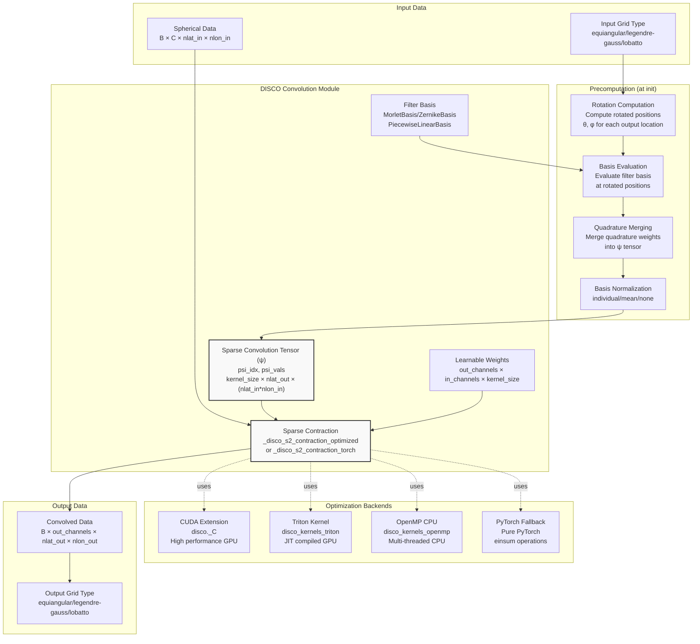

<!-- source: DeepWiki mcp.deepwiki.com · repo NVIDIA/torch-harmonics · page 3 DISCO Convolutions · fetched 2026-10-26 -->

# DISCO Convolutions

<details>
<summary>Relevant source files</summary>

The following files were used as context for generating this wiki page:

- [tests/test_convolution.py](tests/test_convolution.py)
- [torch_harmonics/distributed/distributed_convolution.py](torch_harmonics/distributed/distributed_convolution.py)

</details>


## Purpose and Scope

This page provides an overview of Discrete-Continuous (DISCO) convolutions on the 2-sphere, which enable localized feature extraction on spherical data with rotation equivariance. DISCO convolutions are one of the three core mathematical primitives in torch-harmonics, alongside spherical harmonic transforms and spherical attention mechanisms.

For detailed implementation of the base DISCO convolution classes, see [DiscreteContinuousConvS2](#3.1). For information about filter basis functions that define convolution kernels, see [Filter Basis Functions](#3.2). For transpose convolutions used in upsampling and generative models, see [Transpose Convolutions and Upsampling](#3.3). For distributed implementations, see [Distributed DISCO Convolutions](#6.2).

## What are DISCO Convolutions?

DISCO (Discrete-Continuous) convolutions are a method for performing localized convolutions on spherical data while maintaining rotation equivariance. Unlike standard convolutions on planar images, DISCO convolutions must account for the curved geometry of the sphere and the non-uniform distortions that occur when representing spherical data on a grid.

The key innovation is the "discrete-continuous" approach:
- **Discrete**: Input and output data are represented on discrete grids (equiangular, Legendre-Gauss, etc.)
- **Continuous**: The convolution kernel is defined continuously on the sphere using analytic filter basis functions

This approach enables:
- **Rotation equivariance**: Rotating the input produces a correspondingly rotated output
- **Localized support**: Kernels have compact support controlled by `theta_cutoff`, enabling efficient local feature extraction
- **Flexible resolution**: Input and output grids can have different resolutions
- **Grid agnosticism**: Works with different quadrature grids (equiangular, Legendre-Gauss, Lobatto)

**Main implementation classes:**
- `DiscreteContinuousConvS2`: Standard DISCO convolution
- `DiscreteContinuousConvTransposeS2`: Transpose convolution for upsampling
- `DistributedDiscreteContinuousConvS2`: Distributed version for multi-GPU execution
- `DistributedDiscreteContinuousConvTransposeS2`: Distributed transpose convolution

**Sources:** [torch_harmonics/distributed/distributed_convolution.py:115-156](), [tests/test_convolution.py:40]()

## Key Concepts

### Localized Support via Theta Cutoff

The `theta_cutoff` parameter controls the angular extent of the convolution kernel on the sphere. Points on the sphere separated by an angular distance greater than `theta_cutoff` from a given output location do not contribute to that output. This creates a spatially localized receptive field.

```
theta_cutoff = π / (nlat - 1)  # Typical default value
```

The cutoff is measured in radians and represents the geodesic distance on the unit sphere. Smaller values create more localized kernels (fewer parameters, faster computation), while larger values increase the receptive field (more global context).

**Sources:** [tests/test_convolution.py:245-247](), [torch_harmonics/distributed/distributed_convolution.py:191-195]()

### Filter Basis Functions

DISCO convolutions use continuous filter basis functions to define the convolution kernel. Three basis types are supported:

| Basis Type | Characteristics | Typical Use Case |
|------------|----------------|------------------|
| `"piecewise linear"` | Simple, fast to evaluate | General-purpose convolutions |
| `"morlet"` | Wavelet-like, localized in space and frequency | Multi-scale feature extraction |
| `"zernike"` | Orthogonal polynomials on a disk | Rotation-sensitive features |

Each basis function is parameterized by learnable weights that are optimized during training. The basis functions are evaluated at rotated positions on the sphere to construct the convolution kernel.

**Sources:** [tests/test_convolution.py:189-213]()

### Sparse Convolution Tensor (Psi)

The core of DISCO convolution is the precomputed sparse tensor `psi` (ψ), which encodes how filter basis functions evaluated at rotated positions contribute to each output location. The tensor has shape:

```
psi: [kernel_size, nlat_out, nlat_in * nlon_in]  (for forward convolution)
psi: [kernel_size, nlat_in, nlat_out * nlon_out] (for transpose convolution)
```

The tensor is stored in compressed sparse format using indices and values:
- `psi_ker_idx`: Kernel index (which basis function)
- `psi_row_idx`: Output latitude index
- `psi_col_idx`: Flattened input coordinate index
- `psi_vals`: Non-zero values of the tensor
- `psi_roff_idx`: Row offset indices (for optimized kernels)

This sparse representation is crucial for efficiency, as `theta_cutoff` ensures most entries are zero.

**Sources:** [torch_harmonics/distributed/distributed_convolution.py:222-236](), [tests/test_convolution.py:281-299]()

## DISCO Convolution Architecture

The following diagram shows the high-level architecture of DISCO convolutions and how they fit into the torch-harmonics ecosystem:



**Sources:** [tests/test_convolution.py:100-174](), [torch_harmonics/distributed/distributed_convolution.py:206-219]()

## Convolution Tensor Computation

The following diagram shows the mathematical computation flow for constructing the sparse convolution tensor ψ:

```mermaid
graph LR
    subgraph "For each output location (t, p)"
        OUT_COORDS["Output Coords<br/>θ_out[t], φ_out[p]"]
        
        subgraph "Rotation to Local Frame"
            ALPHA["α = -θ_out[t]"]
            BETA["β = φ_in - φ_out[p]"]
            GAMMA["γ = θ_in"]
        end
        
        subgraph "Cartesian Coordinates"
            X["x = cos(α)cos(β)sin(γ) + cos(γ)sin(α)"]
            Y["y = sin(β)sin(γ)"]
            Z["z = -cos(β)sin(α)sin(γ) + cos(α)cos(γ)"]
            NORMALIZE["Normalize: x,y,z → x/||·||, y/||·||, z/||·||"]
        end
        
        subgraph "Spherical Coordinates"
            THETA["θ = arccos(z)"]
            PHI["φ = arctan2(y, x)"]
        end
        
        subgraph "Support Filtering"
            SUPPORT_CHECK["if θ < θ_cutoff_eff"]
            BASIS_VALS["vals = filter_basis.compute_support_vals(θ, φ)"]
            STORE["Store to ψ[kernel_idx, t, p, input_coords]"]
        end
    end
    
    subgraph "Post-processing"
        QUAD_WEIGHT["Merge quadrature weights"]
        BASIS_NORM["Apply basis normalization"]
        SPARSIFY["Convert to COO sparse format"]
    end
    
    OUT_COORDS --> ALPHA
    OUT_COORDS --> BETA
    OUT_COORDS --> GAMMA
    
    ALPHA --> X
    BETA --> X
    GAMMA --> X
    ALPHA --> Y
    BETA --> Y
    GAMMA --> Y
    ALPHA --> Z
    BETA --> Z
    GAMMA --> Z
    
    X --> NORMALIZE
    Y --> NORMALIZE
    Z --> NORMALIZE
    
    NORMALIZE --> THETA
    NORMALIZE --> PHI
    
    THETA --> SUPPORT_CHECK
    SUPPORT_CHECK --> BASIS_VALS
    BASIS_VALS --> STORE
    
    STORE --> QUAD_WEIGHT
    QUAD_WEIGHT --> BASIS_NORM
    BASIS_NORM --> SPARSIFY
    
    style SUPPORT_CHECK fill:#f9f9f9,stroke:#333,stroke-width:2px
    style SPARSIFY fill:#f9f9f9,stroke:#333,stroke-width:2px
```



**Sources:** [tests/test_convolution.py:140-174]()

## Implementation Classes and Data Flow

The following diagram maps the natural language concepts to specific code entities:

```mermaid
graph TB
    subgraph "torch_harmonics.convolution"
        DISCO_CONV["DiscreteContinuousConvS2<br/>forward() method"]
        DISCO_CONV_T["DiscreteContinuousConvTransposeS2<br/>forward() method"]
        DISCO_BASE["DiscreteContinuousConv<br/>Base class (abstract)"]
        PRECOMPUTE["_precompute_convolution_tensor_s2()<br/>Returns: idx, vals, nnz"]
    end
    
    subgraph "torch_harmonics.disco._disco_utils"
        GET_PSI["_get_psi()<br/>Convert indices to sparse tensor"]
        CONTRACTION_TORCH["_disco_s2_contraction_torch()<br/>Pure PyTorch implementation"]
        CONTRACTION_OPT["_disco_s2_contraction_optimized()<br/>CUDA/Triton/OpenMP kernel"]
        TRANSPOSE_TORCH["_disco_s2_transpose_contraction_torch()"]
        TRANSPOSE_OPT["_disco_s2_transpose_contraction_optimized()"]
    end
    
    subgraph "torch_harmonics.filter_basis"
        FILTER_BASE["FilterBasis (ABC)"]
        MORLET["MorletBasis"]
        ZERNIKE["ZernikeBasis"]
        PIECEWISE["PiecewiseLinearBasis"]
        GET_FILTER["get_filter_basis()<br/>Factory function"]
    end
    
    subgraph "disco_helpers (C++ extension)"
        PREPROCESS_PSI["preprocess_psi()<br/>Create psi_roff_idx<br/>for optimized kernels"]
        OPT_AVAILABLE["optimized_kernels_is_available()"]
        CUDA_AVAILABLE["cuda_kernels_is_available()"]
    end
    
    subgraph "Distributed Extensions"
        DIST_DISCO["DistributedDiscreteContinuousConvS2"]
        DIST_DISCO_T["DistributedDiscreteContinuousConvTransposeS2"]
        SPLIT_TENSOR["_split_distributed_convolution_tensor_s2()<br/>Split psi along latitude"]
    end
    
    DISCO_BASE --> DISCO_CONV
    DISCO_BASE --> DISCO_CONV_T
    DISCO_BASE --> DIST_DISCO
    DISCO_BASE --> DIST_DISCO_T
    
    GET_FILTER --> MORLET
    GET_FILTER --> ZERNIKE
    GET_FILTER --> PIECEWISE
    
    FILTER_BASE --> MORLET
    FILTER_BASE --> ZERNIKE
    FILTER_BASE --> PIECEWISE
    
    PRECOMPUTE --> GET_PSI
    PRECOMPUTE --> SPLIT_TENSOR
    
    DISCO_CONV -.uses.-> CONTRACTION_TORCH
    DISCO_CONV -.uses.-> CONTRACTION_OPT
    DISCO_CONV_T -.uses.-> TRANSPOSE_TORCH
    DISCO_CONV_T -.uses.-> TRANSPOSE_OPT
    
    CONTRACTION_OPT --> PREPROCESS_PSI
    TRANSPOSE_OPT --> PREPROCESS_PSI
    
    OPT_AVAILABLE -.checks.-> PREPROCESS_PSI
    CUDA_AVAILABLE -.checks.-> PREPROCESS_PSI
    
    style DISCO_CONV fill:#f9f9f9,stroke:#333,stroke-width:2px
    style CONTRACTION_OPT fill:#f9f9f9,stroke:#333,stroke-width:2px
    style PREPROCESS_PSI fill:#f9f9f9,stroke:#333,stroke-width:2px
```



**Sources:** [torch_harmonics/distributed/distributed_convolution.py:40-48](), [tests/test_convolution.py:40-46]()

## Forward vs Transpose Convolution

DISCO convolutions support both standard (forward) and transpose operations:

### Forward Convolution (`DiscreteContinuousConvS2`)

Forward convolution typically performs downsampling or same-resolution feature extraction:

```
Input:  [B, in_channels, nlat_in, nlon_in]
Output: [B, out_channels, nlat_out, nlon_out]

where nlat_out <= nlat_in (typically)
```

**Computation flow:**
1. Input data is contracted with sparse tensor ψ
2. Result has shape `[B, in_channels, kernel_size, nlat_out, nlon_out]`
3. Learnable weights aggregate over `kernel_size` and `in_channels`
4. Final output has shape `[B, out_channels, nlat_out, nlon_out]`

### Transpose Convolution (`DiscreteContinuousConvTransposeS2`)

Transpose convolution performs upsampling and is used in decoder architectures:

```
Input:  [B, in_channels, nlat_in, nlon_in]
Output: [B, out_channels, nlat_out, nlon_out]

where nlat_out >= nlat_in (typically)
```

**Computation flow:**
1. Input is first multiplied by learnable weights
2. Result has shape `[B, out_channels, kernel_size, nlat_in, nlon_in]`
3. Transposed sparse tensor ψ performs upsampling
4. Final output has shape `[B, out_channels, nlat_out, nlon_out]`

The transpose convolution uses a modified ψ tensor where `theta_cutoff` is computed based on the input resolution (not output), and normalization is adjusted accordingly.

**Sources:** [tests/test_convolution.py:249](), [tests/test_convolution.py:268-279](), [torch_harmonics/distributed/distributed_convolution.py:288-330]()

## Optimization Backends

DISCO convolutions support multiple optimization backends with automatic fallback:

| Backend | Module | Device | Availability Check | Performance |
|---------|--------|--------|-------------------|-------------|
| CUDA Extension | `disco._C` | GPU | `cuda_kernels_is_available()` | Highest (GPU) |
| Triton Kernels | `disco_kernels_triton` | GPU | `optimized_kernels_is_available()` | High (GPU) |
| OpenMP | `disco_kernels_openmp` | CPU | `optimized_kernels_is_available()` | High (CPU) |
| PyTorch Fallback | Native PyTorch | CPU/GPU | Always available | Baseline |

The backend is selected automatically based on device and availability:
1. If `optimized_kernel=True` (default) and CUDA is available → CUDA extension
2. If `optimized_kernel=True` and CPU → OpenMP or Triton
3. If `optimized_kernel=False` or no optimized backend available → PyTorch fallback

The optimized backends use a preprocessed data structure (`psi_roff_idx`) that enables efficient sparse matrix operations. The PyTorch fallback uses standard `einsum` operations.

**Performance characteristics:**
- CUDA extension: ~2ms forward, ~3ms backward (91×180 grid, V100 GPU)
- CPU OpenMP: ~100ms forward, ~90ms backward (91×180 grid, 16 threads)
- PyTorch fallback: Significantly slower for large grids

**Sources:** [tests/test_convolution.py:43-46](), [tests/test_convolution.py:237-239](), [tests/test_convolution.py:605-689]()

## Basis Normalization Modes

The `basis_norm_mode` parameter controls how filter basis functions are normalized:

| Mode | Description | Effect |
|------|-------------|--------|
| `"individual"` | Each basis function normalized independently | Ensures consistent magnitude per basis function |
| `"mean"` | Average normalization across basis functions | Balances contribution across kernel |
| `"none"` | No normalization applied | Raw basis function values used |

Normalization is computed during precomputation and merged into the ψ tensor. The normalization involves integrating the absolute value of each basis function over the sphere using quadrature weights:

```
psi_norm = Σ_θ,φ w(θ) * |ψ(θ, φ)|

where w(θ) are quadrature weights
```

**Sources:** [tests/test_convolution.py:62-98]()

## Groups and Channel Grouping

Similar to standard convolutions, DISCO supports grouped convolutions via the `groups` parameter:

```python
conv = DiscreteContinuousConvS2(
    in_channels=16,
    out_channels=32,
    groups=4,  # 4 independent convolution groups
    ...
)
```

With `groups=g`:
- Input channels are divided into `g` groups of size `in_channels/g`
- Output channels are divided into `g` groups of size `out_channels/g`
- Each group has independent weights and performs convolution separately
- Reduces parameters and enables parallel processing

The weight tensor has shape `[out_channels, in_channels/groups, kernel_size]`, and the computation uses grouped einsum operations.

**Sources:** [torch_harmonics/distributed/distributed_convolution.py:275-280]()

## Distributed Implementation

The distributed versions (`DistributedDiscreteContinuousConvS2` and `DistributedDiscreteContinuousConvTransposeS2`) enable multi-GPU/multi-node execution by partitioning data along latitude and longitude dimensions.

**Key features:**
- Data is partitioned across a 2D process grid (polar × azimuthal)
- The ψ tensor is split along the latitude dimension
- Communication primitives (`distributed_transpose_azimuth`, `reduce_from_polar_region`, etc.) manage data movement
- Each process computes only its local portion of the output

For detailed information about distributed DISCO convolutions, see [Distributed DISCO Convolutions](#6.2).

**Sources:** [torch_harmonics/distributed/distributed_convolution.py:115-156](), [torch_harmonics/distributed/distributed_convolution.py:58-112]()

## Usage Pattern

Basic usage example:

```python
from torch_harmonics import DiscreteContinuousConvS2

# Create DISCO convolution layer
conv = DiscreteContinuousConvS2(
    in_channels=16,
    out_channels=32,
    in_shape=(128, 256),      # nlat_in=128, nlon_in=256
    out_shape=(64, 128),      # nlat_out=64, nlon_out=128
    kernel_shape=3,           # or (3, 3) for separate theta/phi
    basis_type="piecewise linear",
    basis_norm_mode="mean",
    groups=1,
    grid_in="equiangular",
    grid_out="equiangular",
    bias=True,
    theta_cutoff=None,        # Auto-computed if None
    optimized_kernel=True     # Use optimized backends
)

# Apply convolution
x = torch.randn(8, 16, 128, 256)  # [B, C, H, W]
y = conv(x)  # [8, 32, 64, 128]
```

**Sources:** [tests/test_convolution.py:250-264]()

## Gradient Checking and Numerical Stability

DISCO convolutions are fully differentiable and support automatic differentiation. The implementation includes:

- Backward pass for input gradients
- Backward pass for weight gradients
- Support for `torch.autograd.gradcheck` validation
- Numerical stability through double-precision intermediate computations in tensor precomputation

The tests validate gradient correctness by comparing analytical gradients (from autograd) with reference implementations using dense tensors and einsum operations.

**Sources:** [tests/test_convolution.py:310-334]()

---

