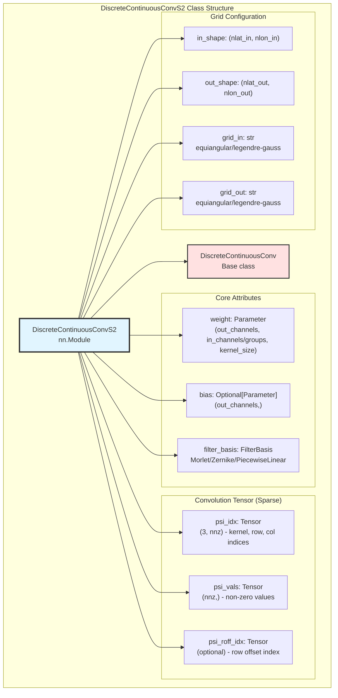
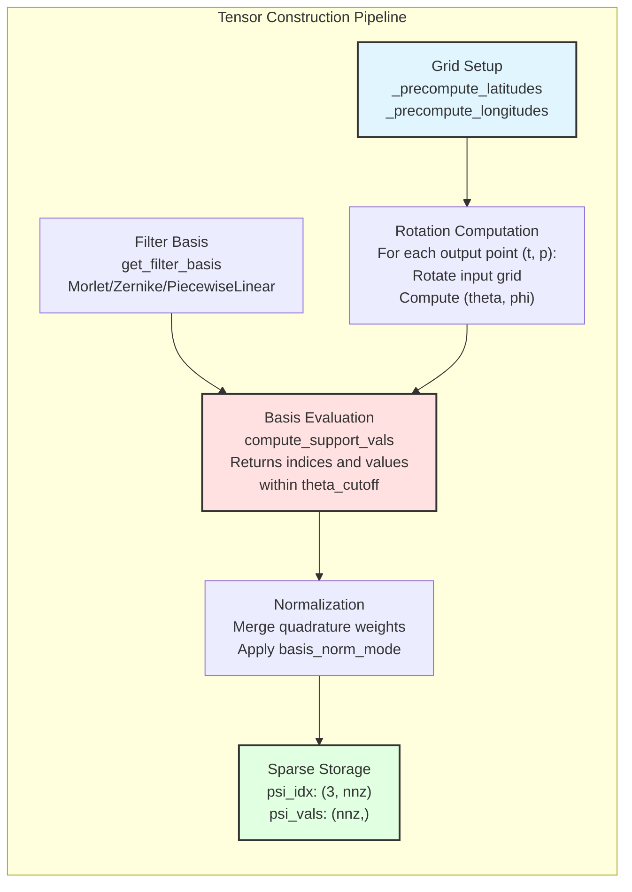
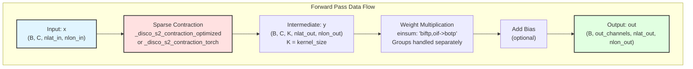
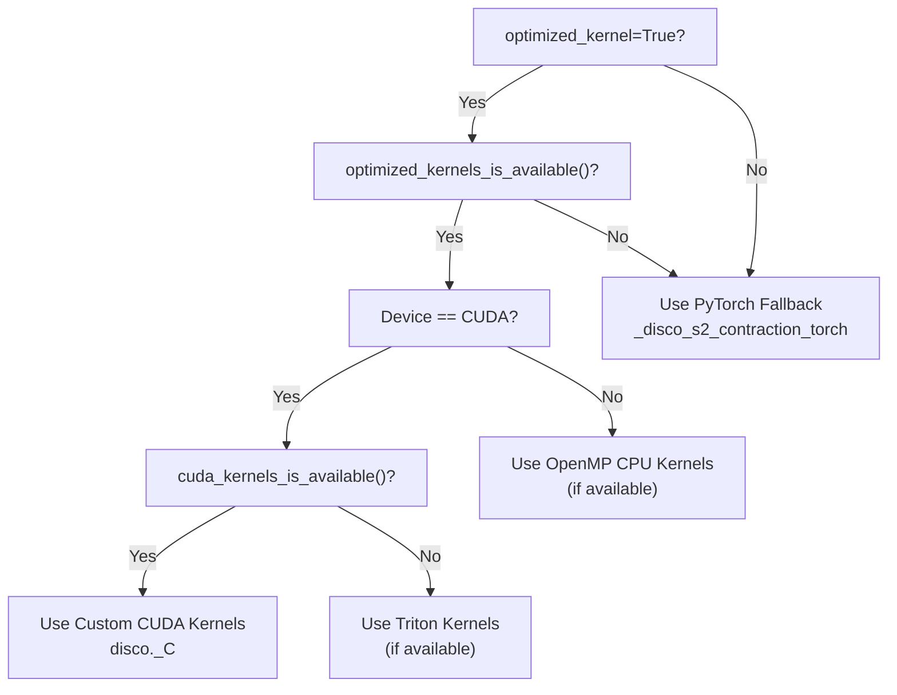

<!-- source: DeepWiki mcp.deepwiki.com · repo NVIDIA/torch-harmonics · page 3.1 DiscreteContinuousConvS2 · fetched 2026-10-26 -->

# DiscreteContinuousConvS2

<details>
<summary>Relevant source files</summary>

The following files were used as context for generating this wiki page:

- [tests/test_convolution.py](tests/test_convolution.py)
- [torch_harmonics/distributed/distributed_convolution.py](torch_harmonics/distributed/distributed_convolution.py)

</details>


## Purpose and Scope

This page documents the `DiscreteContinuousConvS2` class, which implements Discrete-Continuous (DISCO) convolutions on the 2-sphere. DISCO convolutions provide a method for performing local, rotation-equivariant convolutions on spherical data by discretizing a continuous convolution operator using filter basis functions. This page covers the non-distributed implementation; for distributed multi-GPU/multi-node execution, see [Distributed DISCO Convolutions](#6.2). For transpose convolutions used in upsampling and generative models, see [Transpose Convolutions and Upsampling](#3.3). For details on the filter basis functions themselves, see [Filter Basis Functions](#3.2).

---

## Overview

`DiscreteContinuousConvS2` implements the DISCO convolution framework described in Ocampo et al. (2023). Unlike global spectral convolutions that operate in the spherical harmonic domain, DISCO convolutions are **local** operations that maintain rotation equivariance while having compact support controlled by `theta_cutoff`. This makes them computationally efficient and suitable for learning hierarchical features in spherical CNNs.

The key innovation is representing the convolution kernel as a weighted sum of filter basis functions (Morlet wavelets, Zernike polynomials, or piecewise linear functions) that are evaluated at rotated positions on the sphere. The resulting convolution tensor is stored in sparse format for efficiency.

**Sources:** [tests/test_convolution.py:1-50]()

---

## Mathematical Formulation

### Continuous Convolution on the Sphere

The continuous convolution on the sphere is defined by rotating a filter basis function and integrating:

```
(f * ψ)(x) = ∫_S² f(R_x y) ψ(y) dΩ(y)
```

where:
- `f` is the input signal on the sphere
- `ψ` is a filter basis function with compact support
- `R_x` is the rotation operator that maps the north pole to point `x`
- `dΩ` is the invariant measure on the sphere

### Discretization

DISCO discretizes this continuous operator by:
1. Evaluating the rotated filter basis at discrete grid points
2. Using quadrature weights for numerical integration
3. Storing the result as a sparse tensor `Ψ` of shape `(kernel_size, nlat_out, nlat_in × nlon_in)`

The discrete convolution then becomes:
```
y[b, c, t, p] = Σ_k Σ_q Σ_r w[c, k] Ψ[k, t, qr] x[b, c, q, r]
```

**Sources:** [tests/test_convolution.py:62-98](), [tests/test_convolution.py:100-174]()

---

## Class Architecture



**Diagram: Class structure and key attributes of DiscreteContinuousConvS2**

**Sources:** [tests/test_convolution.py:249-264](), [torch_harmonics/distributed/distributed_convolution.py:115-175]()

---

## Parameters

### Constructor Parameters

| Parameter | Type | Default | Description |
|-----------|------|---------|-------------|
| `in_channels` | `int` | Required | Number of input channels |
| `out_channels` | `int` | Required | Number of output channels |
| `in_shape` | `Tuple[int, int]` | Required | Input grid shape `(nlat_in, nlon_in)` |
| `out_shape` | `Tuple[int, int]` | Required | Output grid shape `(nlat_out, nlon_out)` |
| `kernel_shape` | `int` or `Tuple[int, int]` | Required | Number of filter basis functions. Single int or `(radial, angular)` |
| `basis_type` | `str` | `"piecewise linear"` | Filter basis: `"piecewise linear"`, `"morlet"`, or `"zernike"` |
| `basis_norm_mode` | `str` | `"mean"` | Normalization mode: `"none"`, `"individual"`, or `"mean"` |
| `groups` | `int` | `1` | Number of groups for grouped convolutions |
| `grid_in` | `str` | `"equiangular"` | Input grid type: `"equiangular"`, `"legendre-gauss"`, or `"lobatto"` |
| `grid_out` | `str` | `"equiangular"` | Output grid type: `"equiangular"`, `"legendre-gauss"`, or `"lobatto"` |
| `bias` | `bool` | `True` | Whether to include learnable bias |
| `theta_cutoff` | `float` | `None` | Radial support of filter in radians. If `None`, set to `π / (nlat_out - 1)` |
| `optimized_kernel` | `bool` | `True` | Use optimized CUDA/Triton kernels if available |

**Sources:** [tests/test_convolution.py:186-214](), [tests/test_convolution.py:249-264]()

### Key Concepts

**Kernel Shape:** Specifies the number of filter basis functions. For separable bases (Morlet), can be specified as `(radial, angular)` to control radial and angular resolution independently. For non-separable bases (Zernike), must be a single integer.

**Theta Cutoff:** Controls the **local support** of the convolution. Larger values increase the receptive field but also increase computation. Typical values are `(k + 1) * π / (nlat_in - 1)` where `k` is related to `kernel_shape`.

**Basis Normalization:**
- `"none"`: No normalization
- `"individual"`: Each filter basis function normalized independently
- `"mean"`: Filter basis functions normalized to have consistent mean magnitude

**Sources:** [tests/test_convolution.py:244-248](), [tests/test_convolution.py:386-390]()

---

## Convolution Tensor Construction

The convolution tensor `Ψ` is precomputed during initialization and stored in sparse COO (coordinate) format for efficiency.



**Diagram: Convolution tensor construction process**

### Implementation Details

The construction process in [tests/test_convolution.py:100-174]() performs the following steps:

1. **Grid Setup:** Compute latitude/longitude coordinates and quadrature weights for input and output grids
2. **Rotation Loop:** For each output grid point `(t, p)`:
   - Compute rotation angles: `α = -lat_out[t]`, `β = lon_in - lon_out[p]`, `γ = lat_in`
   - Apply rotation to get spherical coordinates `(θ, φ)` of input points in rotated frame
   - Compute: `z = -cos(β)sin(α)sin(γ) + cos(α)cos(γ)`
   - Compute: `x = cos(α)cos(β)sin(γ) + cos(γ)sin(α)`
   - Compute: `y = sin(β)sin(γ)`
   - Normalize and convert to spherical: `θ = arccos(z)`, `φ = arctan2(y, x)`
3. **Basis Evaluation:** Call `filter_basis.compute_support_vals(theta, phi, r_cutoff=theta_cutoff)`
   - Returns indices `(kernel_idx, lat_idx, lon_idx)` and values for points within support
4. **Normalization:** Apply quadrature weights and basis normalization
5. **Sparse Storage:** Store as COO tensor with indices `(kernel, row, col)` and values

**Sources:** [tests/test_convolution.py:100-174](), [torch_harmonics/distributed/distributed_convolution.py:205-219]()

---

## Forward Pass

The forward pass performs the discrete convolution using the precomputed sparse tensor.



**Diagram: Forward pass data transformation**

### Sparse Contraction

Two implementations are available:

1. **Optimized Kernels** (`_disco_s2_contraction_optimized`):
   - Custom CUDA kernels for GPU (see `torch_harmonics/disco/_C`)
   - Custom Triton kernels for GPU
   - OpenMP-accelerated CPU kernels
   - Requires `optimized_kernel=True` and availability of compiled extensions

2. **PyTorch Fallback** (`_disco_s2_contraction_torch`):
   - Pure PyTorch implementation using sparse tensors
   - Works on all devices without special compilation
   - Slower but guaranteed to work

The contraction computes:
```python
y[b, c, k, t, p] = Σ_{qr} Ψ[k, t, qr] * x[b, c, q, r]
```

where `qr` is the flattened index over `(nlat_in, nlon_in)`.

**Sources:** [torch_harmonics/distributed/distributed_convolution.py:249-285](), [tests/test_convolution.py:310-334]()

---

## Optimization Backends

### Backend Selection

The class automatically selects the best available backend:



**Diagram: Backend selection logic**

**Sources:** [tests/test_convolution.py:236-240](), [tests/test_convolution.py:377-379]()

### Performance Characteristics

From [tests/test_convolution.py:53-59](), the expected performance thresholds are:

| Device | Forward Pass | Backward Pass |
|--------|--------------|---------------|
| CPU (16 OpenMP threads) | ≤ 100 ms | ≤ 90 ms |
| GPU (V100 16GB) | ≤ 2 ms | ≤ 3 ms |

These are measured on a `(91, 180)` grid with `kernel_shape=3` and `in_channels=4`, `out_channels=2`.

**Sources:** [tests/test_convolution.py:603-689]()

---

## Grid Type Support

The class supports three grid types for both input and output:

### Equiangular Grid
- Uniform spacing in latitude and longitude
- Grid points: `lat[i] = π(i + 0.5)/nlat - π/2`, `lon[j] = 2πj/nlon`
- Most common for computer vision applications
- Uses Clenshaw-Curtis quadrature weights

### Legendre-Gauss Grid
- Latitude points at Gauss-Legendre quadrature nodes
- Longitude uniformly spaced
- Optimal for spectral accuracy
- Uses Gauss-Legendre quadrature weights

### Lobatto Grid
- Latitude points at Gauss-Lobatto quadrature nodes
- Includes poles (unlike equiangular and Legendre-Gauss)
- Useful for certain boundary conditions

The convolution tensor automatically adapts quadrature weights and grid coordinates based on `grid_in` and `grid_out` parameters.

**Sources:** [tests/test_convolution.py:198-213](), [torch_harmonics/distributed/distributed_convolution.py:40-41]()

---

## Usage Examples

### Basic Convolution

```python
import torch
from torch_harmonics import DiscreteContinuousConvS2

# Create convolution layer
conv = DiscreteContinuousConvS2(
    in_channels=16,
    out_channels=32,
    in_shape=(128, 256),    # nlat=128, nlon=256
    out_shape=(128, 256),   # same resolution
    kernel_shape=5,         # 5 radial basis functions
    basis_type="piecewise linear",
    grid_in="equiangular",
    grid_out="equiangular",
    theta_cutoff=6 * torch.pi / 127  # 6-pixel receptive field
)

# Input: batch=8, channels=16, nlat=128, nlon=256
x = torch.randn(8, 16, 128, 256)

# Forward pass
y = conv(x)  # Output: (8, 32, 128, 256)
```

### Downsampling Convolution

```python
# Convolution with spatial downsampling
conv_down = DiscreteContinuousConvS2(
    in_channels=32,
    out_channels=64,
    in_shape=(128, 256),
    out_shape=(64, 128),    # 2x downsampling
    kernel_shape=7,
    basis_type="morlet",
    theta_cutoff=8 * torch.pi / 127
)

x = torch.randn(4, 32, 128, 256)
y = conv_down(x)  # Output: (4, 64, 64, 128)
```

### Anisotropic Kernel (Morlet Basis)

```python
# Use different radial and angular resolution
conv_aniso = DiscreteContinuousConvS2(
    in_channels=16,
    out_channels=16,
    in_shape=(64, 128),
    out_shape=(64, 128),
    kernel_shape=(4, 3),    # 4 radial, 3 angular
    basis_type="morlet",
    basis_norm_mode="individual"
)
```

### Grid Conversion

```python
# Convert from Legendre-Gauss to equiangular
conv_grid = DiscreteContinuousConvS2(
    in_channels=8,
    out_channels=8,
    in_shape=(64, 128),
    out_shape=(64, 128),
    kernel_shape=3,
    grid_in="legendre-gauss",
    grid_out="equiangular",
    basis_type="piecewise linear"
)
```

**Sources:** [tests/test_convolution.py:217-335]()

---

## Grouped Convolutions

The `groups` parameter enables grouped convolutions, which reduce parameters and computation:

```python
# Depthwise-separable style convolution
conv_grouped = DiscreteContinuousConvS2(
    in_channels=32,
    out_channels=32,
    in_shape=(64, 128),
    out_shape=(64, 128),
    kernel_shape=5,
    groups=8  # 8 groups, each processes 4 input and 4 output channels
)

# Weight shape: (32, 4, 5) instead of (32, 32, 5)
# Computation is split into 8 independent group convolutions
```

With `groups=G`:
- Input channels must be divisible by `G`
- Output channels must be divisible by `G`
- Each group processes `in_channels/G` inputs and produces `out_channels/G` outputs
- Weight shape: `(out_channels, in_channels/G, kernel_size)`

**Sources:** [tests/test_convolution.py:186-214](), [torch_harmonics/distributed/distributed_convolution.py:276-280]()

---

## Testing and Validation

### Numerical Correctness Tests

The test suite validates correctness by comparing against dense reference implementations:

1. **Sparse vs Dense Convolution** ([tests/test_convolution.py:217-335]()):
   - Constructs full dense convolution tensor
   - Compares sparse implementation against dense einsum operations
   - Tests forward and backward passes
   - Validates gradients with respect to input and weights

2. **Optimized vs PyTorch** ([tests/test_convolution.py:361-451]()):
   - Compares custom CUDA/Triton kernels against PyTorch fallback
   - Ensures optimizations don't affect numerical results
   - Tests tolerance: `rtol=1e-4, atol=1e-4`

3. **PyTorch 2.0 Compatibility** ([tests/test_convolution.py:529-601]()):
   - Uses `torch.library.opcheck` to validate custom operators
   - Tests schema registration, fake tensor support, and AOT dispatch
   - Ensures compatibility with `torch.compile`

### Test Coverage

The test suite covers:
- Multiple grid types: equiangular, Legendre-Gauss
- Multiple basis types: piecewise linear, Morlet, Zernike
- Multiple kernel shapes: scalar and 2D
- Multiple resolutions: same-resolution, downsampling, upsampling (transpose)
- Both CPU and CUDA devices
- Gradient correctness via `torch.autograd.gradcheck`

**Sources:** [tests/test_convolution.py:177-690]()

---

## Device Placement and Initialization

The class properly handles device placement during initialization:

```python
# Method 1: Initialize on CPU, then move to device
conv = DiscreteContinuousConvS2(...)
conv = conv.to('cuda')

# Method 2: Use device context manager
with torch.device('cuda'):
    conv = DiscreteContinuousConvS2(...)
```

All internal buffers (`psi_idx`, `psi_vals`, `psi_roff_idx`) are registered with `persistent=False`, meaning they are not saved in `state_dict()` but are moved correctly with `.to(device)`.

**Sources:** [tests/test_convolution.py:462-516](), [torch_harmonics/distributed/distributed_convolution.py:226-236]()

---

## Memory and Computation Complexity

### Memory Requirements

The dominant memory cost is the sparse convolution tensor:

- **Sparse tensor size:** `O(kernel_size × nlat_out × nlat_in × nlon_in × sparsity)`
- **Sparsity factor:** Controlled by `theta_cutoff`; typical values are 1-10% for local kernels
- **Weight tensor:** `(out_channels, in_channels/groups, kernel_size)`

For a `(128, 256)` grid with `kernel_shape=5` and `theta_cutoff` giving ~5% sparsity:
- Sparse tensor: ~5 × 128 × 128 × 256 × 0.05 = ~4M float32 values = 16 MB
- Weight (16→32 channels): 32 × 16 × 5 = 2560 values = 10 KB

### Computation Complexity

- **Forward pass:** `O(batch × in_channels × nnz × kernel_size)`
- **Backward pass:** Similar to forward
- **nnz** (number of non-zeros): Controlled by sparsity pattern

For typical values (`batch=8`, `in_channels=16`, `nnz=4M`, `kernel_size=5`):
- ~640M multiply-add operations per forward pass
- On V100: ~2ms (as measured in performance tests)

**Sources:** [tests/test_convolution.py:603-689]()

---

## Integration with Neural Network Architectures

`DiscreteContinuousConvS2` is designed as a drop-in replacement for standard convolutions in spherical CNNs:

### Encoder-Decoder Networks

```python
class S2Encoder(nn.Module):
    def __init__(self):
        super().__init__()
        self.conv1 = DiscreteContinuousConvS2(3, 32, (256, 512), (256, 512), 5)
        self.conv2 = DiscreteContinuousConvS2(32, 64, (256, 512), (128, 256), 7)
        self.conv3 = DiscreteContinuousConvS2(64, 128, (128, 256), (64, 128), 9)
```

### Residual Blocks

```python
class DiscoResBlock(nn.Module):
    def __init__(self, channels, shape):
        super().__init__()
        self.conv1 = DiscreteContinuousConvS2(channels, channels, shape, shape, 3)
        self.conv2 = DiscreteContinuousConvS2(channels, channels, shape, shape, 3)
        
    def forward(self, x):
        residual = x
        x = F.relu(self.conv1(x))
        x = self.conv2(x)
        return F.relu(x + residual)
```

See [S2 Segformer](#7.3) and [Local Spherical Neural Operator](#7.2) for complete architecture examples.

**Sources:** [tests/test_convolution.py:186-214]()

---

## Common Pitfalls and Best Practices

### Theta Cutoff Selection

**Problem:** Setting `theta_cutoff` too small results in disconnected receptive fields near poles.

**Solution:** Use `theta_cutoff = (k + 1) * π / (nlat - 1)` where `k` relates to desired receptive field size in grid cells.

### Basis Type Selection

**Piecewise Linear:** Fast, general-purpose, good for most applications.

**Morlet:** Better spectral properties, use when frequency selectivity matters. Supports anisotropic `kernel_shape=(radial, angular)`.

**Zernike:** Rotation-invariant within support, use for texture/pattern analysis.

See [Filter Basis Functions](#3.2) for detailed comparison.

### Grid Mismatch

**Problem:** Using different grid types for layers without resampling causes artifacts.

**Solution:** Either keep consistent grid types throughout, or use explicit resampling layers (see [ResampleS2](#5.1)).

### Memory on Large Grids

**Problem:** High-resolution grids (e.g., `(512, 1024)`) can have large sparse tensors.

**Solution:** 
- Use smaller `theta_cutoff` to reduce sparsity
- Use grouped convolutions to reduce weight parameters
- Consider distributed implementation for very large grids (see [Distributed DISCO](#6.2))

**Sources:** [tests/test_convolution.py:244-248](), [tests/test_convolution.py:386-390]()

---

## Related Classes and Functions

### Core Implementation

- `DiscreteContinuousConv`: Base class defining common interface
- `_precompute_convolution_tensor_s2`: Constructs the sparse convolution tensor
- `_disco_s2_contraction_optimized`: Optimized sparse contraction kernel
- `_disco_s2_contraction_torch`: PyTorch fallback implementation

### Related Modules

- [DiscreteContinuousConvTransposeS2](#3.3): Transpose convolution for upsampling
- [DistributedDiscreteContinuousConvS2](#6.2): Multi-GPU distributed version
- [FilterBasis](#3.2): Filter basis function implementations
- [ResampleS2](#5.1): Resampling between resolutions

**Sources:** [torch_harmonics/distributed/distributed_convolution.py:40-48](), [tests/test_convolution.py:40-47]()

---

