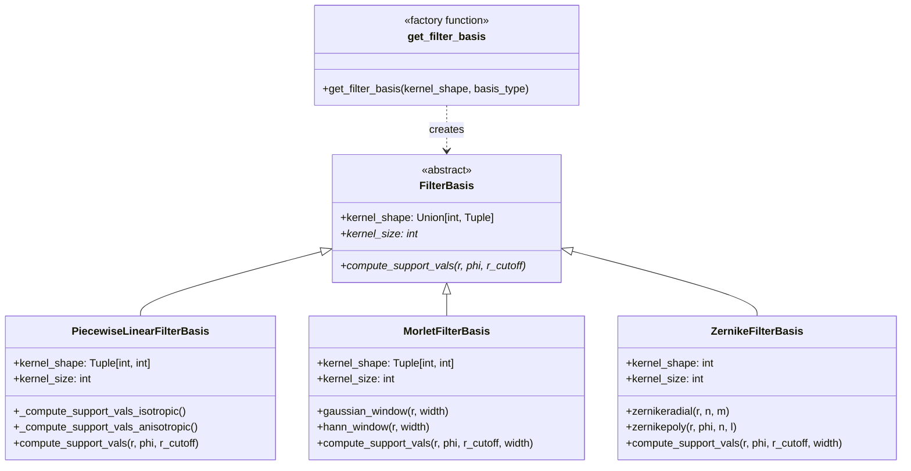
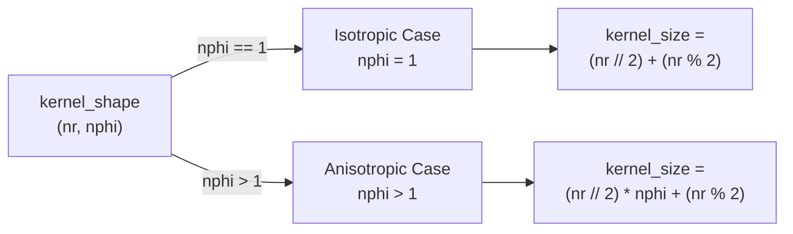
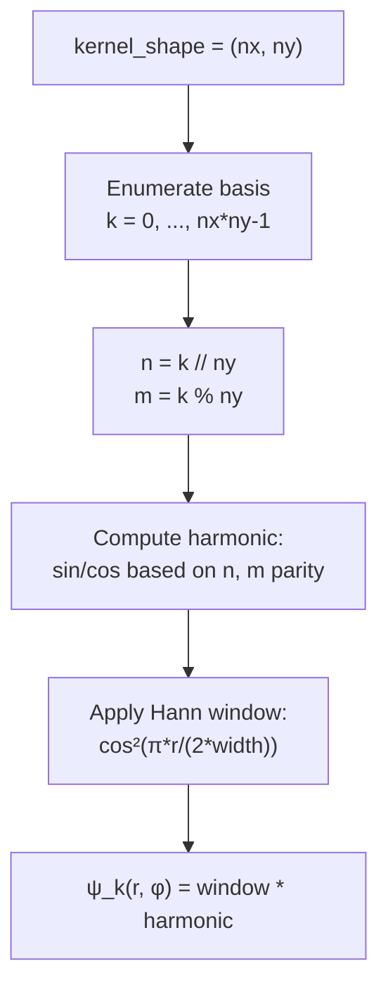
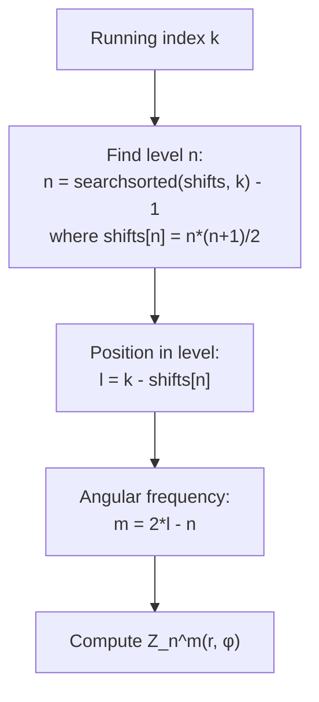
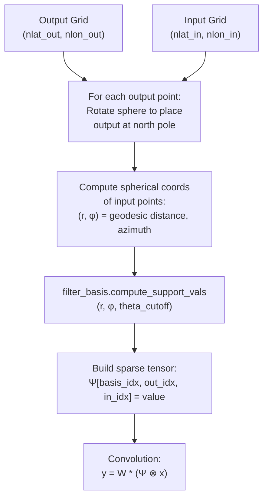

<!-- source: DeepWiki mcp.deepwiki.com · repo NVIDIA/torch-harmonics · page 3.2 Filter Basis Functions · fetched 2026-10-26 -->

# Filter Basis Functions

<details>
<summary>Relevant source files</summary>

The following files were used as context for generating this wiki page:

- [tests/test_convolution.py](tests/test_convolution.py)
- [torch_harmonics/filter_basis.py](torch_harmonics/filter_basis.py)
- [torch_harmonics/quadrature.py](torch_harmonics/quadrature.py)

</details>


## Purpose and Scope

This page documents the filter basis functions used in DISCO (Discrete-Continuous) convolutions on the sphere. Filter basis functions define the spatial structure of convolutional kernels by providing a set of basis functions on a disk, which are then mapped onto the spherical surface during convolution operations.

For information about how these filter bases are used in convolution operations, see [DiscreteContinuousConvS2](#3.1). For the overall DISCO convolution framework, see [DISCO Convolutions](#3).

**Sources:** [torch_harmonics/filter_basis.py:1-327]()

---

## Overview

Filter basis functions provide a structured way to represent convolutional kernels with localized support on the sphere. The library implements an abstract `FilterBasis` class with three concrete implementations:

- **Piecewise Linear**: Tensor-product basis using hat functions in radial and angular directions
- **Morlet Wavelets**: Fourier basis modulated by a Hann window envelope
- **Zernike Polynomials**: Orthogonal polynomials defined on the unit disk

Each basis type offers different trade-offs between spatial localization, smoothness, and computational efficiency. The choice of basis affects the expressiveness of learned kernels and the computational cost of convolution operations.

**Sources:** [torch_harmonics/filter_basis.py:53-94]()

---

## Class Hierarchy and Factory Pattern



The factory function `get_filter_basis` provides a unified interface for instantiating filter basis objects. It is cached using an LRU cache to avoid redundant computations when the same configuration is requested multiple times.

**Sources:** [torch_harmonics/filter_basis.py:53-94]()

---

## Common Interface: FilterBasis

All filter basis implementations inherit from the abstract `FilterBasis` class and must implement:

| Method/Property | Description | Return Type |
|----------------|-------------|-------------|
| `kernel_size` | Number of basis functions in the kernel | `int` |
| `compute_support_vals(r, phi, r_cutoff)` | Compute indices and values where basis functions are non-zero | `Tuple[Tensor, Tensor]` |

The `compute_support_vals` method is the core interface used by DISCO convolutions. It takes spherical coordinates `(r, phi)` representing the geodesic distance and azimuthal angle from a reference point, along with a cutoff radius `r_cutoff`, and returns:

1. **Indices tensor** (`iidx`): Shape `[nnz, 3]` where each row is `[basis_idx, lat_idx, lon_idx]`
2. **Values tensor** (`vals`): Shape `[nnz]` containing the corresponding basis function values

This sparse representation enables efficient computation by only storing non-zero entries.

**Sources:** [torch_harmonics/filter_basis.py:53-80]()

---

## Piecewise Linear Filter Basis

### Mathematical Definition

The piecewise linear basis uses tensor products of hat functions (piecewise linear functions) in radial and angular directions. For a kernel shape `(nr, nphi)`:

- **Radial direction**: Hat functions centered at `r_k = k * dr` for `k = 0, ..., nr-1` where `dr = 2*r_cutoff/(nr+1)`
- **Angular direction**: Hat functions centered at `φ_j = j * dφ - π` for `j = 0, ..., nphi-1` where `dφ = 2π/nphi`

The basis function value at position `(r, φ)` is:
```
ψ_{k,j}(r, φ) = (1 - |r - r_k|/dr) * (1 - circle_dist(φ, φ_j)/dφ)
```
where `circle_dist` handles the angular periodicity.

### Kernel Size Calculation



For isotropic kernels (`nphi=1`), only the radial component is used, reducing the kernel size. For anisotropic kernels, the central basis function (if `nr` is odd) has no angular variation, while outer functions use the full tensor product.

### Implementation Details

The implementation handles even and odd radial discretizations differently:

- **Odd `nr`**: Central basis function at `r=0` is purely radial; outer functions use tensor products
- **Even `nr`**: All basis functions use tensor products; overlapping regions are handled by considering reflections across the origin

**Sources:** [torch_harmonics/filter_basis.py:96-204](), [tests/test_convolution.py:189-213]()

---

## Morlet Filter Basis

### Mathematical Definition

Morlet wavelets combine oscillatory Fourier modes with a localized envelope:

```
ψ_{n,m}(r, φ) = w(r) * cos/sin(⌈n/2⌉ * π * x / width) * cos/sin(⌈m/2⌉ * π * y / width)
```

where:
- `x = r * sin(φ)`, `y = r * cos(φ)` are Cartesian coordinates
- `w(r)` is a Hann window: `w(r) = cos²(π*r/(2*width))`
- Alternating indices produce sine/cosine variations

### Kernel Configuration

For a kernel shape `(nx, ny)`, the total kernel size is `nx * ny`, creating a grid of basis functions with different oscillation frequencies in x and y directions.



### Use Cases

Morlet wavelets are particularly effective for:
- Capturing directional features (edges, ridges) due to oriented oscillations
- Multi-scale representations by varying the width parameter
- Applications requiring smooth, differentiable kernels

**Sources:** [torch_harmonics/filter_basis.py:206-259](), [tests/test_convolution.py:193-207]()

---

## Zernike Filter Basis

### Mathematical Definition

Zernike polynomials form a complete orthogonal basis on the unit disk. They are indexed by a radial order `n` and angular frequency `m`:

```
Z_n^m(r, φ) = R_n^m(r) * { cos(mφ)  if m ≥ 0
                          { sin(|m|φ) if m < 0
```

The radial component is:
```
R_n^m(r) = Σ_{k=0}^{(n-|m|)/2} (-1)^k * (n-k)! / (k! * ((n+|m|)/2-k)! * ((n-|m|)/2-k)!) * r^(n-2k)
```

### Index Mapping

Zernike polynomials are typically indexed by a single running index. The library uses a triangular indexing scheme:



For a maximum order `nmax`, the total number of basis functions is `nmax * (nmax + 1) / 2`.

### Properties

Zernike polynomials offer several advantages:
- **Orthogonality**: Minimize aliasing between different basis functions
- **Rotational structure**: Natural representation of rotationally symmetric and asymmetric features
- **Completeness**: Can represent arbitrary smooth functions on the disk

**Sources:** [torch_harmonics/filter_basis.py:261-327](), [tests/test_convolution.py:195-208]()

---

## Basis Type Comparison

| Property | Piecewise Linear | Morlet | Zernike |
|----------|-----------------|---------|---------|
| **Smoothness** | C⁰ continuous | C^∞ smooth | C^∞ smooth |
| **Orthogonality** | No | No | Yes |
| **Kernel Size** | `(nr//2)*nφ + nr%2` | `nx * ny` | `n*(n+1)/2` |
| **Computational Cost** | Low | Medium | High |
| **Localization** | Compact support | Soft window | Soft window |
| **Anisotropy** | Tensor product | Grid of oscillations | Polynomial orders |
| **Typical Use Case** | General purpose, efficient | Directional features | High accuracy, smooth kernels |

**Sources:** [torch_harmonics/filter_basis.py:96-327]()

---

## Integration with DISCO Convolutions

### Convolution Tensor Construction

DISCO convolutions use filter basis functions to construct a sparse convolution tensor `Ψ`. For each output location `(θ_out, φ_out)` and input location `(θ_in, φ_in)`, the algorithm:

1. Computes the geodesic distance `r` and relative azimuth `φ_rel` via spherical rotation
2. Calls `filter_basis.compute_support_vals(r, φ_rel, theta_cutoff)` to get non-zero basis indices and values
3. Stores the sparse triplet `(basis_idx, output_idx, input_idx, value)`



### Basis Normalization

The convolution tensor can be normalized using the `basis_norm_mode` parameter:

- **`"none"`**: No normalization, raw basis values
- **`"individual"`**: Each basis function normalized to integrate to 1
- **`"mean"`**: Average normalization across all basis functions

Normalization ensures stable gradients and balanced contributions from different basis functions.

**Sources:** [tests/test_convolution.py:62-174](), [torch_harmonics/filter_basis.py:76-79]()

---

## Usage Examples from Test Suite

### Creating Filter Basis Objects

```python
# Via factory function (recommended)
filter_basis = get_filter_basis(kernel_shape=(3, 3), basis_type="piecewise linear")
filter_basis = get_filter_basis(kernel_shape=(2, 2), basis_type="morlet")
filter_basis = get_filter_basis(kernel_shape=3, basis_type="zernike")
```

### Kernel Shape Specifications

| Basis Type | Valid Kernel Shapes | Examples |
|------------|---------------------|----------|
| Piecewise Linear | `int` or `(nr,)` or `(nr, nphi)` | `3`, `(5,)`, `(4, 3)` |
| Morlet | `(nx, ny)` | `(2, 2)`, `(3, 2)` |
| Zernike | `int` or `(n,)` | `3`, `(5,)` |

### Computing Support Values

```python
# Example: compute basis values for points on a grid
r = torch.tensor([...])      # Geodesic distances, shape (nlat, nlon)
phi = torch.tensor([...])    # Azimuthal angles, shape (nlat, nlon)
theta_cutoff = 0.1 * math.pi

# Get sparse indices and values
iidx, vals = filter_basis.compute_support_vals(r, phi, r_cutoff=theta_cutoff)

# iidx shape: (nnz, 3) with columns [basis_idx, lat_idx, lon_idx]
# vals shape: (nnz,) with corresponding basis function values
```

**Sources:** [tests/test_convolution.py:186-214](), [torch_harmonics/filter_basis.py:83-94]()

---

## Performance Considerations

### Sparse Storage

All filter basis implementations return sparse index-value pairs, enabling efficient storage and computation. The sparsity is controlled by `theta_cutoff`, which defines the maximum geodesic distance at which basis functions are considered non-zero.

### Caching

The `get_filter_basis` factory function uses an LRU cache to avoid redundant basis object creation. Once a basis configuration is created, subsequent requests with identical parameters return the cached object.

### Computational Complexity

| Operation | Piecewise Linear | Morlet | Zernike |
|-----------|-----------------|--------|---------|
| Support computation | O(kernel_size) | O(kernel_size) | O(kernel_size * n) |
| Memory per output point | O(avg_support) | O(avg_support) | O(avg_support) |

where `avg_support` is the average number of non-zero basis values per output location.

**Sources:** [torch_harmonics/filter_basis.py:82-94](), [torch_harmonics/cache.py]()

---

## Helper Functions

### Circle Distance

```python
def _circle_dist(x1: torch.Tensor, x2: torch.Tensor):
    return torch.minimum(torch.abs(x1 - x2), 
                        torch.abs(2 * math.pi - torch.abs(x1 - x2)))
```

Computes the minimum angular distance on a circle, handling periodicity at `2π`.

### Factorial Computation

```python
def _log_factorial(x: torch.Tensor):
    return torch.lgamma(x + 1)

def _factorial(x: torch.Tensor):
    return torch.exp(_log_factorial(x))
```

Numerically stable factorial computation for Zernike polynomial coefficients.

**Sources:** [torch_harmonics/filter_basis.py:41-51]()

---

## Advanced Configuration

### Anisotropic vs Isotropic Kernels

Piecewise linear basis supports both isotropic (radially symmetric) and anisotropic (directionally dependent) kernels:

- **Isotropic**: `kernel_shape = (nr,)` or `kernel_shape = (nr, 1)` creates radially symmetric basis
- **Anisotropic**: `kernel_shape = (nr, nphi)` with `nphi > 1` creates directionally dependent basis

### Basis Function Width

For Morlet and Zernike bases, the `width` parameter in `compute_support_vals` controls the spatial extent:

- **Morlet**: Width of the Hann window envelope (default: 1.0)
- **Zernike**: Scaling factor for the window (default: 0.25)

Larger widths create smoother, more spatially extended basis functions.

**Sources:** [torch_harmonics/filter_basis.py:96-327]()

---

