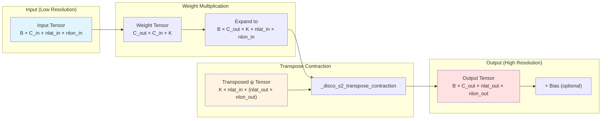
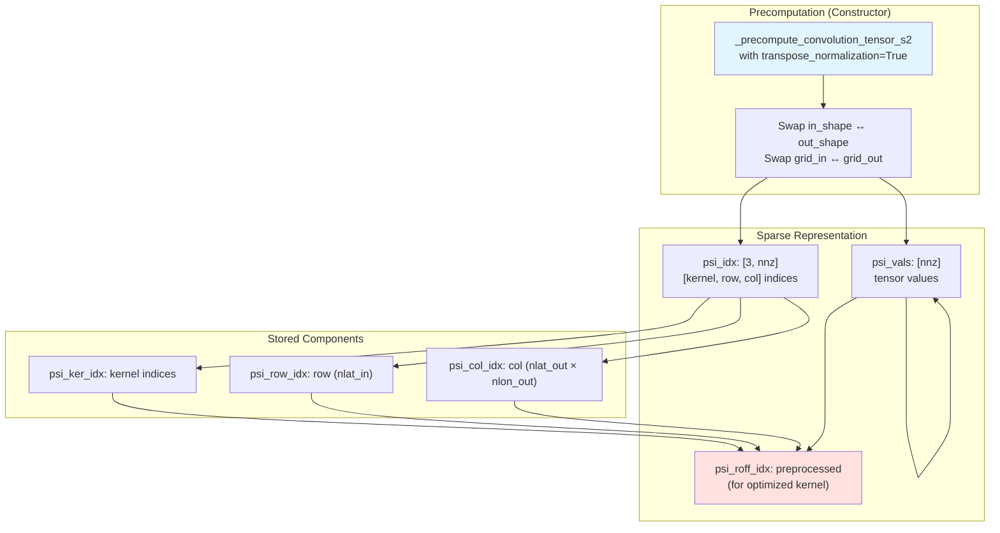
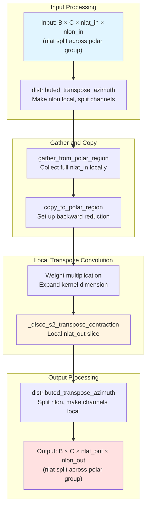
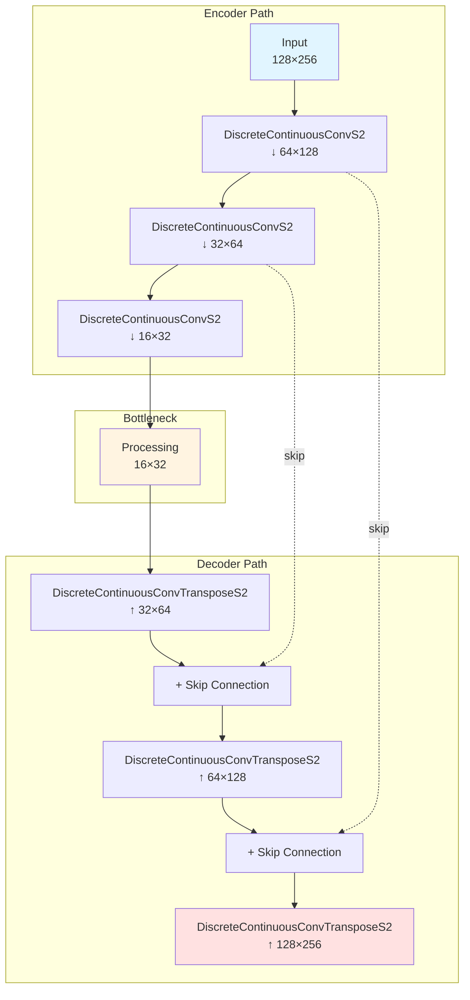
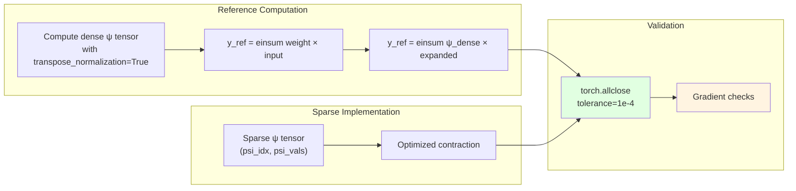

<!-- source: DeepWiki mcp.deepwiki.com · repo NVIDIA/torch-harmonics · page 3.3 Transpose Convolutions and Upsampling · fetched 2026-10-26 -->

# Transpose Convolutions and Upsampling

<details>
<summary>Relevant source files</summary>

The following files were used as context for generating this wiki page:

- [tests/test_convolution.py](tests/test_convolution.py)
- [torch_harmonics/distributed/distributed_convolution.py](torch_harmonics/distributed/distributed_convolution.py)

</details>


This page documents the transpose convolution operations in torch-harmonics, specifically `DiscreteContinuousConvTransposeS2` and `DistributedDiscreteContinuousConvTransposeS2`, which enable upsampling of spherical data for decoder architectures and generative models.

For information about regular DISCO convolutions (downsampling), see [DISCO Convolutions](#3). For general resampling operations, see [Resampling and Interpolation](#5).

## Overview

Transpose convolutions on the sphere serve as learnable upsampling operations that increase the spatial resolution of spherical data. They are the adjoint operation to regular DISCO convolutions and are essential for:

- **Decoder networks** in encoder-decoder architectures (e.g., U-Nets on the sphere)
- **Generative models** that synthesize high-resolution spherical data
- **Super-resolution tasks** for spherical images
- **Multi-scale processing** where features need to be upsampled and combined

Unlike bilinear interpolation or spectral resampling (see [ResampleS2](#5.1)), transpose convolutions learn optimal upsampling kernels through backpropagation, making them suitable for tasks where the upsampling pattern depends on the data distribution.

Sources: [tests/test_convolution.py:40](), [torch_harmonics/distributed/distributed_convolution.py:288-327]()

## Mathematical Formulation

### Regular vs Transpose Convolution

A regular DISCO convolution maps from input shape `(nlat_in, nlon_in)` to output shape `(nlat_out, nlon_out)` where typically `nlat_out ≤ nlat_in`:

```
y(θ_out, φ_out) = Σ_k w_k * ∫ ψ_k(θ_out, φ_out; θ_in, φ_in) x(θ_in, φ_in) dΩ_in
```

A transpose convolution reverses this directionality, mapping from `(nlat_in, nlon_in)` to `(nlat_out, nlon_out)` where typically `nlat_out ≥ nlat_in`:

```
y(θ_out, φ_out) = Σ_k w_k * ∫ ψ_k(θ_in, φ_in; θ_out, φ_out)^T x(θ_in, φ_in) dΩ_in
```

The key difference is that the convolution tensor `ψ` is transposed, effectively reversing the flow of information from low to high resolution.

### Normalization Differences

The transpose convolution uses `transpose_normalization=True` when computing the convolution tensor, which affects how quadrature weights are incorporated:

| Aspect | Regular Convolution | Transpose Convolution |
|--------|-------------------|---------------------|
| Input Resolution | Higher or equal | Lower or equal |
| Output Resolution | Lower or equal | Higher or equal |
| Quadrature Weights | Merged with input grid | Merged with output grid |
| Normalization Mode | Based on input dimension | Based on output dimension |
| Typical Use Case | Downsampling/encoding | Upsampling/decoding |

Sources: [tests/test_convolution.py:62-98](), [tests/test_convolution.py:269-279]()

### Transpose Convolution Data Flow



**Diagram: Transpose Convolution Forward Pass** - The weight multiplication happens first, creating an expanded feature tensor with kernel dimension K, which is then contracted with the transposed convolution tensor to produce high-resolution output.

Sources: [torch_harmonics/distributed/distributed_convolution.py:426-460]()

## DiscreteContinuousConvTransposeS2 Class

The `DiscreteContinuousConvTransposeS2` class implements transpose convolutions on the sphere. It shares the same interface as `DiscreteContinuousConvS2` but operates in the opposite resolution direction.

### Constructor Parameters

```python
DiscreteContinuousConvTransposeS2(
    in_channels: int,           # Number of input channels
    out_channels: int,          # Number of output channels
    in_shape: Tuple[int],       # (nlat_in, nlon_in) - input resolution
    out_shape: Tuple[int],      # (nlat_out, nlon_out) - output resolution
    kernel_shape: Union[int, Tuple[int], Tuple[int, int]],
    basis_type: str = "piecewise linear",
    basis_norm_mode: str = "mean",
    groups: int = 1,
    grid_in: str = "equiangular",
    grid_out: str = "equiangular",
    bias: bool = True,
    theta_cutoff: Optional[float] = None,
    optimized_kernel: bool = True
)
```

### Key Parameter Notes

| Parameter | Description for Transpose Convolution |
|-----------|-------------------------------------|
| `in_shape` | Lower resolution input (e.g., 16×32) |
| `out_shape` | Higher resolution output (e.g., 32×64) |
| `theta_cutoff` | Defaults to `π / (nlat_in - 1)` (note: based on input, not output) |
| `basis_type` | Same options as regular convolution: "piecewise linear", "morlet", "zernike" |
| `basis_norm_mode` | "individual", "mean", or "none" - affects transpose normalization |

Sources: [tests/test_convolution.py:249-264](), [tests/test_convolution.py:201-213]()

### Internal Tensor Structure

The class precomputes and stores the transposed convolution tensor in sparse format:



**Diagram: Transpose Convolution Tensor Storage** - The convolution tensor is computed with swapped dimensions and stored in sparse COO format with optional preprocessing for optimized kernels.

Sources: [tests/test_convolution.py:268-283]()

### Forward Pass Implementation

The forward pass differs from regular convolution in the order of operations:

1. **Weight Multiplication First**: `x` is multiplied with weights to expand kernel dimension
2. **Transpose Contraction**: The expanded tensor is contracted with transposed `ψ`
3. **Bias Addition**: Optional bias is added to output

This order ensures proper gradient flow for the adjoint operation.

Sources: [torch_harmonics/distributed/distributed_convolution.py:426-460]()

## Distributed Implementation

### DistributedDiscreteContinuousConvTransposeS2

The distributed version partitions transpose convolutions across a 2D process grid with polar and azimuthal splitting:



**Diagram: Distributed Transpose Convolution Data Flow** - The forward pass gathers input latitudes, performs local transpose contraction, then redistributes the output.

Sources: [torch_harmonics/distributed/distributed_convolution.py:426-460]()

### Communication Patterns

The distributed transpose convolution uses different communication primitives than regular convolution:

| Operation | Regular Convolution | Transpose Convolution |
|-----------|-------------------|---------------------|
| Before contraction | `reduce_from_polar_region` + `scatter_to_polar_region` | `gather_from_polar_region` + `copy_to_polar_region` |
| After contraction | Transpose azimuth | Transpose azimuth |
| Latitude dimension | Input is split, output is reduced | Input is gathered, output is split |
| Gradient flow | Scatter in forward, gather in backward | Gather in forward, scatter in backward |

This asymmetry ensures that the distributed transpose convolution is truly the adjoint of the distributed regular convolution.

Sources: [torch_harmonics/distributed/distributed_convolution.py:442-443](), [torch_harmonics/distributed/distributed_convolution.py:265-267]()

### Tensor Splitting

The distributed transpose convolution splits the precomputed `ψ` tensor differently:

```python
# For transpose convolution, split based on OUTPUT latitude
# (which corresponds to input in the swapped formulation)
idx, vals = _split_distributed_convolution_tensor_s2(
    idx, vals, 
    out_shape,  # Note: swapped
    in_shape    # Note: swapped
)
```

This ensures each process only stores convolution tensor entries needed for its local output latitude slice.

Sources: [torch_harmonics/distributed/distributed_convolution.py:394-396](), [torch_harmonics/distributed/distributed_convolution.py:58-112]()

## Usage Patterns

### Basic Upsampling

```python
# Create transpose convolution for 2× upsampling
transpose_conv = DiscreteContinuousConvTransposeS2(
    in_channels=32,
    out_channels=16,
    in_shape=(64, 128),      # Low resolution
    out_shape=(128, 256),    # High resolution (2× upsampling)
    kernel_shape=3,
    basis_type="piecewise linear",
    grid_in="equiangular",
    grid_out="equiangular"
)

# Input: batch_size × 32 × 64 × 128
# Output: batch_size × 16 × 128 × 256
output = transpose_conv(input)
```

### Encoder-Decoder Architecture

Transpose convolutions are typically used in decoder paths paired with regular convolutions in encoder paths:



**Diagram: Encoder-Decoder with Transpose Convolutions** - Regular convolutions downsample in the encoder, transpose convolutions upsample in the decoder, with skip connections preserving spatial information.

Sources: [tests/test_convolution.py:201-213]()

### Asymmetric Resolution Changes

Transpose convolutions support asymmetric resolution changes (different scaling in latitude and longitude):

| Configuration | Input Shape | Output Shape | Use Case |
|--------------|-------------|--------------|----------|
| 2× uniform | (32, 64) | (64, 128) | Standard upsampling |
| Latitude only | (32, 64) | (64, 64) | Increase latitude resolution |
| Longitude only | (32, 64) | (32, 128) | Increase longitude resolution |
| Asymmetric | (32, 64) | (48, 96) | Non-power-of-2 upsampling |

Sources: [tests/test_convolution.py:204-210]()

### Filter Basis Selection

Different filter basis types affect upsampling characteristics:

```python
# Piecewise linear: smooth, localized upsampling
transpose_conv_pwl = DiscreteContinuousConvTransposeS2(
    ..., kernel_shape=3, basis_type="piecewise linear"
)

# Morlet wavelets: multi-scale, orientation-selective
transpose_conv_morlet = DiscreteContinuousConvTransposeS2(
    ..., kernel_shape=(2, 2), basis_type="morlet"
)

# Zernike polynomials: radially symmetric, smooth
transpose_conv_zernike = DiscreteContinuousConvTransposeS2(
    ..., kernel_shape=3, basis_type="zernike"
)
```

For details on filter basis properties, see [Filter Basis Functions](#3.2).

Sources: [tests/test_convolution.py:206-208](), [tests/test_convolution.py:350-356]()

## Implementation Details

### Optimized Kernels

The transpose convolution supports two backends:

1. **Optimized kernels** (`optimized_kernel=True`): Uses `_disco_s2_transpose_contraction_optimized` with preprocessed sparse structure (`psi_roff_idx`) for efficient GPU execution
2. **PyTorch fallback** (`optimized_kernel=False`): Uses `_disco_s2_transpose_contraction_torch` with standard sparse tensors

The optimized version requires custom CUDA extensions and provides significant performance improvements.

Sources: [torch_harmonics/distributed/distributed_convolution.py:445-450]()

### Gradient Computation

The transpose convolution's backward pass becomes a regular convolution:

```
∂L/∂x = DiscreteContinuousConvS2(∂L/∂y)
∂L/∂w = contraction(x, ψ, ∂L/∂y)
```

This duality ensures efficient training of encoder-decoder networks where gradients flow through both convolution types.

Sources: [tests/test_convolution.py:310-334]()

### Testing and Validation

The test suite validates transpose convolutions against dense reference implementations:



**Diagram: Transpose Convolution Testing Strategy** - Sparse implementation is validated against dense reference with gradient checks.

Sources: [tests/test_convolution.py:268-334](), [tests/test_convolution.py:361-450]()

### Performance Considerations

Performance benchmarks for transpose convolutions show:

- **Forward pass**: ~2ms on GPU (V100) for 91×180 grid, batch size 8
- **Backward pass**: ~3ms on GPU (V100) for the same configuration
- **CPU performance**: ~100ms forward, ~90ms backward (16 OpenMP threads)

Optimized kernels provide 10-50× speedup over PyTorch fallback depending on sparsity.

Sources: [tests/test_convolution.py:53-59](), [tests/test_convolution.py:603-689]()

## Summary

`DiscreteContinuousConvTransposeS2` and its distributed variant `DistributedDiscreteContinuousConvTransposeS2` provide learnable upsampling operations for spherical data:

- **Purpose**: Increase spatial resolution through learned kernels
- **Relationship**: Adjoint operation to regular DISCO convolutions
- **Key difference**: Weight multiplication before contraction, transposed ψ tensor
- **Typical use**: Decoder networks, generative models, super-resolution
- **Distributed**: Gathers input latitudes, computes locally, redistributes output
- **Performance**: Optimized CUDA kernels provide efficient GPU execution

For complete API details, see [torch_harmonics.convolution](#11.2). For distributed communication primitives, see [Communication Primitives](#6.3).

---

