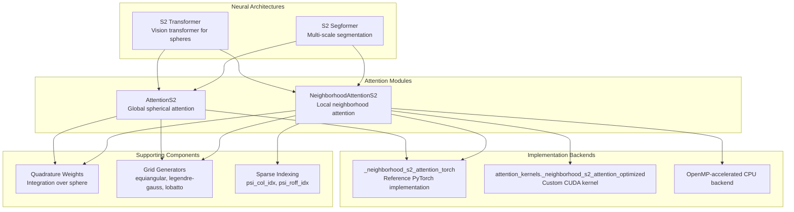
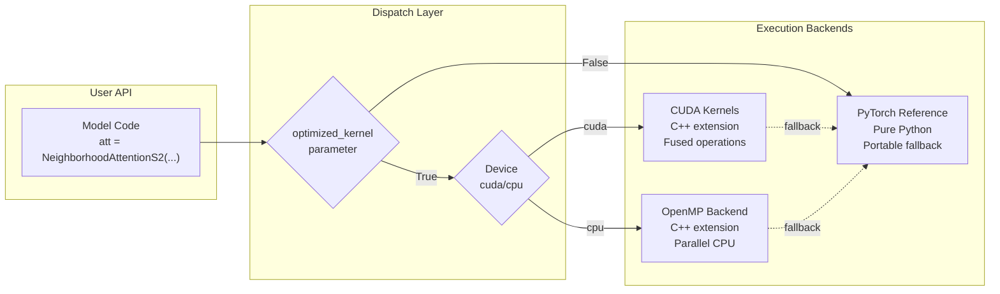
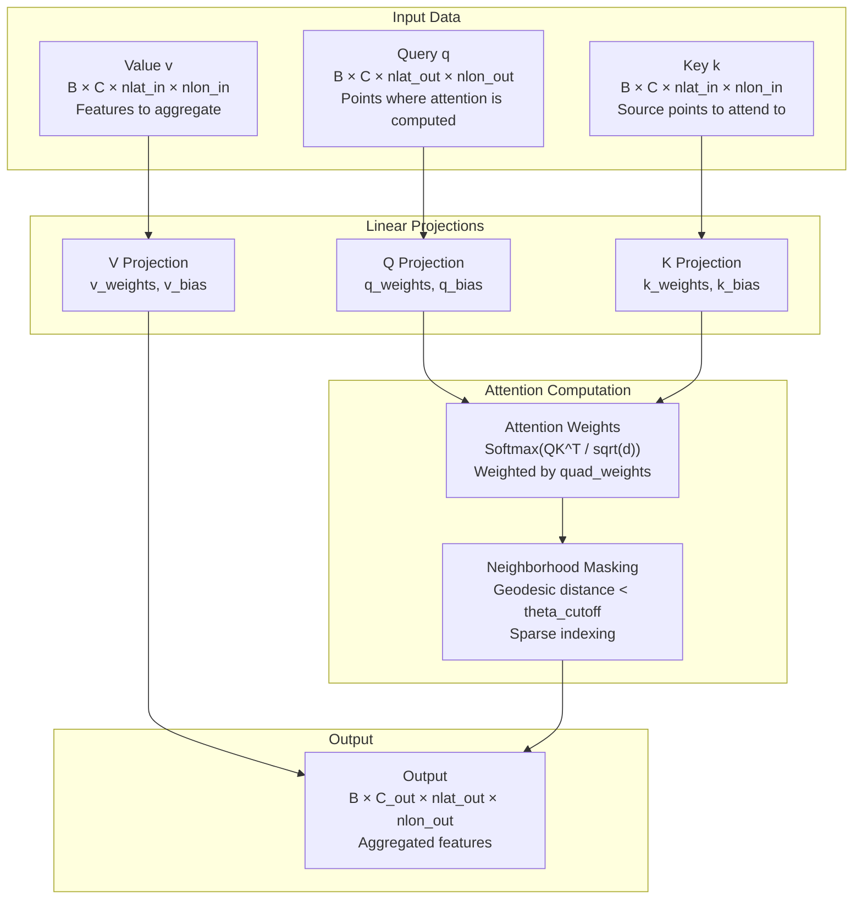
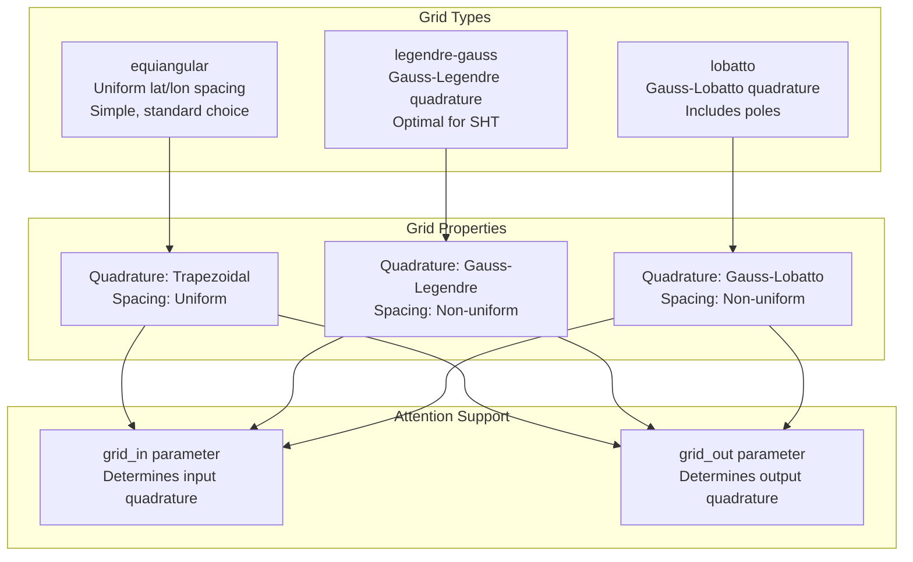
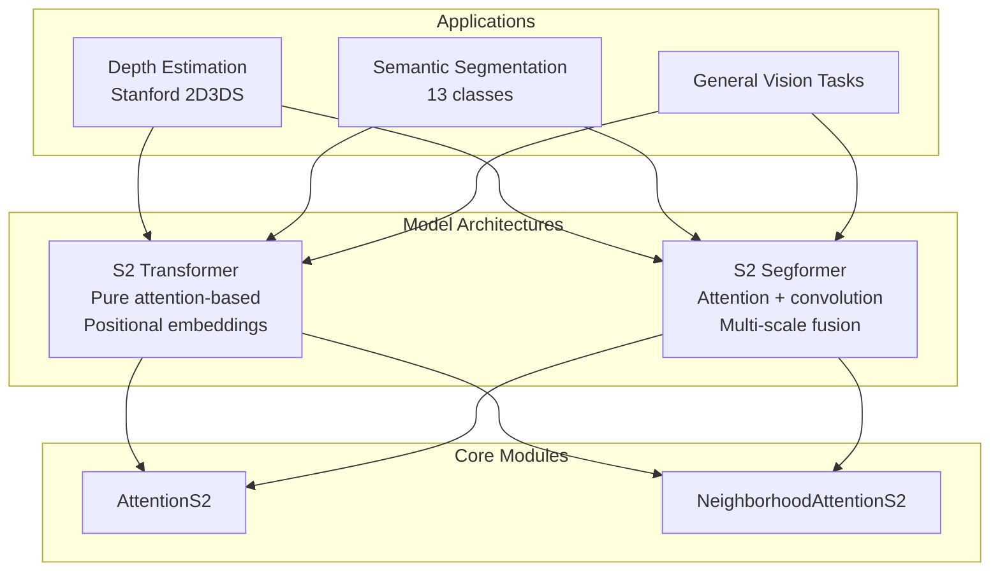

<!-- source: DeepWiki mcp.deepwiki.com · repo NVIDIA/torch-harmonics · page 4 Spherical Attention Mechanisms · fetched 2026-10-26 -->

# Spherical Attention Mechanisms

<details>
<summary>Relevant source files</summary>

The following files were used as context for generating this wiki page:

- [Dockerfile.examples](Dockerfile.examples)
- [tests/test_attention.py](tests/test_attention.py)
- [torch_harmonics/plotting.py](torch_harmonics/plotting.py)

</details>


## Purpose and Scope

This page provides an overview of attention mechanisms adapted for spherical geometry in torch-harmonics. It introduces the core concepts, architectural design, and implementation strategies for processing spherical data using attention-based operations. For detailed documentation of specific attention modules, see [AttentionS2 (Global)](#4.1) and [NeighborhoodAttentionS2](#4.2).

For alternative approaches to processing spherical data, see [DISCO Convolutions](#3) for local convolution operations and [Spherical Harmonic Transforms](#2) for global spectral methods.

---

## Overview

Spherical attention mechanisms enable transformer-like architectures to operate on data defined on the sphere (e.g., omnidirectional images, global climate data, planetary observations). Unlike standard 2D attention which assumes planar geometry, spherical attention accounts for the non-Euclidean geometry of the sphere, including:

- **Geodesic distances** rather than Euclidean distances for measuring proximity
- **Spherical grids** (equiangular, Legendre-Gauss, Lobatto) with non-uniform spacing
- **Polar singularities** at the north and south poles requiring special handling
- **Quadrature weights** for proper integration over the sphere

torch-harmonics provides two attention variants:

| Module | Scope | Use Case |
|--------|-------|----------|
| `AttentionS2` | Global | Full self-attention across entire sphere, suitable for tasks requiring global context |
| `NeighborhoodAttentionS2` | Local | Attention restricted to geodesic neighborhoods, reduces computational cost for high-resolution data |

Sources: [tests/test_attention.py:42-44](), [tests/test_attention.py:250-254]()

---

## Architecture and Key Classes

### Class Hierarchy



**Diagram: Attention Module Architecture and Dependencies**

Sources: [tests/test_attention.py:42-44](), [tests/test_attention.py:105-108](), [tests/test_attention.py:314-318]()

---

### Core Parameters

Both attention classes share a common parameter interface:

| Parameter | Type | Description |
|-----------|------|-------------|
| `in_channels` | int | Number of input feature channels |
| `out_channels` | int | Number of output feature channels (defaults to `in_channels`) |
| `num_heads` | int | Number of attention heads for multi-head attention |
| `in_shape` | tuple | Input spatial shape `(nlat_in, nlon_in)` |
| `out_shape` | tuple | Output spatial shape `(nlat_out, nlon_out)` |
| `grid_in` | str | Input grid type: `"equiangular"`, `"legendre-gauss"`, or `"lobatto"` |
| `grid_out` | str | Output grid type: `"equiangular"`, `"legendre-gauss"`, or `"lobatto"` |
| `bias` | bool | Whether to include bias terms in linear projections |
| `theta_cutoff` | float | (NeighborhoodAttentionS2 only) Maximum geodesic distance for neighborhood, in radians |
| `optimized_kernel` | bool | Whether to use optimized CUDA/OpenMP kernels (defaults to `True`) |

Sources: [tests/test_attention.py:73-83](), [tests/test_attention.py:105](), [tests/test_attention.py:173-175]()

---

## Implementation Strategies

### Multi-Backend Architecture



**Diagram: Multi-Backend Execution Strategy**

The library employs a three-tier backend strategy:

1. **CUDA kernels** ([tests/test_attention.py:90-91]()): Custom fused kernels for GPU execution
   - Kernel operation: `torch.ops.attention_kernels._neighborhood_s2_attention_optimized`
   - Enables efficient attention computation for large spherical grids
   - Availability checked via `cuda_kernels_is_available()` function

2. **OpenMP CPU backend**: Parallelized CPU implementation for multi-core processors
   - Used when CUDA is unavailable or explicitly disabled
   - Enables efficient CPU execution with thread-level parallelism

3. **PyTorch reference** ([tests/test_attention.py:43]()): Pure Python implementation
   - Function: `_neighborhood_s2_attention_torch`
   - Provides portable fallback and numerical reference for validation
   - Used for testing and when optimized backends are unavailable

Sources: [tests/test_attention.py:44](), [tests/test_attention.py:86-91](), [tests/test_attention.py:314-320]()

---

## Attention Mechanism Details

### Query-Key-Value Pattern

Spherical attention follows the standard transformer attention pattern with spherical adaptations:



**Diagram: Attention Computation Flow**

Key spherical adaptations:

- **Quadrature weights**: Each spatial location has an associated quadrature weight for proper spherical integration ([tests/test_attention.py:317]())
- **Sparse indexing**: Neighborhood attention uses sparse indexing (`psi_col_idx`, `psi_roff_idx`) to efficiently represent local neighborhoods ([tests/test_attention.py:317]())
- **Multi-head support**: Features are split across `num_heads` attention heads ([tests/test_attention.py:76-78]())

Sources: [tests/test_attention.py:98-101](), [tests/test_attention.py:314-318]()

---

## Global vs. Neighborhood Attention

### Computational Complexity

| Attention Type | Complexity | Memory | Best For |
|----------------|-----------|--------|----------|
| Global (`AttentionS2`) | O(n² × h × d) | O(n²) | Low to medium resolution (≤128×256), tasks requiring global context |
| Neighborhood (`NeighborhoodAttentionS2`) | O(n × k × h × d) | O(n × k) | High resolution (>256×512), local feature extraction |

Where:
- n = total spatial positions (nlat × nlon)
- h = number of heads
- d = feature dimension per head
- k = average neighborhood size (controlled by `theta_cutoff`)

### Equivalence Property

Neighborhood attention with `theta_cutoff = 2 * π` (full sphere) is mathematically equivalent to global attention:

```python
# These produce equivalent results
att_global = AttentionS2(in_channels=64, num_heads=4, in_shape=(128, 256))
att_neighborhood = NeighborhoodAttentionS2(
    in_channels=64, num_heads=4, in_shape=(128, 256), 
    theta_cutoff=2 * torch.pi  # Full sphere
)
```

This equivalence is verified in the test suite at [tests/test_attention.py:232-286]().

Sources: [tests/test_attention.py:173-175](), [tests/test_attention.py:232-286]()

---

## Grid Support and Resampling

### Supported Grid Types

All attention modules support three spherical grid types:



**Diagram: Grid Type Support**

Attention can resample between different grid types when `grid_in ≠ grid_out`. This enables:
- Interfacing between different model components
- Adapting to data in different formats
- Optimizing computation for specific operations

Sources: [tests/test_attention.py:74-82]()

---

## Performance Characteristics

### Benchmarks and Thresholds

The library includes performance regression tests with defined thresholds:

| Device | Forward Pass | Backward Pass | Test Configuration |
|--------|-------------|---------------|-------------------|
| CPU (16 threads) | ≤1000 ms | ≤8000 ms | 1×256, 91×180, 1 head |
| GPU (V100 16GB) | ≤50 ms | ≤150 ms | 1×256, 91×180, 1 head |

Performance testing is enabled via environment variable:
```bash
export TORCH_HARMONICS_RUN_PERF_TESTS=1
```

Sources: [tests/test_attention.py:53-59](), [tests/test_attention.py:329-404]()

### Optimization Techniques

The optimized kernels employ several techniques:

1. **Fused operations**: Q/K/V projections and attention computation fused into single kernel
2. **Sparse computation**: Only compute attention for valid neighborhoods (NeighborhoodAttentionS2)
3. **Memory coalescing**: Optimized memory access patterns for GPU efficiency
4. **Thread-level parallelism**: OpenMP parallelization for CPU backend

Sources: [tests/test_attention.py:333-404]()

---

## Usage Patterns

### Basic Self-Attention

```python
from torch_harmonics import NeighborhoodAttentionS2

# Create attention module
att = NeighborhoodAttentionS2(
    in_channels=64,
    num_heads=4,
    in_shape=(128, 256),    # Input resolution
    out_shape=(128, 256),   # Output resolution (same for self-attention)
    grid_in="equiangular",
    grid_out="equiangular",
    theta_cutoff=torch.pi / 4,  # 45-degree neighborhood radius
)

# Apply attention (self-attention: q, k, v from same source)
x = torch.randn(4, 64, 128, 256)  # Batch × Channels × Lat × Lon
output = att(q=x, k=x, v=x)       # Same shape as input
```

### Cross-Attention with Different Resolutions

```python
# Query at high resolution, attend to low-resolution context
att = NeighborhoodAttentionS2(
    in_channels=64,
    out_channels=128,
    num_heads=8,
    in_shape=(64, 128),     # Low-res key/value
    out_shape=(256, 512),   # High-res query
    grid_in="equiangular",
    grid_out="equiangular",
)

k_v = torch.randn(4, 64, 64, 128)      # Context features
q = torch.randn(4, 64, 256, 512)       # Query features
output = att(q=q, k=k_v, v=k_v)        # Shape: (4, 128, 256, 512)
```

Sources: [tests/test_attention.py:98-101](), [tests/test_attention.py:116]()

---

## Validation and Testing

### Test Coverage

The test suite validates multiple aspects:

| Test Category | Purpose | File Reference |
|--------------|---------|----------------|
| Custom vs Reference | Numerical equivalence between optimized and reference implementations | [tests/test_attention.py:87-143]() |
| Device Equivalence | CPU vs CUDA consistency | [tests/test_attention.py:154-218]() |
| Global-Neighborhood | Mathematical equivalence when theta_cutoff=2π | [tests/test_attention.py:232-286]() |
| PyTorch 2.0 Compatibility | Integration with torch.compile and operator registration | [tests/test_attention.py:295-324]() |
| Performance Regression | Ensure optimizations maintain performance targets | [tests/test_attention.py:334-404]() |

### Gradient Checking

Both forward and backward passes are validated:
- Input gradients (∂L/∂q, ∂L/∂k, ∂L/∂v)
- Parameter gradients (∂L/∂weights, ∂L/∂biases)
- Numerical tolerances: atol=1e-5, rtol=1e-3 for most tests

Sources: [tests/test_attention.py:124-143](), [tests/test_attention.py:200-218]()

---

## Integration with Neural Architectures

Spherical attention is the foundation for transformer-based architectures:



**Diagram: Attention Integration in Neural Architectures**

For detailed documentation on these architectures, see [S2 Transformer and Segformer](#7.3).

Sources: Architecture diagrams from system overview

---

## Environment Configuration

### Enabling Optimized Kernels

Optimized kernels are controlled during build and runtime:

**Build-time configuration:**
```bash
# Force building CUDA extensions
export FORCE_CUDA_EXTENSION=1

# Enable OpenMP backend
export TORCH_HARMONICS_ENABLE_OPENMP=1

# Target specific GPU architectures
export TORCH_CUDA_ARCH_LIST="7.0 7.5 8.0 8.6 9.0"
```

**Runtime checking:**
```python
from torch_harmonics.attention import (
    cuda_kernels_is_available,
    optimized_kernels_is_available
)

print(f"CUDA kernels available: {cuda_kernels_is_available()}")
print(f"Optimized kernels available: {optimized_kernels_is_available()}")
```

Sources: [tests/test_attention.py:44](), [tests/test_attention.py:46-47](), [Dockerfile.examples:58-60]()

---

## Relationship to Other Components

Spherical attention complements other torch-harmonics components:

| Component | Relationship | Use Together For |
|-----------|-------------|------------------|
| **DISCO Convolutions** | Alternative local operation | Hybrid models combining local convolution and attention (e.g., S2 Segformer) |
| **Spherical Transforms** | Global spectral operation | Preprocessing or feature extraction before attention, or as alternative global operator |
| **Resampling** | Enables resolution changes | Multi-scale architectures with attention at different resolutions |
| **Distributed Computing** | Scalability layer | Large-scale training on high-resolution spherical data (future work) |

For DISCO convolutions, see [DISCO Convolutions](#3). For spherical transforms, see [Spherical Harmonic Transforms](#2).

Sources: System architecture diagrams

---

## Next Steps

For detailed usage of specific attention modules:
- **Global attention**: See [AttentionS2 (Global)](#4.1)
- **Neighborhood attention**: See [NeighborhoodAttentionS2](#4.2)

For example applications:
- **Vision tasks**: See [S2 Transformer and Segformer](#7.3)
- **Depth estimation**: See [Depth Estimation on 2D3DS](#8.1)
- **Segmentation**: See [Semantic Segmentation on 2D3DS](#8.2)

For performance optimization:
- **Backend details**: See [Optimization Backends](#9.1)
- **CUDA extensions**: See [Custom CUDA Extensions](#9.3)

---

