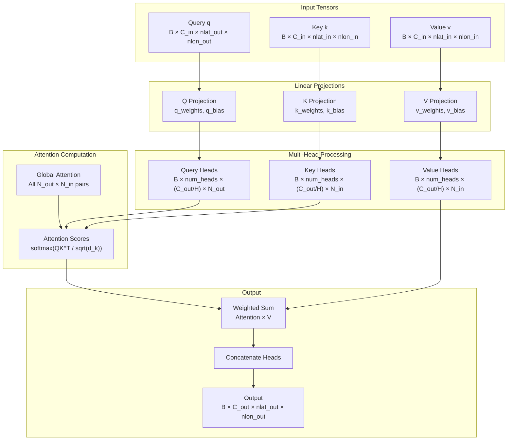
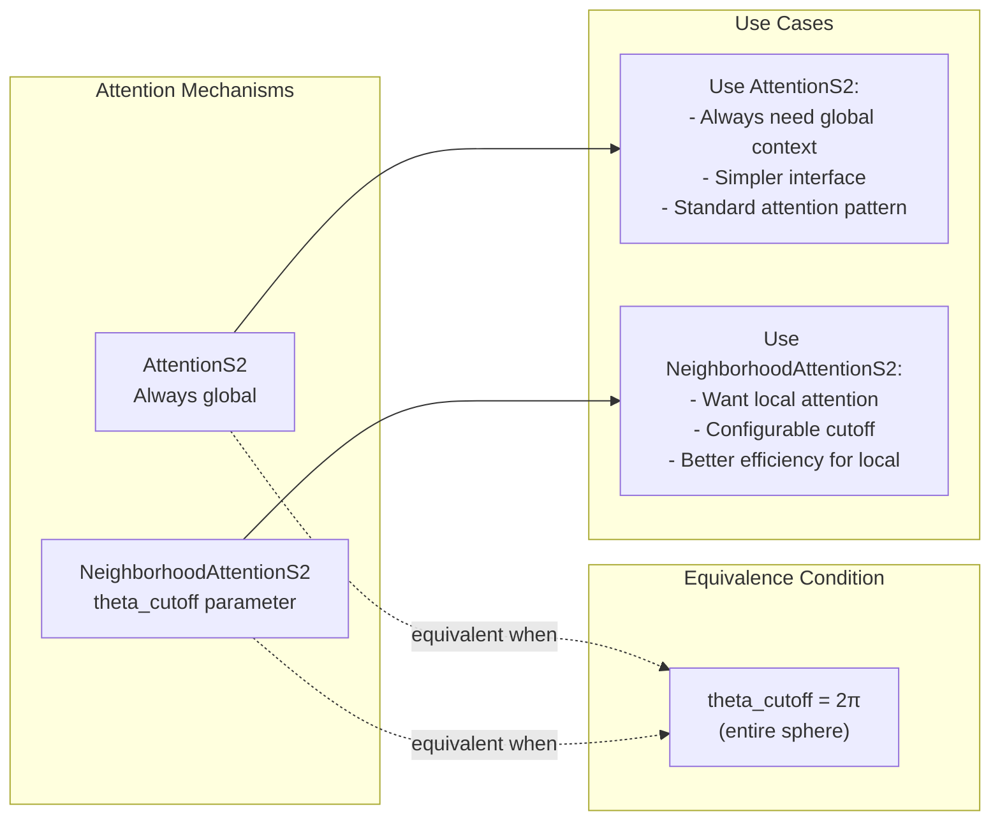
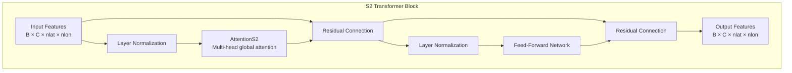
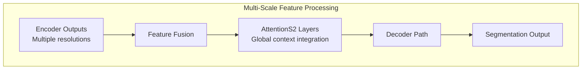
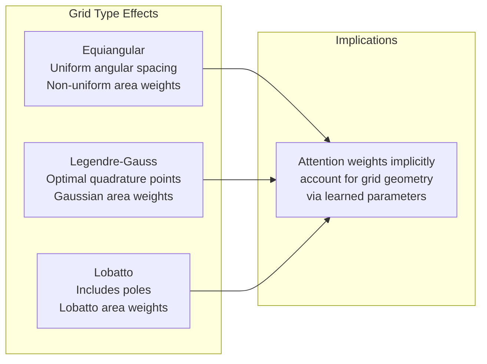

<!-- source: DeepWiki mcp.deepwiki.com · repo NVIDIA/torch-harmonics · page 4.1 AttentionS2 (Global) · fetched 2026-10-26 -->

# AttentionS2 (Global)

<details>
<summary>Relevant source files</summary>

The following files were used as context for generating this wiki page:

- [Dockerfile.examples](Dockerfile.examples)
- [tests/test_attention.py](tests/test_attention.py)
- [torch_harmonics/plotting.py](torch_harmonics/plotting.py)

</details>


## Purpose and Scope

`AttentionS2` implements **global spherical attention** that allows each query point on the sphere to attend to all key-value points across the entire spherical surface. This module adapts the standard multi-head attention mechanism to spherical geometry, accounting for the curved manifold structure of the sphere.

For **localized attention** with geodesic distance-based neighborhoods, see [NeighborhoodAttentionS2](#4.2). For broader context on spherical attention mechanisms, see [Spherical Attention Mechanisms](#4).

## Overview

`AttentionS2` computes attention weights based on queries, keys, and values defined on spherical grids. Unlike `NeighborhoodAttentionS2` which restricts attention to local neighborhoods (controlled by `theta_cutoff`), `AttentionS2` performs full global attention where every query location can attend to every key location on the sphere.

The module supports:
- Multi-head attention with configurable number of heads
- Different input and output resolutions and shapes
- Multiple grid types (equiangular, Legendre-Gauss, Lobatto)
- Optional bias terms
- Automatic handling of spherical geometry

**Sources:** [tests/test_attention.py:232-286]()

## Architecture

### Attention Mechanism Flow



**Sources:** [tests/test_attention.py:250-264](), [tests/test_attention.py:282-285]()

### Key Components

| Component | Type | Description |
|-----------|------|-------------|
| `q_weights` | Parameter | Linear projection weights for queries (C_in → C_out) |
| `k_weights` | Parameter | Linear projection weights for keys (C_in → C_out) |
| `v_weights` | Parameter | Linear projection weights for values (C_in → C_out) |
| `q_bias` | Parameter (optional) | Bias term for query projection |
| `k_bias` | Parameter (optional) | Bias term for key projection |
| `v_bias` | Parameter (optional) | Bias term for value projection |
| `num_heads` | Config | Number of attention heads |
| `in_shape` | Config | Input grid shape (nlat_in, nlon_in) |
| `out_shape` | Config | Output grid shape (nlat_out, nlon_out) |

**Sources:** [tests/test_attention.py:282-285](), [tests/test_attention.py:250]()

## Parameters

### Constructor Arguments

```python
AttentionS2(
    in_channels: int,
    out_channels: int,
    num_heads: int,
    in_shape: Tuple[int, int],
    out_shape: Tuple[int, int],
    grid_in: str = "equiangular",
    grid_out: str = "equiangular",
    bias: bool = True
)
```

| Parameter | Type | Description | Default |
|-----------|------|-------------|---------|
| `in_channels` | int | Number of input channels | Required |
| `out_channels` | int | Number of output channels | Required |
| `num_heads` | int | Number of attention heads (must divide `out_channels`) | Required |
| `in_shape` | Tuple[int, int] | Input grid shape (nlat_in, nlon_in) | Required |
| `out_shape` | Tuple[int, int] | Output grid shape (nlat_out, nlon_out) | Required |
| `grid_in` | str | Input grid type: "equiangular", "legendre-gauss", or "lobatto" | "equiangular" |
| `grid_out` | str | Output grid type: "equiangular", "legendre-gauss", or "lobatto" | "equiangular" |
| `bias` | bool | Whether to include bias terms in projections | True |

**Sources:** [tests/test_attention.py:74-83](), [tests/test_attention.py:250]()

### Grid Type Compatibility

`AttentionS2` supports all combinations of input and output grid types:

| Grid Type | Description | Use Case |
|-----------|-------------|----------|
| `equiangular` | Uniform spacing in latitude/longitude | Most common, easy visualization |
| `legendre-gauss` | Gaussian quadrature points | Exact integration for spherical harmonics |
| `lobatto` | Lobatto quadrature points | Includes poles explicitly |

**Sources:** [tests/test_attention.py:74-83]()

## Usage

### Basic Self-Attention

```python
from torch_harmonics import AttentionS2
import torch

# Configuration
batch_size = 4
in_channels = 64
out_channels = 64
num_heads = 8
nlat, nlon = 128, 256

# Create attention module
attention = AttentionS2(
    in_channels=in_channels,
    out_channels=out_channels,
    num_heads=num_heads,
    in_shape=(nlat, nlon),
    out_shape=(nlat, nlon),
    grid_in="equiangular",
    grid_out="equiangular",
    bias=True
)

# Input tensors (self-attention uses same tensor for Q, K, V)
x = torch.randn(batch_size, in_channels, nlat, nlon)

# Forward pass
output = attention(q=x, k=x, v=x)  # Shape: (4, 64, 128, 256)
```

**Sources:** [tests/test_attention.py:250]()

### Cross-Resolution Attention

```python
# Different input and output resolutions
attention = AttentionS2(
    in_channels=64,
    out_channels=128,
    num_heads=4,
    in_shape=(64, 128),   # Lower resolution input
    out_shape=(128, 256),  # Higher resolution output
    grid_in="equiangular",
    grid_out="equiangular"
)

# Inputs at different resolutions
k = torch.randn(batch_size, 64, 64, 128)    # Keys at lower res
v = torch.randn(batch_size, 64, 64, 128)    # Values at lower res
q = torch.randn(batch_size, 64, 128, 256)   # Queries at higher res

# Output will be at query resolution
output = attention(q=q, k=k, v=v)  # Shape: (batch_size, 128, 128, 256)
```

**Sources:** [tests/test_attention.py:74-83]()

### Multi-Head Configuration

```python
# Single head
attention_1h = AttentionS2(
    in_channels=64,
    out_channels=64,
    num_heads=1,
    in_shape=(128, 256),
    out_shape=(128, 256)
)

# Multiple heads (out_channels must be divisible by num_heads)
attention_8h = AttentionS2(
    in_channels=64,
    out_channels=64,
    num_heads=8,  # Each head has 64/8 = 8 channels
    in_shape=(128, 256),
    out_shape=(128, 256)
)
```

**Sources:** [tests/test_attention.py:74-79]()

## Relationship to NeighborhoodAttentionS2

`AttentionS2` is mathematically equivalent to `NeighborhoodAttentionS2` when the neighborhood covers the entire sphere (`theta_cutoff=2*pi`):



**Verification:** The test suite explicitly validates this equivalence in the `test_neighborhood_global_equivalence` test, which confirms that both modules produce identical outputs (within numerical tolerance) when `NeighborhoodAttentionS2` uses `theta_cutoff=2*pi`.

**Sources:** [tests/test_attention.py:232-286]()

### Choosing Between Global and Neighborhood Attention

| Criterion | Use `AttentionS2` | Use `NeighborhoodAttentionS2` |
|-----------|-------------------|------------------------------|
| **Context needs** | Always need global context | Variable local/global context |
| **Computational cost** | O(N²) attention (all pairs) | O(N·k) where k depends on theta_cutoff |
| **Parameter control** | Fixed global behavior | Tunable locality via theta_cutoff |
| **Simplicity** | Simpler interface | More configuration options |
| **Optimization** | Standard attention kernels | Custom geodesic-aware kernels |

**Sources:** [tests/test_attention.py:232-286]()

## Integration with Neural Architectures

### S2 Transformer Usage

`AttentionS2` is used in transformer-based architectures for spherical vision tasks:



**Sources:** High-level Diagram 5 (S2 Transformer uses AttentionS2)

### S2 Segformer Usage

In segmentation architectures, `AttentionS2` is combined with other operations:



**Sources:** High-level Diagram 5 (S2 Segformer uses attention components)

## Computational Characteristics

### Forward Pass Complexity

| Aspect | Complexity | Notes |
|--------|-----------|-------|
| Attention matrix | O(B × H × N_out × N_in) | Full pairwise attention |
| Memory | O(B × H × N_out × N_in) | Attention scores storage |
| Linear projections | O(B × C × N × (C_in + C_out)) | Q, K, V projections |

Where:
- B = batch size
- H = num_heads
- N_in = nlat_in × nlon_in
- N_out = nlat_out × nlon_out
- C = channels

**Sources:** [tests/test_attention.py:250-264]()

### Grid Type Considerations

Different grid types affect the geometric interpretation of attention:



**Sources:** [tests/test_attention.py:74-83]()

## Testing and Validation

### Test Coverage

The test suite validates `AttentionS2` through multiple dimensions:

| Test Type | Purpose | Location |
|-----------|---------|----------|
| Equivalence with NeighborhoodAttentionS2 | Validates that global case works correctly | [tests/test_attention.py:232-286]() |
| Multiple grid types | Tests equiangular, Legendre-Gauss, Lobatto | [tests/test_attention.py:224-229]() |
| Various channel configurations | Tests different in/out channel combinations | [tests/test_attention.py:224-229]() |
| Gradient correctness | Validates backward pass | [tests/test_attention.py:270-285]() |

**Sources:** [tests/test_attention.py:221-286]()

### Numerical Tolerances

The test suite uses the following tolerances for validation:

```python
atol = 1e-2  # Absolute tolerance
rtol = 0     # Relative tolerance (not used)
```

These tolerances account for numerical differences between implementations while ensuring correctness.

**Sources:** [tests/test_attention.py:224]()

## Implementation Details

### Forward Pass Signature

```python
def forward(
    self,
    q: torch.Tensor,  # Query:  (B, C_in, nlat_out, nlon_out)
    k: torch.Tensor,  # Key:    (B, C_in, nlat_in, nlon_in)
    v: torch.Tensor,  # Value:  (B, C_in, nlat_in, nlon_in)
) -> torch.Tensor:    # Output: (B, C_out, nlat_out, nlon_out)
```

**Input Requirements:**
- All tensors must have the same batch size (B)
- `k` and `v` must have the same spatial dimensions (nlat_in, nlon_in)
- `q`, `k`, `v` must all have `in_channels` channels
- All tensors must be on the same device

**Output:**
- Same batch size as inputs
- `out_channels` channels
- Spatial dimensions match `out_shape` (nlat_out, nlon_out)

**Sources:** [tests/test_attention.py:264]()

### Parameter Initialization

The module initializes learnable parameters for Q, K, V projections:

```python
# Typical parameter shapes
q_weights: (out_channels, in_channels)
k_weights: (out_channels, in_channels)
v_weights: (out_channels, in_channels)

# Optional bias terms (if bias=True)
q_bias: (out_channels,)
k_bias: (out_channels,)
v_bias: (out_channels,)
```

**Sources:** [tests/test_attention.py:282-285]()

## Common Usage Patterns

### Pattern 1: Self-Attention Block

```python
class SelfAttentionBlock(nn.Module):
    def __init__(self, channels, num_heads, shape, grid="equiangular"):
        super().__init__()
        self.norm = nn.LayerNorm(channels)
        self.attention = AttentionS2(
            in_channels=channels,
            out_channels=channels,
            num_heads=num_heads,
            in_shape=shape,
            out_shape=shape,
            grid_in=grid,
            grid_out=grid
        )
    
    def forward(self, x):
        # x: (B, C, nlat, nlon)
        residual = x
        x = self.norm(x.permute(0, 2, 3, 1)).permute(0, 3, 1, 2)
        x = self.attention(q=x, k=x, v=x)
        return x + residual
```

### Pattern 2: Cross-Attention Between Scales

```python
class CrossScaleAttention(nn.Module):
    def __init__(self, channels, num_heads, low_res_shape, high_res_shape):
        super().__init__()
        self.attention = AttentionS2(
            in_channels=channels,
            out_channels=channels,
            num_heads=num_heads,
            in_shape=low_res_shape,   # Key/Value at low resolution
            out_shape=high_res_shape,  # Query at high resolution
            grid_in="equiangular",
            grid_out="equiangular"
        )
    
    def forward(self, high_res_query, low_res_features):
        # high_res_query: (B, C, nlat_high, nlon_high)
        # low_res_features: (B, C, nlat_low, nlon_low)
        return self.attention(
            q=high_res_query,
            k=low_res_features,
            v=low_res_features
        )
```

**Sources:** [tests/test_attention.py:250-264]()

## Best Practices

### Memory Management

For large spherical grids, global attention can be memory-intensive:

| Grid Size | Attention Matrix Size | Memory (FP32) | Recommendation |
|-----------|----------------------|---------------|----------------|
| 64×128 | 8,192 × 8,192 | ~256 MB per head per batch | ✓ Feasible |
| 128×256 | 32,768 × 32,768 | ~4 GB per head per batch | ⚠️ Use gradient checkpointing |
| 256×512 | 131,072 × 131,072 | ~64 GB per head per batch | ✗ Consider NeighborhoodAttentionS2 |

**Mitigation strategies:**
1. Use fewer attention heads
2. Reduce batch size
3. Apply gradient checkpointing
4. Switch to `NeighborhoodAttentionS2` with appropriate `theta_cutoff`

### Channel Configuration

Ensure `out_channels` is divisible by `num_heads`:

```python
# ✓ Valid configurations
AttentionS2(in_channels=64, out_channels=64, num_heads=8)  # 64/8 = 8 ✓
AttentionS2(in_channels=32, out_channels=64, num_heads=4)  # 64/4 = 16 ✓

# ✗ Invalid configurations
AttentionS2(in_channels=64, out_channels=64, num_heads=7)  # 64/7 not integer ✗
```

**Sources:** [tests/test_attention.py:74-79]()

### Device Placement

Ensure all tensors are on the same device:

```python
# Move model and data to GPU
attention = AttentionS2(...).cuda()
q = q.cuda()
k = k.cuda()
v = v.cuda()

# Or use .to(device) for flexibility
device = torch.device("cuda" if torch.cuda.is_available() else "cpu")
attention = attention.to(device)
q, k, v = q.to(device), k.to(device), v.to(device)
```

**Sources:** [tests/test_attention.py:68-69]()

## Summary

`AttentionS2` provides a clean interface for global spherical attention with:

- **Full global context**: Every query point attends to all key points
- **Multi-head support**: Configurable number of attention heads
- **Flexible resolutions**: Different input/output grid sizes and types
- **Standard attention interface**: Compatible with transformer architectures
- **Validated correctness**: Comprehensive test suite ensures reliability

For applications requiring **localized attention** with configurable neighborhood sizes, use [NeighborhoodAttentionS2](#4.2) instead.

**Sources:** [tests/test_attention.py:232-286]()

---

