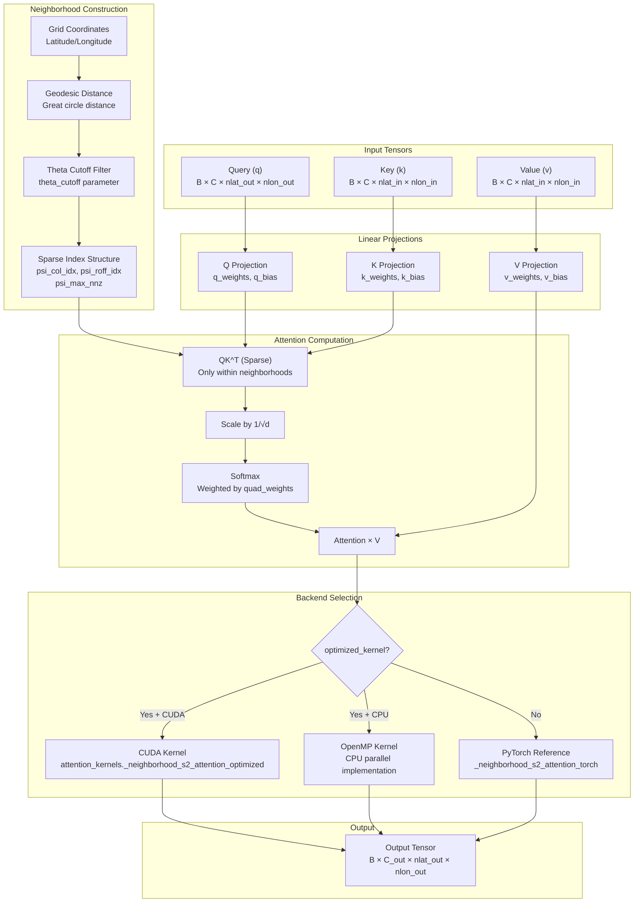
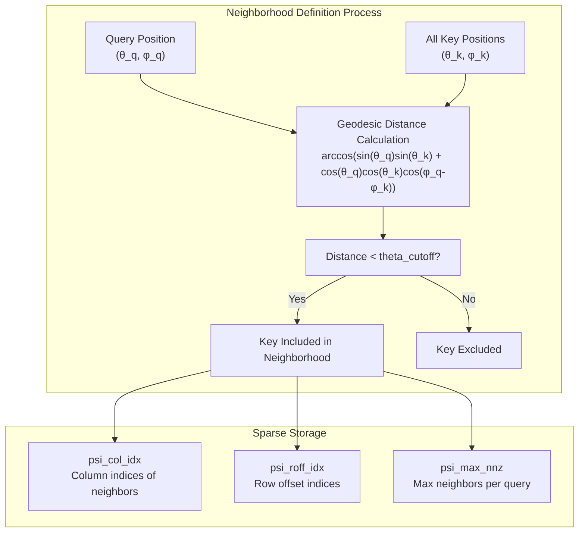
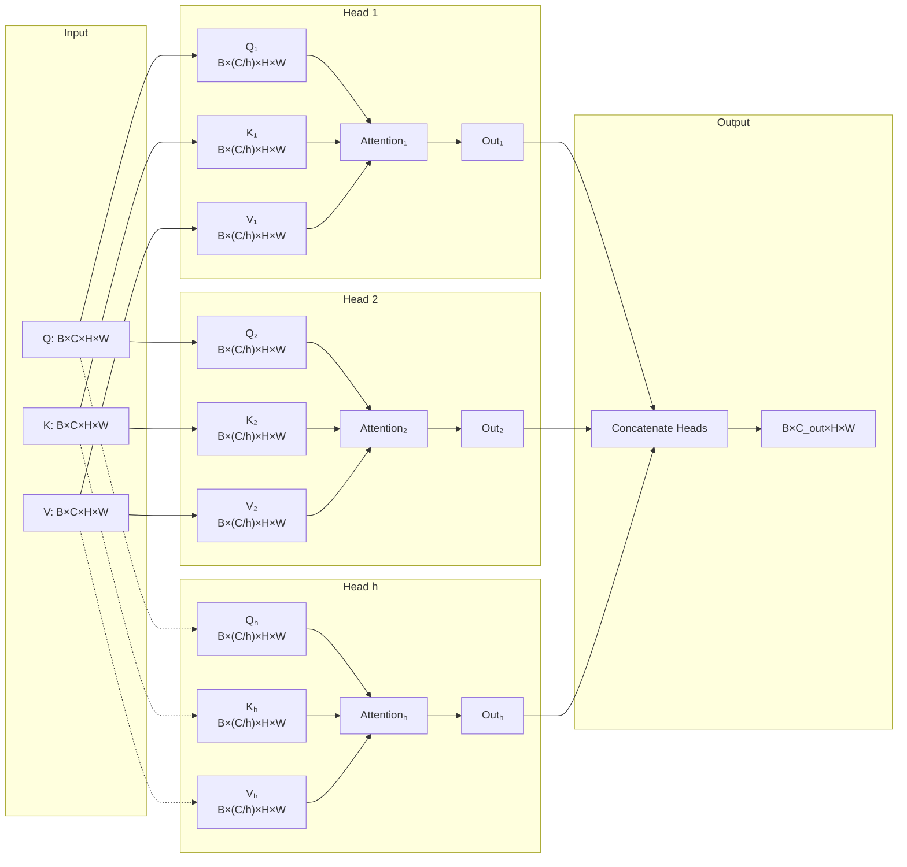
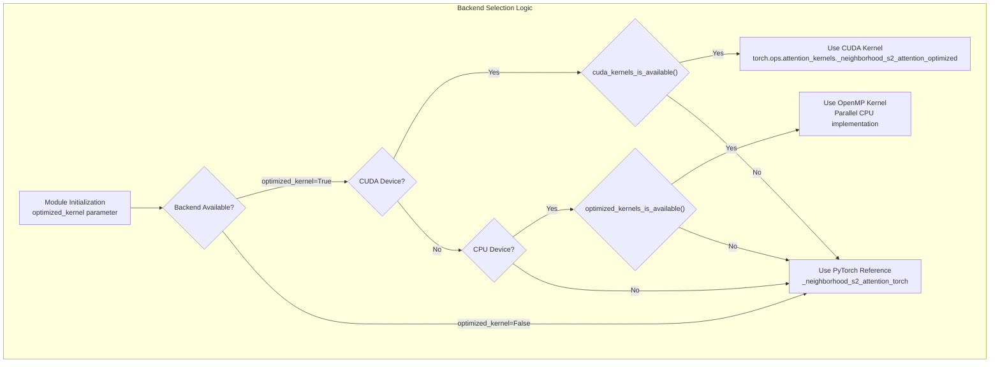
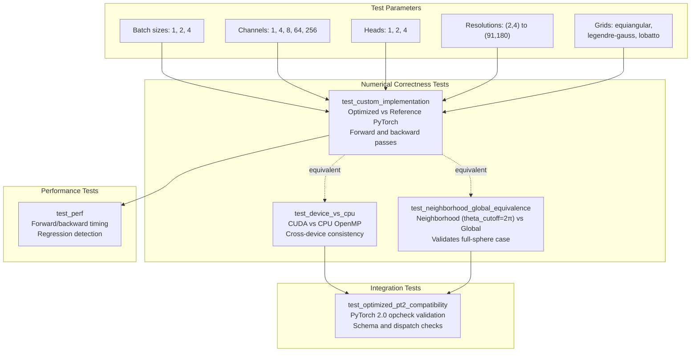

<!-- source: DeepWiki mcp.deepwiki.com · repo NVIDIA/torch-harmonics · page 4.2 NeighborhoodAttentionS2 · fetched 2026-10-26 -->

# NeighborhoodAttentionS2

<details>
<summary>Relevant source files</summary>

The following files were used as context for generating this wiki page:

- [Dockerfile.examples](Dockerfile.examples)
- [tests/test_attention.py](tests/test_attention.py)
- [torch_harmonics/plotting.py](torch_harmonics/plotting.py)

</details>


**Purpose**: This page documents the `NeighborhoodAttentionS2` class, which implements spatially-localized attention mechanisms on the sphere using geodesic distance-based neighborhoods. This enables efficient attention computation by restricting each query location to attend only to nearby key-value pairs within a configurable angular distance.

**Scope**: Covers the neighborhood attention mechanism, its configuration parameters (especially `theta_cutoff`), optimized CUDA/OpenMP backends, and usage patterns. For global spherical attention without spatial restrictions, see [AttentionS2](#4.1). For using attention in complete model architectures, see [S2 Transformer and Segformer](#7.3).

---

## Overview

`NeighborhoodAttentionS2` implements a scaled dot-product attention mechanism adapted for spherical geometry, where each query location attends only to key-value pairs within a geodesic neighborhood. This differs from standard global attention by exploiting locality on the sphere, reducing computational complexity from O(N²) to O(N·k) where k is the average neighborhood size.

The module computes attention using the standard formula:

```
Attention(Q, K, V) = softmax(QK^T / √d) V
```

but restricts the computation to pairs (q_i, k_j) where the geodesic distance between their spatial positions is less than `theta_cutoff`.

**Key Features**:
- Geodesic distance-based neighborhood definition
- Configurable angular cutoff (`theta_cutoff`)
- Multi-head attention support
- Optimized CUDA and OpenMP backends for sparse attention computation
- Support for different input/output grids and resolutions
- Compatible with equiangular, Legendre-Gauss, and Lobatto grids

Sources: [tests/test_attention.py:1-407]()

---

## Architecture and Data Flow



**Diagram: NeighborhoodAttentionS2 Data Flow and Backend Selection**

This diagram illustrates the complete processing pipeline from input tensors through linear projections, neighborhood construction, sparse attention computation, and backend-specific implementations.

Sources: [tests/test_attention.py:86-144](), [tests/test_attention.py:295-324]()

---

## Geodesic Neighborhoods on the Sphere

The core concept of neighborhood attention is restricting attention to spatially nearby locations. On the sphere, proximity is defined using geodesic (great circle) distance.



**Diagram: Geodesic Neighborhood Construction**

The neighborhood for each query point is determined by computing geodesic distances to all key positions and filtering based on `theta_cutoff`. The result is stored in a sparse CSR-like format.

**Key Parameters**:

| Parameter | Type | Description |
|-----------|------|-------------|
| `theta_cutoff` | `float` | Angular distance threshold in radians. Points within this geodesic distance are included in the neighborhood. Default: `π/8` |
| `psi_col_idx` | `Tensor` | Column indices of neighboring keys for each query (sparse storage) |
| `psi_roff_idx` | `Tensor` | Row offset indices indicating where each query's neighborhood starts |
| `psi_max_nnz` | `int` | Maximum number of non-zero entries (neighbors) per query row |

**Special Case**: When `theta_cutoff = 2π`, every key is in every query's neighborhood, making this equivalent to global attention (see [AttentionS2](#4.1)).

Sources: [tests/test_attention.py:232-286]()

---

## Class Interface and Parameters

### Constructor Parameters

```python
NeighborhoodAttentionS2(
    in_channels: int,
    out_channels: int,
    num_heads: int = 1,
    in_shape: Tuple[int, int],
    out_shape: Tuple[int, int],
    grid_in: str = "equiangular",
    grid_out: str = "equiangular",
    theta_cutoff: float = pi/8,
    bias: bool = True,
    optimized_kernel: bool = True
)
```

| Parameter | Type | Description |
|-----------|------|-------------|
| `in_channels` | `int` | Number of input channels |
| `out_channels` | `int` | Number of output channels |
| `num_heads` | `int` | Number of attention heads for multi-head attention |
| `in_shape` | `Tuple[int, int]` | Input spatial resolution `(nlat_in, nlon_in)` |
| `out_shape` | `Tuple[int, int]` | Output spatial resolution `(nlat_out, nlon_out)` |
| `grid_in` | `str` | Input grid type: `"equiangular"`, `"legendre-gauss"`, or `"lobatto"` |
| `grid_out` | `str` | Output grid type: `"equiangular"`, `"legendre-gauss"`, or `"lobatto"` |
| `theta_cutoff` | `float` | Angular distance cutoff in radians for neighborhood inclusion |
| `bias` | `bool` | Whether to include bias terms in linear projections |
| `optimized_kernel` | `bool` | Whether to use optimized CUDA/OpenMP kernels (if available) |

### Forward Method

```python
def forward(self, q: Tensor, k: Tensor, v: Tensor) -> Tensor:
    """
    Args:
        q: Query tensor of shape (B, C, nlat_out, nlon_out)
        k: Key tensor of shape (B, C, nlat_in, nlon_in)
        v: Value tensor of shape (B, C, nlat_in, nlon_in)
    
    Returns:
        Output tensor of shape (B, C_out, nlat_out, nlon_out)
    """
```

Sources: [tests/test_attention.py:71-83](), [tests/test_attention.py:304-307]()

---

## Multi-Head Attention Architecture



**Diagram: Multi-Head Attention Structure**

When `num_heads > 1`, the input channels are split across multiple attention heads, each processing a subset of channels independently. The outputs are concatenated along the channel dimension.

Sources: [tests/test_attention.py:71-83]()

---

## Optimized Backend Implementations

`NeighborhoodAttentionS2` supports multiple computation backends with different performance characteristics:



**Diagram: Backend Selection and Fallback Logic**

The module automatically selects the best available backend based on device type and availability of optimized kernels.

### Backend Comparison

| Backend | Platform | Performance | Requirements | Fallback Behavior |
|---------|----------|-------------|--------------|-------------------|
| **CUDA Kernel** | GPU (CUDA) | Highest | Custom CUDA extension compiled | Falls back to PyTorch reference if unavailable |
| **OpenMP Kernel** | CPU | Medium | OpenMP support enabled during build | Falls back to PyTorch reference if unavailable |
| **PyTorch Reference** | CPU/GPU | Lowest | None (always available) | Default fallback implementation |

**Compilation Flags**:
- CUDA backend: Requires `FORCE_CUDA_EXTENSION=1` during installation
- OpenMP backend: Requires `TORCH_HARMONICS_ENABLE_OPENMP=1` during installation

Sources: [tests/test_attention.py:44-47](), [tests/test_attention.py:86-92](), [Dockerfile.examples:58-60]()

---

## Usage Examples

### Basic Self-Attention

```python
import torch
from torch_harmonics import NeighborhoodAttentionS2

# Configuration
batch_size = 4
channels = 64
nlat, nlon = 128, 256
num_heads = 4

# Create module
attention = NeighborhoodAttentionS2(
    in_channels=channels,
    out_channels=channels,
    num_heads=num_heads,
    in_shape=(nlat, nlon),
    out_shape=(nlat, nlon),
    grid_in="equiangular",
    grid_out="equiangular",
    theta_cutoff=torch.pi / 4,  # 45 degree neighborhood
    bias=True,
    optimized_kernel=True
).cuda()

# Input tensor
x = torch.randn(batch_size, channels, nlat, nlon).cuda()

# Self-attention: q, k, v all from same input
output = attention(x, x, x)
# Output shape: (4, 64, 128, 256)
```

### Cross-Attention with Different Resolutions

```python
# Different input and output resolutions
attention = NeighborhoodAttentionS2(
    in_channels=64,
    out_channels=128,
    num_heads=4,
    in_shape=(64, 128),    # Lower resolution input
    out_shape=(128, 256),  # Higher resolution output
    grid_in="equiangular",
    grid_out="equiangular",
    theta_cutoff=torch.pi / 8,
    bias=True
).cuda()

# Cross-attention: different sources for q vs k,v
q = torch.randn(batch_size, 64, 128, 256).cuda()  # High-res queries
k = torch.randn(batch_size, 64, 64, 128).cuda()   # Low-res keys
v = torch.randn(batch_size, 64, 64, 128).cuda()   # Low-res values

output = attention(q, k, v)
# Output shape: (batch_size, 128, 128, 256)
```

### Global Attention (Full Sphere)

```python
# Equivalent to global attention when theta_cutoff = 2π
global_attention = NeighborhoodAttentionS2(
    in_channels=64,
    out_channels=64,
    num_heads=4,
    in_shape=(128, 256),
    out_shape=(128, 256),
    theta_cutoff=2 * torch.pi,  # Include entire sphere
    bias=True
)
```

### Using PyTorch Reference Implementation

```python
# Disable optimized kernels for debugging
attention_ref = NeighborhoodAttentionS2(
    in_channels=64,
    out_channels=64,
    num_heads=1,
    in_shape=(64, 128),
    out_shape=(64, 128),
    optimized_kernel=False  # Use pure PyTorch implementation
)
```

Sources: [tests/test_attention.py:96-102](), [tests/test_attention.py:164-170](), [tests/test_attention.py:242-247]()

---

## Computational Complexity and Performance

### Complexity Analysis

| Operation | Global Attention | Neighborhood Attention | Reduction Factor |
|-----------|------------------|------------------------|------------------|
| **Forward QK^T** | O(N² · d) | O(N · k · d) | N/k |
| **Forward Softmax** | O(N²) | O(N · k) | N/k |
| **Forward Attention×V** | O(N² · d) | O(N · k · d) | N/k |
| **Memory** | O(N²) | O(N · k) | N/k |

Where:
- N = nlat × nlon (total spatial points)
- d = channels / num_heads (dimension per head)
- k = average neighborhood size (depends on `theta_cutoff`)

### Performance Benchmarks

Performance thresholds from the test suite (normalized to reference hardware):

| Device | Forward Pass | Backward Pass | Test Configuration |
|--------|--------------|---------------|-------------------|
| **CPU (16 OpenMP threads)** | < 1000 ms | < 8000 ms | Batch=1, Channels=256, Resolution=91×180 |
| **GPU (V100 16GB)** | < 50 ms | < 150 ms | Batch=1, Channels=256, Resolution=91×180 |

**Note**: These are regression detection thresholds, not absolute performance guarantees. Actual performance depends on hardware, theta_cutoff, and input resolution.

Sources: [tests/test_attention.py:53-59](), [tests/test_attention.py:326-404]()

### Memory Optimization

The sparse storage format significantly reduces memory usage:

```python
# Memory consumption comparison
# Global attention: O(nlat_out × nlon_out × nlat_in × nlon_in)
# Neighborhood attention: O(nlat_out × nlon_out × max_neighbors)

# Example: 128×256 grid, theta_cutoff = π/8
# Global: 128 × 256 × 128 × 256 = 1,073,741,824 elements
# Neighborhood (avg ~200 neighbors): 128 × 256 × 200 = 6,553,600 elements
# Reduction: ~164x less memory
```

---

## Grid Type Support

`NeighborhoodAttentionS2` supports multiple spherical grid types, affecting the quadrature weights used in the attention computation:

| Grid Type | Description | Quadrature Weights | Use Case |
|-----------|-------------|-------------------|----------|
| `"equiangular"` | Uniformly spaced in latitude and longitude | Non-uniform (latitude-dependent) | General-purpose, most common |
| `"legendre-gauss"` | Gauss-Legendre quadrature points | Gauss-Legendre weights | Spectral accuracy, integration |
| `"lobatto"` | Gauss-Lobatto quadrature points | Lobatto weights | Includes pole points |

**Grid Compatibility**: Input and output grids can differ. Geodesic distances are computed correctly regardless of grid type.

Sources: [tests/test_attention.py:71-83](), [tests/test_attention.py:221-229]()

---

## Testing and Validation

The test suite validates `NeighborhoodAttentionS2` across multiple dimensions:

### Test Categories



**Diagram: Test Coverage and Validation Strategy**

### Key Test Scenarios

**Custom Implementation Tests** ([tests/test_attention.py:86-144]()):
- Validates CUDA/OpenMP kernels against PyTorch reference
- Tests multiple heads (1, 2, 4)
- Various channel configurations
- All supported grid types
- Tolerance: atol=1e-5, rtol=1e-3

**Cross-Device Tests** ([tests/test_attention.py:153-219]()):
- Compares CUDA and CPU OpenMP implementations
- Ensures numerical consistency across devices
- Tests full-sphere case (theta_cutoff=2π)
- Tolerance: atol=5e-2, rtol=1e-4

**Global Equivalence Tests** ([tests/test_attention.py:232-286]()):
- Validates that NeighborhoodAttentionS2 with theta_cutoff=2π matches AttentionS2
- Single-head configuration only (multi-head implementations differ slightly)
- Tolerance: atol=1e-2, rtol=0

**PyTorch 2.0 Compatibility** ([tests/test_attention.py:295-324]()):
- Uses `torch.library.opcheck` to validate custom operator registration
- Ensures compatibility with torch.compile and autograd

**Performance Tests** ([tests/test_attention.py:326-404]()):
- Enabled via `TORCH_HARMONICS_RUN_PERF_TESTS=1` environment variable
- Measures forward and backward pass timing
- Compares against reference thresholds
- Normalized to V100 GPU and 16-thread CPU

Sources: [tests/test_attention.py:62-405]()

---

## Integration with Model Architectures

`NeighborhoodAttentionS2` is designed to be used as a building block in larger spherical vision models:

### S2 Transformer Integration

```python
# Typical usage in transformer blocks
class TransformerBlock(nn.Module):
    def __init__(self, channels, num_heads, in_shape, theta_cutoff):
        super().__init__()
        
        self.attention = NeighborhoodAttentionS2(
            in_channels=channels,
            out_channels=channels,
            num_heads=num_heads,
            in_shape=in_shape,
            out_shape=in_shape,
            theta_cutoff=theta_cutoff
        )
        
        self.norm1 = nn.LayerNorm(channels)
        self.norm2 = nn.LayerNorm(channels)
        self.mlp = MLP(channels)
    
    def forward(self, x):
        # Self-attention with residual connection
        x = x + self.attention(self.norm1(x), self.norm1(x), self.norm1(x))
        
        # MLP with residual connection
        x = x + self.mlp(self.norm2(x))
        
        return x
```

**Common Patterns**:
1. **Self-attention layers**: All three inputs (q, k, v) come from the same feature map
2. **Encoder-decoder cross-attention**: Queries from decoder, keys/values from encoder
3. **Multi-scale fusion**: Different resolutions for input and output grids
4. **Progressive theta_cutoff**: Smaller neighborhoods in early layers, larger in later layers

For complete transformer architectures using this module, see [S2 Transformer and Segformer](#7.3).

Sources: [tests/test_attention.py:1-42]()

---

## Debugging and Troubleshooting

### Common Issues

**Issue**: CUDA kernels not available
```
Warning: Couldn't import optimized disco convolution kernels
```
**Solution**: Rebuild with `FORCE_CUDA_EXTENSION=1`:
```bash
FORCE_CUDA_EXTENSION=1 pip install --no-build-isolation .
```

**Issue**: Gradient mismatch between optimized and reference implementations
**Solution**: 
1. Check tolerance settings (atol, rtol)
2. Verify input tensor dtypes (should be float32)
3. Enable debug mode: `TORCH_HARMONICS_DEBUG=1`
4. Compare with `optimized_kernel=False` version

**Issue**: Out of memory errors
**Solution**:
1. Reduce `theta_cutoff` to decrease neighborhood size
2. Use gradient checkpointing for training
3. Reduce batch size or resolution
4. Monitor `psi_max_nnz` (max neighbors per query)

### Validation Script

```python
# Validate installation and backends
from torch_harmonics.attention import (
    cuda_kernels_is_available, 
    optimized_kernels_is_available
)

print(f"Optimized kernels available: {optimized_kernels_is_available()}")
print(f"CUDA kernels available: {cuda_kernels_is_available()}")

# Test basic functionality
import torch
from torch_harmonics import NeighborhoodAttentionS2

att = NeighborhoodAttentionS2(
    in_channels=4, 
    out_channels=4, 
    num_heads=1,
    in_shape=(6, 12), 
    out_shape=(6, 12),
    optimized_kernel=True
).cuda()

x = torch.randn(1, 4, 6, 12).cuda()
out = att(x, x, x)
print(f"Output shape: {out.shape}")
print("Neighborhood attention working correctly!")
```

Sources: [tests/test_attention.py:44-47]()

---

## API Summary

### Module Attributes

| Attribute | Type | Description |
|-----------|------|-------------|
| `q_weights` | `nn.Parameter` | Query projection weights, shape `(out_channels, in_channels)` |
| `k_weights` | `nn.Parameter` | Key projection weights, shape `(in_channels, in_channels)` |
| `v_weights` | `nn.Parameter` | Value projection weights, shape `(in_channels, in_channels)` |
| `q_bias` | `nn.Parameter` | Query projection bias (if `bias=True`) |
| `k_bias` | `nn.Parameter` | Key projection bias (if `bias=True`) |
| `v_bias` | `nn.Parameter` | Value projection bias (if `bias=True`) |
| `quad_weights` | `Tensor` | Quadrature weights for softmax normalization |
| `psi_col_idx` | `Tensor` | Column indices for sparse neighborhood structure |
| `psi_roff_idx` | `Tensor` | Row offset indices for sparse neighborhood structure |
| `psi_max_nnz` | `int` | Maximum non-zero entries (neighbors) per query |
| `num_heads` | `int` | Number of attention heads |

### Helper Functions

```python
# Check backend availability
from torch_harmonics.attention import (
    cuda_kernels_is_available,
    optimized_kernels_is_available
)

# Access reference implementation
from torch_harmonics.attention._attention_utils import (
    _neighborhood_s2_attention_torch
)
```

Sources: [tests/test_attention.py:314-318](), [tests/test_attention.py:42-44]()

---

## See Also

- [AttentionS2](#4.1) - Global spherical attention without spatial restrictions
- [S2 Transformer and Segformer](#7.3) - Complete architectures using neighborhood attention
- [Custom CUDA Extensions](#9.3) - Details on building and debugging CUDA kernels
- [Optimization Backends](#9.1) - Overview of CUDA, Triton, and OpenMP backends
- [Testing](#10.2) - Guide to running the test suite

---

