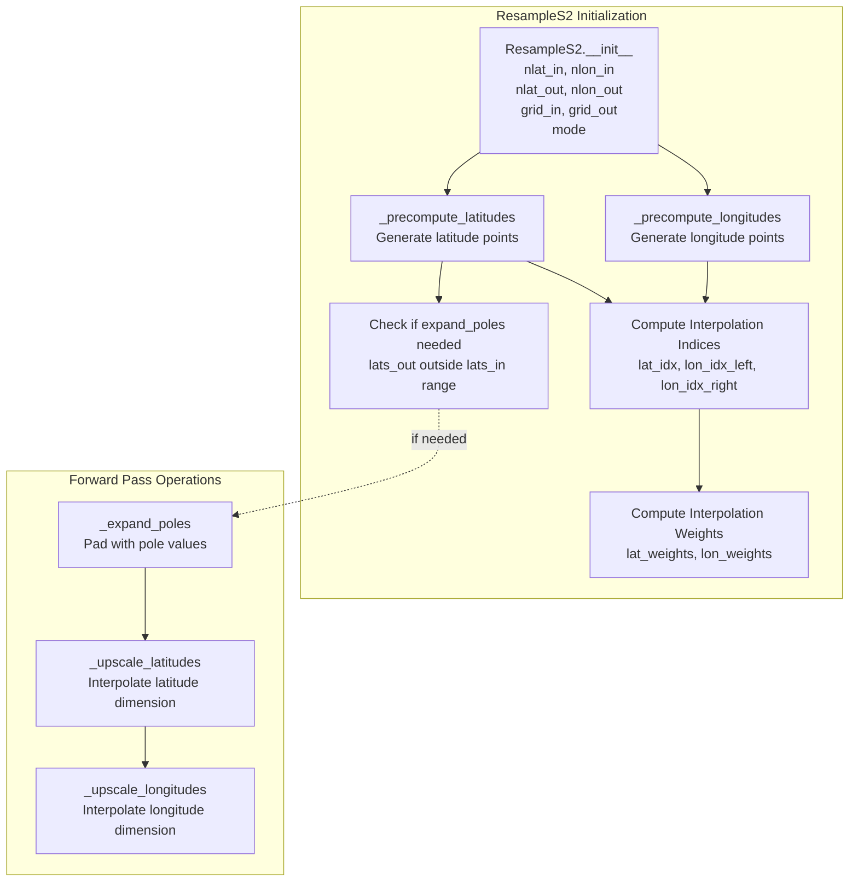
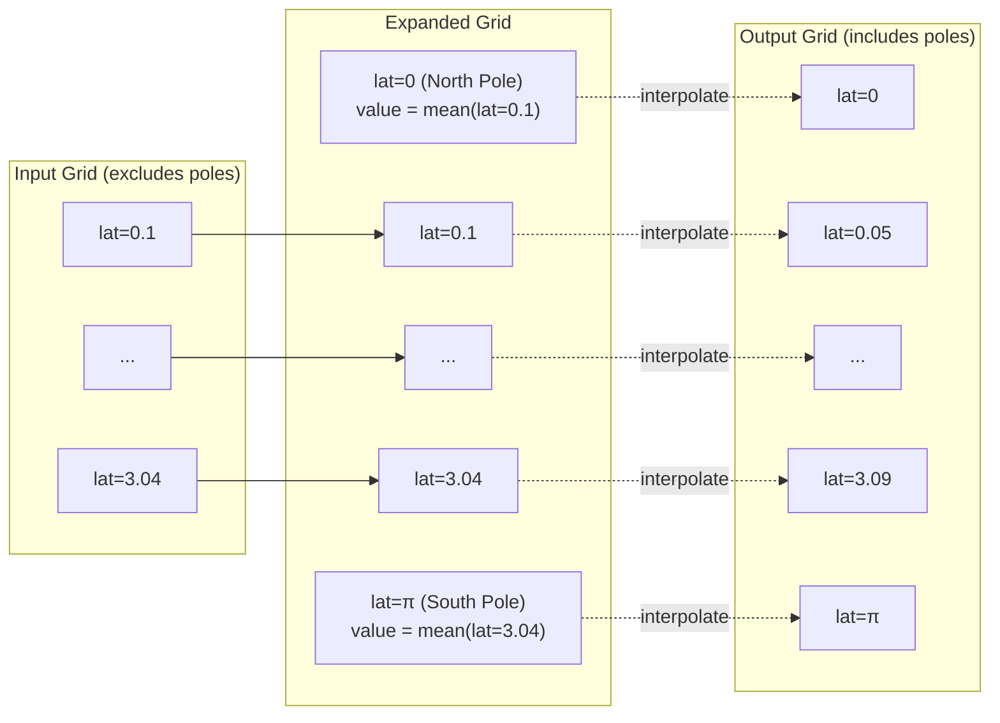
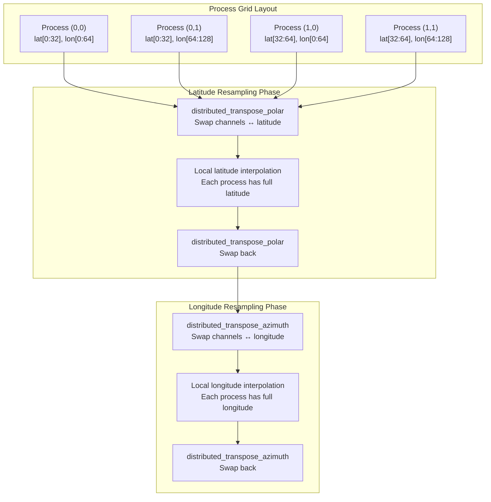
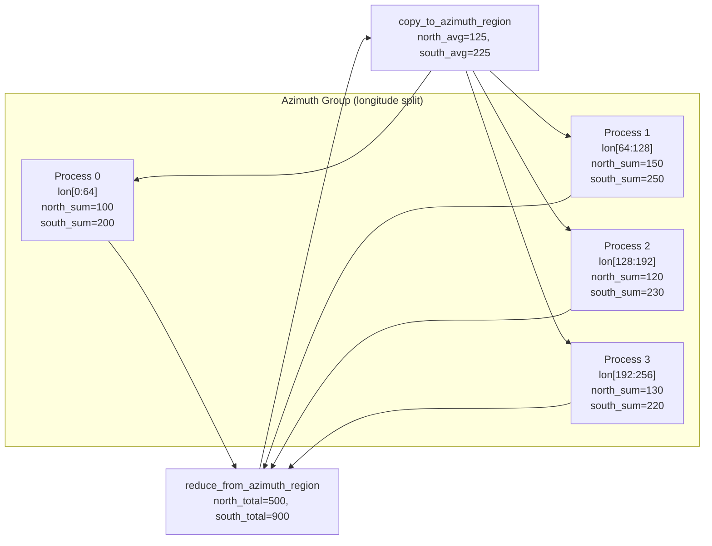
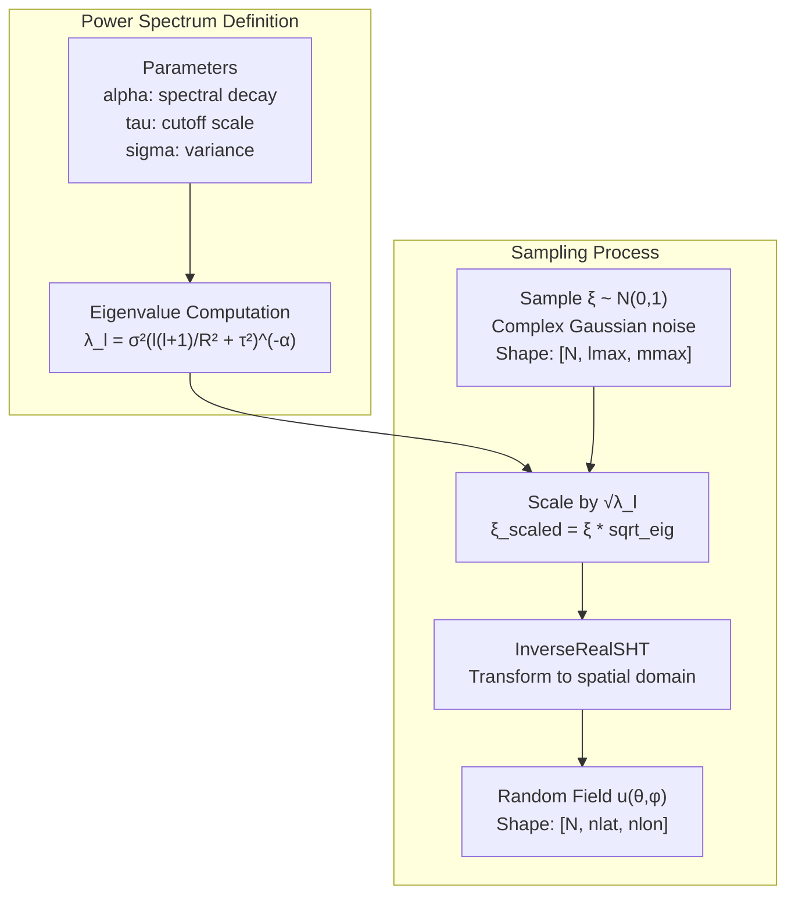
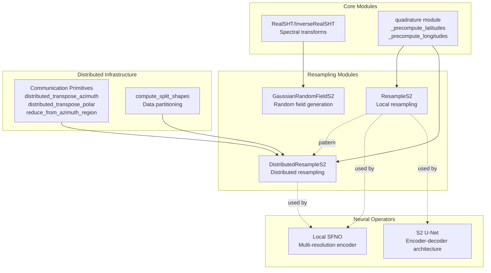

<!-- source: DeepWiki mcp.deepwiki.com · repo NVIDIA/torch-harmonics · page 5 Resampling and Interpolation · fetched 2026-10-26 -->

# Resampling and Interpolation

<details>
<summary>Relevant source files</summary>

The following files were used as context for generating this wiki page:

- [tests/test_cache.py](tests/test_cache.py)
- [tests/test_distributed_resample.py](tests/test_distributed_resample.py)
- [tests/test_sht.py](tests/test_sht.py)
- [torch_harmonics/cache.py](torch_harmonics/cache.py)
- [torch_harmonics/distributed/distributed_resample.py](torch_harmonics/distributed/distributed_resample.py)
- [torch_harmonics/random_fields.py](torch_harmonics/random_fields.py)
- [torch_harmonics/resample.py](torch_harmonics/resample.py)

</details>


This page covers the resampling and interpolation capabilities in torch-harmonics, which allow conversion of spherical data between different grid resolutions and grid types. This includes the `ResampleS2` module for local resampling, `DistributedResampleS2` for multi-process resampling, and `GaussianRandomFieldS2` for generating random fields on the sphere.

For spherical harmonic transform operations, see [Spherical Harmonic Transforms](#2). For distributed computing primitives, see [Distributed Computing](#6).

## Overview

Resampling in torch-harmonics enables conversion of spherical signals between different spatial grids, supporting both upsampling (increasing resolution) and downsampling (decreasing resolution). The library provides two interpolation strategies:

- **Bilinear interpolation**: Standard linear interpolation in latitude and longitude
- **Spherical interpolation**: Geodesic-aware interpolation using great circle distances

All resampling operations respect the periodicity of the sphere in the longitudinal direction and handle special cases at the poles.

**Sources:** [torch_harmonics/resample.py:42-191]()

## ResampleS2 Module

### Class Structure

The `ResampleS2` class provides the core resampling functionality for spherical data. It precomputes interpolation indices and weights during initialization for efficient runtime performance.



**Sources:** [torch_harmonics/resample.py:42-141](), [torch_harmonics/quadrature.py]() (referenced at line 39)

### Grid Types and Compatibility

`ResampleS2` supports conversion between the following grid types:

| Grid Type | Description | Number of Latitude Points |
|-----------|-------------|---------------------------|
| `equiangular` | Uniform spacing in latitude and longitude | User-specified |
| `legendre-gauss` | Gauss-Legendre quadrature nodes | User-specified |
| `lobatto` | Gauss-Lobatto quadrature nodes | User-specified |

The module can convert between any pair of these grid types, enabling workflows like:
- Transform data from `legendre-gauss` grid (optimal for SHT) to `equiangular` grid (simpler for visualization)
- Upsample from low-resolution to high-resolution grids
- Downsample from high-resolution to low-resolution grids

**Sources:** [torch_harmonics/resample.py:59-75]()

### Interpolation Modes

#### Bilinear Interpolation

Standard bilinear interpolation using `torch.lerp`:

```python
# Longitude interpolation
x = torch.lerp(x[..., lon_idx_left], x[..., lon_idx_right], lon_weights)

# Latitude interpolation  
x = torch.lerp(x[..., lat_idx, :], x[..., lat_idx + 1, :], lat_weights)
```

This mode treats the sphere as a flat grid and interpolates linearly between neighboring points.

**Sources:** [torch_harmonics/resample.py:142-154](), [torch_harmonics/resample.py:165-177]()

#### Spherical Interpolation

Spherical interpolation uses the SLERP (Spherical Linear Interpolation) formula, which accounts for the spherical geometry:

```python
# For points p0 and p1, interpolate along great circle
omega = p1 - p0
somega = sin(omega)
start_prefac = sin((1-t) * omega) / somega
end_prefac = sin(t * omega) / somega
result = start_prefac * p0 + end_prefac * p1
```

This mode provides more accurate interpolation for spherical data, especially when interpolating over large angular distances.

**Sources:** [torch_harmonics/resample.py:147-153](), [torch_harmonics/resample.py:170-176]()

### Pole Handling

When the output grid extends beyond the input grid's latitude range (e.g., output grid includes poles but input grid does not), the module expands the input data by padding with average values at the poles:



**Sources:** [torch_harmonics/resample.py:98-105](), [torch_harmonics/resample.py:156-163]()

### Implementation Details

The module precomputes all interpolation indices and weights during initialization to minimize runtime overhead:

| Buffer | Purpose | Computation |
|--------|---------|-------------|
| `lat_idx` | Left neighbor index for latitude | `searchsorted(lats_in, lats_out) - 1` |
| `lat_weights` | Interpolation weight for latitude | `(lats_out - lats_in[lat_idx]) / diff(lats_in)[lat_idx]` |
| `lon_idx_left` | Left neighbor index for longitude | `searchsorted(lons_in, lons_out) - 1` |
| `lon_idx_right` | Right neighbor index for longitude | Handles periodicity |
| `lon_weights` | Interpolation weight for longitude | `(lons_out - lons_in[lon_idx_left]) / diff` |

The longitude indexing handles periodicity by wrapping the right index to zero when it exceeds the grid bounds.

**Sources:** [torch_harmonics/resample.py:106-134]()

## Distributed Resampling

### DistributedResampleS2 Architecture

The `DistributedResampleS2` class extends resampling to multi-process environments where data is partitioned across a 2D process grid:



**Sources:** [torch_harmonics/distributed/distributed_resample.py:45-248]()

### Communication Strategy

The distributed implementation follows a transpose-interpolate-transpose pattern:

1. **Latitude Resampling:**
   - Transpose: Split channels across polar group, gather latitude locally
   - Interpolate: Each process performs local latitude interpolation
   - Transpose: Restore original channel layout, split latitude

2. **Longitude Resampling:**
   - Transpose: Split channels across azimuth group, gather longitude locally
   - Interpolate: Each process performs local longitude interpolation
   - Transpose: Restore original channel layout, split longitude

This strategy ensures each process has complete access to the dimension being interpolated, avoiding the need for halo exchanges.

**Sources:** [torch_harmonics/distributed/distributed_resample.py:211-247]()

### Distributed Pole Expansion

When expanding to poles in a distributed setting, the module must compute pole values by averaging across all processes in the azimuthal group:



**Sources:** [torch_harmonics/distributed/distributed_resample.py:173-194]()

### Split Shape Computation

The module uses `compute_split_shapes` to determine how data is partitioned across processes:

```python
# Example: 129 latitude points split across 4 processes
lat_shapes = compute_split_shapes(129, 4)  
# Returns: [33, 32, 32, 32]

# Process 0: lat[0:33]
# Process 1: lat[33:65]
# Process 2: lat[65:97]
# Process 3: lat[97:129]
```

These split shapes are stored as `lat_in_shapes`, `lon_in_shapes`, `lat_out_shapes`, and `lon_out_shapes` to track both input and output partitioning.

**Sources:** [torch_harmonics/distributed/distributed_resample.py:104-107]()

## Gaussian Random Fields

### GaussianRandomFieldS2 Module

The `GaussianRandomFieldS2` class generates isotropic Gaussian random fields on the sphere using the Karhunen-Loève expansion:



**Sources:** [torch_harmonics/random_fields.py:35-98]()

### Mathematical Background

The power spectrum is defined as:

```
C_l = σ² (l(l+1)/R² + τ²)^(-α/2)
```

where:
- `l` is the spherical harmonic degree
- `α` controls the rate of spectral decay (higher α = smoother fields)
- `τ` is the cutoff scale parameter
- `σ` is the overall variance (defaults to `τ^(α-1)` if not specified)
- `R` is the sphere radius

The Karhunen-Loève expansion transforms spectral noise to spatial fields:

```
u(θ,φ) = Σ_l Σ_m √λ_l ξ_lm Y_lm(θ,φ)
```

where `Y_lm` are the spherical harmonic basis functions and `ξ_lm ~ N(0,1)` are complex Gaussian random variables.

**Sources:** [torch_harmonics/random_fields.py:56-77](), [torch_harmonics/random_fields.py:88-98]()

### Usage Example

```python
import torch
from torch_harmonics import GaussianRandomFieldS2

# Create random field generator
grf = GaussianRandomFieldS2(
    nlat=128,
    alpha=2.0,    # Decay exponent
    tau=3.0,      # Cutoff scale
    grid="equiangular",
    dtype=torch.float32
)

# Generate 16 random field samples
samples = grf(N=16)  # Shape: [16, 128, 256]
```

The module ensures the Gaussian noise sampler is properly initialized on the correct device by overriding the `cuda()` and `to()` methods.

**Sources:** [torch_harmonics/random_fields.py:35-112]()

## Relationship to Other Components



**Sources:** [torch_harmonics/resample.py:39](), [torch_harmonics/distributed/distributed_resample.py:38-42](), [torch_harmonics/random_fields.py:33]()

## Performance Considerations

### Memory Efficiency

The resampling modules use several strategies to minimize memory overhead:

1. **Precomputed indices**: All interpolation indices are computed once during initialization and stored as buffers
2. **Non-persistent buffers**: Registered with `persistent=False` to avoid saving in checkpoints
3. **In-place operations**: Longitude and latitude interpolation avoid unnecessary tensor copies
4. **Skip optimization**: When input and output grids match, the forward pass is a no-op

**Sources:** [torch_harmonics/resample.py:118-136](), [torch_harmonics/resample.py:179-182]()

### Gradient Computation

Both `ResampleS2` and `DistributedResampleS2` support gradient computation through PyTorch's autograd system. The interpolation operations are differentiable, enabling their use in neural network training pipelines.

The distributed version requires proper gradient handling during transpose operations, which is managed by the `distributed_transpose_azimuth` and `distributed_transpose_polar` autograd functions.

**Sources:** [tests/test_distributed_resample.py:225-264]()

### Test Coverage

The test suite validates:

- Forward and backward pass correctness for distributed resampling
- Consistency between local and distributed implementations
- Different grid type combinations (equiangular, legendre-gauss, lobatto)
- Both interpolation modes (bilinear, bilinear-spherical)
- Upsampling and downsampling scenarios
- Gradient correctness through numerical differentiation

**Sources:** [tests/test_distributed_resample.py:188-265]()

---

