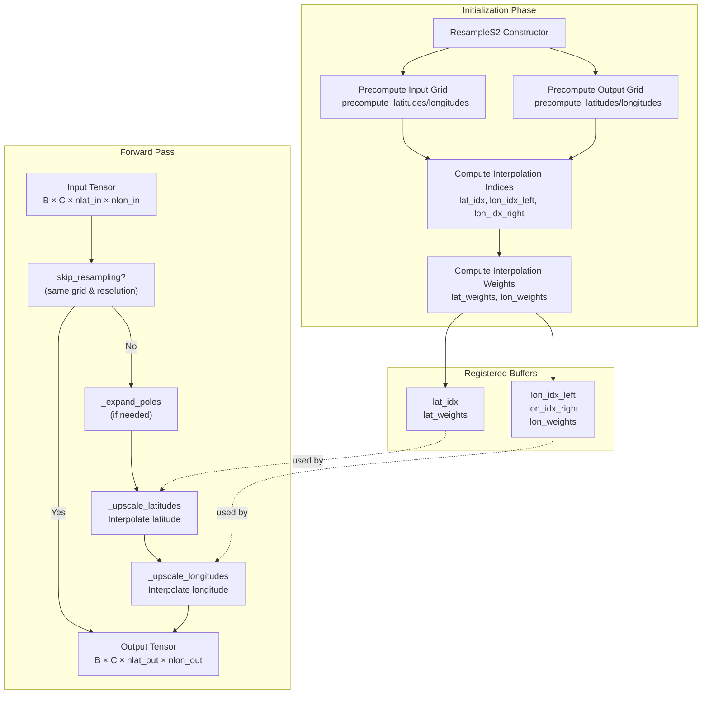
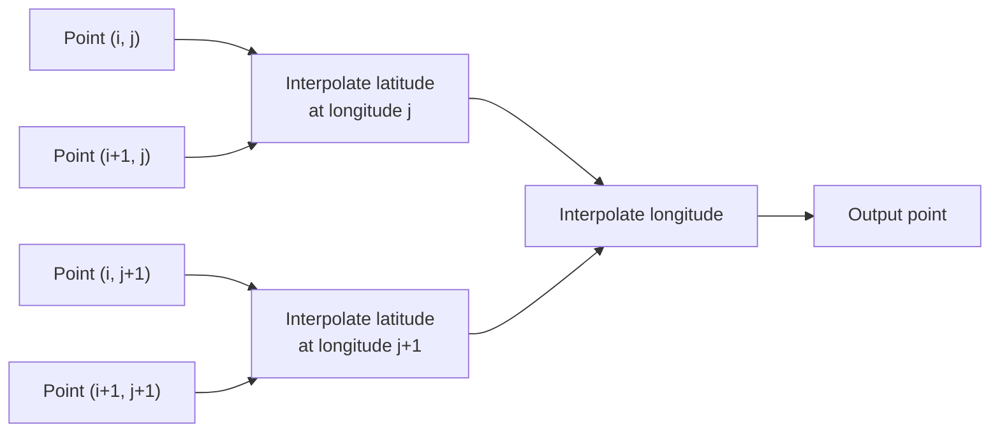
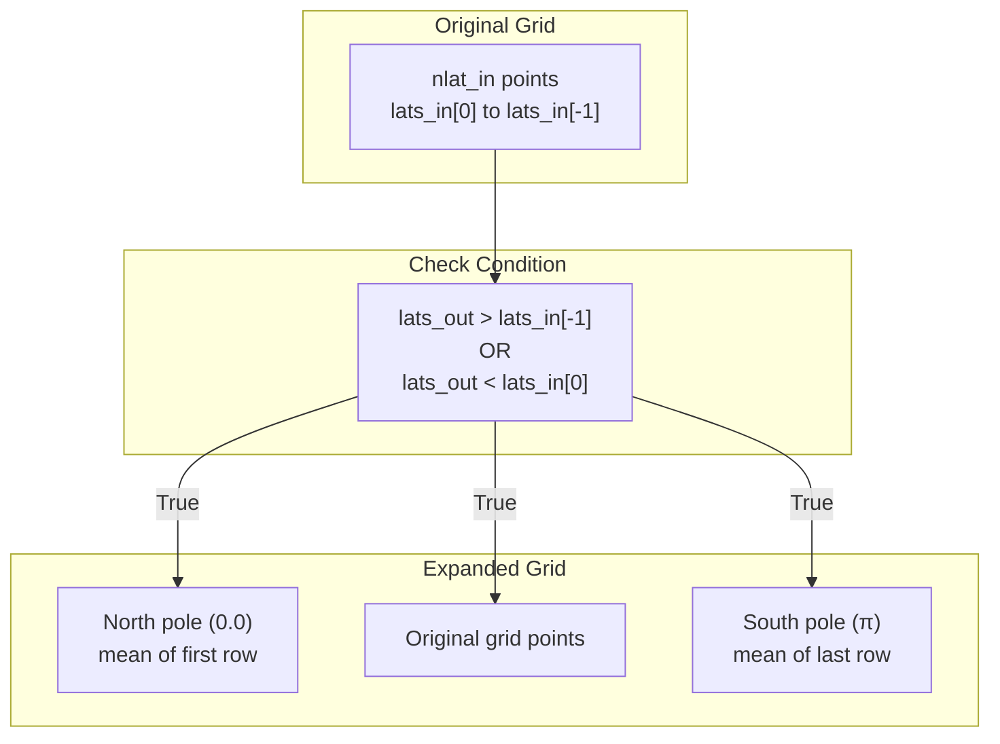
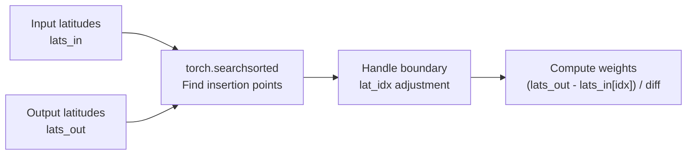
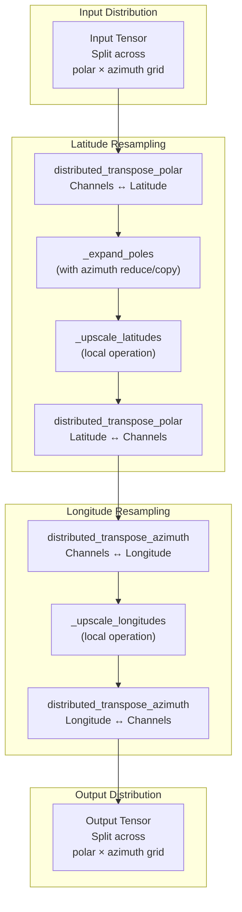
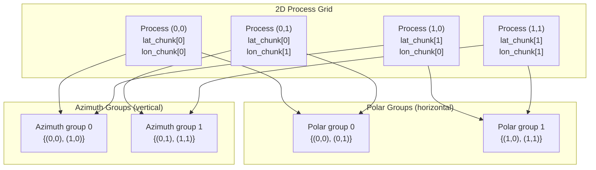

<!-- source: DeepWiki mcp.deepwiki.com · repo NVIDIA/torch-harmonics · page 5.1 ResampleS2 · fetched 2026-10-26 -->

# ResampleS2

<details>
<summary>Relevant source files</summary>

The following files were used as context for generating this wiki page:

- [tests/test_cache.py](tests/test_cache.py)
- [tests/test_distributed_resample.py](tests/test_distributed_resample.py)
- [tests/test_sht.py](tests/test_sht.py)
- [torch_harmonics/cache.py](torch_harmonics/cache.py)
- [torch_harmonics/distributed/distributed_resample.py](torch_harmonics/distributed/distributed_resample.py)
- [torch_harmonics/random_fields.py](torch_harmonics/random_fields.py)
- [torch_harmonics/resample.py](torch_harmonics/resample.py)

</details>


This document describes the `ResampleS2` module, which provides resampling functionality for spherical signals on the 2-sphere. It enables conversion between different grid resolutions and grid types using bilinear or spherical interpolation methods.

For distributed resampling across multiple processes, see the `DistributedResampleS2` variant documented in this page. For generating random fields on the sphere, see [Gaussian Random Fields](#5.2).

---

## Overview

The `ResampleS2` class provides spatial-domain resampling of spherical data without requiring transformation to spectral space. This makes it efficient for resolution changes and grid type conversions when spectral accuracy is not required.

**Key capabilities:**
- Upsampling and downsampling of spherical grids
- Conversion between grid types (equiangular, Legendre-Gauss, Lobatto)
- Two interpolation modes: standard bilinear and spherical bilinear
- Automatic handling of polar singularities
- Differentiable operations with autograd support

**Location:** [torch_harmonics/resample.py:42-191]()

Sources: [torch_harmonics/resample.py:42-65]()

---

## Architecture and Data Flow



The resampling process separates latitude and longitude interpolation into distinct stages, with precomputed indices and weights stored as buffers to avoid recomputation during forward passes.

Sources: [torch_harmonics/resample.py:67-137](), [torch_harmonics/resample.py:179-190]()

---

## Parameters and Configuration

### Constructor Parameters

| Parameter | Type | Default | Description |
|-----------|------|---------|-------------|
| `nlat_in` | int | required | Number of latitude points in input grid |
| `nlon_in` | int | required | Number of longitude points in input grid |
| `nlat_out` | int | required | Number of latitude points in output grid |
| `nlon_out` | int | required | Number of longitude points in output grid |
| `grid_in` | str | `"equiangular"` | Input grid type: `"equiangular"`, `"legendre-gauss"`, `"lobatto"` |
| `grid_out` | str | `"equiangular"` | Output grid type: `"equiangular"`, `"legendre-gauss"`, `"lobatto"` |
| `mode` | str | `"bilinear"` | Interpolation mode: `"bilinear"` or `"bilinear-spherical"` |

### Supported Grid Types

The module supports the same grid types as the spherical harmonic transforms (see [Grid Types and Quadrature](#2.3)):

- **Equiangular**: Uniform angular spacing in both dimensions
- **Legendre-Gauss**: Gauss-Legendre quadrature points in latitude
- **Lobatto**: Gauss-Lobatto quadrature points in latitude

Grid coordinates are precomputed using `_precompute_latitudes` and `_precompute_longitudes` from the quadrature module.

Sources: [torch_harmonics/resample.py:42-96](), [torch_harmonics/resample.py:39]()

---

## Interpolation Modes

### Bilinear Interpolation

Standard bilinear interpolation using `torch.lerp`:



Implementation at [torch_harmonics/resample.py:142-154]() for longitude and [torch_harmonics/resample.py:165-177]() for latitude.

**Latitude interpolation:**
```
x_out = lerp(x[lat_idx], x[lat_idx + 1], lat_weights)
```

**Longitude interpolation:**
```
x_out = lerp(x[lon_idx_left], x[lon_idx_right], lon_weights)
```

### Bilinear-Spherical Interpolation

Spherical linear interpolation (slerp-based) that accounts for great circle distances:

**Formula:**
```
start_prefac = sin((1 - w) * ω) / sin(ω)
end_prefac = sin(w * ω) / sin(ω)
x_out = start_prefac * x_start + end_prefac * x_end
```

where `ω = x_end - x_start` is the angular difference, and `w` is the interpolation weight.

This mode is more accurate for spherical data but computationally more expensive. Implementation includes a fallback to linear interpolation when `sin(ω) < 1e-4` to avoid numerical instability.

Sources: [torch_harmonics/resample.py:147-152](), [torch_harmonics/resample.py:170-175]()

---

## Pole Handling

### Pole Expansion

When output grid points extend beyond the range of input latitudes (e.g., when downsampling from Legendre-Gauss to equiangular), the module automatically expands the input to include pole values:



**Implementation:**
1. Compute mean values across longitude at north and south boundaries
2. Pad tensor with constant values for poles
3. Update `lats_in` to include `[0.0, ..., π]`

The pole values are computed as the mean across all longitudes to provide a rotationally invariant value at the pole:
```
x_north = mean(x[..., 0, :])  # First latitude row
x_south = mean(x[..., -1, :])  # Last latitude row
```

Sources: [torch_harmonics/resample.py:98-104](), [torch_harmonics/resample.py:156-163]()

---

## Interpolation Index Computation

### Latitude Indices



For each output latitude, the module finds the interval `[lats_in[i], lats_in[i+1]]` containing it:
- Uses `torch.searchsorted` with `side="right"` and subtracts 1
- Special handling when output exactly equals the last input point
- Computes normalized weight: `(lat_out - lat_in[i]) / (lat_in[i+1] - lat_in[i])`

Sources: [torch_harmonics/resample.py:107-120]()

### Longitude Indices

Longitude interpolation must handle periodicity (wraparound at 2π):

```
lon_idx_left = searchsorted(lons_in, lons_out) - 1
lon_idx_right = where(lons_out >= lons_in[-1], 0, lon_idx_left + 1)
```

When the output longitude exceeds the last input longitude, it wraps to index 0 (periodic boundary).

Weight computation accounts for the periodic difference:
```
diff = lons_in[right] - lons_in[left]
diff = where(diff < 0, diff + 2π, diff)  # Handle wraparound
lon_weights = (lons_out - lons_in[left]) / diff
```

Sources: [torch_harmonics/resample.py:123-134]()

---

## Usage Examples

### Basic Resampling

```python
import torch
import torch_harmonics as th

# Create resampling module (64x128 -> 128x256)
resample = th.ResampleS2(
    nlat_in=64, nlon_in=128,
    nlat_out=128, nlon_out=256,
    grid_in="equiangular",
    grid_out="equiangular",
    mode="bilinear"
).cuda()

# Resample a batch of spherical images
x = torch.randn(4, 3, 64, 128, device="cuda")  # B × C × H × W
y = resample(x)  # Output: 4 × 3 × 128 × 256
```

### Grid Type Conversion

```python
# Convert from Legendre-Gauss to equiangular
resample = th.ResampleS2(
    nlat_in=128, nlon_in=256,
    nlat_out=128, nlon_out=256,
    grid_in="legendre-gauss",
    grid_out="equiangular"
)

# Same resolution, different grid
y = resample(x)
```

### Spherical Interpolation

```python
# Use spherical interpolation for angular data
resample = th.ResampleS2(
    nlat_in=64, nlon_in=128,
    nlat_out=32, nlon_out=64,
    mode="bilinear-spherical"
)
```

Sources: [torch_harmonics/resample.py:42-191]()

---

## Distributed Resampling

### DistributedResampleS2 Architecture



The distributed version uses the same interpolation kernels but orchestrates communication to make dimensions local before interpolation. It uses the 2D process grid strategy with polar (latitude) and azimuthal (longitude) process groups.

Sources: [torch_harmonics/distributed/distributed_resample.py:45-248]()

### Distributed Pole Expansion

In the distributed setting, pole expansion requires communication across the azimuthal group:

1. **Sum across local longitude points** for north and south rows
2. **All-reduce across azimuth group** using `reduce_from_azimuth_region`
3. **Divide by total count** to get global mean
4. **Broadcast back** using `copy_to_azimuth_region`

This ensures the pole value represents the mean across all longitude points globally, not just local chunks.

Implementation: [torch_harmonics/distributed/distributed_resample.py:173-194]()

### Process Group Layout



The distributed resampling module queries the process group configuration via:
- `polar_group_size()` / `polar_group_rank()`
- `azimuth_group_size()` / `azimuth_group_rank()`
- `compute_split_shapes()` for chunk sizes

Sources: [torch_harmonics/distributed/distributed_resample.py:98-107]()

### Communication Primitives

The distributed implementation uses these communication operations:

| Operation | Purpose | Location |
|-----------|---------|----------|
| `distributed_transpose_polar` | Swap channels with latitude dimension | [torch_harmonics/distributed/distributed_resample.py:222-233]() |
| `distributed_transpose_azimuth` | Swap channels with longitude dimension | [torch_harmonics/distributed/distributed_resample.py:238-245]() |
| `reduce_from_azimuth_region` | All-reduce across azimuth group for pole values | [torch_harmonics/distributed/distributed_resample.py:180-182]() |
| `copy_to_azimuth_region` | Broadcast pole values to azimuth group | [torch_harmonics/distributed/distributed_resample.py:187-188]() |

For more details on these primitives, see [Communication Primitives](#6.3).

Sources: [torch_harmonics/distributed/distributed_resample.py:39-41]()

---

## Performance Considerations

### Optimization Strategies

1. **Skip resampling when unnecessary:**
   - The module checks if input/output grids are identical
   - Sets `skip_resampling = True` to bypass all computation
   - Early return in forward pass: [torch_harmonics/resample.py:180-181]()

2. **Precomputed indices and weights:**
   - All interpolation indices computed once in `__init__`
   - Stored as registered buffers for automatic device management
   - Avoids repeated searchsorted calls during forward passes

3. **Memory efficiency:**
   - Uses `persistent=False` for buffers to exclude from state_dict
   - Reduces checkpoint file sizes
   - Buffers recreated during module construction

4. **Precision handling:**
   - Interpolation weights cast to input tensor dtype
   - Supports both float32 and float64 precision
   - Implementation: [torch_harmonics/resample.py:144](), [torch_harmonics/resample.py:167]()

### Computational Complexity

For an input of size `B × C × nlat_in × nlon_in` -> `B × C × nlat_out × nlon_out`:

- **Initialization:** O(nlat_out + nlon_out) for index computation
- **Forward pass:** O(B × C × nlat_out × nlon_out) for interpolation
- **Memory:** O(nlat_out + nlon_out) for indices and weights

The distributed version adds communication overhead but enables larger grids by partitioning data.

Sources: [torch_harmonics/resample.py:136-137](), [torch_harmonics/resample.py:119-120]()

---

## Testing and Validation

### Test Coverage

The module is tested via:

1. **Distributed resampling tests:** [tests/test_distributed_resample.py:188-264]()
   - Tests upsampling and downsampling
   - Validates both interpolation modes
   - Compares distributed vs local results
   - Tests forward and backward passes

2. **Grid type combinations:**
   - Equiangular ↔ Legendre-Gauss conversions
   - Odd and even resolution combinations
   - Multiple batch sizes and channel counts

3. **Gradient validation:**
   - Backward pass correctness verified
   - Relative error tolerance: 1e-7
   - Tests gradient flow through transpose operations

### Test Matrix

The test suite covers these configurations:

| nlat_in | nlon_in | nlat_out | nlon_out | grid_in | grid_out | mode |
|---------|---------|----------|----------|---------|----------|------|
| 64 | 128 | 128 | 256 | equiangular | equiangular | bilinear |
| 128 | 256 | 64 | 128 | equiangular | equiangular | bilinear |
| 64 | 128 | 128 | 256 | equiangular | equiangular | bilinear-spherical |
| 129 | 256 | 65 | 128 | equiangular | legendre-gauss | bilinear |
| 65 | 128 | 129 | 256 | legendre-gauss | equiangular | bilinear |

Sources: [tests/test_distributed_resample.py:188-199]()

---

## Integration with Neural Operators

The `ResampleS2` module is used in several neural operator architectures:

### S2 U-Net Architecture

Multi-scale encoder-decoder architectures use resampling in downsampling/upsampling paths to change resolution between DISCO convolution layers.

### Local Spherical Neural Operator (LSNO)

Uses resampling to match resolutions when combining local and global paths. See [Local Spherical Neural Operator](#7.2).

### Usage Pattern in Models

```python
# Downsampling path
self.down = nn.ModuleList([
    ResampleS2(nlat_in, nlon_in, nlat_in//2, nlon_in//2)
    for nlat_in, nlon_in in resolutions
])

# Upsampling path  
self.up = nn.ModuleList([
    ResampleS2(nlat_in, nlon_in, nlat_in*2, nlon_in*2)
    for nlat_in, nlon_in in resolutions
])
```

The module provides an alternative to transpose convolutions (see [Transpose Convolutions and Upsampling](#3.3)) when spectral accuracy is not required.

Sources: [torch_harmonics/resample.py:42-191]()

---

## Related Components

- **Quadrature Module:** Provides `_precompute_latitudes` and `_precompute_longitudes` used for grid generation - see [Grid Types and Quadrature](#2.3)
- **Distributed Communication:** Uses transpose primitives from distributed module - see [Communication Primitives](#6.3)
- **DISCO Convolutions:** Alternative approach for upsampling with learnable parameters - see [Transpose Convolutions and Upsampling](#3.3)
- **Spherical Transforms:** Spectral-domain alternative for high-accuracy resampling - see [RealSHT and InverseRealSHT](#2.1)

Sources: [torch_harmonics/resample.py:39](), [torch_harmonics/distributed/distributed_resample.py:38-42]()

---

