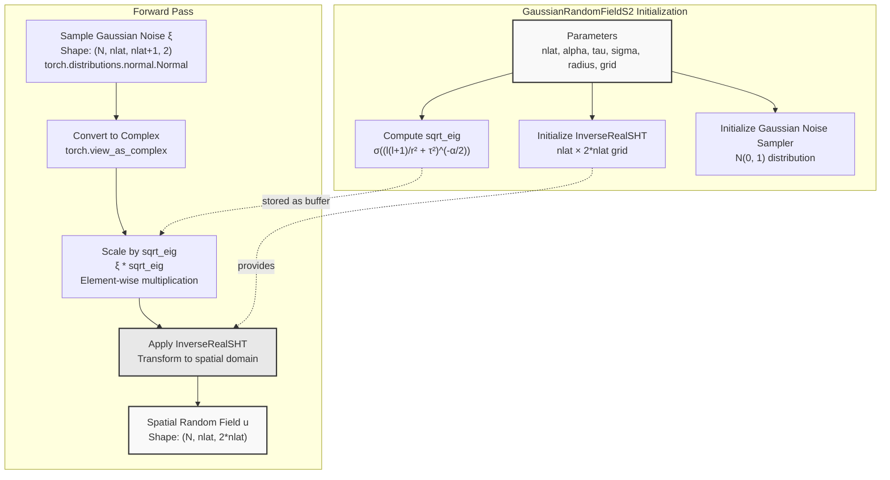
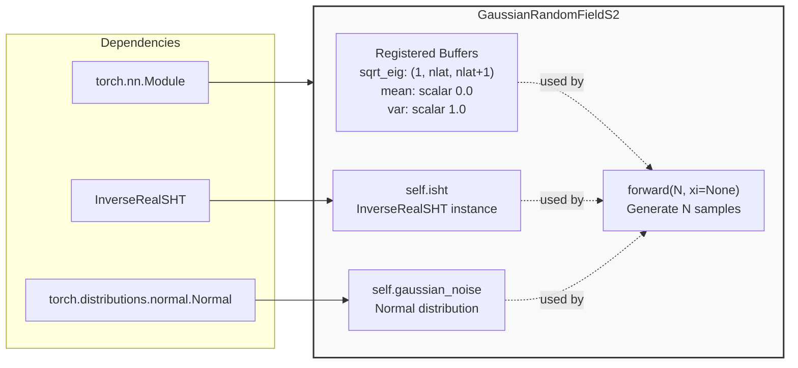
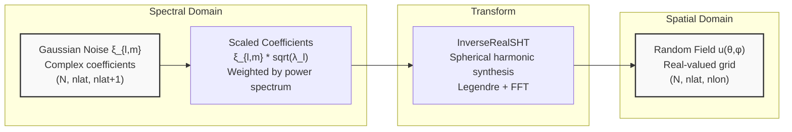

<!-- source: DeepWiki mcp.deepwiki.com · repo NVIDIA/torch-harmonics · page 5.2 Gaussian Random Fields · fetched 2026-10-26 -->

# Gaussian Random Fields

<details>
<summary>Relevant source files</summary>

The following files were used as context for generating this wiki page:

- [torch_harmonics/distributed/distributed_resample.py](torch_harmonics/distributed/distributed_resample.py)
- [torch_harmonics/random_fields.py](torch_harmonics/random_fields.py)
- [torch_harmonics/resample.py](torch_harmonics/resample.py)

</details>


This page documents the generation of Gaussian random fields on the sphere using Karhunen-Loeve expansion. The `GaussianRandomFieldS2` class provides functionality to synthesize statistically homogeneous and isotropic random fields with configurable power spectra, useful for testing, data augmentation, and uncertainty quantification.

For general resampling operations on spherical data, see [ResampleS2](#5.1). For distributed computing on spherical data, see [Distributed Computing](#6).

---

## Purpose and Applications

The `GaussianRandomFieldS2` module generates random fields on the sphere that follow a Gaussian distribution in both spatial and spectral domains. These fields are characterized by a power spectrum that controls the correlation structure and energy distribution across spatial scales.

**Common use cases:**
- Generating synthetic test data for spherical neural networks
- Data augmentation for climate and weather models
- Uncertainty quantification in geophysical applications
- Testing spherical transform accuracy and stability
- Initializing stochastic PDE simulations

Sources: [torch_harmonics/random_fields.py:35-56]()

---

## Mathematical Foundation

### Karhunen-Loeve Expansion

Gaussian random fields on the sphere are generated using the Karhunen-Loeve expansion, which expresses the random field as a weighted sum of spherical harmonic basis functions:

```
u(θ, φ) = Σ_{l,m} ξ_{l,m} * sqrt(λ_l) * Y_l^m(θ, φ)
```

Where:
- `ξ_{l,m}` are independent standard Gaussian random variables (complex-valued)
- `λ_l` are eigenvalues determined by the power spectrum
- `Y_l^m(θ, φ)` are spherical harmonic basis functions
- `l` is the spherical harmonic degree, `m` is the order

This expansion ensures that the resulting field is Gaussian-distributed with the desired covariance structure.

### Power Spectrum Parameterization

The eigenvalues `λ_l` are computed from a parameterized power spectrum:

```
λ_l = σ² * (l(l+1)/r² + τ²)^(-α)
```

**Parameters:**
- **`alpha`**: Exponent controlling the decay rate of the power spectrum. Higher values produce smoother fields (more energy in low frequencies). Must be > 1.0.
- **`tau`**: Cutoff wavenumber controlling the characteristic length scale. Smaller values produce larger-scale features.
- **`sigma`**: Overall amplitude scaling. If not specified, computed as `τ^(α-1)` to normalize the spectrum.
- **`radius`**: Sphere radius (default 1.0). Affects the relationship between spherical harmonic degree and physical wavelength.

The spectrum decays as `l^(-α)` for large `l`, with the cutoff parameter `tau` providing a smooth transition at intermediate scales.

Sources: [torch_harmonics/random_fields.py:57-76]()

---

## Class Structure and Data Flow



**Diagram: Data flow through GaussianRandomFieldS2 showing initialization and forward pass**

Sources: [torch_harmonics/random_fields.py:35-99]()

---

## Implementation Details

### Class: `GaussianRandomFieldS2`

The main class is located in [torch_harmonics/random_fields.py:35-113]() and inherits from `torch.nn.Module`, making it compatible with PyTorch's module ecosystem.



**Diagram: Class dependencies and internal structure**

### Eigenvalue Computation

The square root of eigenvalues is precomputed during initialization [torch_harmonics/random_fields.py:71-76]():

1. Compute `l(l+1)` for each degree `l` from 0 to `nlat-1`
2. Apply power spectrum formula: `σ * ((l(l+1)/r² + τ²)^(-α/2))`
3. Store as lower triangular matrix (only `m ≤ l` are non-zero)
4. Set `sqrt_eig[0,0] = 0` to ensure zero mean
5. Register as a buffer for automatic device management

The eigenvalues tensor has shape `(1, nlat, nlat+1)` where the last dimension accommodates all `m` values from 0 to `nlat`.

### Noise Sampling

Standard Gaussian noise is sampled with shape `(N, nlat, nlat+1, 2)` [torch_harmonics/random_fields.py:92-93](), where:
- `N`: batch size (number of independent realizations)
- `nlat`: spherical harmonic degree dimension
- `nlat+1`: spherical harmonic order dimension
- `2`: real and imaginary components

The real/imaginary components are converted to complex values using `torch.view_as_complex()`.

### Device Management

The class overrides `cuda()` and `to()` methods [torch_harmonics/random_fields.py:102-112]() to ensure the Gaussian noise sampler is re-initialized when the module is moved to a different device. This is necessary because `torch.distributions.normal.Normal` instances are not automatically moved by PyTorch's standard device transfer mechanisms.

Sources: [torch_harmonics/random_fields.py:35-113]()

---

## Usage Patterns

### Basic Usage

```python
from torch_harmonics.random_fields import GaussianRandomFieldS2

# Initialize generator with desired resolution and power spectrum
grf = GaussianRandomFieldS2(
    nlat=128,           # Spatial resolution (128 latitude points)
    alpha=2.5,          # Decay exponent (smoother fields)
    tau=3.0,            # Cutoff scale
    grid="equiangular", # Grid type
    dtype=torch.float32
)

# Generate 10 independent realizations
samples = grf(N=10)  # Shape: (10, 128, 256)
```

### Power Spectrum Control

Different `alpha` values produce different correlation structures:

| `alpha` | Characteristics | Typical Use Case |
|---------|----------------|------------------|
| 1.5-2.0 | Rougher fields, more high-frequency content | Turbulent flows, rough terrain |
| 2.0-3.0 | Moderate smoothness | General-purpose testing |
| 3.0-4.0 | Smooth fields, dominated by low frequencies | Smooth climate patterns, large-scale flows |

The `tau` parameter controls the characteristic length scale:
- Small `tau` (1-2): Large-scale features dominate
- Medium `tau` (3-5): Balanced multi-scale structure
- Large `tau` (>5): More uniform across scales

### Custom Noise Injection

For reproducibility or advanced use cases, provide pre-generated noise:

```python
# Pre-generate noise for reproducibility
torch.manual_seed(42)
xi = torch.randn(10, 128, 129, 2)
xi_complex = torch.view_as_complex(xi)

# Generate fields with fixed noise
samples = grf(N=10, xi=xi_complex)
```

### Grid Type Compatibility

The `grid` parameter determines the spatial grid on which the field is evaluated:
- `"equiangular"`: Uniform spacing in latitude and longitude (default)
- `"legendre-gauss"`: Gauss-Legendre quadrature points in latitude
- `"lobatto"`: Gauss-Lobatto quadrature points in latitude

The grid type affects the output spatial distribution but not the spectral properties. For details on grid types, see [Grid Types and Quadrature](#2.3).

Sources: [torch_harmonics/random_fields.py:57-98]()

---

## Integration with Spherical Harmonic Transforms

### Spectral-to-Spatial Pipeline



**Diagram: Transform pipeline from spectral coefficients to spatial field**

The `GaussianRandomFieldS2` class internally uses `InverseRealSHT` [torch_harmonics/random_fields.py:69]() configured with:
- Resolution: `nlat` latitude points, `2*nlat` longitude points
- Normalization: `'backward'` (inverse transform includes normalization factor)
- Grid type: User-specified (equiangular, legendre-gauss, or lobatto)

This integration ensures:
1. **Exact spectral control**: The power spectrum is precisely enforced in the spectral domain
2. **Efficient generation**: Leverages optimized FFT and Legendre polynomial evaluation
3. **Grid flexibility**: Supports all grid types available in the SHT implementation

For more details on the spherical harmonic transform, see [RealSHT and InverseRealSHT](#2.1).

### Relationship to Covariance Structure

The generated fields have a covariance function determined by the power spectrum. For two points separated by geodesic distance `d`, the covariance is:

```
Cov[u(x₁), u(x₂)] = Σ_l (2l+1)/(4π) * λ_l * P_l(cos(d))
```

Where `P_l` are Legendre polynomials. The power spectrum `λ_l` directly controls this covariance structure, making it straightforward to generate fields with desired statistical properties.

Sources: [torch_harmonics/random_fields.py:69-98]()

---

## Parameter Reference

### Constructor Parameters

| Parameter | Type | Default | Description |
|-----------|------|---------|-------------|
| `nlat` | `int` | Required | Number of latitude points. Determines spectral resolution (degrees 0 to `nlat-1`). |
| `alpha` | `float` | `2.0` | Power spectrum exponent. Controls smoothness. Must be > 1.0. |
| `tau` | `float` | `3.0` | Cutoff wavenumber. Controls characteristic length scale. |
| `sigma` | `float` | `None` | Amplitude scaling. If `None`, computed as `tau^(alpha-1)`. |
| `radius` | `float` | `1.0` | Sphere radius. Affects physical interpretation of wavenumbers. |
| `grid` | `str` | `"equiangular"` | Grid type for spatial output. Options: `"equiangular"`, `"legendre-gauss"`, `"lobatto"`. |
| `dtype` | `torch.dtype` | `torch.float32` | Data type for computations and output. |

### Forward Method

**Signature:** `forward(N, xi=None)`

| Parameter | Type | Description |
|-----------|------|-------------|
| `N` | `int` | Number of independent field realizations to generate. |
| `xi` | `torch.Tensor` or `None` | Optional pre-generated Gaussian noise. If provided, must have shape `(N, nlat, nlat+1)` and be complex-valued. If `None`, noise is sampled internally. |

**Returns:** `torch.Tensor` of shape `(N, nlat, 2*nlat)` containing the spatial random fields.

Sources: [torch_harmonics/random_fields.py:57-98]()

---

## Performance Considerations

### Memory Usage

The main memory overhead comes from:
1. **Eigenvalue buffer**: `(1, nlat, nlat+1)` complex values (negligible for typical resolutions)
2. **InverseRealSHT internal buffers**: Cached Legendre polynomials and quadrature weights (see [Caching and Performance](#9.4))
3. **Temporary noise tensor**: `(N, nlat, nlat+1, 2)` real values during forward pass

For `nlat=256` with `dtype=float32` and batch size `N=32`, temporary memory is approximately:
- Noise: 32 × 256 × 257 × 2 × 4 bytes ≈ 64 MB
- Spatial output: 32 × 256 × 512 × 4 bytes ≈ 128 MB

### Computational Cost

The dominant cost is the `InverseRealSHT` operation, which has complexity:
- **Longitude FFT**: O(N × nlat × nlon × log(nlon)) = O(N × nlat² × log(nlat))
- **Legendre evaluation**: O(N × nlat³) 

Total complexity is O(N × nlat³) for typical use cases. Generation is highly parallelizable across batch dimension `N`.

### Device Placement

For GPU execution:
```python
grf = GaussianRandomFieldS2(nlat=256).cuda()
samples = grf(N=32)  # Generated on GPU
```

The module automatically handles device placement for all internal components, including the noise sampler and InverseRealSHT instance.

Sources: [torch_harmonics/random_fields.py:35-113]()

---

## Limitations and Considerations

1. **Isotropy assumption**: The generated fields are statistically isotropic (rotation-invariant). Anisotropic fields require different power spectrum parameterizations not currently supported.

2. **Gaussianity**: The fields are exactly Gaussian in both spatial and spectral domains. Non-Gaussian fields require post-processing transformations.

3. **Spatial resolution**: The output resolution is fixed at `(nlat, 2*nlat)`. For different aspect ratios, use `ResampleS2` (see [ResampleS2](#5.1)) to interpolate to the desired grid.

4. **Mean constraint**: The zero-frequency component (`sqrt_eig[0,0]`) is always set to zero, ensuring zero-mean fields. Non-zero mean fields require adding a constant after generation.

5. **Power spectrum form**: The parameterization assumes a specific functional form. Custom power spectra require modifying the eigenvalue computation in the source code.

6. **Alpha constraint**: The requirement `alpha > 1.0` ensures that the total variance is finite. Values ≤ 1.0 produce fields with divergent energy.

Sources: [torch_harmonics/random_fields.py:35-76]()

---

## Related Components

- **[ResampleS2](#5.1)**: Interpolate generated fields to different resolutions or grid types
- **[InverseRealSHT](#2.1)**: Underlying transform used for spectral-to-spatial conversion
- **[Grid Types and Quadrature](#2.3)**: Details on spatial grid options
- **[Distributed Computing](#6)**: For generating large-scale fields across multiple GPUs (requires custom implementation of distributed random field generation)

Sources: [torch_harmonics/random_fields.py:1-113]()

---

