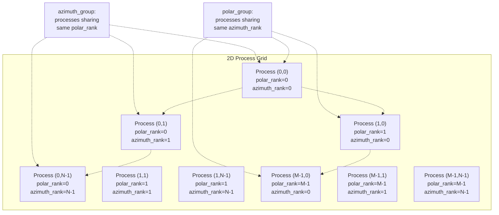
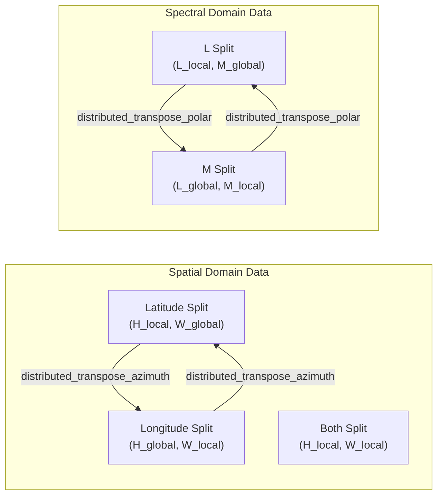
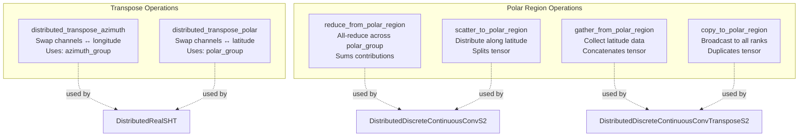
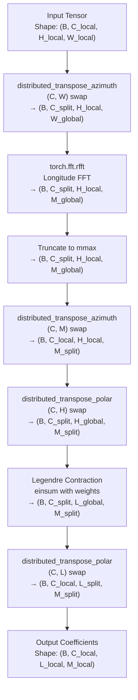
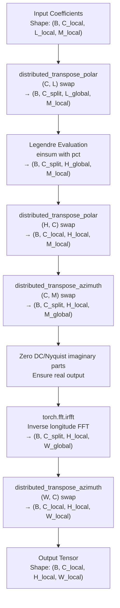
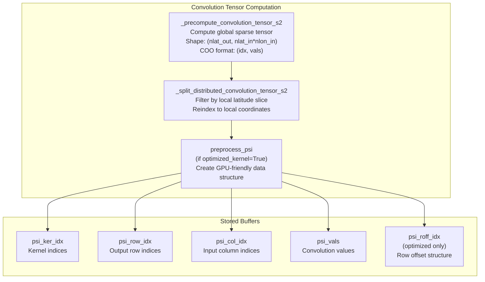
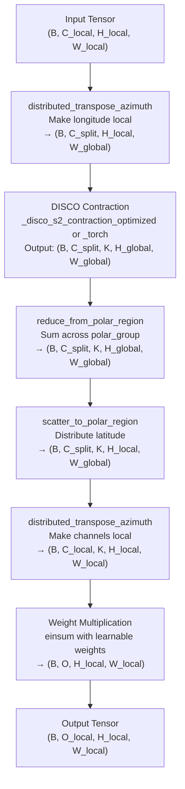
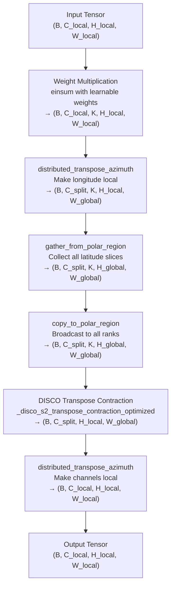

<!-- source: DeepWiki mcp.deepwiki.com · repo NVIDIA/torch-harmonics · page 6 Distributed Computing · fetched 2026-10-26 -->

# Distributed Computing

<details>
<summary>Relevant source files</summary>

The following files were used as context for generating this wiki page:

- [torch_harmonics/distributed/distributed_convolution.py](torch_harmonics/distributed/distributed_convolution.py)
- [torch_harmonics/distributed/distributed_sht.py](torch_harmonics/distributed/distributed_sht.py)
- [torch_harmonics/sht.py](torch_harmonics/sht.py)

</details>


## Purpose and Scope

This page provides an overview of the distributed computing architecture in torch-harmonics, which enables scaling spherical operations across multiple GPUs and nodes. The distributed implementations maintain mathematical equivalence to their local counterparts while partitioning data and computation across a 2D process grid.

**Scope**: This page covers the high-level distributed computing strategy, data partitioning schemes, and how distributed modules orchestrate communication. For detailed API documentation on specific distributed modules, see:
- [Distributed SHT](#6.1) - `DistributedRealSHT` and related classes
- [Distributed DISCO Convolutions](#6.2) - `DistributedDiscreteContinuousConvS2` and variants
- [Communication Primitives](#6.3) - Low-level transpose, reduce, scatter, and gather operations

**Target Use Cases**: Distributed operations are necessary when:
- Input resolutions exceed single-GPU memory capacity (typically `nlat × nlon > 2048 × 4096`)
- Training large models that require model parallelism
- Batch sizes are large enough to warrant data parallelism across spatial dimensions

Sources: [torch_harmonics/distributed/distributed_sht.py:1-80](), [torch_harmonics/distributed/distributed_convolution.py:1-60]()

---

## 2D Process Grid Strategy

The distributed architecture employs a **2D process grid** that partitions spherical data along both latitude (polar) and longitude (azimuthal) dimensions. This approach balances memory distribution with communication efficiency.

### Process Grid Topology


**Figure 1: 2D Process Grid with M polar processes and N azimuthal processes**

Each process belongs to two orthogonal communicator groups:
- **`polar_group`**: Processes sharing the same `azimuth_rank`, used for latitude-wise operations
- **`azimuth_group`**: Processes sharing the same `polar_rank`, used for longitude-wise operations

The grid dimensions are determined by:
- `polar_group_size()`: Number of processes along the latitude dimension
- `azimuth_group_size()`: Number of processes along the longitude dimension

Sources: [torch_harmonics/distributed/distributed_sht.py:105-109](), [torch_harmonics/distributed/distributed_convolution.py:178-182]()

### Grid Size Configuration

| Configuration | Typical Use Case | Memory per Process | Communication Volume |
|---------------|------------------|-------------------|---------------------|
| 1×1 (no distribution) | Small problems, single GPU | 100% | None |
| 2×1 or 1×2 | Moderate resolution, 2 GPUs | 50% | Medium |
| 2×2 | High resolution, 4 GPUs | 25% | High |
| 4×4 | Very high resolution, 16 GPUs | 6.25% | Very High |

The grid configuration must evenly divide both `nlat` and `nlon` dimensions. For example, with `nlat=512` and `nlon=1024`, a 4×8 grid would assign each process a local slice of 128×128.

Sources: [torch_harmonics/distributed/distributed_sht.py:118-121](), [torch_harmonics/distributed/distributed_convolution.py:185-188]()

---

## Data Partitioning Modes

Data partitioning alternates between different layouts during computation to make specific operations local. The library uses three primary partitioning modes:

### Partitioning Layouts


**Figure 2: Data layout transitions during distributed operations**

### Compute Split Shapes

The `compute_split_shapes()` function divides a dimension as evenly as possible across processes:

```python
# For dimension size=512 with 3 processes:
# Returns: [171, 171, 170]  (processes 0 and 1 get 171, process 2 gets 170)
```

This ensures load balancing while handling dimensions that don't divide evenly.

Sources: [torch_harmonics/distributed/distributed_sht.py:118-121](), [torch_harmonics/distributed/distributed_convolution.py:185-188]()

### Partitioning During SHT

The following table shows how data is partitioned at each stage of `DistributedRealSHT`:

| Stage | Latitude | Longitude | Channels | l-modes | m-modes |
|-------|----------|-----------|----------|---------|---------|
| Input | Split | Split | Local | - | - |
| After azimuth transpose | Split | Local | Split | - | - |
| After FFT | Split | - | Split | - | Local (truncated) |
| After azimuth transpose | Split | - | Local | - | Split |
| After polar transpose | Local | - | Split | - | Split |
| After Legendre | - | - | Split | Local | Split |
| After polar transpose (output) | - | - | Local | Split | Split |

Sources: [torch_harmonics/distributed/distributed_sht.py:136-177]()

---

## Communication Primitives

Distributed operations are built from five core communication primitives. These handle data movement between partitioning layouts while maintaining gradients.

### Communication Primitive Taxonomy


**Figure 3: Communication primitive types and their primary usage**

### Primitive Characteristics

| Primitive | Direction | Communication Pattern | Gradient Behavior |
|-----------|-----------|----------------------|-------------------|
| `distributed_transpose_azimuth` | Bidirectional | All-to-all in azimuth_group | Reverses transpose |
| `distributed_transpose_polar` | Bidirectional | All-to-all in polar_group | Reverses transpose |
| `reduce_from_polar_region` | Many-to-one | All-reduce in polar_group | Scatters gradient |
| `scatter_to_polar_region` | One-to-many | Scatter in polar_group | Reduces gradient |
| `gather_from_polar_region` | Many-to-one | Gather in polar_group | Scatters gradient |
| `copy_to_polar_region` | One-to-many | Broadcast in polar_group | Reduces gradient |

All primitives are implemented as `torch.autograd.Function` to ensure correct gradient flow during backpropagation.

Sources: [torch_harmonics/distributed/distributed_convolution.py:52-54](), [torch_harmonics/distributed/distributed_sht.py:40-42]()

---

## Distributed SHT Architecture

The `DistributedRealSHT` and `DistributedInverseRealSHT` classes partition spherical harmonic transforms across the process grid. The key insight is to make dimensions local before applying non-distributed operations (FFT and Legendre contraction).

### DistributedRealSHT Data Flow


**Figure 4: Forward pass of DistributedRealSHT showing transpose and compute operations**

### Key Implementation Details

1. **Longitude FFT** ([torch_harmonics/distributed/distributed_sht.py:145-152]()):
   - Requires full longitude dimension to be local
   - First transpose swaps channels with longitude
   - After FFT, truncate to `mmax` modes

2. **Legendre Transform** ([torch_harmonics/distributed/distributed_sht.py:160-168]()):
   - Requires full latitude dimension to be local
   - Polar transpose swaps channels with latitude
   - Weights are pre-split along m-dimension

3. **Weight Initialization** ([torch_harmonics/distributed/distributed_sht.py:124-131]()):
   - Legendre polynomials computed globally
   - Weights split along m-dimension based on `azimuth_rank`
   - Each process stores only its local m-modes

Sources: [torch_harmonics/distributed/distributed_sht.py:45-177]()

### DistributedInverseRealSHT Data Flow

The inverse transform reverses the operations:


**Figure 5: Forward pass of DistributedInverseRealSHT**

Sources: [torch_harmonics/distributed/distributed_sht.py:180-309]()

---

## Distributed DISCO Convolutions

The `DistributedDiscreteContinuousConvS2` class extends DISCO convolutions to distributed settings by partitioning the pre-computed convolution tensor `psi` and orchestrating communication during the forward pass.

### Convolution Tensor Partitioning

Unlike SHT where only metadata (weights) is split, DISCO requires splitting the large sparse convolution tensor:


**Figure 6: Convolution tensor preparation in DistributedDiscreteContinuousConvS2**

The `_split_distributed_convolution_tensor_s2` function ([torch_harmonics/distributed/distributed_convolution.py:58-112]()):
1. Computes which latitude rows belong to this process
2. Filters `idx` and `vals` to keep only relevant entries
3. Reindexes column indices to reference local input latitudes

Sources: [torch_harmonics/distributed/distributed_convolution.py:206-236]()

### DistributedDiscreteContinuousConvS2 Forward Pass


**Figure 7: Forward pass of DistributedDiscreteContinuousConvS2**

Key differences from local DISCO:
1. **Azimuth transpose** makes longitude local before convolution
2. **Reduce operation** accumulates partial results from different latitude slices
3. **Scatter operation** distributes output back to latitude owners
4. **Second azimuth transpose** restores channel locality

Sources: [torch_harmonics/distributed/distributed_convolution.py:249-285]()

### DistributedDiscreteContinuousConvTransposeS2

The transpose convolution uses gather/copy instead of reduce/scatter:


**Figure 8: Forward pass of DistributedDiscreteContinuousConvTransposeS2**

The `gather_from_polar_region` collects latitude slices so each process has the full input needed for transpose convolution. The `copy_to_polar_region` ensures gradients flow correctly during backpropagation.

Sources: [torch_harmonics/distributed/distributed_convolution.py:426-460]()

---

## Performance Considerations

### When to Use Distributed Implementations

| Criterion | Use Local | Use Distributed |
|-----------|-----------|-----------------|
| Resolution | `nlat × nlon ≤ 1024 × 2048` | `nlat × nlon > 1024 × 2048` |
| Batch Size | Small (1-16) | Large (32+) |
| GPU Memory | Fits in single GPU | Exceeds single GPU |
| Available GPUs | 1 | 2+ |
| Communication Overhead | Not applicable | High-bandwidth interconnect (NVLink, InfiniBand) |

### Communication Overhead Analysis

Each transpose operation incurs an all-to-all communication. For a tensor of size `(B, C, H, W)`:

- **Azimuth transpose**: Moves `B × C × H × W × sizeof(dtype) / azimuth_group_size` bytes between processes
- **Polar transpose**: Moves `B × C × H × W × sizeof(dtype) / polar_group_size` bytes between processes

A single `DistributedRealSHT` forward pass performs:
- 2 azimuth transposes
- 2 polar transposes

Total data movement ≈ `2 × B × C × H × W × sizeof(dtype) × (1/polar_size + 1/azimuth_size)`

### Optimization Strategies

1. **Minimize Process Grid Dimensions**: Use the smallest grid that fits your data
2. **Balance Polar/Azimuth Split**: For `nlat=512, nlon=1024`, prefer 2×4 over 4×2
3. **Use Optimized Kernels**: Set `optimized_kernel=True` for DISCO operations (default)
4. **Backend Selection**: Use NCCL for GPU communication, Gloo for CPU

Sources: [torch_harmonics/distributed/distributed_sht.py:1-80](), [torch_harmonics/distributed/distributed_convolution.py:157-173]()

### Memory Savings

With a `M × N` process grid:

| Component | Memory per Process |
|-----------|-------------------|
| Spatial Data | `(nlat/M) × (nlon/N)` |
| Spectral Coefficients | `(lmax/M) × (mmax/N)` |
| SHT Weights | `(mmax/N) × lmax × (nlat/M)` |
| DISCO psi tensor | Sparse, approximately `1/(M)` of global |

For a 512×1024 problem at float32 with 4×4 grid:
- Local spatial: `(512/4) × (1024/4) × 4 bytes = 128 × 256 × 4 = 131KB` per process
- Global would be: `512 × 1024 × 4 = 2MB` total

This enables problems 16× larger to fit in memory.

---

## Setup and Usage

### Process Group Initialization

Before using distributed modules, initialize PyTorch distributed:

```python
import torch.distributed as dist
from torch_harmonics.distributed import init_grid_comm_groups

# Initialize distributed backend
dist.init_process_group(backend='nccl')  # or 'gloo' for CPU

# Create 2D process grid (e.g., 2 polar × 4 azimuthal)
init_grid_comm_groups(2, 4)
```

The `init_grid_comm_groups` function creates `polar_group` and `azimuth_group` communicators based on the grid dimensions.

Sources: Reference to communication primitives page [Communication Primitives](#6.3)

### Basic DistributedRealSHT Example

```python
from torch_harmonics.distributed import DistributedRealSHT, DistributedInverseRealSHT

# Create distributed SHT for 512×1024 grid
sht = DistributedRealSHT(nlat=512, nlon=1024, grid='equiangular')
isht = DistributedInverseRealSHT(nlat=512, nlon=1024, grid='equiangular')

# Input: (batch, channels_local, nlat_local, nlon_local)
# Each process has a slice of the full data
x_local = ...  # Shape depends on process grid

# Forward transform
coeffs_local = sht(x_local)  # Shape: (batch, channels_local, lmax_local, mmax_local)

# Inverse transform
x_reconstructed = isht(coeffs_local)
```

The input and output tensors are automatically partitioned based on the process's position in the grid.

Sources: [torch_harmonics/distributed/distributed_sht.py:45-177]()

### Basic DistributedDiscreteContinuousConvS2 Example

```python
from torch_harmonics.distributed import DistributedDiscreteContinuousConvS2

# Create distributed DISCO layer
conv = DistributedDiscreteContinuousConvS2(
    in_channels=64,
    out_channels=128,
    in_shape=(512, 1024),
    out_shape=(512, 1024),
    kernel_shape=3,  # or (3, 3)
    basis_type='piecewise linear',
    optimized_kernel=True
)

# Input: (batch, in_channels_local, nlat_local, nlon_local)
x_local = ...

# Forward pass
out_local = conv(x_local)  # Shape: (batch, out_channels_local, nlat_local, nlon_local)
```

The convolution tensor is automatically computed and split during initialization.

Sources: [torch_harmonics/distributed/distributed_convolution.py:115-286]()

### Data Loading for Distributed Training

When using distributed data loading, ensure data is properly partitioned:

```python
from torch.utils.data.distributed import DistributedSampler

# Create distributed sampler
sampler = DistributedSampler(dataset, shuffle=True)
dataloader = DataLoader(dataset, sampler=sampler, batch_size=8)

# Data returned from dataloader is replicated across all processes
# Distributed modules will handle spatial partitioning internally
for batch in dataloader:
    x = batch['input']  # Shape: (batch, channels, nlat, nlon) - same on all processes
    # The distributed modules will partition x internally during forward pass
```

Note that data entering distributed modules should be **replicated** (same on all processes), not pre-partitioned. The modules handle partitioning internally through transpose operations.

---

## Gradient Correctness

All distributed operations maintain mathematically correct gradients. Communication primitives are implemented as `torch.autograd.Function` subclasses with custom backward methods:

| Forward Operation | Backward Operation |
|------------------|-------------------|
| `distributed_transpose_azimuth(x, dims)` | `distributed_transpose_azimuth(grad, dims_reversed)` |
| `reduce_from_polar_region(x)` | `scatter_to_polar_region(grad)` |
| `scatter_to_polar_region(x, dim)` | `gather_from_polar_region(grad, dim)` + reduce |
| `gather_from_polar_region(x, dim)` | `scatter_to_polar_region(grad, dim)` |
| `copy_to_polar_region(x)` | `reduce_from_polar_region(grad)` |

This ensures end-to-end differentiability through distributed operations.

Sources: [torch_harmonics/distributed/distributed_convolution.py:266-267](), [torch_harmonics/distributed/distributed_convolution.py:442-443]()

---

## Limitations and Future Work

### Current Limitations

1. **Fixed Grid Size**: Process grid must be set at initialization and cannot change dynamically
2. **Even Division Required**: `nlat`, `nlon`, `lmax`, `mmax` should be divisible by corresponding grid dimensions
3. **No Adaptive Load Balancing**: Static partitioning may lead to imbalance for irregular workloads
4. **Communication Backend**: Requires PyTorch distributed initialization

### Future Enhancements

- Support for uneven dimension splits with automatic padding
- Hybrid data+model parallelism for very large models
- Integration with tensor parallelism frameworks (e.g., Megatron-LM)
- Profiling tools for communication overhead analysis

Sources: [torch_harmonics/distributed/distributed_sht.py:118-121](), [torch_harmonics/distributed/distributed_convolution.py:185-188]()

---

